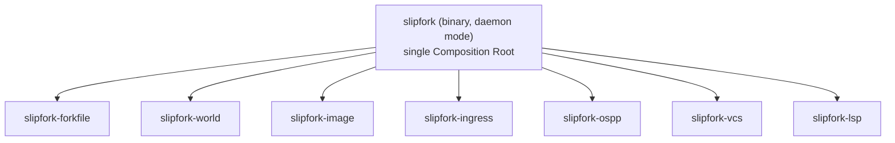
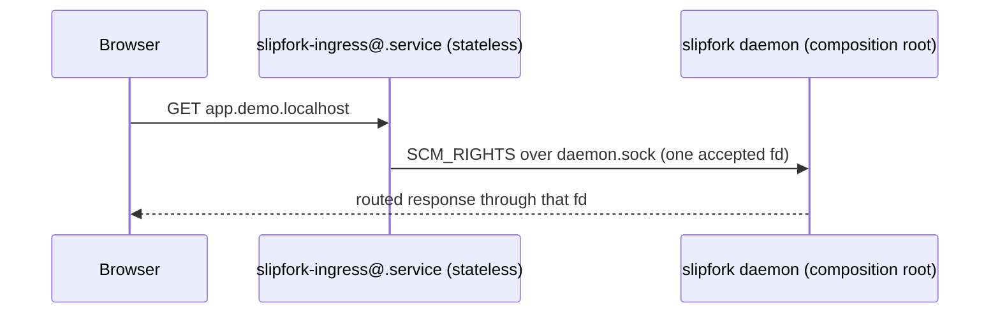

# Architecture

Slipfork is eight focused crates around **one** composition root. Nothing else reads the
environment, probes `/proc`, or binds ambient sockets, so the rules below are enforced by type
signatures rather than by convention.



## Crate map

`crates/slipfork/src/main.rs` is the **single Composition Root**: the only place that reads
`std::env`, probes `/proc`, or binds ambient sockets and filesystems. `slipfork daemon` is a mode
of that same binary and builds the same constructor-injected tree — there is no second composition
root and no separate daemon executable.

| Crate | Owns | Port → adapter |
| :--- | :--- | :--- |
| `slipfork` | CLI parsing, rendering, daemon composition; daemon-side `SecretVault` + `DaemonControl` wiring | builds the tree |
| `slipfork-forkfile` | `Forkfile` parse, typecheck, evaluate, `migrate`, `fmt` | — |
| `slipfork-world` | Btrfs subvolumes, snapshots, world boot/reap, ioctls | `WorldEngine` → `BtrfsEngine` |
| `slipfork-image` | OCI pulls and native `Dockerfile` builds | `BaseImageBuilder` → `NativeImageBuilder` |
| `slipfork-ingress` | HTTP/WS framing and `.localhost` route matching | injected `TcpListener` |
| `slipfork-ospp` | `OSPP v1` frames, device keys, HPKE, dumps | `OsppClient` → `WsOsppClient` |
| `slipfork-vcs` | worktrees, branch topology, dirty snapshots | `VcsWorkspace` → `GitWorkspace` / `JjWorkspace` |
| `slipfork-lsp` | language server over stdio | no port |

The canonical port set is exactly `WorldEngine`, `BaseImageBuilder`, `SecretVault`,
`DaemonControl`, `OsppClient`, and `VcsWorkspace`. No single-impl mock trait sits beside them; a
plain value struct covers anything that is only data.

!!! note "Target shape"
    The daemon, `daemon.sock`, and ingress sections below describe the target shape of Slipfork
    0.1.0. The current scaffold ships only `slipfork help` and `slipfork version`; the remaining
    verbs and the port adapters arrive in later slices.

## Local daemon control plane

Every local command talks to one socket at `<runtime_dir>/daemon.sock`, and the direction is always
client → daemon.

| Element | Contract |
| :--- | :--- |
| Path | `<runtime_dir>/daemon.sock` (mode `0600`, owned by the developer) |
| Request | One NEWLINE-delimited JSON frame: `{"v":1,"id":<string>,"method":<string>,"params":{…}}` |
| Success | `{"v":1,"id":<string>,"ok":<object>}` |
| Failure | `{"v":1,"id":<string>,"error":{"code":<string>,"message":<string>}}` |
| Unknown `v` or `method` | A typed `error` frame; the connection stays open |
| Descriptors | `SCM_RIGHTS` carries **only** the accepted `:80` connection fd (`ingress.accept`) |

The CLI and the ingress always **connect to** `daemon.sock`; the daemon never dials out to a
client, and no second control socket exists.

```json
{"v":1,"id":"b3f1","method":"world.status","params":{"world":"demo"}}
{"v":1,"id":"b3f1","ok":{"world":"demo","running":true}}
```

## Ingress ownership

`slipfork-ingress` owns HTTP/WebSocket framing and route matching: preserve-by-default prefixes,
`strip-prefix`, `rewrite`, `exact`, and `domain` authority filters.

The composition root injects an already-bound `TcpListener` — from `LISTEN_FDS` under systemd, or a
direct bind under OpenRC. The systemd `slipfork-ingress@.service` template instance is stateless: it
accepts and forwards that one connection fd to `daemon.sock`, and the daemon's ingress module makes
the routing decision. That handoff is the single direction; nothing pushes traffic the other way.



!!! warning "One socket, one direction"
    The ingress never routes on its own and never opens a second control socket. If a design needs
    the daemon to call back into the ingress, it is the wrong design.

## Dependency rule

Crates never depend on `slipfork` and never on each other's internals. The binary depends on all
seven libraries; libraries depend on plain values and the port traits they define or consume.
