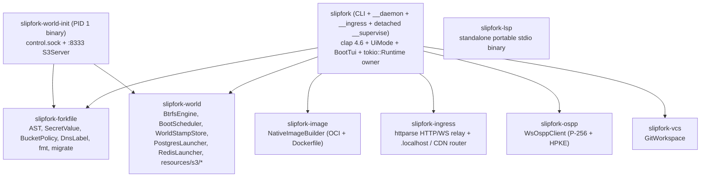
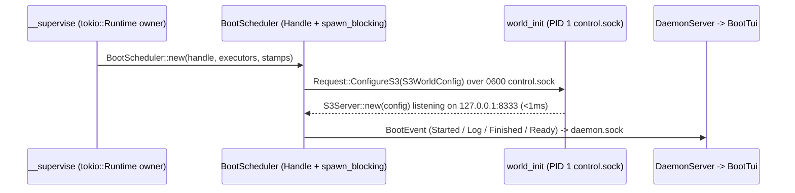
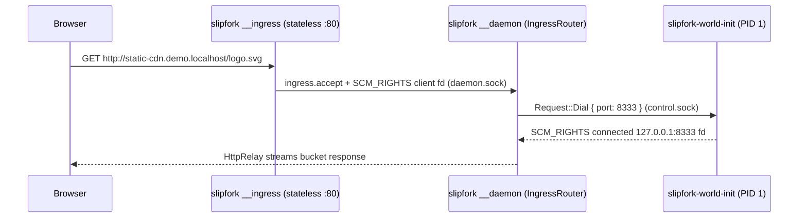

# Architecture

Slipfork runs your cloud environment locally in a box; CI is the clutch. The workspace is eight focused Rust crates wired around explicit process composition roots so Constructor IoC/DI, ANSI purity, and module boundaries are enforced by type signatures rather than convention.

<!-- sample output -->
```console
$ cargo clippy --workspace --all-targets -- -D warnings
$ slipfork up
✓ Ready -> http://demo.localhost  (<elapsed_ms>)
```



---

## 1. Explicit Composition Roots, `clap` CLI & `BootTui`

Library crates contain **zero** `std::env::var`, `OnceLock`/`LazyLock`, `tokio::runtime::Runtime::new()`, or mutable `static` state; ambient OS wiring happens strictly in five composition roots:

1. **`crates/slipfork/src/main.rs` (CLI, `__daemon`, `__ingress`):** Parses `Cli` (`clap` 4.6 derive + `clap_complete` + `clap_mangen`), builds `UiMode` (`ColorTty`, `AsciiTty` for TTY `NO_COLOR`/`TERM=dumb`, `PlainPipe`, `Json`), and wires `BootTui`, `TableLayout`, `FileVault`, and `DaemonServer`.
2. **Detached `__supervise` (`crates/slipfork/src/main.rs` child mode):** Owns the **single** boot `tokio::Runtime` and constructs `BootScheduler::new(handle, ...)` (`tokio::runtime::Handle`), `PostgresLauncher`, `RedisLauncher`, `WorldStampStore`, `BtrfsEngine`, `NativeImageBuilder`, and the `S3WorldConfig` value.
3. **`crates/slipfork-world/src/bin/world_init/main.rs` (world PID 1):** Binds `0600` `<pods_dir>/control.sock`, serves `Dial`/`List`/`Shutdown`/`Exec`/`Logs`, and constructs `S3Server::new(config)` on `127.0.0.1:8333` from `Request::ConfigureS3`.
4. **`crates/slipfork-lsp/src/main.rs`:** Reads only argv and stdio so `slipfork-lsp` ships across Linux, macOS, and Windows with zero Btrfs or `crun` dependency.
5. **`packages/opencode-slipfork/src/index.ts`:** Reads `PATH`/`SYSTEMROOT` and shells the `slipfork` binary with zero embedded world logic.

| Crate | Cohesive Structs / Modules (`<= 500` LOC per file) | Port → Adapter |
| :--- | :--- | :--- |
| `slipfork` | `Cli`, `UiMode`, `BootTui` (`indicatif::MultiProgress`), `TableLayout` (`console` widths), `FileVault`, `DaemonServer` | `SecretVault`, `DaemonControl` |
| `slipfork-forkfile` | `ForkfileCompiler`, `SecretValue` (redacted `Debug`, zeroize-on-drop), `BucketPolicy`, `DnsLabel`, `Formatter`, `SnowMigrator` | — |
| `slipfork-world` | `BtrfsEngine`, `BootScheduler` (`Handle` + `spawn_blocking`), `WorldStampStore` (`world_epoch`), `PostgresLauncher`, `RedisLauncher`, `resources/s3/{server.rs,object_ops.rs,listing.rs,policy.rs}` (`S3Server`, `S3BucketStore`, `SigV4Verifier`), `WorldSupervisor` | `WorldEngine` → `BtrfsEngine` |
| `slipfork-image` | `NativeImageBuilder`, `OciRegistryClient`, `DockerfileExecutor` | `BaseImageBuilder` → `NativeImageBuilder` |
| `slipfork-ingress` | `IngressRouter`, `HttpRelay` (`httparse` raw byte/WS proxy over injected `TcpListener`) | — |
| `slipfork-ospp` | `WsOsppClient`, `DeviceIdentity`, `DumpStreamReader` | `OsppClient` → `WsOsppClient` |
| `slipfork-vcs` | `GitWorkspace` | `VcsWorkspace` → `GitWorkspace` |
| `slipfork-lsp` | `LspServer` | — |

The canonical port set is strictly `WorldEngine`, `BaseImageBuilder`, `SecretVault`, `DaemonControl`, `OsppClient`, and `VcsWorkspace` — zero single-impl mock traits sit beside them.

---

## 2. Reactive `tokio` Boot DAG, Native S3 & Epoch-Stamped Fork

`BootScheduler` executes a **reactive `tokio` task graph** using the injected `tokio::runtime::Handle` with zero phase barriers: blocking steps (Btrfs ioctls, `unshare`, `crun` spawn) run via `spawn_blocking` around the injected sync step executor, and each node records `node_start.elapsed()` once its own `tokio::sync::watch` parent edges resolve.



- **Process-boundary S3 (`resources/s3/{server.rs,object_ops.rs,listing.rs,policy.rs}`):** `__supervise` sends `S3WorldConfig` (carrying `BucketPolicy` and `SecretValue` credentials) in one typed `Request::ConfigureS3` frame over `0600` `control.sock` — never via argv or `/proc` — and `world_init` serves HTTP/1.1 via `hyper` `1` on `:8333` (`hmac = "0.12"` + `sha2 = "0.10"`).
- **Golden PG18 template & `world_epoch` stamps:** `BtrfsEngine` clones `templates/postgres-18` (`BTRFS_SUBVOL_RDONLY`) into sibling `worlds/<world>.pg.<id>` subvolumes in `< 1ms`; at `CHECKPOINT`, Slipfork writes one `world_epoch` into both `<world>/.slipfork-world-stamp.json` and `worlds/<world>.pg.<id>/.slipfork-pg-stamp.json`, refusing stamp reuse on `fork` if epochs diverge.

---

## 3. Dual Control Sockets (`daemon.sock` & `control.sock`) & `:80` Ingress

| Socket (`0600`) | Direction & `SCM_RIGHTS` | Canonical Frames |
| :--- | :--- | :--- |
| `<runtime_dir>/daemon.sock` | CLI / `__ingress` → `__daemon`; `SCM_RIGHTS` passes accepted `:80` client fd on `ingress.accept` (`__ingress` → `__daemon`). | `{"v":1,"id","method","params"}` → zero or more `event` frames → final `ok` or `error`. |
| `<pods_dir>/control.sock` | `__supervise` / `__daemon` → PID 1 `world_init`; `SCM_RIGHTS` returns connected world-netns stream fd on `Dial` (`world_init` → `__daemon`). | `ConfigureS3`, `Dial { port }` (incl. `:8333` for CDN ingress), `List`, `Shutdown`, `Exec` (+ `ExecInput`), `Logs`. |



!!! warning "One direction per socket, strict crate layering"
    Clients connect to `daemon.sock` and `__daemon`/`__supervise` connect to `control.sock`; neither server ever dials back, and library crates never depend on `slipfork` or each other's internals.
