# Slipfork Technical Architecture (`ARCHITECTURE.md`)

This document is the authoritative specification of Slipfork's **Composition Root**, **Inversion of Control / Dependency Injection (IoC/DI) Tree**, crate boundaries, wire protocols, and execution invariants (`ADR-0001`..`ADR-0007`, plus `ADR-0008` pending `H-010`).

Every hypervisor backend, secret store, OSPP capability/dump client, VCS workspace driver, tunnel registrar, or language test runner MUST plug into the trait tree below without global state, ambient OS/env reads, downcasts, opaque extras bags, `match kind` sprawl, or fallback hacks. **All Rust crates use synchronous blocking I/O (`std::net`, `UnixStream`, synchronous `tungstenite` over `rustls` + `webpki-roots`, `std::thread`; zero `tokio` or async runtime). If a feature cannot fit this DI tree cleanly, stop and file a `direction-challenge` in `plan/HUMAN.md`.**

---

## 1. Composition Root & DI Tree

Only **two entrypoints** in the entire repository wire concrete adapters from ambient environment variables, wall clocks, OS sockets, or real filesystems:

1. **Rust CLI / Daemon Composition Root:** `crates/slipfork` (`src/main.rs` + `composition.rs`; `0.1.0` wires `snow resolve`, `dag plan`, `doctor`, and the M1 PoC subcommands; M2 wires `slipfork` including `exec` [sole owner of in-world `snow.yml` env injection] and `support [--json]`, unprivileged `slipforkd`, and `git-remote-slipfork`)

```mermaid
flowchart TD
  CR["Composition Root<br/>(crates/slipfork: slipfork, slipforkd, git-remote-slipfork)"]

  CR -->|injects| SnowRes["SnowFile / ResourceCoordinates<br/>(crates/slipfork-snow)"]
  CR -->|injects| DagOrch["DagPlanner, SlipforkConfig & ResourcePlan<br/>(crates/slipfork-dag)"]
  CR -->|injects M2| OsppSvc["OsppClient & DumpStreamer<br/>(crates/slipfork-ospp, M2)"]
  CR -->|wires M2 CLI client| CliCtl["slipfork CLI (--world <fork> selector; owns WorldSpec materialization & exec env;<br/>holds NO TunnelLease)"]
  CR -->|wires M2 daemon| EdgeDaemon["slipforkd Unprivileged Sole Ingress (LISTEN_FDS / --listen)<br/>(crates/slipfork-edge, M2)"]
  CR -->|injects M2| VcsSvc["RepoRootResolver & VcsWorkspaceFactory<br/>(crates/slipfork-vcs, M2)"]
  CR -->|injects M3| TestCoord["TestCoordinator<br/>(crates/slipfork-test, M3)"]

  CliCtl -->|M2 CLI wiring| SR["slipfork_dag::SupportRegistry::embedded()<br/>(schema + embedded file shipped in 0.1.0; CLI wired in M2)"]
  CliCtl -->|0600 Unix JSON-line IPC| DC["trait DaemonControl<br/>(crates/slipfork-edge, M2)"]
  DC --> WR
  EdgeDaemon --> WR["WorldRegistry (struct, M2)<br/>owns WorldEntry (TunnelLease) + shared_hosts map"]

  SnowRes --> SP["trait SecretProvider (Send + Sync)"]
  SnowRes --> RG["trait EntropySource (Send + Sync)"]
  SP --- SP1["FileVaultProvider (0600 JSON — sole local vault writer)"]
  SP --- SP2["OsppSecretProvider (ospp-v1 WebSocket, zero fs writes)"]
  SP --- SP3["LayeredSecretProvider<P, F> (reads Primary=FileVault -> Fallback=Ospp; writes FileVault)"]
  SP --- SP4["MemorySecretProvider (tests)"]

  OsppSvc --> DKS["trait DeviceKeySigner (Send + Sync)"]
  OsppSvc --> KSP["KeyStorePaths & trait DeviceKeyStore"]
  OsppSvc --> SDS["trait SeedDumpStore (DiskSeedDumpStore over non-tmpfs CacheRoot)"]
  OsppSvc --> BO["trait BrowserOpener (Send + Sync)"]
  DKS --- DKS0["FallbackDeviceKeySigner<P, F> (TpmdDeviceKeySigner -> SoftwareP256Signer on Unavailable only)"]

  DagOrch --> AS["trait ArtifactStore (M3) / DigestCache"]
  DagOrch --> VC["trait VolumeCloner (M3)"]
  DagOrch --> IH["trait InputHasher"]
  AS --- AS1["CowArtifactStore (uses dyn VolumeCloner)"]

  WR --> WE["trait WorldEngine<br/>(crates/slipfork-engine)"]
  WR --> TR["trait TunnelRegistrar -> Box&lt;dyn TunnelLease&gt;<br/>(crates/slipfork-world)"]
  WE --- WE1["ReflinkNetnsEngine (FICLONE + CLONE_NEW* + PTY + netns dialer)"]
  WE --- WE2["IncusEngine (Unix REST /1.0; live daemon gated on open H-004)"]
  TR --- TR1["UnavailableTunnelRegistrar (share fails closed until M2.22; deleted when WeavedRegistrar ships)"]
  TR --- TR2["WeavedRegistrar (isolated leaf M2.22; gated on weaved IPC spec per closed H-006)"]

  SnowRes --> WN["crates/slipfork-world<br/>ProjectSlug, WorldTarget, LocalHostRoute, WorldOrigin & WeaverServiceName (<= 31 bytes)"]
  DagOrch --> WN
  OsppSvc --> WN
  WE --> WN
  WR --> WN
  VcsSvc --> WN
  TestCoord --> WN

  VcsSvc --> VW["trait VcsWorkspaceFactory -> VcsWorkspace"]
  VW --- VW1["GitWorktreeAdapter (.worktrees/<fork> + .slipfork/git/ scratch index)"]
  VW --- VW2["JjWorkspaceAdapter (jj workspace + @ / @- refs)"]

  TestCoord --> DagOrch
  TestCoord --> DC
  TestCoord --> TA["trait TestAdapter"]
  TA -->|optional capability| CD["trait CoverageDriver (M3)"]
  TA --- TA1["SocketRunnerAdapter (RunnerProtocol v1 -> pytest-slipfork, Playwright, PHPUnit, nextest)"]
  TA --- TA2["CommandTestAdapter (zero-plugin CLI sharding)"]
```

2. **OpenCode V2 Plugin Composition Root:** `packages/opencode-slipfork/src/index.ts` (injecting explicit `SlipforkProjectState` in M2.18 and routing shell calls via `slipfork exec --cwd <cwd>` without injecting `snow.yml` env vars itself, `ADR-0004`)



---

## 2. Crate & Package Boundaries

| Crate / Package | Milestone | Purity & `unsafe` Policy | Owned Domain Ports (Traits) & Responsibilities |
|---|---|---|---|
| `crates/slipfork-world` | M1 (shipped) + M2 `WorldOrigin` & `WeaverServiceName` (`M2.3`) | `#![forbid(unsafe_code)]`; depends only on `serde`, `thiserror` (+ `sha2`, `hex` in `M2.2`); zero OS socket/FD/env/fs types | Validated `ProjectSlug`, `WorldTarget { Canonical, UserFork, TestSlot }`, `WorldError`, encapsulated `LocalHostRoute`, M2 `WorldOrigin { Local, Shared }`, `WeaverServiceName` (`SERVICE_NAME_MAX = 31`, `derive_weaver_service_name`, `ADR-0008` §6), and pure `TunnelRequest` + `TunnelLease` + `TunnelRegistrar` |
| `crates/slipfork-snow` | M1 (shipped) + M2 `Send + Sync` & `effective_components` (`M2.4`) | `#![forbid(unsafe_code)]`; depends on `slipfork-world` (zero `slipfork-dag` dep); zero ambient `env`/`net`/clock (`FileVaultProvider` `0600` is the sole vault filesystem writer; `M2.4` deletes M1 `OsppBundle` & `from_bundle`) | `SnowFile` v2 AST (`modes.all` + `modes.<m>`, `SnowFile::effective_components(mode)` per `ADR-0001` §1, `SnowError::ForbiddenTopLevelKey { key }` in `M2.4`), `Faceless` v2 (`??` vs `!!`), `ResourceCoordinates` (`WorldOrigin` precedence over `domains::`, redacted `Debug`), `SecretValue`, `SecretProvider: Send + Sync` (`&self`), `EntropySource: Send + Sync` (`&self`) |
| `crates/slipfork-dag` | M1 (shipped) + M2 `[resources]` & `fs` gate (`M2.5`) + M3 | `#![forbid(unsafe_code)]`; depends on `slipfork-world` (zero `slipfork-snow`/`slipfork-engine`/`std::env`/clock dep); domain core is filesystem-free (`default = []`, `FsMerkleHasher`/`FsDigestCache` behind `#[cfg(feature = "fs")]`) | Root `SlipforkConfig` (`project`, `artifacts`, `fixtures`, `test: TestSpec`, M2 `resources: ResourcesSpec`), `FixtureSpec` (`per_world: bool`), `TestSpec` / `CoverageConfig` / `CoverageThreshold` (shipped in `0.1.0`), M2 `ResourceMode { Local, Test }`, `ResourceStrategy { Local, PreferRemote, Remote }`, `DumpPolicy`, and single `ResourcePlan::resolve(...)` (`ADR-0008` §3), `SupportRegistry` + `IntegrationTier::required_evidence()` (`support/integrations.toml`, `ADR-0007`), `DagPlanner`, `InputHasher`, `DigestCache`, and M3 `ArtifactStore` + `VolumeCloner` |
| `crates/slipfork-ospp` | M2 (`M2.13`–`M2.14`) | `#![forbid(unsafe_code)]`; depends on `slipfork-world`, `slipfork-snow`, `slipfork-dag`, `tungstenite` + `rustls` + `webpki-roots` (sync), `p256`, `zstd`; zero `std::env`, zero `slipfork-engine` dep | Slipfork-owned `OSPP v1` sync WebSocket client (`ospp-v1` subprotocol, 16 KiB text-frame cap, `"ospp-v1" \|\| nonce_s(32) \|\| nonce_c(32) \|\| server_name`), `DeviceKeySigner` (`KeyId` = `p256:<66 hex>`, 64-byte raw `r \|\| s` `DeviceSignature`; generic `FallbackDeviceKeySigner<P, F>`, `TpmdDeviceKeySigner` [`sealed` floor, `ResumeOrCreate` over `KeyStorePaths`], `SoftwareP256Signer` [`DeviceKeyStore` + `EntropySource`]), fragment-only `PairingUrl` + `BrowserOpener`, `OsppSecretProvider` (zero fs writes), `RemoteResourceBundle` (consumed via `slipfork_dag::ResourcePlan::resolve`), and bounded-window `zstd` `DumpStreamer` over `SeedDumpStore` (`ADR-0008` §1–§3) |
| `crates/slipfork-engine` | M1 (shipped) + M2 full spec (`M2.2`, `M2.6`–`M2.7`) | `unsafe` confined strictly to **two** Linux syscall modules with per-call `// SAFETY:` proofs: `linux_cow.rs` (`ioctl(FICLONE)`, `geteuid`/`getegid`, `setns(CLONE_NEWNET)`) and `pty.rs` (`posix_openpt`/`grantpt`/`unlockpt`/`ptsname_r`/`termios`/`ioctl(TIOCSWINSZ)`); `M2.2` adds `slipfork-world` dep (zero `slipfork-snow`/`slipfork-ospp` dep) | `WorldEngine` (`create_snapshot`, `freeze_world`, `clone_world`, `spawn_service`, `stop_service`, `service_logs`, streaming `exec_in_world`, PTY `exec_interactive_in_world` over `InteractiveTty`, `dial_world_tcp`, `destroy_world`; `EngineCapabilities` deleted in `M2.6`), `WorldSpec` (`WorldMount` RO/RW + self-contained redacted `ExecEnv`), `SnapshotMode`, opaque `WorldHandle`; adapters: `ReflinkNetnsEngine` and `IncusEngine` (live daemon gated on `H-004`) |
| `crates/slipfork-edge` | M2 (`M2.8`–`M2.10`) | `#![forbid(unsafe_code)]` (uses safe `listenfd`, `socket2`, and `httparse`); `std::env` confined strictly to `activation.rs` (`LISTEN_PID` / `LISTEN_FDS`) | Unprivileged `slipforkd` sole ingress (`adopt_systemd_listener` at `fd >= 3` with immediate `set_nonblocking(true)` + explicit fd-order `ListenerSet`, `--listen`, `UnitSpec` `.socket`/`.service` renderer with `ReadWritePaths=`, `httparse` with `<= 16 KiB` header cap, `ADR-0008` §5): proxies `shared_hosts` via `WorldEngine::dial_world_tcp` (`Host` + `X-Forwarded-*` preserved) and `*.localhost` via `LocalHostRoute`, enforcing `308`/`421` on `*.localhost` when `Shared` (`ADR-0005` §1, `H-008`); `trait DaemonControl` (`0600` Unix JSON-line IPC); `UnavailableTunnelRegistrar` + `InMemoryTunnelRegistrar` (tests) + isolated `WeavedRegistrar` (`M2.22`) |
| `crates/slipfork-vcs` | M2 (`M2.11`–`M2.12`) | `#![forbid(unsafe_code)]`; depends on `slipfork-world`, `serde`, `serde_json`, `thiserror`; zero `src/bin/*` targets | `RepoRootResolver` (`RepoRoot`), `VcsWorkspace` (`WorkspaceRefs`, `WorkspaceChanges`), `VcsWorkspaceFactory` (`WorkspaceRequest`), `GitWorktreeAdapter` (`.worktrees/<fork>` + scratch `GIT_INDEX_FILE` under `.slipfork/git/`), `JjWorkspaceAdapter` (`@` -> `<fork>/wip`, `@-` -> `<fork>`), and pure `remote_helper` (`git-remote-slipfork` line protocol over `BufRead`/`Write`) |
| `crates/slipfork-test` | M3 | `#![forbid(unsafe_code)]`; depends on `slipfork-world`, `slipfork-dag`, `slipfork-edge`; injected `EntropySource` | `TestCoordinator` (consumes `ResourcePlan::resolve`), canonical `.slipfork/runs/<run_id>/<slot>/{runner.sock,coverage,output}` run tree, `RunnerProtocol v1` (`SocketRunnerAdapter` + `CommandTestAdapter`), typed `CoverageDriver` (`ADR-0006` §5), and pre-warmed `TestSlot` world pool |
| `crates/slipfork` | M1..M4 (`M2.16`–`M2.17`) | `#![forbid(unsafe_code)]`; **sole Rust Composition Root** | Binaries `slipfork`, `slipforkd`, and `git-remote-slipfork`; CLI (`clap`, uniform `--world <fork>`), `HOME`-unset fail-closed guard, adapter wiring (`composition.rs`, `DiskSeedDumpStore`, `InteractiveTty`), single `WorldSpec` materializer, `exec` (sole in-world env injector), hook rescue UX, `db`/`redis`/`forward` bridges, `auth login`, and M2 `slipfork support [--json]` (`SupportRegistry::embedded()`, `ADR-0007`) |
| `packages/opencode-slipfork` | M1 (shipped) + M2 e2e (`M2.18`) | Type-only `@opencode/plugin`; injected `SlipforkProjectState` + `SlipforkGateway` (zero `existsSync` inside gateway in M2) | OpenCode V2 `worktree.transform`, `shell.hook("create.before")` (routes to `slipfork exec --cwd <cwd>`, never injects `snow.yml` envs), and `session.hook("context")` |

---

## 3. Core Trait Contracts & Wire Protocols

### 3.1 `SecretProvider`, `ResourceCoordinates` & Mode-Scoped Components (`crates/slipfork-snow`, `ADR-0001`, `ADR-0005`, `ADR-0008`)

```rust
// Shipped in 0.1.0 with `&mut self`; promoted to `Send + Sync` + `&self` in M2.4:
pub trait SecretProvider: Send + Sync {
    fn get(&self, namespace: Namespace, key: &str) -> Result<Option<String>, ProviderError>;
    /// Persist `proposed` under `secrets::<key>` iff absent (`put_if_absent` / CAS).
    fn ensure_secret(&self, key: &str, proposed: &str) -> Result<String, ProviderError>;
}

pub trait EntropySource: Send + Sync {
    fn fill_bytes(&self, buf: &mut [u8]) -> Result<(), ProviderError>;
}

pub struct LayeredSecretProvider<Primary, Fallback> {
    primary: Primary,   // e.g. FileVaultProvider (0600): read first, sole write sink for !!
    fallback: Fallback, // e.g. OsppSecretProvider: read second, never written in local mode
}
```

- **Single `0600` Vault Owner & `OsppBundle` Deletion (`M2.4`):** `FileVaultProvider` (`flock` + `O_EXCL` temp + atomic `rename`, `0600`) is the **only** secret-vault filesystem writer; `M2.4` deletes M1's `OsppBundle` + `MemorySecretProvider::from_bundle` from `slipfork-snow`. **OSPP is never a prerequisite for local worlds** (`ADR-0005` §1).
- **Redaction, Forbidden Keys & Mode-Scoped Components (`M2.4`):** Top-level `envs:` and `project:` return `SnowError::ForbiddenTopLevelKey { key }` (`M2.4`, key name only, never values); `SecretValue`, `S3Coordinates`, and `ResourceCoordinates` implement redacting `Debug`; `SnowFile::effective_components(mode)` implements `ADR-0001` §1's single add/remove/override contract.
- **Origin-Aware `ResourceCoordinates`:** `ResourceCoordinates` sets `app_url`/`app_domain` strictly from the world's `WorldOrigin` (overriding provider `domains::` in `Local` worlds and failing closed on `${{ domains::<id> }}` in `Shared` worlds) and accepts plain `S3Coordinates` overrides resolved from `ResourcePlan` by the Composition Root (zero `slipfork-dag` dependency in `slipfork-snow`).

### 3.2 `OSPP v1` WebSocket, `DeviceKeySigner`, `SeedDumpStore` & `ResourcePlan` (`crates/slipfork-ospp`, `crates/slipfork-dag`, `ADR-0008`)

```rust
// crates/slipfork-dag — [resources] & single ResourcePlan::resolve owner (M2.5, zero slipfork-snow dep)
#[derive(Debug, Clone, Copy, PartialEq, Eq, PartialOrd, Ord, Serialize)] // derived strictly from WorldTarget; no Deserialize
#[serde(rename_all = "snake_case")]
pub enum ResourceMode {
    Local, // WorldTarget::Canonical | UserFork(_) -> defaults_for = ResourceStrategy::PreferRemote
    Test,  // WorldTarget::TestSlot(_) -> defaults_for = ResourceStrategy::Local (hermetic by construction)
}

#[derive(Debug, Clone, Copy, PartialEq, Eq, Serialize, Deserialize)]
#[serde(rename_all = "snake_case")]
pub enum ResourceStrategy {
    Local,        // world-local ResourceCoordinates (127.0.0.1:9000 in world netns) / clean initdb
    PreferRemote, // use OSPP S3 / seed dump when paired & offered, else Local with [resources] diagnostic
    Remote,       // require OSPP S3 / seed dump; fail closed if unpaired/offline/absent
}

#[derive(Debug, Clone, Copy, PartialEq, Eq)]
pub enum DumpPolicy {
    Default,     // governed by effective ResourceStrategy
    NoDump,      // --no-dump (mutually exclusive with --refresh-dump): clean initdb
    RefreshDump, // --refresh-dump: require live OSPP check; fail closed if offline or Local
}

impl ResourcePlan {
    /// Sole owner of S3 + PG seed resolution consumed by `up`/`fork`, `OsppClient`, and `TestCoordinator`.
    pub fn resolve(
        spec: &ResourcesSpec,
        mode: ResourceMode,
        dump_policy: DumpPolicy,
        offer: Option<&RemoteResourceOffer>,
    ) -> Result<Self, DagError>;
}
```

```rust
// crates/slipfork-ospp — ospp-v1 sync WebSocket (tungstenite + rustls + webpki-roots), P-256 keys, SeedDumpStore
pub struct KeyStorePaths {
    pub candidates: Vec<PathBuf>, // CR-resolved: [$XDG_RUNTIME_DIR/tpmd/tpmd.sock (if set), /run/tpmd/tpmd.sock]
}

pub struct KeyId(String);             // SEC1 compressed 33-byte P-256 pubkey as "p256:<66 lowercase hex>"
pub struct DeviceSignature([u8; 64]); // raw fixed-width r || s (never ASN.1 DER)
pub struct SoftwareP256Key(/* private 32-byte scalar, zeroized on Drop, redacted Debug */);

pub trait DeviceKeyStore: Send + Sync {
    fn load_or_create_p256(&self, entropy: &dyn EntropySource) -> Result<SoftwareP256Key, OsppError>;
}

pub trait DeviceKeySigner: Send + Sync {
    fn key_id(&self) -> &KeyId;
    fn backend_label(&self) -> &'static str; // e.g. "tpmd:sealed", "tpmd:hardware", "software:file-0600"
    fn sign(&self, message: &[u8]) -> Result<DeviceSignature, OsppError>;
}

pub struct FallbackDeviceKeySigner<P: DeviceKeySigner, F: DeviceKeySigner> {
    primary: P,
    fallback: F, // selected ONLY when P reports absent / BackendUnavailable across all candidates
}

pub trait BrowserOpener: Send + Sync {
    fn open_pairing_url(&self, url: &PairingUrl) -> Result<(), OsppError>;
}

pub trait SeedDumpStore: Send + Sync {
    fn lookup(&self, sha256_compressed: &str) -> Option<PathBuf>;
    fn write_from(&self, sha256_compressed: &str, src: &mut dyn std::io::Read) -> Result<PathBuf, OsppError>;
}
```

- **Handshake, Key Floor & Pairing (`ADR-0008` §1):** Subprotocol `ospp-v1` (16 KiB text-frame cap, 10 s first-frame deadline); `CHALLENGE { nonce_s }` -> `HELLO { version: 1, key_id, nonce_c, sig }` over `"ospp-v1" || nonce_s(32) || nonce_c(32) || server_name` -> `WELCOME` or `REJECT`. `TpmdDeviceKeySigner` enforces security floor `sealed` (`allow_below_floor: false`, `ResumeOrCreate` in `"slipfork"` namespace; wire framing pending `H-010` #3); `FallbackDeviceKeySigner<P, F>` falls back to `F` **only** when `P` is absent/unavailable (emitting one diagnostic; floor/sig errors fail closed). `PairingUrl` (`/_ospp/v1/pair`, `"ospp-v1-pair"` transcript, `slipfork auth login -` stdin support) enforces fragment-only `#handle=<64 hex>`, zeroization, and `#handle=[REDACTED]`.
- **Engine-Agnostic Seed Dump Pipeline (`ADR-0008` §2):** `DumpStreamer` streams binary `zstd` chunks (`<= 64 KiB`) + incremental SHA-256 into `SeedDumpStore::write_from` (`DiskSeedDumpStore` over non-`tmpfs` `CacheRoot` wired at the Composition Root), aborting before any DB mutation on mismatch/truncation. Verified `<sha256>.pgdump` mounts `MountMode::ReadOnly` into the `base` world via `WorldSpec.mounts` and runs `pg_restore` + `CHECKPOINT;` + `freeze_world` via `WorldEngine` (**zero downcasts**; non-zero `pg_restore` fails closed via rescue UX).

### 3.3 `WorldEngine`, Multi-Mount `WorldSpec`, Redacted `ExecEnv` & Interactive/Streaming Exec (`crates/slipfork-engine`, `ADR-0002`, `ADR-0008`)

```rust
#[derive(Debug, Clone, Copy, PartialEq, Eq)]
pub enum SnapshotMode {
    DiskCow,
    StatefulRam, // unsupported engines fail closed with EngineError::StatefulRamUnsupported (no boolean bag)
}

#[derive(Debug, Clone, Copy, PartialEq, Eq)]
pub enum MountMode { ReadOnly, ReadWrite }

#[derive(Debug, Clone, PartialEq, Eq)]
pub struct WorldMount {
    pub host_path: PathBuf,
    pub guest_path: PathBuf,
    pub mode: MountMode, // overlapping RW mounts fail closed (EngineError::OverlappingMounts)
}

/// Self-contained child environment (`Command::env_clear()`): restricted inherited allowlist
/// (`PATH`, `TERM`, `LANG` + world-scoped `HOME`) plus plain/secret vars (`effective = base ⊕ overlay`).
/// Custom `Debug` redacts every secret value; plaintext is exposed strictly at `Command::env`.
#[derive(Clone, Default, PartialEq, Eq)]
pub struct ExecEnv { /* private allowlist + plain/secret entries; custom redacting Debug */ }

pub struct WorldSpec {
    pub target: WorldTarget,     // slipfork_world::WorldTarget (added in M2.2)
    pub snapshot: SnapshotId,    // content-addressed origin-independent fixture digest or base snapshot
    pub mounts: Vec<WorldMount>, // repo (RW) + ArtifactVolumes/SeedDump (RO) + M3 run dirs (RW)
    pub base_env: ExecEnv,       // resolved at world boot from single WorldOrigin
}

#[derive(Clone, PartialEq, Eq)]
pub struct WorldHandle(/* private engine-scoped token; cross-process sharing pending H-010 #1 */);

#[derive(Debug, Clone, PartialEq, Eq)]
pub enum StreamSource { Stdout, Stderr }

#[derive(Debug, Clone, PartialEq, Eq)]
pub struct StreamChunk { pub source: StreamSource, pub bytes: Vec<u8> }

/// Explicit interactive terminal session wired at the Composition Root (verifies `isatty`, owns
/// single-shot `SIGWINCH` forwarding and RAII `termios` restore on every return/panic path).
pub struct InteractiveTty<'a> { /* borrowed TTY fds + initial window size + resize receiver */ }

pub trait WorldEngine: Send + Sync {
    fn name(&self) -> &'static str;
    fn create_snapshot(&self, source_dir: &Path, id: &SnapshotId, mode: SnapshotMode) -> Result<(), EngineError>;
    fn freeze_world(&self, world: &WorldHandle, id: &SnapshotId, mode: SnapshotMode) -> Result<(), EngineError>;
    fn clone_world(&self, spec: &WorldSpec) -> Result<WorldHandle, EngineError>;
    fn spawn_service(&self, world: &WorldHandle, spec: &ServiceSpec) -> Result<ServiceHandle, EngineError>;
    fn stop_service(&self, service: &ServiceHandle) -> Result<(), EngineError>;
    fn service_logs(&self, world: &WorldHandle, id: &str) -> Result<ServiceLogs, EngineError>;
    fn exec_in_world(
        &self,
        world: &WorldHandle,
        argv: &[String],
        cwd: &Path,
        overlay_env: &ExecEnv,
        on_output: &mut dyn FnMut(StreamChunk),
    ) -> Result<ExecOutput, EngineError>;
    fn exec_interactive_in_world(
        &self,
        world: &WorldHandle,
        argv: &[String],
        cwd: &Path,
        overlay_env: &ExecEnv,
        tty: &mut InteractiveTty<'_>,
    ) -> Result<i32, EngineError>;
    fn dial_world_tcp(&self, world: &WorldHandle, port: u16) -> Result<std::net::TcpStream, EngineError>;
    fn destroy_world(&self, world: WorldHandle) -> Result<(), EngineError>;
}
```

- **Zero Unisolated Fallbacks, Dialer Isolation & Shared `$UID`:** Unavailable engines fail closed (`EngineError::ReflinkUnsupported` / `EngineError::DaemonUnavailable`; `M2.6` deletes `0.1.0`'s `EngineCapabilities` boolean bag in favor of `EngineError::StatefulRamUnsupported`); dialing a destroyed world returns `EngineError::WorldGone`. `ReflinkNetnsEngine` maps `"$UID $UID 1"` inside `CLONE_NEWUSER | CLONE_NEWNET | CLONE_NEWNS | CLONE_NEWPID` and dials via a per-world `setns(CLONE_NEWNET)` worker; `IncusEngine` mounts with `shift = "true"`. Neither `slipforkd` nor `slipfork forward` inspects `engine.name()`.

### 3.4 Single-Origin `WorldOrigin`, `<= 31`-Byte `WeaverServiceName`, `LISTEN_FDS` `slipforkd`, `DaemonControl` & `TunnelRegistrar` (`crates/slipfork-world`, `crates/slipfork-edge`, `ADR-0005`, `ADR-0008`)

`slipforkd` runs unprivileged (`User=<user>`, empty `CapabilityBoundingSet=`). In `activation.rs` (`#![forbid(unsafe_code)]` via `listenfd`), when `LISTEN_PID` or `LISTEN_FDS` is set, `adopt_systemd_listener() -> Result<Option<ListenerSet>, EdgeError>` verifies `LISTEN_PID == getpid()`, calls `set_nonblocking(true)` immediately on every inherited socket, and assigns roles by explicit descriptor count/order (`LISTEN_FDS == 1` -> single HTTP ingress + `forward_listener: None`; `LISTEN_FDS >= 2` -> `UnitSpec`'s emitted order `127.0.0.1:80`, `[::1]:80`, `127.0.0.1:<forward_port>`; any other shape fails closed `EdgeError::ActivationBroken`, `ADR-0008` §5). It binds `--listen` **only** when activation env vars are absent, and fails closed (`EdgeError::NoListener`) when neither is provided. HTTP/1.1 request headers are parsed via `httparse` (`<= 16 KiB` cap, bounded read timeout) to enforce pre-body `308` on `Expect: 100-continue`, `421` on `Upgrade` against shared `*.localhost`, and zero-buffering bidirectional stream piping.

```rust
// crates/slipfork-world — pure identity, single-origin, <= 31-byte service label & tunnel port
pub const SERVICE_NAME_MAX: usize = 31; // ADR-0008 §6 is normative for <= 31-byte derivation

#[derive(Debug, Clone, PartialEq, Eq, PartialOrd, Ord, Hash, Serialize)]
pub struct WeaverServiceName(String);

pub fn derive_weaver_service_name(full_label: &str) -> Result<WeaverServiceName, WorldError>;

#[derive(Debug, Clone, PartialEq, Eq, Serialize)] // custom fail-closed Deserialize; --listen port handling pending H-010 #2
#[serde(tag = "kind", rename_all = "snake_case")]
pub enum WorldOrigin {
    Local { url: String },  // constructed solely via WorldOrigin::local(&LocalHostRoute)
    Shared { url: String }, // constructed via WorldOrigin::shared(url) from TunnelLease::public_url()
}

#[derive(Debug, Clone, Copy)]
pub struct TunnelRequest<'a> {
    pub route: &'a LocalHostRoute, // deterministically yields WeaverServiceName (ADR-0008 §6)
    pub local_port: u16,           // slipforkd's planned static forward_port (distinct from :80, decided pre-boot)
}

pub trait TunnelLease: Send + Sync {
    fn public_url(&self) -> &str;
    fn lease_id(&self) -> &str;
}

pub trait TunnelRegistrar: Send + Sync {
    fn register(&self, request: &TunnelRequest<'_>) -> Result<Box<dyn TunnelLease>, TunnelError>;
}
```

```rust
// crates/slipfork-edge (M2) — activation, unit generator, WorldRegistry & 0600 Unix DaemonControl IPC
pub struct ListenerSet {
    pub http_listeners: Vec<std::net::TcpListener>,
    pub forward_listener: Option<std::net::TcpListener>, // None when LISTEN_FDS == 1 (share_world fails closed)
}

pub struct UnitSpec {
    pub user: String,
    pub listen_addrs: Vec<std::net::SocketAddr>, // e.g. 127.0.0.1:80, [::1]:80
    pub forward_port: u16,                       // must not collide with listen_addrs (EdgeError::UnitPortCollision)
    pub executable: PathBuf,
    pub state_dir: PathBuf,                      // emitted into ReadWritePaths= alongside runtime_dir
    pub runtime_dir: PathBuf,
} // render_socket_unit(&UnitSpec) -> String, render_service_unit(&UnitSpec) -> String

#[derive(Debug, Clone, PartialEq, Eq, Serialize, Deserialize)]
pub struct SharedWorldInfo {
    pub public_url: String,
    pub lease_id: String,
} // impl From<&dyn TunnelLease> for SharedWorldInfo; impl From<TunnelError> for EdgeError

/// Slipfork's CLI / TestCoordinator <-> slipforkd control port ($XDG_RUNTIME_DIR/slipfork/slipforkd.sock, 0600;
/// cross-process WorldRegistration fields pending H-010 #1; tested against InMemoryTunnelRegistrar).
pub trait DaemonControl: Send + Sync {
    fn register_world(&self, project: &ProjectSlug, target: &WorldTarget) -> Result<WorldOrigin, EdgeError>;
    fn release_world(&self, project: &ProjectSlug, target: &WorldTarget) -> Result<bool, EdgeError>;
    fn share_world(&self, project: &ProjectSlug, target: &WorldTarget) -> Result<SharedWorldInfo, EdgeError>;
    /// Idempotent success no-op returning `WorldOrigin::Local` when no tunnel lease is active.
    fn unshare_world(&self, project: &ProjectSlug, target: &WorldTarget) -> Result<WorldOrigin, EdgeError>;
}
```

### 3.5 `RepoRootResolver`, `VcsWorkspace` (`Git` + `Jujutsu`) & `git-remote-slipfork` (`crates/slipfork-vcs`, `ADR-0005`, `ADR-0008`)

```rust
#[derive(Debug, Clone, PartialEq, Eq)]
pub struct RepoRoot {
    pub vcs_root: PathBuf,
    pub worktree_root: PathBuf,
    pub project: ProjectSlug,
}

#[derive(Debug, Clone, PartialEq, Eq)]
pub struct WorkspaceRequest {
    pub repo: RepoRoot,
    pub fork: String,
    pub base: Option<String>,
}

#[derive(Debug, Clone, PartialEq, Eq)]
pub struct WorkspaceRefs {
    pub base: String, // refs/heads/<fork> in Git; @- in Jujutsu
    pub wip: String,  // synthesized via scratch .slipfork/git/index-<fork> in Git; @ in Jujutsu
}

#[derive(Debug, Clone, PartialEq, Eq)]
pub struct WorkspaceChanges {
    pub tracked: Vec<PathBuf>,
    pub untracked: Vec<PathBuf>,
    pub truncated: bool,
}

pub trait RepoRootResolver: Send + Sync {
    fn resolve(&self, start: &Path) -> Result<RepoRoot, VcsError>;
}

pub trait VcsWorkspace: Send + Sync {
    fn fork_name(&self) -> &str;
    fn path(&self) -> &Path;
    fn refs(&self) -> WorkspaceRefs;
    fn changes(&self) -> Result<WorkspaceChanges, VcsError>;
    fn forget(&self) -> Result<(), VcsError>;
}

pub trait VcsWorkspaceFactory: Send + Sync {
    fn create_workspace(&self, request: &WorkspaceRequest) -> Result<Box<dyn VcsWorkspace>, VcsError>;
}
```

- Zero `AdapterKind` enum outside the Composition Root factory (`JjWorkspaceAdapter` when `.jj/` detected, else `GitWorktreeAdapter`), zero mutation of the live `.git/index`, and zero binary targets in `crates/slipfork-vcs` (`git-remote-slipfork` lives in `crates/slipfork` and drives pure `slipfork_vcs::remote_helper` over `BufRead`/`Write`).

### 3.6 World-Owns-The-Stack, `RunnerProtocol v1`, Typed `CoverageDriver` & `SLIPFORK_OUTPUT_DIR` (`crates/slipfork-dag`, `crates/slipfork-test` M3, `ADR-0003`, `ADR-0006`)

The CoW world — **never** the test runner — migrates PostgreSQL, seeds snapshots under hermetic `ResourceMode::Test` defaults (`ResourcePlan::resolve`, `ADR-0008` §3), assigns `WorldOrigin`, and boots services before tests run. `FixtureSpec.per_world: bool` and the typed `[test]` schema **shipped in `0.1.0`** in `crates/slipfork-dag`:

```rust
#[derive(Debug, Clone, Copy, PartialEq, Eq, PartialOrd, Ord, Deserialize)]
#[serde(rename_all = "snake_case")]
pub enum CoverageReportFormat { Html, Xml, Json, Lcov, Text }

#[derive(Debug, Clone, Copy, PartialEq, Eq)]
pub struct CoverageThreshold(u8); // validated 0..=100 via parse_toml (CoverageThreshold::MAX, percent(self) -> u8)

#[derive(Debug, Clone, PartialEq, Eq)]
pub struct CoverageConfig {
    pub reports: BTreeSet<CoverageReportFormat>, // defaults to {Text} when coverage_report omitted
    pub fail_under: Option<CoverageThreshold>,
}

#[derive(Debug, Default, Clone, PartialEq, Eq)]
pub struct TestSpec {
    pub coverage: Option<CoverageConfig>, // coverage = true is the sole activation switch
}
```

- **`FixtureSpec.per_world` Read & Write Non-Sharing Invariant (`ADR-0003` §1):** `per_world` (`"per-world"` vs `"shared"`) is hashed into every fixture digest, cannot be the `parent` of an origin-independent fixture (`DagError::OriginIndependentChildOfPerWorld`), is **never** reported as `CacheAction::Cached` by `DagPlanner::plan`, and **MUST NEVER be inserted into `DigestCache`** by M2/M3 snapshot materializers or `TestCoordinator`.

```rust
// crates/slipfork-test (M3) — canonical .slipfork/runs/<run_id>/<slot>/{runner.sock,coverage,output}
#[derive(Debug, Clone, Copy, PartialEq, Eq, Serialize, Deserialize)]
#[serde(rename_all = "snake_case")]
pub enum IsolationTier { Batch, World }

#[derive(Debug, Clone, PartialEq, Eq, Serialize, Deserialize)]
pub struct DiscoveredTest {
    pub id: String,
    pub fixture: String,
    pub isolation: IsolationTier,
}

pub struct WorldEndpoint {
    pub origin: WorldOrigin,
    pub env: BTreeMap<String, SecretValue>,
}

pub struct WorldSlotContext<'a> {
    pub target: &'a WorldTarget,
    pub endpoint: &'a WorldEndpoint,
    pub output_dir: &'a Path,           // .slipfork/runs/<run_id>/<slot>/output (SLIPFORK_OUTPUT_DIR)
    pub coverage_dir: Option<&'a Path>, // .slipfork/runs/<run_id>/<slot>/coverage (slot-stable at pre-warm boot)
}

pub trait CoverageDriver: Send + Sync {
    fn world_env(&self, world_coverage_dir: &Path) -> BTreeMap<String, String>;
    fn collect(
        &self,
        shard_dirs: &[PathBuf],
        formats: &BTreeSet<CoverageReportFormat>,
        report_dir: &Path,
    ) -> Result<CoverageSummary, TestError>;
}

pub trait TestAdapter: Send + Sync {
    fn name(&self) -> &'static str;
    fn coverage(&self) -> Option<&dyn CoverageDriver> { None }
    fn discover(&self, workspace: &Path, filters: &[String]) -> Result<Vec<DiscoveredTest>, TestError>;
    fn run_items(
        &self,
        slot: &WorldSlotContext<'_>,
        items: &[DiscoveredTest],
        on_result: &mut dyn FnMut(TestOutcome),
    ) -> Result<(), TestError>;
}
```

### 3.7 Integration Support Registry (`support/integrations.toml`, `crates/slipfork-dag`, `ADR-0007`, `H-009` Option B)

`0.1.0` shipped the typed schema, `SupportRegistry::embedded()`, `support/integrations.toml`, and `critical_support.rs`; M2 wires `slipfork support [--json]`, `tools/check_support.py` (`make check` ceiling + `make support-sync`), and generated `docs/support-matrix.md`.

```rust
// crates/slipfork-dag/src/support.rs
#[derive(Debug, Error)]
pub enum RegistryError {
    Toml(String),
    EmptyRegistry,
    DuplicateId(String),
    MissingEvidence { id: String, tier: IntegrationTier, field: EvidenceField },
}

#[derive(Debug, Clone, Copy, PartialEq, Eq, PartialOrd, Ord, Deserialize)] // + fmt::Display
#[serde(rename_all = "kebab-case")]
pub enum IntegrationTier { None, Declared, Exercised, FieldTested, Hardened }

impl IntegrationTier {
    /// Single tier→evidence ladder consumed by parse_toml, critical_support.rs, slipfork support --json,
    /// and tools/check_support.py (never restated in Python).
    pub fn required_evidence(self) -> &'static [EvidenceField];
}

#[derive(Debug, Clone, Copy, PartialEq, Eq, Deserialize)]
#[serde(rename_all = "kebab-case")]
pub enum IntegrationCategory { WorldEngine, Secrets, Tunnel, Vcs, TestRunner, Cli }

#[derive(Debug, Clone, Copy, PartialEq, Eq)] // + as_str(self) -> &'static str + fmt::Display
pub enum EvidenceField {
    Rationale, SignoffDoc, SignoffCommit, RecipePage, CriticalTest,
    CiJob, DeployRef, ProductionSuiteRef, TestAudit,
}

#[derive(Debug, Clone, PartialEq, Eq)]
pub struct SupportRegistry { /* private entries: Vec<IntegrationEntry> */ }

impl SupportRegistry {
    pub fn embedded() -> Result<Self, RegistryError>;   // include_str!("../../../support/integrations.toml")
    pub fn parse_toml(raw: &str) -> Result<Self, RegistryError>;
    pub fn entries(&self) -> &[IntegrationEntry];
}
```

- **User-Reachable Scope & Total Pointer Verification (`H-009` Option B):** Only user-reachable integrations appear in `support/integrations.toml`; pre-CLI internal adapters (`incus-engine` while gated on open `H-004`, `WeavedRegistrar` while gated on deferred `weaved` IPC per closed `H-006`) are omitted until `declared` (`M2.5` deletes `0.1.0`'s temporary `incus-engine` `none` record). Both `critical_support.rs` (`M2.5`) and `tools/check_support.py --check` (`M2.15`) verify **all present** `EvidenceField` file/symbol pointers on every entry (not only tier-required ones), while `tools/check_support.py` additionally verifies `git` `signoff_commit` existence/attestation, `.github/workflows/*.yml` `ci_job` keys, and byte-exact parity between `docs/support-matrix.md` and the rendered Markdown table from `SupportRegistry::embedded()` using `required_evidence` from `slipfork support --json`.

---

## 4. Validated Architectural Decisions & Open Host Items (`plan/HUMAN.md`)

1. **`H-001` [Validated + Gate Confirmation]:** Mode-scoped components (`modes.<mode>.components.<id>` add/remove/override via `disabled: true`, `ADR-0001` §1) live in `snow.yml`, while `[artifacts]`, `[fixtures]` (`per_world`), `[resources]` (`ResourceStrategy`), and the typed `[test]` table (`coverage`, `coverage_report`, `coverage_fail_under`) live in `slipfork.toml` (`ADR-0006`, `ADR-0008`).
2. **`H-002` [Validated]:** Locked `::` namespace separator, unquoted `all:` universal mode, and hard rejection of top-level `envs:` and `project:` (`SnowError::ForbiddenTopLevelKey` in `M2.4`).
3. **`H-003` [Validated + Gate Addendum]:** `LayeredSecretProvider` persists newly generated `!!` secrets to the local `0600` vault in `local` mode and to cloud `EnvGroup` secrets in `cloud` mode; **OSPP is not a prerequisite for M2 or M3**, and Slipfork-assigned `WorldOrigin` always overrides provider `domains::` in local worlds (`ADR-0005` §1, `ADR-0008` §2–§3).
4. **`H-004` [Open — Isolated Leaf `M2.21`]:** This container host runs XFS (`reflink=1`) + unprivileged `netns`/`userns` (`ReflinkNetnsEngine` proven live); live `IncusEngine` conformance and `declared` promotion stay isolated in `M2.21` awaiting a project-scoped `incusd` socket (`plan/HUMAN.md`).
5. **`H-005` [Validated + Gate Amendment]:** Canonical VCS `ProjectSlug` resolution (`ADR-0005` §3), single `WorldOrigin = Local { url } | Shared { url }` per world, and reserved `test-*` prefix across forks and `domains[].id`.
6. **`H-006` [Closed by Deferral — Isolated Leaf `M2.22`]:** `weaved`'s registration wire payload remains deferred until `tunnel-weaver` publishes `weaved`'s IPC specification; `UnavailableTunnelRegistrar` makes `share_world` fail closed in the meantime (while `unshare_world` is an idempotent no-op, and `UnavailableTunnelRegistrar` is deleted once `WeavedRegistrar` lands in `M2.22`), `weaved` forwards to `slipforkd`'s planned static `forward_port`, and service names obey `SERVICE_NAME_MAX = 31` bytes (`ADR-0008` §6).
7. **`H-008` [Validated]:** Unprivileged `LISTEN_FDS` `slipforkd` is the **sole local + shared ingress** (`shared_hosts` map -> `dial_world_tcp` with `Host` + `X-Forwarded-*` preserved; `*.localhost` -> `308`/`421` when `Shared`, `ADR-0005` §1–§2, `ADR-0008` §5).
8. **`H-009` [Validated — Option B]:** `ADR-0007`'s 5-tier scale (`none`..`hardened`) is scoped strictly to user-reachable integrations; pre-CLI internal library adapters are omitted from `support/integrations.toml` until wired + documented at `declared` (`plan/HUMAN.md`).
9. **`H-010` [Open — `M2.1` `direction-challenge`]:** Cross-process `WorldEngine`/`WorldHandle` & `DaemonControl` registration fields, `--listen` port-qualified `WorldOrigin::Local` + in-netns `$BASE_URL`, and `tpmd` `u32be + postcard` wire framing vs `M2.2`/`M2.13` (`plan/HUMAN.md`).
