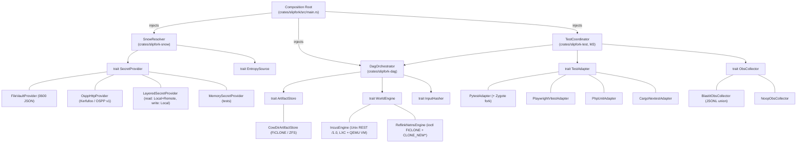

# Slipfork Technical Architecture (`ARCHITECTURE.md`)

This document is the authoritative specification of Slipfork's **Composition Root**, **Inversion of Control / Dependency Injection (IoC/DI) Tree**, crate boundaries, wire protocols, and execution invariants.

Every new backend, secret store, or test framework MUST plug into the trait tree below without global state, ambient OS/env reads, `match kind` sprawl, or fallback hacks. **If a feature cannot fit this DI tree cleanly, stop and file a `direction-challenge` in `plan/HUMAN.md`.**

---

## 1. Composition Root & DI Tree

Only **two entrypoints** in the entire repository may touch ambient environment variables, wall clocks, OS sockets, or real filesystems to wire concrete types:

1. **Rust CLI / Daemon Composition Root:** `crates/slipfork/src/main.rs`
2. **OpenCode V2 Plugin Composition Root:** `packages/opencode-slipfork/src/index.ts`



---

## 2. Crate & Package Boundaries

| Crate / Package | Purity & `unsafe` Policy | Owned Domain Ports (Traits) & Responsibilities |
|---|---|---|
| `crates/slipfork-snow` | `#![forbid(unsafe_code)]`; zero ambient `env`/`net` in core | `SnowFile` v2 AST (`modes.all` + `modes.<m>`, mutually exclusive with `envs`), `Faceless` v2 lexer/evaluator (`??` fallback vs `!!` write-once ensure), `SecretValue` (redacted `Debug`), `SecretProvider`, `EntropySource`, `ResourceResolver` |
| `crates/slipfork-dag` | `#![forbid(unsafe_code)]`; pure graph + injected `InputHasher`/`ArtifactStore` | `ArtifactSpec`, `FixtureNode`, topological wave planner, SHA-256 Merkle tree hasher, orthogonal invalidation rules (stateless artifacts vs stateful snapshots) |
| `crates/slipfork-engine` | `unsafe` confined strictly to `linux_raw.rs` (`ioctl(FICLONE)` with `// SAFETY:` proof) | `WorldEngine`, `EngineCapabilities`, `WorldSpec`, `SnapshotId`, `InstanceHandle`, `HostBindMount`; adapters: `IncusEngine` (REST `/1.0` over Unix socket) and `ReflinkNetnsEngine` (`FICLONE` + `unshare` `CLONE_NEWUSER\|NEWNS\|NEWNET\|NEWPID`) |
| `crates/slipfork` | `#![forbid(unsafe_code)]`; **Composition Root** | CLI parsing (`clap`), adapter wiring, `doctor`/`snow`/`dag`/`fork`/`bench` commands |
| `packages/opencode-slipfork` | Type-only `@opencode/plugin`; injected `SlipforkClient` & `GitWorktreeRunner` | OpenCode V2 `worktree.transform`, `shell.hook("create.before")`, and `session.hook("context")` |

---

## 3. Core Trait Contracts

### 3.1 `SecretProvider` & `Faceless` v2 (`crates/slipfork-snow`)

```rust
pub trait SecretProvider {
    /// Read an existing value from `secrets::<key>`, `vars::<key>`, or `domains::<key>`.
    fn get(&self, namespace: Namespace, key: &str) -> Result<Option<String>, ProviderError>;

    /// Persist a newly generated secret if and only if `key` is absent (`put_if_absent`),
    /// returning the authoritative stored secret (safe under concurrent callers).
    fn ensure_secret(&mut self, key: &str, proposed: &str) -> Result<String, ProviderError>;
}
```

- **Exhaustive Error Collection:** `SnowFile::resolve_mode(mode, provider, resources, entropy)` never stops at the first missing variable. It evaluates every key across the requested env groups and returns **all** missing `vars::*` / `secrets::*` references in one structured `SnowError::MissingValues(Vec<MissingRef>)` diagnostic.
- **Strict Mutual Exclusion:** If raw YAML contains both `envs` and `modes`, parsing fails immediately with `SnowError::EnvsAndModesMutuallyExclusive`. Inside `modes`, only `all` is accepted as the universal base key; `"*"` fails with `SnowError::AsteriskModeForbidden` naming `all`.

### 3.2 `WorldEngine` (`crates/slipfork-engine`)

```rust
#[derive(Debug, Clone, Copy, PartialEq, Eq)]
pub struct EngineCapabilities {
    pub disk_cow: bool,
    pub stateful_ram_snapshot: bool,
    pub isolated_netns: bool,
    pub uid_passthrough: bool,
}

pub trait WorldEngine: Send + Sync {
    fn name(&self) -> &'static str;
    fn capabilities(&self) -> EngineCapabilities;
    fn create_snapshot(&self, source_dir: &Path, label: &str, stateful: bool) -> Result<SnapshotId, EngineError>;
    fn clone_world(&self, snapshot: &SnapshotId, bind: &HostBindMount) -> Result<WorldHandle, EngineError>;
    fn exec_in_world(&self, world: &WorldHandle, spec: &ExecSpec) -> Result<ExecOutput, EngineError>;
    fn destroy_world(&self, world: WorldHandle) -> Result<(), EngineError>;
}
```

- **Zero Unisolated Fallbacks:** If `IncusEngine` is selected and `/var/lib/incus/unix.socket` is missing or returns `403`, it returns `Err(EngineError::DaemonUnavailable)` — it **never** falls back to executing commands directly on the host! Selection between `IncusEngine` and `ReflinkNetnsEngine` happens explicitly at the Composition Root (`slipfork doctor` / explicit config) after verifying kernel capabilities (`FICLONE` probe + `unshare` probe).
- **Shared-UID Host Mount Guarantee:**
  - `IncusEngine`: attaches the host repo/worktree directory as an Incus `disk` device with `shift: "true"` (kernel `MOUNT_ATTR_IDMAP`) and runs `exec` under `uid = host_uid`, `gid = host_gid`.
  - `ReflinkNetnsEngine`: maps the caller's host UID/GID inside the user namespace (`unshare --user --map-root-user` or identity UID map where file ownership on the XFS filesystem translates back to `host_uid:host_gid` on the host!). Wait — **critical Linux userns invariant**: `unshare -r` (`--map-root-user`) maps container `uid 0 -> host_uid`, so any file created by container `uid 0` inside the namespace **is literally owned by `host_uid:host_gid` on the host filesystem** AND gives `CAP_SYS_ADMIN`/`CAP_NET_ADMIN` inside the child namespace to bring up `lo` (`ip link set lo up`) and mount private `/tmp` and `/run/postgresql`!

### 3.3 Orthogonal Artifact Volumes vs Stateful Snapshot DAG (`crates/slipfork-dag`)

Why we do **not** put every component in a separate VM per test, and do **not** bake frontend builds into the linear DB snapshot chain (`ADR-0003`):

1. **Stateless Build Artifacts (`[artifacts.<id>]`):**
   - Hashed by `(build_command, resolved_build_envs, merkle_sha256(input_globs))`.
   - Stored once in `ArtifactStore` (`~/.cache/slipfork/artifacts/<digest>/`).
   - Mounted **read-only** into every cloned world.
2. **Stateful Fixture Lineage (`[fixtures.<id>]`):**
   - Tree rooted at `base` (initialized `PGDATA` + `Redis` + `SeaweedFS`).
   - Each child node hashes `(parent_digest, run_command, resolved_runtime_envs, merkle_sha256(input_globs))`.
   - Materialized by cloning parent CoW state, running the migration/seeder, cleanly checkpointing (or stateful-snapshotting), and sealing as an immutable CoW base directory/snapshot.
3. **Ephemeral Per-Test World (`clone_world`):**
   - Clones **one** world (one private network namespace with `lo` up, one CoW-reflinked `PGDATA`/state tree, read-only mounts of all `ArtifactVolume`s, read-write shared-UID mount of the repo).
   - Inside this single world, canonical ports (`:5432`, `:6379`, `:8000`, `:3000`, `:9000`) never collide across `1..N` concurrent workers, and destroying the world (`rm -rf` on the reflinked state directory after killing the PID namespace init) frees 0-copy blocks in `< 5 ms`.

### 3.4 Warm Zygote Runner Inside Fixture Worlds (RAM CoW Without Hypervisor Overhead)

Starting Python + importing Django + Wagtail + Ninja takes `~0.8–2.5 s` per cold process. Even when hypervisor-level VM RAM snapshots are not used (e.g., inside nested CI containers via `ReflinkNetnsEngine`), Slipfork achieves **process-RAM Copy-on-Write** via a **Runner Zygote**:

- A worker process boots once, imports the framework (`django.setup()`), and listens on a Unix domain socket.
- For each test (or per-snapshot worker pool), `os.fork()` duplicates the warm Python/PHP/Node heap via Linux kernel page-table CoW in **`< 1 ms`**, connects to that test world's private PostgreSQL instance, runs the test, and `_exit`s!

---

## 4. Upward Direction Checks (Open Architectural Decisions for Human Review)

In accordance with **Iron Law #2**, every subtle cross-cutting tension surfaced during M1 design is documented in `plan/HUMAN.md` (`H-001`..`H-004`) rather than buried in assumptions:

1. **`H-001` (`snow.yml` local component commands vs `slipfork.toml`):** In `snow.yml`, production components often omit `run_command` (relying on `Dockerfile` `CMD`) or wrap commands in `modelw-docker run ...`. Proposed: allow optional `modes.local.components.<id>.run_command` directly in `snow.yml` while keeping `[artifacts]` and `[fixtures]` test-DAG definitions in `slipfork.toml` (with zero-config defaults for `hooks: pre-deploy`).
2. **`H-002` (Canonical syntax lock — `::` + `all`):** Confirm locking `::` (`secrets::KEY !! random_string(50)`) and unquoted `all:` as the single canonical syntax (no `.` or `"*"` aliases).
3. **`H-003` (`!!` persistence sink in `local` mode):** Confirm that in `local` mode `LayeredSecretProvider` reads `LocalVault -> Remote OSPP/Kerfufoo` and writes `!!`-generated secrets to `LocalVault` (`0600`) so laptops work offline without mutating shared cloud secrets, while `cloud` mode persists `!!` directly in Kerfufoo's `EnvGroup`.
4. **`H-004` (Host `incusd` exposure for M2 live VM tests):** This OpenCode environment runs *inside* an LXC/Incus container (`/dev/incus/sock` guest socket, XFS rootfs with working `FICLONE` + `unshare` `netns`/`userns`, no `/var/lib/incus/unix.socket` or `/dev/kvm` exposed inside the guest). M1 proves `ReflinkNetnsEngine` live against PostgreSQL 18 + Playwright here and verifies `IncusEngine` against a spec-accurate Unix-socket REST harness; M2 live `IncusEngine` integration tests will need either nested `incusd` or a test project socket mounted into this container.
