# Slipfork Technical Architecture (`ARCHITECTURE.md`)

This document is the authoritative specification of Slipfork's **Composition Root**, **Inversion of Control / Dependency Injection (IoC/DI) Tree**, crate boundaries, wire protocols, and execution invariants (`ADR-0001`..`ADR-0007`).

Every hypervisor backend, secret store, VCS workspace driver, tunnel registrar, or language test runner MUST plug into the trait tree below without global state, ambient OS/env reads, `match kind` sprawl, or fallback hacks. **If a feature cannot fit this DI tree cleanly, stop and file a `direction-challenge` in `plan/HUMAN.md`.**

---

## 1. Composition Root & DI Tree

Only **two entrypoints** in the entire repository may touch ambient environment variables, wall clocks, OS sockets, or real filesystems to wire concrete types:

1. **Rust CLI / Daemon Composition Root:** `crates/slipfork/src/main.rs` (wires CLI commands, `slipforkd`, `SupportRegistry::embedded()` — schema embedded in `0.1.0`, `slipfork support` in M2 — and `git-remote-slipfork`)
2. **OpenCode V2 Plugin Composition Root:** `packages/opencode-slipfork/src/index.ts`

```mermaid
flowchart TD
  CR["Composition Root<br/>(crates/slipfork/src/main.rs)"]

  CR -->|injects| SnowRes["SnowResolver<br/>(crates/slipfork-snow)"]
  CR -->|injects| DagOrch["DagOrchestrator<br/>(crates/slipfork-dag)"]
  CR -->|wires M2 CLI client| CliCtl["slipfork CLI (up/down/share/drop/support)<br/>holds NO TunnelLease"]
  CR -->|wires M2 daemon| EdgeDaemon["slipforkd Sole Local+Shared Ingress<br/>(crates/slipfork-edge, M2)"]
  CR -->|injects| VcsSvc["WorkspaceService<br/>(crates/slipfork-vcs, M2)"]
  CR -->|injects| TestCoord["TestCoordinator<br/>(crates/slipfork-test, M3)"]

  CliCtl -->|compile-time include_str!| SR["SupportRegistry::embedded()<br/>(support/integrations.toml, embedded in 0.1.0; CLI in M2)"]
  CliCtl -->|Slipfork internal IPC| DC["trait DaemonControl<br/>(crates/slipfork-edge, M2)"]
  DC --> WR
  EdgeDaemon --> WR["WorldRegistry (struct, M2)<br/>owns (WorldOrigin, Option&lt;TunnelLease&gt;) + shared_hosts map"]

  SnowRes --> SP["trait SecretProvider"]
  SnowRes --> RG["trait EntropySource"]
  SP --- SP1["FileVaultProvider (0600 JSON — M2 default, zero OSPP prereq)"]
  SP --- SP2["OsppHttpProvider (Kerfufoo / OSPP v1, optional later M2 leaf)"]
  SP --- SP3["LayeredSecretProvider (read: Local+Remote, write: Local)"]
  SP --- SP4["MemorySecretProvider (tests)"]

  DagOrch --> AS["trait ArtifactStore (M3) / DigestCache"]
  DagOrch --> VC["trait VolumeCloner (M3)"]
  DagOrch --> IH["trait InputHasher"]
  AS --- AS1["CowArtifactStore (uses dyn VolumeCloner)"]

  WR --> WE["trait WorldEngine<br/>(crates/slipfork-engine)"]
  WR --> TR["trait TunnelRegistrar -> Box&lt;dyn TunnelLease&gt;<br/>(crates/slipfork-world)"]
  WE --- WE1["IncusEngine (Unix REST /1.0, LXC + QEMU VM)"]
  WE --- WE2["ReflinkNetnsEngine (FICLONE / loopback-XFS + CLONE_NEW*)"]
  TR --- TR1["WeavedRegistrar (M2 wire adapter; gated on weaved IPC spec)"]

  SnowRes --> WN["slipfork-world<br/>ProjectSlug, WorldTarget, LocalHostRoute & WorldOrigin (M2)"]
  DagOrch --> WN
  WR --> WN
  TestCoord --> WN

  VcsSvc --> VW["trait VcsWorkspaceFactory -> VcsWorkspace"]
  VW --- VW1["GitWorktreeAdapter (.git worktrees + scratch-index wip)"]
  VW --- VW2["JjWorkspaceAdapter (jj workspace + @ wip commit)"]

  TestCoord --> DagOrch
  TestCoord --> DC
  TestCoord --> TA["trait TestAdapter"]
  TA -->|optional capability| CD["trait CoverageDriver (M3)"]
  TA --- TA1["SocketRunnerAdapter (RunnerProtocol v1 -> pytest-slipfork, Playwright, PHPUnit, nextest)"]
  TA --- TA2["CommandTestAdapter (zero-plugin CLI sharding)"]
```



---

## 2. Crate & Package Boundaries

| Crate / Package | Milestone | Purity & `unsafe` Policy | Owned Domain Ports (Traits) & Responsibilities |
|---|---|---|---|
| `crates/slipfork-world` | M1 (shipped) + M2 `WorldOrigin` | `#![forbid(unsafe_code)]`; depends only on `serde` + `thiserror`, zero OS socket/FD types | Validated `ProjectSlug` newtype (`parse` / `as_str` / `Display` / `Serialize` / fail-closed `Deserialize`), `WorldTarget { Canonical, UserFork, TestSlot }` (`WorldTarget::validate(&[&str])` + `validate_fork_name`), `WorldError`, encapsulated `LocalHostRoute` (sole constructor of `WorldOrigin::Local`), M2 `WorldOrigin { Local { url }, Shared { url } }` (`ADR-0005` §1), and pure `TunnelLease` + `TunnelRegistrar` traits with shared conformance |
| `crates/slipfork-snow` | M1 (shipped) + M2 component add/remove | `#![forbid(unsafe_code)]`; zero ambient `env`/`net`/clock | `SnowFile` v2 AST (`modes.all` + `modes.<m>`, mode-scoped `modes.<m>.components.<id>`: `run_command` override validated in M1, add/remove/override supervised in M2; `#[serde(deny_unknown_fields)]`; hard rejection of top-level `envs`/`project`), `Faceless` v2 (`??` vs `!!`), `ResourceCoordinates::local_for_world` (sole local coordinate/origin constructor; M2 resolves per-world boot coordinates from `WorldOrigin` with local precedence over `domains::`), `SecretValue`, `SecretProvider`, `EntropySource` |
| `crates/slipfork-dag` | M1 (shipped) + pre-merge cleanup + M2/M3 | `#![forbid(unsafe_code)]`; depends on `slipfork-world`, zero `slipfork-engine` dep | Root `SlipforkConfig` (`project: Option<ProjectSlug>`, `artifacts`, `fixtures`, `test: TestSpec`, parse-time validation of the raw wire tables), `ArtifactSpec`, `FixtureSpec` (incl. `per_world: bool`), typed `TestSpec { coverage: Option<CoverageConfig> }` + `CoverageReportFormat`/`CoverageThreshold`, `SupportRegistry` + `IntegrationEntry`/`Evidence`/`IntegrationTier` (`support/integrations.toml`, `ADR-0007`), wave planner, `InputHasher`, `DigestCache`, and M3 `ArtifactStore` + `VolumeCloner` ports |
| `crates/slipfork-engine` | M1 (shipped) + M2 full spec | `unsafe` confined strictly to `linux_cow.rs` (`ioctl(FICLONE)` with `// SAFETY:` proof) | `WorldEngine` (including M2 `spawn_service`, `freeze_world`, `dial_world_tcp`), `WorldSpec` (`WorldMount` RO/RW list + redacted `ExecEnv`), `SnapshotMode`, opaque `WorldHandle`; adapters: `IncusEngine` and `ReflinkNetnsEngine` |
| `crates/slipfork-edge` | M2 | `#![forbid(unsafe_code)]`; pure of ambient env | Sole ingress reverse proxy (`slipforkd`, `H-008`): proxies shared hostnames via `WorldRegistry`'s `shared_hosts` map and `*.localhost` via `LocalHostRoute`, enforcing `308`/`421` strictly on `*.localhost` when a world is `Shared` (`ADR-0005` §1); internal `trait DaemonControl` (`register_world` / `release_world` + `share_world` / `unshare_world`); and `WeavedRegistrar` gated on `weaved`'s IPC spec (`H-006`) |
| `crates/slipfork-vcs` | M2 | `#![forbid(unsafe_code)]`; injected `ScratchDir` | `VcsWorkspace`, `VcsWorkspaceFactory`, `GitWorktreeAdapter`, `JjWorkspaceAdapter`, and `git-remote-slipfork` protocol handler |
| `crates/slipfork-test` | M3 | `#![forbid(unsafe_code)]`; injected `EntropySource` | `TestCoordinator`, canonical `.slipfork/runs/<run_id>/<slot>/{runner.sock,coverage,output}` run tree, `RunnerProtocol v1` (`SocketRunnerAdapter` + `CommandTestAdapter`), typed `CoverageDriver` multi-world shard collection (`ADR-0006` §5), and pre-warmed world pool |
| `crates/slipfork` | M1..M4 | `#![forbid(unsafe_code)]`; **thin Composition Root only** | CLI (`clap`), OS env/socket discovery, fail-closed canonical `ProjectSlug` resolution (`ADR-0005` §3), fail-closed engine wiring (`ReflinkNetnsEngine` in M1; multi-engine in M2), and M2/M3 `slipfork support [--json]` reading `SupportRegistry::embedded()` (`include_str!`, `ADR-0007`) |
| `packages/opencode-slipfork` | M1 (shipped) + M2 e2e | Type-only `@opencode/plugin`; injected `SlipforkGateway` | OpenCode V2 `worktree.transform`, `shell.hook("create.before")`, and `session.hook("context")` |

---

## 3. Core Trait Contracts & Wire Protocols

### 3.1 `SecretProvider`, `ResourceCoordinates` & `snow.yml` v2 (`crates/slipfork-snow`, `ADR-0001`, `ADR-0005`)

```rust
pub trait SecretProvider {
    /// Read an existing value from `secrets::<key>`, `vars::<key>`, or `domains::<key>`.
    fn get(&self, namespace: Namespace, key: &str) -> Result<Option<String>, ProviderError>;

    /// Persist `proposed` under `secrets::<key>` if and only if absent (`put_if_absent` / CAS),
    /// returning the authoritative stored secret.
    fn ensure_secret(&mut self, key: &str, proposed: &str) -> Result<String, ProviderError>;
}
```

- **M2 Concurrency & Zero OSPP Prerequisite:** Before M2/M3 parallel world resolution, `SecretProvider` and `EntropySource` gain `Send + Sync` bounds with `&self` interior synchronization (`flock` + `O_EXCL`/atomic rename on `FileVaultProvider`). Per `ADR-0005` §1, **OSPP is not a prerequisite for M2**: M2 runs end-to-end on `FileVaultProvider` (`0600`) alone, with `OsppHttpProvider` landing as an independent later M2 leaf.
- **One Canonical `modes` Schema (Zero Top-Level `envs`):** Top-level `envs:` (`SnowError::TopLevelEnvsUnsupported`) and top-level `project:` (`ADR-0005` §3) are hard-rejected; unquoted `all` is the sole universal base mode (`"*"` fails with `SnowError::AsteriskModeForbidden`).
- **Mode-Scoped Components (`modes.<mode>.components.<id>`, `H-001`):** Approved add/remove/override design (`ADR-0001` §1): M1 parses and validates `run_command` overrides on existing components (`SnowFile::effective_run_command`, rejecting `modes.all.components` and unknown component IDs); M2 adds mode-scoped component addition/removal alongside process supervision in `slipfork-edge`.
- **Single-Origin Boot Coordinates (`ResourceCoordinates` & `WorldOrigin`):** `LocalHostRoute::url()` / `ResourceCoordinates::local_for_world(&snow, &project_slug, &WorldTarget)` is the **sole constructor** of `WorldOrigin::Local { url }` (validating `target` via `WorldTarget::validate(&snow.domain_ids())` and failing closed via `SnowError::UnknownResourcePath` on unexposed `components::<id>.private_port`; M2 adds no parallel local renderer). M2 supplies `WorldOrigin` (`Local | Shared`) at **world materialization** (`ADR-0005` §1): Slipfork-assigned origins always override provider `domains::` in local worlds, reusable (`per_world = false`) fixture snapshots withhold origin-bearing coordinates, and `modes.local` never hardcodes a `BASE_URL` literal.
- **Exhaustive Error Collection:** `SnowFile::resolve_mode` evaluates every key across all requested env groups and returns **all** missing `vars::*` / `secrets::*` references in one `SnowError::MissingValues(Vec<MissingRef>)` diagnostic.

### 3.2 `WorldEngine`, Multi-Mount `WorldSpec` & Redacted `ExecEnv` (`crates/slipfork-engine`, `ADR-0002`, `ADR-0003`)

M1 ships the minimal PoC subset (`HostBindMount`, `stateful: bool`, plain `ExecSpec.env` map); M2 promotes `WorldEngine` to the complete service-supervising, snapshot-freezing, dialable contract below:

```rust
#[derive(Debug, Clone, Copy, PartialEq, Eq)]
pub enum SnapshotMode {
    DiskCow,
    StatefulRam,
}

#[derive(Debug, Clone, Copy, PartialEq, Eq)]
pub enum MountMode {
    ReadOnly,
    ReadWrite,
}

#[derive(Debug, Clone, PartialEq, Eq)]
pub struct WorldMount {
    pub host_path: PathBuf,
    pub guest_path: PathBuf,
    pub mode: MountMode,
}

/// Replaces ambient host environment completely except root-supplied constants (`PATH`, `TERM`,
/// `LANG`) and a world-scoped `HOME`; custom `Debug` redacts every secret `SecretValue`.
/// Overlay semantics: `effective_env = base_env ⊕ overlay_env` (`overlay_env` wins on key collision).
pub struct ExecEnv {
    pub inherited_allowlist: BTreeMap<String, String>,
    pub resolved_vars: BTreeMap<String, SecretValue>,
}

pub struct WorldSpec {
    pub target: WorldTarget,     // `slipfork_world::WorldTarget` (M2 engine adds the slipfork-world dep)
    pub snapshot: SnapshotId,    // content-addressed origin-independent fixture digest or named snapshot
    pub mounts: Vec<WorldMount>, // repo (RW) + ArtifactVolumes (RO) + M3 .slipfork/runs/<run_id>/<slot>/{output,coverage} (RW)
    pub base_env: ExecEnv,       // resolved at world boot from known WorldOrigin (+ slot-stable coverage env when enabled)
}

pub trait WorldEngine: Send + Sync {
    fn name(&self) -> &'static str;
    fn probe(&self) -> Result<EngineCapabilities, EngineError>;
    fn create_snapshot(&self, source_dir: &Path, id: &SnapshotId, mode: SnapshotMode) -> Result<(), EngineError>;
    /// Seal an origin-independent live world (`base -> migrate -> seed_*`) into an immutable child snapshot.
    fn freeze_world(&self, world: &WorldHandle, id: &SnapshotId, mode: SnapshotMode) -> Result<(), EngineError>;
    fn clone_world(&self, spec: &WorldSpec) -> Result<WorldHandle, EngineError>;
    fn spawn_service(&self, world: &WorldHandle, spec: &ServiceSpec) -> Result<ServiceHandle, EngineError>;
    fn stop_service(&self, service: ServiceHandle) -> Result<(), EngineError>;
    fn exec_in_world(&self, world: &WorldHandle, argv: &[String], cwd: &Path, overlay_env: &ExecEnv) -> Result<ExecOutput, EngineError>;
    /// Open a TCP stream from `slipforkd` into `127.0.0.1:<port>` inside `world`'s netns
    /// (one dialer worker per `WorldHandle`, released on `destroy_world`).
    fn dial_world_tcp(&self, world: &WorldHandle, port: u16) -> Result<std::net::TcpStream, EngineError>;
    fn destroy_world(&self, world: WorldHandle) -> Result<(), EngineError>;
}
```

- **Zero Unisolated Fallbacks & Clean Env Seam:** Unavailable engines fail closed at Composition Root wiring (`probe_reflink_dir` / `EngineError::ReflinkUnsupported` on `ReflinkNetnsEngine` in M1; `EngineError::DaemonUnavailable` when M2 wires `IncusEngine`). Child processes execute with `Command::env_clear()`, receiving **only** `ExecEnv` and exposing `SecretValue::expose()` strictly at the OS `Command::env` call site.
- **Engine-Agnostic Port Dialing (`dial_world_tcp`):** `IncusEngine` dials via Incus instance proxy/netns FD; `ReflinkNetnsEngine` enters `/proc/<init_pid>/ns/net` via `setns(CLONE_NEWNET)` on a dedicated dialer worker and connects to `127.0.0.1:<port>`. `slipforkd` never inspects `engine.name()`.
- **Shared-UID Host Mount Guarantee:** `IncusEngine` mounts `WorldMount`s with `shift: "true"` (`MOUNT_ATTR_IDMAP`); `ReflinkNetnsEngine` maps `"$UID $UID 1"` inside `CLONE_NEWUSER | CLONE_NEWNET | CLONE_NEWNS | CLONE_NEWPID` (`--keep-caps`), keeping `geteuid() == host_uid` while retaining `CAP_NET_ADMIN` to bring `lo` up.

### 3.3 Single-Origin `WorldOrigin`, Sole Ingress (`slipforkd`), `DaemonControl` & `TunnelRegistrar` (`crates/slipfork-world`, `crates/slipfork-edge` M2, `ADR-0005`)

`slipforkd` is the **sole ingress** for both `Local` and `Shared` worlds (`H-008`): requests matching `WorldRegistry`'s `shared_hosts: BTreeMap<String, (ProjectSlug, WorldTarget)>` map proxy directly via `WorldEngine::dial_world_tcp` (`Host` + `X-Forwarded-*` preserved), while `*.localhost` requests parse via `LocalHostRoute::parse` (`404` if absent) — proxying when `Local` and enforcing `308 Permanent Redirect` / `421 Misdirected Request` across all `*.localhost` hostnames (including `snow_domain` ingresses) when `Shared` (`ADR-0005` §1–§2, `H-006`, `H-008`).

```rust
// crates/slipfork-world — pure identity + single-origin + outbound tunnel port (zero OS socket/FD types)
#[derive(Debug, Clone, PartialEq, Eq, PartialOrd, Ord, Hash, Serialize)] // custom fail-closed Deserialize
pub struct ProjectSlug(String); // ProjectSlug::parse / as_str / Display

pub struct LocalHostRoute {
    project: ProjectSlug,
    target: WorldTarget,
    snow_domain: Option<String>,
} // LocalHostRoute::new / parse / project() / target() / snow_domain() / host() / url()

/// M2 addition in crates/slipfork-world: a world has at most one public origin (ADR-0005 §1, H-008).
#[derive(Debug, Clone, PartialEq, Eq, Serialize, Deserialize)]
#[serde(tag = "kind", rename_all = "snake_case")]
pub enum WorldOrigin {
    Local { url: String },  // constructed exclusively via LocalHostRoute::url()
    Shared { url: String }, // minted from TunnelLease::public_url() against slipforkd's planned static port
} // WorldOrigin::url(&self) -> &str

pub struct TunnelRequest<'a> {
    pub route: &'a LocalHostRoute,
    pub local_port: u16, // slipforkd's planned static port (decided before world materialization, H-008)
}

/// Opaque RAII lease: adapters keep their transport private and revoke the tunnel on Drop.
pub trait TunnelLease: Send + Sync {
    fn public_url(&self) -> &str;
    fn lease_id(&self) -> &str;
}

pub trait TunnelRegistrar: Send + Sync {
    fn register(&self, request: &TunnelRequest<'_>) -> Result<Box<dyn TunnelLease>, TunnelError>;
}
```

```rust
// crates/slipfork-edge (M2) — daemon-owned world + shared_hosts registry & CLI/TestCoordinator IPC
#[derive(Debug, Clone, PartialEq, Eq, Serialize, Deserialize)]
pub struct SharedWorldInfo {
    pub public_url: String,
    pub lease_id: String,
}

/// Slipfork's own CLI / TestCoordinator <-> slipforkd control IPC port (not weaved's protocol).
pub trait DaemonControl: Send + Sync {
    fn register_world(&self, project: &ProjectSlug, target: &WorldTarget) -> Result<WorldOrigin, EdgeError>;
    fn release_world(&self, project: &ProjectSlug, target: &WorldTarget) -> Result<bool, EdgeError>;
    fn share_world(&self, project: &ProjectSlug, target: &WorldTarget) -> Result<SharedWorldInfo, EdgeError>;
    fn unshare_world(&self, project: &ProjectSlug, target: &WorldTarget) -> Result<WorldOrigin, EdgeError>;
}

impl WorldRegistry {
    pub fn new(engine: Arc<dyn WorldEngine>, registrar: Arc<dyn TunnelRegistrar>, planned_port: u16) -> Self;
}

impl DaemonControl for WorldRegistry {
    fn register_world(&self, project: &ProjectSlug, target: &WorldTarget) -> Result<WorldOrigin, EdgeError>;
    fn release_world(&self, project: &ProjectSlug, target: &WorldTarget) -> Result<bool, EdgeError>;
    fn share_world(&self, project: &ProjectSlug, target: &WorldTarget) -> Result<SharedWorldInfo, EdgeError>;
    fn unshare_world(&self, project: &ProjectSlug, target: &WorldTarget) -> Result<WorldOrigin, EdgeError>;
}
```

### 3.4 `VcsWorkspace` (`Git` + `Jujutsu`) & `git-remote-slipfork` (`crates/slipfork-vcs`, `ADR-0005`)

```rust
#[derive(Debug, Clone, PartialEq, Eq)]
pub struct ExportedRefs {
    /// Committed branch/parent revision (`refs/heads/<fork>` in Git; `@-` in Jujutsu).
    pub head_oid: String,
    /// Commit capturing the live working tree including uncommitted & untracked edits
    /// (synthesized via scratch `GIT_INDEX_FILE` in Git; native `@` working-copy commit in Jujutsu).
    pub wip_oid: String,
}

pub trait VcsWorkspace: Send + Sync {
    fn create_workspace(&self, fork: &str, dest: &Path) -> Result<(), VcsError>;
    fn remove_workspace(&self, fork: &str, dest: &Path) -> Result<(), VcsError>;
    fn export_refs(&self, workspace_dir: &Path) -> Result<ExportedRefs, VcsError>;
}

pub trait VcsWorkspaceFactory: Send + Sync {
    fn open_repo(&self, repo_root: &Path) -> Result<Box<dyn VcsWorkspace>, VcsError>;
}
```

- Zero `kind()` enum on `VcsWorkspace`. At the Composition Root, `DefaultVcsWorkspaceFactory` inspects `repo_root` (`.jj/` -> `JjWorkspaceAdapter`; `.git/` -> `GitWorktreeAdapter` injected with disk-backed `ScratchDir` under `state_root/scratch`) and auto-registers `slipfork::.` during `slipfork up` / `slipfork fork` (`ADR-0005` §3).

### 3.5 World-Owns-The-Stack, `RunnerProtocol v1`, Typed `CoverageDriver` & `SLIPFORK_OUTPUT_DIR` (`crates/slipfork-dag`, `crates/slipfork-test` M3, `ADR-0006`)

The CoW world — **never** the test runner — migrates PostgreSQL, seeds snapshots, assigns `WorldOrigin`, and boots services before tests run (`ADR-0006` §1–§5). `FixtureSpec.per_world: bool` plus the single-way typed `[test]` schema below are parsed by `SlipforkConfig::parse_toml` (`coverage = true` is the sole TOML switch, parsed into `Option<CoverageConfig>` with zero boolean flag in domain structs):

```rust
// crates/slipfork-dag — target schemas for [fixtures.<id>] and [test] in slipfork.toml
#[derive(Debug, Clone, Copy, PartialEq, Eq, PartialOrd, Ord, Serialize, Deserialize)]
#[serde(rename_all = "snake_case")]
pub enum CoverageReportFormat {
    Html,
    Xml,
    Json,
    Lcov,
    Text,
}

/// Validated integer percentage in `0..=100` (`DagError::InvalidCoverageThreshold` /
/// `TestError::InvalidCoverageThreshold` on `101..=255`), constructed only by parse-time
/// validation of `coverage_fail_under`.
#[derive(Debug, Clone, Copy, PartialEq, Eq)]
pub struct CoverageThreshold(u8);

impl CoverageThreshold {
    pub const MAX: u8 = 100;
    pub fn percent(self) -> u8;
}

#[derive(Debug, Clone, PartialEq, Eq)]
pub struct CoverageConfig {
    pub reports: BTreeSet<CoverageReportFormat>, // defaults to {Text} when coverage_report omitted
    pub fail_under: Option<CoverageThreshold>,
}

/// `SlipforkConfig::parse_toml` validates the raw `[test]` wire table: `coverage = true` is the
/// sole activation switch and rejects `coverage_report` / `coverage_fail_under` without it
/// (`DagError::CoverageOptionsRequireEnabled`) and an explicitly empty `coverage_report`
/// (`DagError::EmptyCoverageReport`).
#[derive(Debug, Default, Clone, PartialEq, Eq)]
pub struct TestSpec {
    pub coverage: Option<CoverageConfig>,
}
```

- **`FixtureSpec.per_world` (`ADR-0003` §1):** a `per_world = true` fixture writes absolute origin URLs into persistent state, is never sealed into a snapshot shared across worlds, and cannot be the `parent` of an origin-independent fixture (`DagError::OriginIndependentChildOfPerWorld`); `per_world` is part of the fixture digest and is carried on every `PlannedFixture`. `DagPlanner::plan` never reports a `per_world = true` node as `CacheAction::Cached`: the `DigestCache` port carries no world discriminator, so a cache hit would reuse another world's snapshot with its baked-in URLs.

```rust
// crates/slipfork-test (M3) — canonical .slipfork/runs/<run_id>/<slot>/{runner.sock,coverage,output}
#[derive(Debug, Clone, Copy, PartialEq, Eq, Serialize, Deserialize)]
#[serde(rename_all = "snake_case")]
pub enum IsolationTier {
    Batch,
    World,
}

#[derive(Debug, Clone, PartialEq, Eq, Serialize, Deserialize)]
pub struct DiscoveredTest {
    pub id: String,
    pub fixture: String,
    pub isolation: IsolationTier,
}

pub struct WorldEndpoint {
    pub origin: WorldOrigin, // single typed origin; expose origin.url() only at wire/env boundary
    pub env: BTreeMap<String, SecretValue>,
}

pub struct WorldSlotContext<'a> {
    pub target: &'a WorldTarget,
    pub endpoint: &'a WorldEndpoint,
    pub output_dir: &'a Path,           // .slipfork/runs/<run_id>/<slot>/output (SLIPFORK_OUTPUT_DIR)
    pub coverage_dir: Option<&'a Path>, // .slipfork/runs/<run_id>/<slot>/coverage (slot-stable at pre-warm boot)
}

pub struct CoverageSummary {
    pub line_percent: f64,
    pub report_paths: BTreeMap<CoverageReportFormat, PathBuf>,
}

pub trait CoverageDriver: Send + Sync {
    /// Tool-owned env vars injected at pre-warm world boot and into test shards for `world_coverage_dir`.
    fn world_env(&self, world_coverage_dir: &Path) -> BTreeMap<String, String>;
    /// Combine coverage shards across all N worlds via typed argv (concrete adapters invoke tools
    /// through injected subprocess ports wired at the Composition Root — never a shell pipeline).
    fn collect(
        &self,
        shard_dirs: &[PathBuf],
        formats: &BTreeSet<CoverageReportFormat>,
        report_dir: &Path,
    ) -> Result<CoverageSummary, TestError>;
}

pub trait TestAdapter: Send + Sync {
    fn name(&self) -> &'static str;
    fn coverage(&self) -> Option<&dyn CoverageDriver> { None }
    fn discover(&self, workspace: &Path, filters: &[String]) -> Result<Vec<DiscoveredTest>, TestError>;
    fn run_items(
        &self,
        slot: &WorldSlotContext<'_>,
        items: &[DiscoveredTest],
        on_result: &mut dyn FnMut(TestOutcome),
    ) -> Result<(), TestError>;
}
```

- Every `TestAdapter` must pass the shared `TestAdapter` conformance suite (including fail-closed `TestError::CoverageUnsupported` when `TestSpec.coverage.is_some()` and `coverage()` is `None`, plus `TestCoordinator` threshold enforcement for `CoverageThreshold`).

### 3.6 Integration Support Registry (`support/integrations.toml`, `crates/slipfork-dag`, `ADR-0007`)

`0.1.0` lands the typed registry schema and the embedded registry file; `slipfork support [--json]` and the read-only `make check` ceiling land in M2/M3.

```rust
// crates/slipfork-dag/src/support.rs
#[derive(Debug, Clone, Copy, PartialEq, Eq, PartialOrd, Ord, Deserialize)]
#[serde(rename_all = "kebab-case")]
pub enum IntegrationTier {
    None,
    Declared,
    Exercised,
    FieldTested,
    Hardened,
}

impl IntegrationTier {
    /// Cumulative tier→evidence ladder shared by validation, the critical test, and the M2
    /// compliance tool (the table lives here once, never restated).
    pub fn required_evidence(self) -> &'static [EvidenceField];
}

#[derive(Debug, Clone, Copy, PartialEq, Eq, Deserialize)]
#[serde(rename_all = "kebab-case")]
pub enum IntegrationCategory {
    WorldEngine,
    Secrets,
    Tunnel,
    Vcs,
    TestRunner,
    Cli,
}

/// One evidence pointer kind (`ADR-0007` §1).
#[derive(Debug, Clone, Copy, PartialEq, Eq)]
pub enum EvidenceField {
    Rationale,          // none
    SignoffDoc,         // none: existing ADR/review path
    SignoffCommit,      // none: 40-hex commit SHA
    RecipePage,         // declared: existing published doc path
    CriticalTest,       // declared: <crate>::<critical_file>::<test_fn>
    CiJob,              // exercised: <workflow.yml>#<job_id>
    DeployRef,          // field-tested: support/deployments/<id>.md
    ProductionSuiteRef, // hardened: committed scale record
    TestAudit,          // hardened: docs/testing/AUDIT-*.md
}

/// One flat record of optional evidence pointers (the "typed in-record fields" reading of
/// `ADR-0007` §1). Fields are private and the type has no `Deserialize`, so
/// `SupportRegistry::parse_toml` is the only constructor.
#[derive(Debug, Clone, PartialEq, Eq)]
pub struct Evidence {
    // rationale, signoff_doc, signoff_commit, recipe_page, critical_test, ci_job,
    // deploy_ref, production_suite_ref, test_audit
}

impl Evidence {
    pub fn field(&self, field: EvidenceField) -> Option<&str>;
}

/// One integration support claim; private fields + accessors, constructed only by `parse_toml`.
#[derive(Debug, Clone, PartialEq, Eq)]
pub struct IntegrationEntry {
    // id, category, tier, evidence
}

impl IntegrationEntry {
    pub fn id(&self) -> &str;
    pub fn category(&self) -> IntegrationCategory;
    pub fn tier(&self) -> IntegrationTier;
    pub fn evidence(&self) -> &Evidence;
}

#[derive(Debug, Clone, PartialEq, Eq)]
pub struct SupportRegistry {
    entries: Vec<IntegrationEntry>,
}

impl SupportRegistry {
    /// Compile-time `include_str!("../../../support/integrations.toml")` — zero ambient cwd I/O.
    pub fn embedded() -> Result<Self, RegistryError>;
    /// Sole parser and validating path (private `validate()`): rejects an empty registry, duplicate
    /// ids, and any claimed tier whose required pointers are missing/empty.
    pub fn parse_toml(raw: &str) -> Result<Self, RegistryError>;
    pub fn entries(&self) -> &[IntegrationEntry];
}
```

- **Evidence representation:** one flat optional-field record (not a per-tier sum type) so `make support-sync` can demote an entry in place without reshaping its TOML record; `IntegrationTier::required_evidence()` is the single tier→evidence ladder (`none`: `rationale`/`signoff_doc`/`signoff_commit`; `declared`: `recipe_page`/`critical_test`; `exercised`: +`ci_job`; `field-tested`: +`deploy_ref`; `hardened`: +`production_suite_ref`/`test_audit`), duplicate ids fail as `RegistryError::DuplicateId`, an empty registry fails as `RegistryError::EmptyRegistry`, and malformed TOML or unknown fields fail as `RegistryError::Toml`. Normative tier semantics, the split between **machine-verified** (`declared`, `exercised`) and **attested + artifact** (`none`, `field-tested`, `hardened`) tiers, `slipfork support [--json]`, the read-only `make check` fail-closed ceiling, and explicit `make support-sync` demotion live in `ADR-0007` §1–§3.
- **`0.1.0` scope:** the file ships with the honest `0.1.0` surface only. `crates/slipfork-dag/tests/critical_support.rs` verifies that the registry parses and is non-empty, ids are unique, every tier's required pointers are present and non-empty, every `recipe_page`/`signoff_doc`/`deploy_ref`/`production_suite_ref`/`test_audit` path exists, and every `critical_test` symbol resolves — all via `env!("CARGO_MANIFEST_DIR")`-relative paths (no ambient cwd). `signoff_commit` is checked for lowercase 40-hex **shape only**: `0.1.0` does not verify that the commit exists or that it touches its `signoff_doc`. M2's compliance tool adds `git` commit existence/attestation, `.github/workflows` job-key verification (the test's `ci_job` branch stays dormant until an `exercised` entry ships), `slipfork support [--json]`, the fail-closed `make check` ceiling, and `make support-sync` demotion (`ADR-0007` §2–§3).

---

## 4. Validated Architectural Decisions & Open Host Items (`plan/HUMAN.md`)

1. **`H-001` [Validated + Gate Confirmation]:** Mode-scoped components (`modes.<mode>.components.<id>` add/remove/override) live in `snow.yml`, while `[artifacts]`, `[fixtures]` (`per_world`), and the typed `[test]` table (`coverage`, `coverage_report`, `coverage_fail_under` — typed fields only, zero hooks or shell path assembly) live in `slipfork.toml` (`ADR-0001`, `ADR-0006`).
2. **`H-002` [Validated]:** Locked `::` namespace separator, unquoted `all:` universal mode, and hard rejection of top-level `envs:` (and top-level `project:`).
3. **`H-003` [Validated + Gate Addendum]:** `LayeredSecretProvider` persists `!!` secrets to the local `0600` vault in `local` mode and to cloud `EnvGroup` secrets in `cloud` mode; **OSPP is not a prerequisite for M2**, and Slipfork-assigned `WorldOrigin` always wins over provider `domains::` in local worlds (`ADR-0005` §1).
4. **`H-004` [Open for M2]:** This container host runs XFS (`reflink=1`) + unprivileged `netns`/`userns` (`ReflinkNetnsEngine` proven live in `make bench`); M2 live `IncusEngine` integration tests await mounting a project-scoped `incusd` socket or nested `incusd` (`plan/HUMAN.md`).
5. **`H-005` [Validated + Gate Amendment]:** Canonical VCS `ProjectSlug` resolution (`ADR-0005` §3), single `WorldOrigin = Local { url } | Shared { url }` per world, and reserved `test-*` prefix across forks and `domains[].id`.
6. **`H-006` [Validated]:** `weaved`'s registration wire payload and disconnect/revocation framing remain deferred until `tunnel-weaver` publishes `weaved`'s real IPC specification; `weaved`'s forward target is `slipforkd`'s planned static port (`H-008`).
7. **`H-008` [Validated]:** `slipforkd` is the **sole shared ingress** (`shared_hosts` map -> `dial_world_tcp` with `Host` + `X-Forwarded-*` preserved); `WorldOrigin::Shared` is minted from `TunnelLease::public_url()` against `slipforkd`'s planned static port before materialization, and `308`/`421` applies strictly to `*.localhost` Hosts (collapsing `snow_domain` ingresses into the single shared origin, `ADR-0005` §1–§2).
