# Slipfork Technical Architecture (`ARCHITECTURE.md`)

This document is the authoritative specification of Slipfork's **Composition Root**, **Inversion of Control / Dependency Injection (IoC/DI) Tree**, crate boundaries, wire protocols, and execution invariants (`ADR-0001`..`ADR-0006`).

Every hypervisor backend, secret store, VCS workspace driver, tunnel registrar, or language test runner MUST plug into the trait tree below without global state, ambient OS/env reads, `match kind` sprawl, or fallback hacks. **If a feature cannot fit this DI tree cleanly, stop and file a `direction-challenge` in `plan/HUMAN.md`.**

---

## 1. Composition Root & DI Tree

Only **two entrypoints** in the entire repository may touch ambient environment variables, wall clocks, OS sockets, or real filesystems to wire concrete types:

1. **Rust CLI / Daemon Composition Root:** `crates/slipfork/src/main.rs` (wires CLI commands, `slipforkd`, and `git-remote-slipfork`)
2. **OpenCode V2 Plugin Composition Root:** `packages/opencode-slipfork/src/index.ts`

```mermaid
flowchart TD
  CR["Composition Root<br/>(crates/slipfork/src/main.rs)"]

  CR -->|injects| SnowRes["SnowResolver<br/>(crates/slipfork-snow)"]
  CR -->|injects| DagOrch["DagOrchestrator<br/>(crates/slipfork-dag)"]
  CR -->|wires M2 CLI client| CliCtl["slipfork CLI (up/down/share/drop)<br/>holds NO TunnelLease"]
  CR -->|wires M2 daemon| EdgeDaemon["slipforkd EdgeProxy<br/>(crates/slipfork-edge, M2)"]
  CR -->|injects| VcsSvc["WorkspaceService<br/>(crates/slipfork-vcs, M2)"]
  CR -->|injects| TestCoord["TestCoordinator<br/>(crates/slipfork-test, M3)"]

  CliCtl -->|Slipfork internal IPC| DC["trait DaemonControl<br/>(crates/slipfork-edge, M2)"]
  DC --> WR
  EdgeDaemon --> WR["WorldRegistry (struct, M2)<br/>owns Box&lt;dyn TunnelLease&gt; per (ProjectSlug, WorldTarget)"]

  SnowRes --> SP["trait SecretProvider"]
  SnowRes --> RG["trait EntropySource"]
  SP --- SP1["FileVaultProvider (0600 JSON)"]
  SP --- SP2["OsppHttpProvider (Kerfufoo / OSPP v1, M2)"]
  SP --- SP3["LayeredSecretProvider (read: Local+Remote, write: Local)"]
  SP --- SP4["MemorySecretProvider (tests)"]

  DagOrch --> AS["trait ArtifactStore (M3) / DigestCache"]
  DagOrch --> VC["trait VolumeCloner (M3)"]
  DagOrch --> IH["trait InputHasher"]
  AS --- AS1["CowArtifactStore (uses dyn VolumeCloner)"]

  WR --> WE["trait WorldEngine<br/>(crates/slipfork-engine)"]
  WR --> TR["trait TunnelRegistrar -> Box&lt;dyn TunnelLease&gt;<br/>(crates/slipfork-world)"]
  WE --- WE1["IncusEngine (Unix REST /1.0, LXC + QEMU VM)"]
  WE --- WE2["ReflinkNetnsEngine (FICLONE / loopback-XFS + CLONE_NEW*)"]
  TR --- TR1["WeavedRegistrar (M2 wire adapter; gated on weaved IPC spec)"]

  SnowRes --> WN["slipfork-world<br/>ProjectSlug, WorldTarget & LocalHostRoute"]
  DagOrch --> WN
  WR --> WN

  VcsSvc --> VW["trait VcsWorkspaceFactory -> VcsWorkspace"]
  VW --- VW1["GitWorktreeAdapter (.git worktrees + scratch-index wip)"]
  VW --- VW2["JjWorkspaceAdapter (jj workspace + @ wip commit)"]

  TestCoord --> DagOrch
  TestCoord --> DC
  TestCoord --> TA["trait TestAdapter"]
  TestCoord --> SH["trait SuiteHookRunner"]
  TA --- TA1["SocketRunnerAdapter (RunnerProtocol v1 -> pytest-slipfork, Playwright, PHPUnit, nextest)"]
  TA --- TA2["CommandTestAdapter (zero-plugin CLI sharding)"]
  SH --- SH1["ShellSuiteHookRunner ([test].after_suite)"]
```



---

## 2. Crate & Package Boundaries

| Crate / Package | Milestone | Purity & `unsafe` Policy | Owned Domain Ports (Traits) & Responsibilities |
|---|---|---|---|
| `crates/slipfork-world` | M1 (shipped) | `#![forbid(unsafe_code)]`; depends only on `serde` + `thiserror`, zero OS socket/FD types | Validated `ProjectSlug` newtype (`parse` / `as_str` / `Display` / `Serialize` / fail-closed `Deserialize`), `WorldTarget { Canonical, UserFork, TestSlot }` (`WorldTarget::validate(&[&str])` + `validate_fork_name` as the sole fork rule table), `WorldError` (sole fork/slug/domain error type), encapsulated `LocalHostRoute` (`new` / `parse` / accessors — unroutable construction impossible), pure `TunnelLease` (opaque RAII) + `TunnelRegistrar` traits and their shared conformance suite |
| `crates/slipfork-snow` | M1 (shipped) | `#![forbid(unsafe_code)]`; zero ambient `env`/`net`/clock | `SnowFile` v2 AST (`modes.all` + `modes.<m>`, 2-level `modes.<m>.components.<id>.run_command`, `#[serde(deny_unknown_fields)]`, hard rejection of top-level `envs`/`project`), `Faceless` v2 (`??` vs `!!`), `ResourceCoordinates::local_for_world(&snow, &ProjectSlug, &WorldTarget)` (wraps `WorldError` via `SnowError::World(#[from] WorldError)`), `SecretValue` (redacted `Debug`/`Display`), `SecretProvider`, `EntropySource` |
| `crates/slipfork-dag` | M1 (shipped) + M3 store | `#![forbid(unsafe_code)]`; depends on `slipfork-world`, zero `slipfork-engine` dep | Root `SlipforkConfig` (`project: Option<ProjectSlug>`, `artifacts`, `fixtures`, `test: TestSpec { after_suite: Option<String> }`, all `#[serde(deny_unknown_fields)]`), `ArtifactSpec`, `FixtureSpec`, topological wave planner, SHA-256 Merkle hasher, `InputHasher`, `DigestCache`, and M3 `ArtifactStore` + `VolumeCloner` ports (implemented in `slipfork-engine`) |
| `crates/slipfork-engine` | M1 (shipped) + M2 full spec | `unsafe` confined strictly to `linux_cow.rs` (`ioctl(FICLONE)` with `// SAFETY:` proof) | `WorldEngine` (including M2 `spawn_service`, `freeze_world`, `dial_world_tcp`), `WorldSpec` (`WorldMount` RO/RW list + redacted `ExecEnv`), `SnapshotMode`, opaque `WorldHandle`; adapters: `IncusEngine` and `ReflinkNetnsEngine` |
| `crates/slipfork-edge` | M2 | `#![forbid(unsafe_code)]`; pure of ambient env | Port-80 `*.localhost` HTTP/WebSocket reverse proxy (`slipforkd`), Slipfork's internal `trait DaemonControl` CLI<->`slipforkd` IPC port, concrete `WorldRegistry` (injected with `Arc<dyn WorldEngine>` + `Arc<dyn TunnelRegistrar>`, owning `Box<dyn TunnelLease>` per `(ProjectSlug, WorldTarget)`), and `WeavedRegistrar` wire adapter gated on `tunnel-weaver` publishing `weaved`'s IPC spec |
| `crates/slipfork-vcs` | M2 | `#![forbid(unsafe_code)]`; injected `ScratchDir` | `VcsWorkspace`, `VcsWorkspaceFactory`, `GitWorktreeAdapter`, `JjWorkspaceAdapter`, and `git-remote-slipfork` protocol handler |
| `crates/slipfork-test` | M3 | `#![forbid(unsafe_code)]`; injected `EntropySource` | `TestCoordinator`, `RunnerProtocol v1` (`SocketRunnerAdapter` + `CommandTestAdapter`), pre-warmed world pool, `SuiteHookRunner` (`[test].after_suite`) |
| `crates/slipfork` | M1..M4 | `#![forbid(unsafe_code)]`; **thin Composition Root only** | CLI (`clap`), OS env/socket discovery, fail-closed canonical `ProjectSlug` resolution (`ADR-0005` §3), fail-closed engine wiring (`ReflinkNetnsEngine` + `probe_reflink_dir` in M1; multi-engine selection in M2), and adapter wiring |
| `packages/opencode-slipfork` | M1 (shipped) + M2 e2e | Type-only `@opencode/plugin`; injected `SlipforkGateway` | OpenCode V2 `worktree.transform`, `shell.hook("create.before")`, and `session.hook("context")` |

---

## 3. Core Trait Contracts & Wire Protocols

### 3.1 `SecretProvider`, `ResourceCoordinates` & `snow.yml` v2 (`crates/slipfork-snow`, `ADR-0001`)

```rust
pub trait SecretProvider {
    /// Read an existing value from `secrets::<key>`, `vars::<key>`, or `domains::<key>`.
    fn get(&self, namespace: Namespace, key: &str) -> Result<Option<String>, ProviderError>;

    /// Persist `proposed` under `secrets::<key>` if and only if absent (`put_if_absent` / CAS),
    /// returning the authoritative stored secret.
    fn ensure_secret(&mut self, key: &str, proposed: &str) -> Result<String, ProviderError>;
}
```

- **M2 Concurrency Evolution:** Before M2/M3 parallel world resolution, `SecretProvider` and `EntropySource` gain `Send + Sync` bounds with `&self` interior synchronization (`flock` + `O_EXCL`/atomic rename on `FileVaultProvider`).
- **One Canonical `modes` Schema (Zero Top-Level `envs`):** Top-level `envs:` is hard-rejected (`SnowError::TopLevelEnvsUnsupported`); so is top-level `project:` (canonical VCS `ProjectSlug` derivation is specified normatively in `ADR-0005` §3). Inside `modes:`, `all` is the sole universal base mode (`"*"` fails with `SnowError::AsteriskModeForbidden`).
- **Two-Level Component `run_command` Override (`H-001`):** `modes.<mode>.components.<id>.run_command` overrides top-level `components[].run_command` (`SnowFile::effective_run_command`, parsed and structurally validated in M1; supervised at runtime by `slipfork-edge` in M2). Setting `components` inside `modes.all` or referencing an unknown component ID fails structural validation.
- **Typed `.localhost` Coordinates (`ResourceCoordinates` & `slipfork-world`):** `ResourceCoordinates::local_for_world(&snow, &project_slug, &WorldTarget)` is the **sole** local coordinate constructor: it validates `target` via `WorldTarget::validate(&snow.domain_ids())` (propagating `slipfork_world::WorldError` through `SnowError::World(#[from] WorldError)`), constructs `http://(<fork>|test-<slot>.)?<project>.localhost` via `LocalHostRoute::url()`, and fails closed (`SnowError::UnknownResourcePath`) if a template references `components::<id>.private_port` on a component with neither `ingresses` nor `internal_ports` (M2 adds cloud-mode coordinate and `OsppBundle.domains` loading).
- **Exhaustive Error Collection:** `SnowFile::resolve_mode` evaluates every key across all requested env groups and returns **all** missing `vars::*` / `secrets::*` references in one `SnowError::MissingValues(Vec<MissingRef>)` diagnostic.

### 3.2 `WorldEngine`, Multi-Mount `WorldSpec` & Redacted `ExecEnv` (`crates/slipfork-engine`, `ADR-0002`, `ADR-0003`)

M1 ships the minimal PoC subset (`HostBindMount`, `stateful: bool`, plain `ExecSpec.env` map); M2 promotes `WorldEngine` to the complete service-supervising, snapshot-freezing, dialable contract below:

```rust
#[derive(Debug, Clone, Copy, PartialEq, Eq)]
pub enum SnapshotMode {
    DiskCow,
    StatefulRam,
}

#[derive(Debug, Clone, Copy, PartialEq, Eq)]
pub enum MountMode {
    ReadOnly,
    ReadWrite,
}

#[derive(Debug, Clone, PartialEq, Eq)]
pub struct WorldMount {
    pub host_path: PathBuf,
    pub guest_path: PathBuf,
    pub mode: MountMode,
}

/// Replaces ambient host environment completely except root-supplied constants (`PATH`, `TERM`,
/// `LANG`) and a world-scoped `HOME`; custom `Debug` redacts every secret `SecretValue`.
/// Overlay semantics: `effective_env = base_env ⊕ overlay_env` (`overlay_env` wins on key collision).
pub struct ExecEnv {
    pub inherited_allowlist: BTreeMap<String, String>,
    pub resolved_vars: BTreeMap<String, SecretValue>,
}

pub struct WorldSpec {
    pub target: WorldTarget,     // `slipfork_world::WorldTarget` (M2 engine adds the slipfork-world dep)
    pub snapshot: SnapshotId,    // content-addressed fixture digest or named snapshot
    pub mounts: Vec<WorldMount>, // repo (RW) + ArtifactVolumes (RO) + SLIPFORK_ARTIFACTS_DIR (RW)
    pub base_env: ExecEnv,
}

pub trait WorldEngine: Send + Sync {
    fn name(&self) -> &'static str;
    fn probe(&self) -> Result<EngineCapabilities, EngineError>;
    fn create_snapshot(&self, source_dir: &Path, id: &SnapshotId, mode: SnapshotMode) -> Result<(), EngineError>;
    /// Seal a mutated live world (`base -> migrate -> seed_*`) into an immutable child snapshot.
    fn freeze_world(&self, world: &WorldHandle, id: &SnapshotId, mode: SnapshotMode) -> Result<(), EngineError>;
    fn clone_world(&self, spec: &WorldSpec) -> Result<WorldHandle, EngineError>;
    fn spawn_service(&self, world: &WorldHandle, spec: &ServiceSpec) -> Result<ServiceHandle, EngineError>;
    fn stop_service(&self, service: ServiceHandle) -> Result<(), EngineError>;
    fn exec_in_world(&self, world: &WorldHandle, argv: &[String], cwd: &Path, overlay_env: &ExecEnv) -> Result<ExecOutput, EngineError>;
    /// Open a TCP stream from `slipforkd` into `127.0.0.1:<port>` inside `world`'s netns
    /// (one dialer worker per `WorldHandle`, released on `destroy_world`).
    fn dial_world_tcp(&self, world: &WorldHandle, port: u16) -> Result<std::net::TcpStream, EngineError>;
    fn destroy_world(&self, world: WorldHandle) -> Result<(), EngineError>;
}
```

- **Zero Unisolated Fallbacks & Clean Env Seam:** Unavailable engines fail closed at Composition Root wiring (`probe_reflink_dir` / `EngineError::ReflinkUnsupported` on `ReflinkNetnsEngine` in M1; `EngineError::DaemonUnavailable` when M2 wires `IncusEngine`). Child processes execute with `Command::env_clear()`, receiving **only** `ExecEnv` (preventing host `DATABASE_URL` / `PGPORT` / `AWS_*` leakage into worlds) and exposing `SecretValue::expose()` strictly at the OS `Command::env` call site.
- **Engine-Agnostic Port Dialing (`dial_world_tcp`):** `IncusEngine` dials via Incus instance proxy/netns FD; `ReflinkNetnsEngine` enters `/proc/<init_pid>/ns/net` via `setns(CLONE_NEWNET)` on a dedicated dialer worker and connects to `127.0.0.1:<port>`. `slipforkd` never inspects `engine.name()`.
- **Shared-UID Host Mount Guarantee:** `IncusEngine` mounts `WorldMount`s with `shift: "true"` (`MOUNT_ATTR_IDMAP`); `ReflinkNetnsEngine` maps `"$UID $UID 1"` inside `CLONE_NEWUSER | CLONE_NEWNET | CLONE_NEWNS | CLONE_NEWPID` (`--keep-caps`), keeping `geteuid() == host_uid` while retaining `CAP_NET_ADMIN` to bring `lo` up.

### 3.3 Port-80 `*.localhost` Edge Proxy (`slipforkd`), `WorldRegistry`, `DaemonControl` & `TunnelRegistrar` (`crates/slipfork-world`, `crates/slipfork-edge` M2, `ADR-0005`)

`slipforkd` binds `127.0.0.1:80` / `[::1]:80` (via systemd socket activation or `net.ipv4.ip_unprivileged_port_start=80`, failing closed if unavailable), parses incoming `Host` headers through `slipfork_world::LocalHostRoute::parse(project: &ProjectSlug, snow_domains: &[&str], host_header: &str)`, joins the route against `WorldRegistry` (HTTP `404` on unknown targets), and forwards matched traffic over `WorldEngine::dial_world_tcp(&handle, ingress.target.port)`. The normative 1/2/3-label `.localhost` table and disjoint fork/domain/`test-*` rules live **only** in `ADR-0005` §1.

```rust
// crates/slipfork-world — pure identity + outbound tunnel port (zero OS socket/FD types)
#[derive(Debug, Clone, PartialEq, Eq, PartialOrd, Ord, Hash, Serialize)] // custom fail-closed Deserialize
pub struct ProjectSlug(String); // ProjectSlug::parse / as_str / Display

pub struct LocalHostRoute {
    project: ProjectSlug,
    target: WorldTarget,
    snow_domain: Option<String>,
} // LocalHostRoute::new / parse / project() / target() / snow_domain() / host() / url()

pub struct TunnelRequest<'a> {
    pub route: &'a LocalHostRoute,
    pub local_port: u16,
}

/// Opaque RAII lease: adapters keep their transport private and revoke the tunnel on Drop.
pub trait TunnelLease: Send + Sync {
    fn public_url(&self) -> &str;
    fn lease_id(&self) -> &str;
}

pub trait TunnelRegistrar: Send + Sync {
    fn register(&self, request: &TunnelRequest<'_>) -> Result<Box<dyn TunnelLease>, TunnelError>;
}
```

```rust
// crates/slipfork-edge (M2) — daemon-owned lease registry + Slipfork's internal CLI<->slipforkd IPC
#[derive(Debug, Clone, PartialEq, Eq, Serialize, Deserialize)]
pub struct TunnelLeaseInfo {
    pub public_url: String,
    pub lease_id: String,
}

/// Slipfork's own CLI <-> slipforkd control IPC port (explicitly NOT weaved's external protocol).
pub trait DaemonControl: Send + Sync {
    fn register_tunnel(&self, request: &TunnelRequest<'_>) -> Result<TunnelLeaseInfo, EdgeError>;
    fn release_tunnel(&self, project: &ProjectSlug, target: &WorldTarget) -> Result<bool, EdgeError>;
}

impl WorldRegistry {
    pub fn new(engine: Arc<dyn WorldEngine>, registrar: Arc<dyn TunnelRegistrar>) -> Self;
}

impl DaemonControl for WorldRegistry {
    fn register_tunnel(&self, request: &TunnelRequest<'_>) -> Result<TunnelLeaseInfo, EdgeError>;
    fn release_tunnel(&self, project: &ProjectSlug, target: &WorldTarget) -> Result<bool, EdgeError>;
}
```

- Daemon-owned `TunnelLease` lifecycle, single `WorldRegistry` injection, `Drop` revocation obligation, shared conformance (`assert_tunnel_registrar_conformance`), and `H-006` gating of `WeavedRegistrar` are specified normatively in `ADR-0005` §2. `slipfork share` and `DaemonControl::register_tunnel` apply strictly to a world's default ingress (`route.snow_domain()` must be `None`; domain-scoped tunnel leases are not minted), making `(ProjectSlug, WorldTarget)` 1:1 for `release_tunnel`.

### 3.4 `VcsWorkspace` (`Git` + `Jujutsu`) & `git-remote-slipfork` (`crates/slipfork-vcs`, `ADR-0005`)

```rust
#[derive(Debug, Clone, PartialEq, Eq)]
pub struct ExportedRefs {
    /// Committed branch/parent revision (`refs/heads/<fork>` in Git; `@-` in Jujutsu).
    pub head_oid: String,
    /// Commit capturing the live working tree including uncommitted & untracked edits
    /// (synthesized via scratch `GIT_INDEX_FILE` in Git; native `@` working-copy commit in Jujutsu).
    pub wip_oid: String,
}

pub trait VcsWorkspace: Send + Sync {
    fn create_workspace(&self, fork: &str, dest: &Path) -> Result<(), VcsError>;
    fn remove_workspace(&self, fork: &str, dest: &Path) -> Result<(), VcsError>;
    fn export_refs(&self, workspace_dir: &Path) -> Result<ExportedRefs, VcsError>;
}

pub trait VcsWorkspaceFactory: Send + Sync {
    fn open_repo(&self, repo_root: &Path) -> Result<Box<dyn VcsWorkspace>, VcsError>;
}
```

- Zero `kind()` enum on `VcsWorkspace` (preventing `match`-ladder sprawl in callers). At the Composition Root, `DefaultVcsWorkspaceFactory` inspects `repo_root` (`.jj/` -> `JjWorkspaceAdapter`; `.git/` -> `GitWorktreeAdapter` injected with `ScratchDir` under `state_root/scratch` — never `/tmp` `tmpfs`) and auto-registers the `slipfork` Git remote (`slipfork::.`) during `slipfork up` / `slipfork fork`.
- `git-remote-slipfork` exposes `<fork>` (`head_oid`) and `<fork>/wip` (`wip_oid`), enabling `git pull slipfork <fork>` and `git fetch slipfork <fork>/wip && git diff HEAD..FETCH_HEAD` without mutating the fork's live `.git/index`.

### 3.5 World-Owns-The-Stack Inversion, `RunnerProtocol v1` & `after_suite` Orthogonality (`crates/slipfork-test`, `ADR-0003`, `ADR-0006`)

#### World-Owns-The-Stack Inversion
The CoW world — **never** the test runner — migrates PostgreSQL, seeds fixtures, and boots HTTP/worker components from `snow.yml` + `slipfork.toml`; the normative framework inversion contract lives **only** in `ADR-0006` §1 (with user-facing examples in `docs/design/target-dx.md` §2.1).

#### `TestAdapter` & `WorldEndpoint` (`RunnerProtocol v1` is normatively specified in `ADR-0006`)

```rust
#[derive(Debug, Clone, Copy, PartialEq, Eq, Serialize, Deserialize)]
#[serde(rename_all = "snake_case")]
pub enum IsolationTier {
    /// Reuse one warm world across read-only or SQL-SAVEPOINT tests (< 2 ms/test).
    Batch,
    /// Dedicate one pre-warmed CoW world per test; discard on exit with 0 ms SQL teardown.
    World,
}

#[derive(Debug, Clone, PartialEq, Eq, Serialize, Deserialize)]
pub struct DiscoveredTest {
    pub id: String,
    pub fixture: String,
    pub isolation: IsolationTier,
}

/// Pure endpoint handed to adapters: no engine `WorldHandle`, socket, or process type leaks in.
pub struct WorldEndpoint {
    pub app_url: String,
    pub env: BTreeMap<String, SecretValue>,
}

pub struct WorldSlotContext<'a> {
    pub target: &'a WorldTarget,
    pub endpoint: &'a WorldEndpoint, // app_url, e.g. "http://test-3.acme.localhost"
    pub artifacts_dir: &'a Path,     // .slipfork/test-artifacts/<run_id>/<target>
}

pub trait TestAdapter: Send + Sync {
    fn name(&self) -> &'static str;
    fn discover(&self, workspace: &Path, filters: &[String]) -> Result<Vec<DiscoveredTest>, TestError>;
    fn run_items(
        &self,
        slot: &WorldSlotContext<'_>,
        items: &[DiscoveredTest],
        on_result: &mut dyn FnMut(TestOutcome),
    ) -> Result<(), TestError>;
}
```

- `SocketRunnerAdapter` binds `$SLIPFORK_ARTIFACTS_DIR/runner.sock` and speaks one canonical NDJSON `RunnerProtocol v1`; the normative request/response schema, Zygote note, and the 5 mandatory Speed & Stability Conditions live **only** in `ADR-0006` §2–§3.
- Every `TestAdapter` (starting with `pytest-slipfork`, then Playwright/Vitest, PHPUnit, nextest, and `CommandTestAdapter`) must pass the shared `TestAdapter` conformance suite before it ships.

#### Tool Orthogonality via `$SLIPFORK_ARTIFACTS_DIR` + `SuiteHookRunner` (`[test].after_suite`, `ADR-0006` §4)

```rust
pub trait SuiteHookRunner: Send + Sync {
    fn run_after_suite(&self, command: &str, repo_root: &Path, run_artifacts_dir: &Path) -> Result<(), HookError>;
}
```

- Slipfork ships zero tool-specific collector traits or CLI flags; the normative `$SLIPFORK_ARTIFACTS_DIR` / `$SLIPFORK_RUN_ARTIFACTS_DIR` mount and `ShellSuiteHookRunner` execution contract lives **only** in `ADR-0006` §4, and user-facing recipes live in `docs/design/target-dx.md` §3.

---

## 4. Validated Architectural Decisions & Open Host Items (`plan/HUMAN.md`)

1. **`H-001` [Validated]:** Two-level per-mode component command overrides (`modes.<mode>.components.<id>.run_command` overriding `components[].run_command`) live in `snow.yml`, while `[artifacts]`, `[fixtures]`, and `[test].after_suite` live in `slipfork.toml`.
2. **`H-002` [Validated]:** Locked `::` namespace separator, unquoted `all:` universal mode, and hard rejection of top-level `envs:` (and top-level `project:`).
3. **`H-003` [Validated]:** `LayeredSecretProvider` persists `!!`-generated secrets to the local `0600` vault in `local` mode and to Kerfufoo `EnvGroup` secrets in `cloud` mode.
4. **`H-004` [Open for M2]:** This container host runs XFS (`reflink=1`) + unprivileged `netns`/`userns` (`ReflinkNetnsEngine` proven live against PostgreSQL 18 + Playwright in `make bench`); M2 live `IncusEngine` integration tests await mounting a project-scoped `incusd` socket or nested `incusd` (`plan/HUMAN.md`).
5. **`H-005` [Validated]:** `snow.yml` stays 12-factor pure (canonical VCS `ProjectSlug` resolution is normatively specified in `ADR-0005` §3), `crates/slipfork-world` owns `ProjectSlug`/`WorldTarget`/`LocalHostRoute`/`TunnelRegistrar`, and `test-*` is reserved in both fork names and `domains[].id`.
6. **`H-006` [Validated]:** `weaved`'s wire payload and disconnect/revocation semantics are **not** asserted: only the pure `TunnelRegistrar`/`TunnelLease` traits and their in-memory conformance suite exist; the `WeavedRegistrar` adapter is gated on `tunnel-weaver` publishing its real IPC specification.
