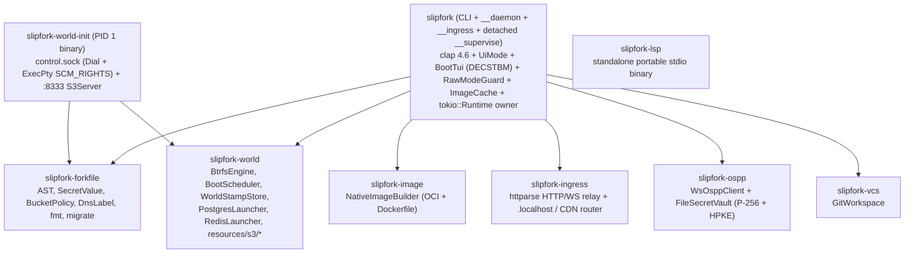
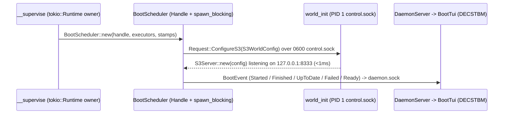
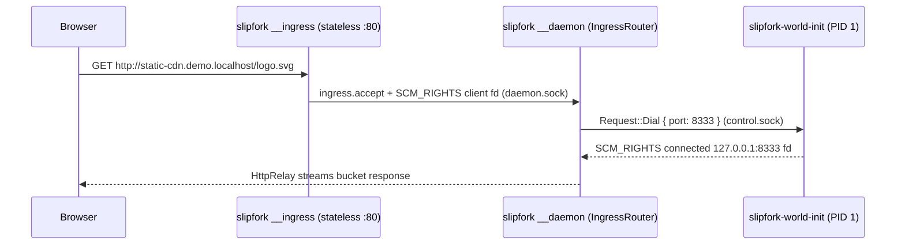

# Architecture

Slipfork runs your cloud environment locally in a box; CI is the clutch. The workspace is eight focused Rust crates wired around explicit process composition roots so Constructor IoC/DI, ANSI purity, and module boundaries are enforced by type signatures rather than convention.

<!-- sample output -->
```console
$ cargo clippy --workspace --all-targets -- -D warnings
$ slipfork up
✓ Ready -> http://demo.localhost  (<elapsed_ms>)
```



---

## 1. Explicit Composition Roots, `DECSTBM` `BootTui` & Real-PTY `shell`

Library crates contain **zero** `std::env::var`, `OnceLock`/`LazyLock`, `tokio::runtime::Runtime::new()`, or mutable `static` state; ambient OS wiring happens strictly in five composition roots:

1. **`crates/slipfork/src/main.rs` (CLI, `__daemon`, `__ingress`):** Parses `Cli` (`clap` 4.6 derive + `clap_complete` + `clap_mangen`), builds `UiMode` (`ColorTty`, `AsciiTty` for TTY `NO_COLOR`/`TERM=dumb`, `PlainPipe`, `Json`), and wires `BootTui` (`ScrollRegionGuard` VT100 `DECSTBM` `\x1b[1;{rows-1}r` + `AsciiLine`), `RawModeGuard` (`crossterm` raw mode + `SIGWINCH` `TIOCSWINSZ` for `slipfork shell <target>`), `TableLayout`, `DaemonClient`, and `DaemonServer`.
2. **Detached `__supervise` (`crates/slipfork/src/main.rs` child mode):** Owns the **single** boot `tokio::Runtime` and constructs `BootScheduler::new(handle, ...)` (`tokio::runtime::Handle`), `ImageCache` (`world/runtime/images.rs`), `PostgresLauncher`, `RedisLauncher`, `WorldStampStore`, `BtrfsEngine`, `NativeImageBuilder`, `FileSecretVault`, and `S3WorldConfig`.
3. **`crates/slipfork-world/src/bin/world_init/main.rs` (world PID 1):** Binds `0600` `<pods_dir>/control.sock`, serves `ConfigureS3`/`Dial`/`List`/`Shutdown`/`ExecPty`/`Exec`/`Logs`, and hosts `S3Server` on `127.0.0.1:8333`.
4. **`crates/slipfork-lsp/src/main.rs`:** Reads only argv and stdio so `slipfork-lsp` ships across Linux, macOS, and Windows with zero Btrfs or `crun` dependency.
5. **`packages/opencode-slipfork/src/index.ts`:** Reads `PATH`/`SYSTEMROOT` and shells the `slipfork` binary with zero embedded world logic.

| Crate | Cohesive Structs / Modules (`<= 500` LOC per file) | Port → Adapter |
| :--- | :--- | :--- |
| `slipfork` | `Cli`, `UiMode`, `BootTui` (`ScrollRegionGuard` `DECSTBM` + `AsciiLine`), `RawModeGuard`, `TableLayout` (`console` widths), `ImageCache` (`world/runtime/images.rs`), `DaemonClient`, `DaemonServer` | — |
| `slipfork-forkfile` | `ForkfileCompiler`, `SecretValue` (redacted `Debug`, zeroize-on-drop), `BucketPolicy`, `DnsLabel`, `Formatter`, `SnowMigrator` | — |
| `slipfork-world` | `BtrfsEngine`, `BootScheduler` (`Handle` + `spawn_blocking`), `WorldStampStore` (`world_epoch`), `PostgresLauncher`, `RedisLauncher`, `resources/s3/{server.rs,object_ops.rs,listing.rs,policy.rs}` (`S3Server`, `S3BucketStore`, `SigV4Verifier`), `WorldSupervisor` | `WorldEngine` → `BtrfsEngine` |
| `slipfork-image` | `NativeImageBuilder`, `OciPuller`, `DockerfileExecutor` | `BaseImageBuilder` → `NativeImageBuilder` |
| `slipfork-ingress` | `IngressRouter`, `HttpRelay` (`httparse` raw byte/WS proxy over injected `TcpListener`) | — |
| `slipfork-ospp` | `WsOsppClient`, `FileSecretVault`, `DeviceIdentity`, `DumpReader` | `OsppClient` → `WsOsppClient`, `SecretVault` → `FileSecretVault` |
| `slipfork-vcs` | `GitWorkspace` | `VcsWorkspace` → `GitWorkspace` |
| `slipfork-lsp` | `LspServer` | — |

The canonical port set is strictly `WorldEngine`, `BaseImageBuilder`, `SecretVault`, `OsppClient`, and `VcsWorkspace` — zero single-impl mock traits sit beside them.

---

## 2. Parallel Reactive `tokio` Boot DAG, Persistent Logs & `< 1.0s` Fork

`BootScheduler` executes a **reactive `tokio` task graph** using the injected `tokio::runtime::Handle` with zero phase barriers: blocking steps run via `spawn_blocking`, component output writes strictly to `<store>/logs/<world>/<id>.log` (retained across failed cold `up` and `down`, deleted on `drop`), and each node records `node_start.elapsed()` once its upstream `tokio::sync::watch` edges resolve.



- **Process-boundary S3 (`resources/s3/{server.rs,object_ops.rs,listing.rs,policy.rs}`):** `__supervise` sends `S3WorldConfig` (carrying `BucketPolicy` and `SecretValue` credentials) in one typed `Request::ConfigureS3` frame over `0600` `control.sock` — never via argv or `/proc` — and `world_init` serves HTTP/1.1 via `hyper` `1` on `:8333` (`hmac = "0.12"` + `sha2 = "0.10"`).
- **Zero-`CHECKPOINT` CoW fork, direct binary `exec` & parallel service start:** `BtrfsEngine` snapshots project, world, and `worlds/<world>.pg.<id>` subvolumes directly via `BTRFS_IOC_SNAP_CREATE_V2` (`fsync=off`, zero pre-fork SQL `CHECKPOINT`), `PostgresLauncher` and `RedisLauncher` `exec` `postgres` and `redis-server` directly (bypassing `docker-entrypoint.sh`), and when `world_epoch` stamps match, `ImageCache` reuses parent `image` subvolumes (`cached`, `~1ms`) while `--no-sync` services spawn **in parallel** with `pg` and `redis` (gating service spawn behind resource readiness only when a hook is stale or unstamped).

---

## 3. Dual Control Sockets (`daemon.sock` & `control.sock`), Real-PTY `SCM_RIGHTS` & `:80` Ingress

| Socket (`0600`) | Direction & `SCM_RIGHTS` | Canonical Frames |
| :--- | :--- | :--- |
| `<runtime_dir>/daemon.sock` | CLI / `__ingress` → `__daemon`; `SCM_RIGHTS` passes `:80` client fd on `ingress.accept` (`__ingress` → `__daemon`) and `/dev/pts/N` master fd on TTY `shell` (`__daemon` → CLI). | `{"v":1,"id","method","params"}` → streamed `event` frames (`started`, `log`, `finished`, `up-to-date`, `failed`, `ready`, `stopped`) → final `ok` or `error`. |
| `<pods_dir>/control.sock` | `__supervise` / `__daemon` → PID 1 `world_init`; `SCM_RIGHTS` returns connected world-netns stream fd on `Dial` and `crun exec --tty --console-socket` PTY master fd on `ExecPty` (`world_init` → `__daemon`). | `ConfigureS3`, `Dial { port }` (incl. `:8333` CDN), `List`, `Shutdown`, `ExecPty` (`"terminal": true`), `Exec` (piped), `Logs` (`<store>/logs/<world>/<id>.log`). |



!!! warning "One direction per socket, strict crate layering"
    Clients connect to `daemon.sock` and `__daemon`/`__supervise` connect to `control.sock`; neither server ever dials back, and library crates never depend on `slipfork` or each other's internals.
