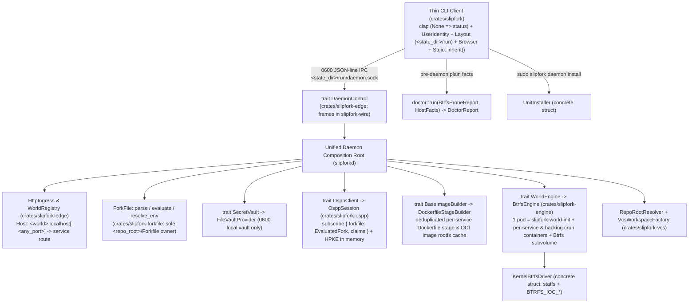

# Slipfork Technical Architecture (`ARCHITECTURE.md`)

This document is the authoritative specification of Slipfork's **Composition Root**, **Inversion of Control / Dependency Injection (IoC/DI) Tree**, crate boundaries, wire protocols, and execution invariants (`docs/design/forkfile.md`, `docs/design/dx-cli-0.1.0.md`, `docs/design/ospp.md`, `ADR-0001`..`ADR-0011`).

The single Btrfs pod engine over concrete `KernelBtrfsDriver` (`ADR-0010` §§3–5), per-service OCI/Dockerfile rootfs builder (`ADR-0009`), `Forkfile` parser/static-checker/evaluator (`crates/slipfork-forkfile`, `docs/design/forkfile.md`), local `0600` file vault (`FileVaultProvider`), OSPP v1 live subscription/dump client (`docs/design/ospp.md`), VCS workspace drivers, and language-blind `STP v1` test orchestrator (`0.2.0`) plug into the port tree below with **zero** global state, ambient OS/env reads in library crates, downcasts, single-impl mock traits, or fallback hacks. **All domain traits are 100% synchronous (`std::net`, `UnixStream`, synchronous `tungstenite` over `rustls` + `webpki-roots`, `std::thread` — zero `tokio`, and remote OSPP secrets never touch disk).**

---

## 1. Composition Root & Constructor DI Tree

> **Cargo Feature & Test-Scaffolding Rule (normative):** Cargo features are reserved for language/platform modularity; test scaffolding (`slipfork-testkit`, `slipfork-ospp-testkit`) lives strictly in `#[cfg(test)]`, `tests/support/`, or `publish = false` workspace crates in `[dev-dependencies]` — never behind a Cargo `[features]` flag on a production crate.

Only **two entrypoints** in the repository wire concrete adapters from ambient environment variables, OS sockets, or real filesystems:

1. **Rust CLI & Unified User Daemon Composition Root (`crates/slipfork/src/main.rs` + `crates/slipfork/src/bin/slipforkd.rs`):**
   - `slipforkd` runs unprivileged as `User=<developer-user>` (socket-activated on `:80` via `slipfork daemon install`, `ADR-0011` §1, or auto-spawned on `--listen 127.0.0.1:0` strictly by `slipfork up` and `slipfork fork`), receives explicit `--state-dir` and `--runtime-dir` (`<state_dir>/run`), binds `<runtime_dir>/daemon.sock` (`0600`) plus `<state_dir>/http-ingress.sock` (`0600`), provisions static `crun` (`runtime_assets`), injects one `OsppEndpoint` authority, and wires all stateful domain ports in-process: `BtrfsEngine` (`KernelBtrfsDriver::new()`), `DockerfileStageBuilder` (`BaseImageBuilder`), `FileVaultProvider` behind `SecretVault` / `SecretProvider`, `WsOsppClient` (`OsppClient` -> `OsppSession`), `VcsWorkspaceFactory` + `RepoRootResolver` (with `ForkfileSlugOverride`), and `Browser`.
   - Thin client `slipfork` (`crates/slipfork/src/main.rs`) parses `clap` (`None => status`, `docs/design/dx-cli-0.1.0.md`), resolves `UserIdentity`, `Layout`, `Browser`, and `$SSH_CONNECTION` once at the CLI boundary, runs pre-daemon `doctor` over concrete `KernelBtrfsDriver` + `OsHostProbe` + `SystemdIngressProbe`, drives `UnitInstaller` for `daemon install`, talks to `slipforkd` over `<state_dir>/run/daemon.sock`, and enters per-service `crun` containers directly inheriting native `Stdio::inherit()`.
2. **OpenCode V2 Plugin Composition Root (`packages/opencode-slipfork/src/index.ts`):** Queries `slipfork status --json`, forks worktrees via `ctx.worktree.transform`, and routes shell calls via `slipfork exec` without resolving `Forkfile` secrets itself (`ADR-0004`).

### Surviving Architectural Port Traits (Complete Set — Zero Single-Impl Mock Traits)

| Port trait | Canonical owner | Production adapter | Wired at |
|---|---|---|---|
| `WorldEngine` | `slipfork-world` (port) / `slipfork-engine` (`BtrfsEngine`) | `BtrfsEngine` | `slipforkd` |
| `BaseImageBuilder` | `slipfork-engine::rootfs` | `DockerfileStageBuilder` | `slipforkd` |
| `SecretVault` | `slipfork-edge` | `FileVaultProvider`-backed vault | `slipforkd` |
| `SecretProvider` / `EntropySource` / `ExternalCheck` | `slipfork-forkfile` | `FileVaultProvider` / `OsCsprngEntropy` / CI or daemon catalog | `slipforkd` & Kerfufoo |
| `DaemonControl` | `slipfork-edge` (wire types in `slipfork-wire::control`) | `DaemonService` | `slipforkd` |
| `OsppClient` -> `OsppSession` | `slipfork-ospp` | `WsOsppClient` | `slipforkd` |
| `DeviceKeySigner` / `DeviceKeyStore` | `slipfork-ospp` | `SoftwareP256Signer` / `FileDeviceKeyStore` | `slipforkd` |
| `VcsWorkspace` / `VcsWorkspaceFactory` | `slipfork-vcs` | `GitWorktreeAdapter` / `JjWorkspaceAdapter` | `slipforkd` |
| `RepoRootResolver` / `ProjectSlugOverride` | `slipfork-vcs` | Git/Jujutsu discovery + `Forkfile` `project <slug>` | `slipforkd` |
| `ArtifactStore` (`0.2.0`) | `slipfork-test` | `BtrfsArtifactStore` | `0.2.0` orchestrator |

Everything else (`KernelBtrfsDriver`, `OsHostProbe`, `SystemdIngressProbe`, `UnitInstaller`, `Browser`, `Layout`, `UserIdentity`, `Duration`, `Instant`) is a concrete struct or plain value — never a mock-only trait.



---

## 2. Crate & Package Boundaries

| Crate / Package | Purity & `unsafe` Policy | Owned Domain Ports & Responsibilities |
|---|---|---|
| `crates/slipfork-world` | `#![forbid(unsafe_code)]`; `serde`, `thiserror`, `sha2`, `hex`; zero FS/process/env/net bind | `ProjectSlug` (local only), `WorldTarget { Canonical, UserFork, TestSlot }`, `WorldId` (`<project>` / `<project>:<fork>`), `LocalHostRoute` (strips `:<any_port>` so SSH `-L` `:8080` routes seamlessly), untagged `WorldOrigin(LocalOrigin)`, `WeaverServiceName` (`<= 31` bytes), `merkle::*`, `WorldEngine` port & pod/service/log/lineage value types (`PodRootfs`, `OciRootfs`, `ServiceSpec`, `ExecEnv`, `LogEntry`, `WorldLineage`, `WorldEntryCommand`) |
| `crates/slipfork-forkfile` *(replaces `slipfork-snow` & `slipfork.toml`)* | `#![forbid(unsafe_code)]`; depends on `slipfork-world`, `serde`, `serde_json`, `thiserror`; zero ambient `env`/`net`/clock | Sole owner of `<repo_root>/Forkfile` (`docs/design/forkfile.md`): lexer/parser with `Span { offset, len, line, col }`, whole-file multi-error static checker across **all** `on` branches, rustc-style caret `Diagnostic` renderer, canonical JSON round-trip (`ForkFile` <-> JSON for Kerfufoo `Spec.spec`), `FeatureSet` (`-F` / `--no-default-features`), `evaluate(&FeatureSet) -> EvaluatedFork`, `ExternalCheck`, `Resolvers` (`app.*`, `deployment.*`, `<db>.*`, `<redis>.*`, `<s3>.*`, `<domain>.*`, `<service>.*`, `var(...)`, `secret(...) ?? <gen>`), word-split-safe `$port`/`$env.KEY`/`$<entity>.<prop>` `argv` interpolation, `TaintedString` secret contamination (`NissaString` 1:1 parity), `SecretProvider`, `EntropySource`, and `FileVaultProvider` (`0600` local vault) |
| `crates/slipfork-dag` | `#![forbid(unsafe_code)]`; depends on `slipfork-world`; zero `std::env`/clock | `ResourceMode { Local, Test }`, `ResourceStrategy { Local, PreferRemote, Remote }`, `DumpPolicy`, `ResourcePlan::resolve`, and `0.2.0` `DagPlanner` / `InputHasher` / `DigestCache` / `TestSpec` (`slipfork.toml` and `WorldImageConfig` deleted) |
| `crates/slipfork-ospp` | `#![forbid(unsafe_code)]`; sync `tungstenite` + `rustls` + `webpki-roots`, `p256`, `hpke`, `zstd`; zero `tokio`, zero `std::env`, zero secret disk writes | `OSPP v1` client (`docs/design/ospp.md`): `OsppEndpoint`, `OsppClient` + `OsppSession` (`pair`, `connect` -> `subscribe`, `dump`, `unsubscribe`, `close`), `SubscribeRequest { id, remote, forkfile: EvaluatedFork, claims }`, `DeviceKeySigner`/`DeviceKeyStore` (`0600` machine key only), per-subscription in-memory `hpke-p256` decryption (`ospp-v1-secret`) and `SetupBaseR` streaming dump reader (`ospp-v1-dump`) |
| `crates/slipfork-wire` | `#![forbid(unsafe_code)]`; `serde`, `serde_json`, `thiserror`, `slipfork-world`; zero CLI/OS state | Bounded 64 KiB JSON-line `DaemonRequest`/`DaemonReply` control framing (`<state_dir>/run/daemon.sock`) and 16 KiB duplex `relay` |
| `crates/slipfork-engine` | `unsafe` confined strictly to `src/btrfs.rs` (`KernelBtrfsDriver`) and `src/linux_cow.rs` (`uid/gid`, `signal_process`, `SCM_RIGHTS` `send_fd`/`recv_fd`) with `// SAFETY:` proofs; `#![forbid(unsafe_code)]` everywhere else | **Per-Service `crun` Pod `BtrfsEngine`** (`ADR-0009`, `ADR-0010`): one unified Btrfs subvolume per world (`state/{pgdata,redis,s3}`, `volumes/<service>/<sanitized_path>`, `home`), persistent `slipfork-world-init` pod PID 1 (`userns + netns + ipcns`, `127.0.0.1` + `:80` ingress bridge + `/.slipfork/bin/crun`), daemonless `crun` OCI supervision for **both** `Forkfile` services and backing resources (`postgres:<v>`, `redis:<v>`, `seaweedfs`), chronological merged log ring + live follow across restarts, `ReadinessProbe`, and `DockerfileStageBuilder` (`BaseImageBuilder` deduplicating `(./dir, dockerfile, stage, build_env)` & `from <image_ref>` caches) |
| `crates/slipfork-edge` | `#![forbid(unsafe_code)]`; `listenfd`, `httparse`, `slipfork-world`, `slipfork-wire` | `adopt_systemd_listener` / `--listen`, `.localhost` HTTP/WS ingress (accepting `Host: <route>.localhost[:<any_port>]` and routing prefix + `sub.*` subdomain `Forkfile` routes to service ports via `dial_world_tcp`), `UnitSpec` renderer, `WorldRegistry`, `trait SecretVault`, and `DaemonService: DaemonControl` |
| `crates/slipfork-vcs` | `#![forbid(unsafe_code)]`; `slipfork-world`, `serde`, `thiserror` | `ProjectSlugOverride` (wired over `ForkFile.project`), `RepoRootResolver` (VCS root + verbatim Git `origin` remote), `VcsWorkspaceFactory` (`GitWorktreeAdapter` + `JjWorkspaceAdapter`, dirty-worktree inspection for `drop` guard, branch derivation), and `git-remote-slipfork` |
| `crates/slipfork-test` (`0.2.0`) | `#![forbid(unsafe_code)]` | Language-blind `STP v1` DAG orchestrator (`ADR-0006` §3) and `BtrfsArtifactStore` |
| `crates/slipfork` | `#![forbid(unsafe_code)]` | `slipforkd` (stateful daemon Composition Root) and `slipfork` (clean-sheet `0.1.0` CLI client, `docs/design/dx-cli-0.1.0.md`) |
| `packages/opencode-slipfork` | TypeScript OpenCode V2 plugin | Queries `slipfork status --json`, forks worktrees implicitly, and routes shell commands via `slipfork exec` |

---

## 3. Core Contracts, Pod Execution & Wire Alignment

### 3.1 `Forkfile` Engine, Static Checker & Two-Tier Secrets (`crates/slipfork-forkfile`, `crates/slipfork-edge`, `docs/design/forkfile.md`)

1. **Whole-File Static Check & `SnowFile`-Compatible Workflow:**
   - `parse_forkfile(source: &str) -> Result<ForkFile, Vec<Diagnostic>>` parses `<repo_root>/Forkfile`, records `1`-based `Span { offset, len, line, col }` on every token/AST node, and validates **every branch (including inactive `on <feat>` blocks)** without stopping on the first error: duplicate IDs across all namespaces, `postgres <cluster> { database <db> }` vs `<db>.<prop>` misuse (`pg.url` suggests `<db>.url`), all 8 `<db>` properties / 6 `<redis>` properties / `s3` / `domain` / `service` / `app` / `deployment` paths, unknown features, `$port` / `$env.KEY` / `$<entity>.<prop>` `argv` references, port bounds, and `build_env` vs `env` conflicts.
   - `ForkFile` serializes losslessly to/from canonical JSON (`serde`), exposes `validate(&self, external: &dyn ExternalCheck)`, `find_service` / `find_image` / `find_pg_cluster` / `find_pg_database` / `find_redis_cluster` / `has_id`, evaluates active Cargo-style features via `evaluate(&FeatureSet) -> Result<EvaluatedFork, Vec<Diagnostic>>`, and resolves per-service environments (including partial/claimed OSPP overlays) exclusively inside `EvaluatedFork::resolve_env(service_id, &Resolvers) -> Result<BTreeMap<String, TaintedString>, Vec<Diagnostic>>` — downstream crates never scan `Forkfile` expressions.
   - Any expression touching `secret(...)` or a secret resource property (`password`, `secret_key`, `url`, `jdbc`) taints the resulting `TaintedString` (1:1 with Kerfufoo's `NissaString`), redacting `[REDACTED]` in `Debug`, `slipfork env` (without `--reveal`), hook progress, and error logs.
2. **Two-Tier Secret Boundary (`SecretVault` vs In-Memory OSPP):**
   - **Tier 1 — Local `0600` Vault (`trait SecretVault` -> `FileVaultProvider`):** Stores strictly local backing-service passwords, `slipfork secret set` overrides, and local `secret(<KEY>) ?? <generator>` write-once values (`<data_home>/slipfork/vaults/<project>.json`, `0600`). `SecretVault::keys(project)` plus locally-provisioned resources/domains automatically populate ID-only `OsppClaims`.
   - **Tier 2 — Remote OSPP Secrets (`OsppSession`, memory only):** Unclaimed `Forkfile` `vars`, `secrets`, and cloud resource properties are resolved by Kerfufoo over `ospp-v1` (`docs/design/ospp.md`). Secret-tainted values arrive sealed with RFC 9180 `hpke-p256` (`{ "encrypted": "<base64>" }`), are opened strictly in `slipforkd` memory using a per-subscription ephemeral keypair (`S=` zeroized on `Drop`), and **never touch disk**.

### 3.2 `OSPP v1` Subscription & Streaming Dump Contract (`crates/slipfork-ospp`, `docs/design/ospp.md`)

`docs/design/ospp.md` is the sole normative wire specification (`Sec-WebSocket-Protocol: ospp-v1`, closed `#[serde(tag = "type", rename_all = "snake_case")]` JSON text frames, `p256` auth, `#handle=` fragment pairing, `hpke-p256` `ospp-v1-secret` & `ospp-v1-dump`):

```rust
pub struct SubscribeRequest {
    pub id: String,              // stable per-project subscription id
    pub remote: String,          // verbatim Git `origin` remote string ONLY
    pub forkfile: EvaluatedFork, // active feature-evaluated Forkfile JSON (zero client feature flags needed on server)
    pub claims: OsppClaims,      // ID-only local claims (vars, secrets, resources, domains, components)
}
```

- Editing `Forkfile`, changing `-F` features (`restart`), or mutating `SecretVault` re-sends `subscribe` with the same `id`; live `env_updated` pushes decrypt in memory, resolve claimed local expressions via `EvaluatedFork::resolve_env`, update `ExecEnv` via `WorldEngine::update_service_env`, and restart affected service containers (emitting a `event: restarted` marker so `slipfork logs -f` stays attached seamlessly).
- `OsppSession::dump` streams `HTTPS GET` through stateful `SetupBaseR` (`info = "ospp-v1-dump"`, `aad = "<subscription_id>:pg_databases.<db_id>"`) directly into `zstd -d | pg_restore` inside the seed pod's `postgres:<v>` `crun` container followed by `CHECKPOINT;` and `WorldEngine::freeze_world` — zero plaintext dump bytes on disk.

### 3.3 Per-Service `crun` Pod Engine & Unified Btrfs Subvolumes (`crates/slipfork-engine`, `ADR-0009`, `ADR-0010`)

```text
<state_dir>/                                         # Btrfs mount (-o user_subvol_rm_allowed,noatime)
├── cache/runtime/crun-<ver>-<arch>-<sha12>.bin      # SHA-256-pinned static crun
├── cache/{rootfs,oci}/<digest>/rootfs/              # deduplicated $UID:$GID RO container rootfses
├── snapshots/<snapshot_id>/                         # sealed RO Btrfs subvolumes (<project>-base-<sha12>, stages)
├── worlds/<world_id>/                               # ONE writable Btrfs subvolume per live pod
│   ├── state/{pgdata/<cluster>,redis/<id>,s3}/      # RW backing-service data
│   ├── volumes/<service>/<sanitized_rel_path>/      # RW CoW volumes (e.g. .venv, node_modules)
│   └── home/                                        # RW /.slipfork/home
└── ctl/<world_id>/                                  # ephemeral pod control dir (0700, outside subvolume)
    ├── netns.sock (0600)  world-init.json (0600)  init.ready
    ├── pod-root/                                    # minimal pod root staging /.slipfork/bin/crun
    ├── oci/<service_id>/{config.json,mountpoints,rootfs}/
    └── oci-run/                                     # crun --root runtime state
```

1. **Pod Sandbox + Per-Service `crun` Containers:**
   - `slipfork-world-init` spawns under `unshare --user --map-user=$UID --map-group=$GID --keep-caps --mount --net --ipc --pid --fork --kill-child=SIGKILL --mount-proc` with an `O_CLOEXEC` `stdin` lifeline, brings up `lo` (`127.0.0.1`), binds `:80` `$BASE_URL` -> `<state_dir>/http-ingress.sock` and `<control_dir>/netns.sock` (`SCM_RIGHTS` `dial_world_tcp`), and stages `/.slipfork/bin/crun` (`ADR-0010` §§6–7).
   - Every `Forkfile` `service` (`ImageSource::Dockerfile { context_dir, dockerfile, stage, build_env }` or `ImageSource::OciImage { image_ref }`) and every backing resource (`postgres:<v>` default `18`, `redis:<v>` default `7`, digest-pinned `seaweedfs`) runs as its own daemonless `crun` container (`readonly: true` two-lowerdir `userxattr` OverlayFS over `<cache_rootfs>`, `[user, pid, mount, ipc, uts]` with identity `$UID:$GID` maps + synthesized `/etc/passwd` & `/etc/group`, sharing the pod's `127.0.0.1` `netns`).
   - Inside each `service` container, host `<worktree>` is live `MS_BIND`-mounted RW, and each declared `volume <rel_path>` mounts `<subvol>/volumes/<service>/<sanitized_path>` RW over `<worktree>/<service_dir>/<rel_path>` (hydrated once from image `<workdir>/<rel_path>` on initial creation if present, populated by `setup`, and cloned in ~20 ms on `slipfork fork`).
   - Direct `execve` lifecycle hooks (`setup`, `pre-deploy`, `post-deploy`, `failed-deploy`) and `task <name> in <service>` run sequentially inside that service's container environment without `/bin/sh -c` wrappers, failing fast on non-zero exit with `Forkfile:<line>`.
2. **Base Key & Retention:**
   - `BaseKey::derive` hashes `"slipfork-base:v3\0"` over `project`, sorted `(service_or_backing_id, rootfs_digest)` pairs across the pod, and sorted `(pg_database_id, "clean" | dump_sha256)` pairs, naming `<project>-base-<sha12>`. `DaemonService::prune` retains `BaseKey`s and `CacheKeepSet` digests across all live worlds and snapshots before calling `prune_snapshots` and `BaseImageBuilder::prune_cache`.

### 3.4 `.localhost` Edge Routing & Clean-Sheet `0.1.0` CLI (`crates/slipfork-edge`, `crates/slipfork`, `docs/design/dx-cli-0.1.0.md`)

- **Port-Agnostic `.localhost` Host & Subdomain Routing:** `HttpIngress` (`httparse` `<= 16 KiB`) strips any `:<port>` suffix on `.localhost` `Host` headers (`Host: demo.localhost:8080`, `Host: mail.demo.localhost:8080`, `Host: feat.demo.localhost:8080`) so `slipfork open --remote [-p 8080]` SSH `-L` tunnels work in any browser without proxy configuration, dispatching `route <sub.*>` subdomain rules and longest-prefix `route /prefix` rules to each service handle's active `port`.
- **Single Normative `0.1.0` CLI Contract (`docs/design/dx-cli-0.1.0.md`):**
  - Bare `slipfork` (`= status`) renders the visual pod/fork tree (`○ No worlds running`, exit `0` when idle, without auto-spawning `slipforkd`); `ps` scopes that tree to `cwd`'s world (`list`, `snow resolve`, `hook run`, `dag`, `share`, and `support` do not exist).
  - `down` and `drop` fail closed (`exit 1`) on unknown world/fork selectors, and `drop [fork]` defaults to `cwd` when inside a fork worktree while enforcing a dirty-worktree guard unless `-f/--force`.
  - `logs [target...] [-f] [-n N]` merges `stdout` + `stderr` chronologically from the engine's timestamped log ring, multiplexes targets with aligned `<target> │ ` gutters, and keeps `-f` subscriptions open across `restart` / `down`+`up` cycles (`── restarted … ──`).
  - `shell [service]`, `exec [-s <service>] <cmd...>`, `run <task> [args...]`, and `env [-s <service>] [--reveal]` auto-select the service when unambiguous (`1` service in `Forkfile` or `cwd` inside `<worktree>/<service_dir>`) and enter the running or materialized service container directly; `db` and `redis` support both interactive TTY and piped non-TTY `stdin`.
