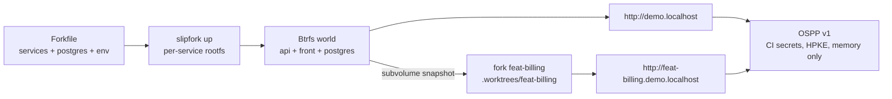

# Slipfork (`0.1.0`)

**Slipfork runs your cloud environment locally in a box; CI is the clutch.** One `Forkfile` gives every developer and every coding agent an instant copy-on-write world: your services, PostgreSQL, Redis, S3, and a port-less `.localhost` URL.

```console
$ sudo slipfork daemon install   # one time: :80 socket activation + AppArmor userns profile
$ slipfork up                    # build each service rootfs, boot the canonical world
$ slipfork fork feat-billing     # 11–24 ms writable clone + .worktrees/feat-billing
$ slipfork status                # one origin URL per world
$ slipfork open -w feat-billing  # browser: http://feat-billing.demo.localhost
```

```text title="Forkfile"
project demo

postgres pg { database app_db }

service api ./api {
    port 8000
    route /api
    env { DATABASE_URL = app_db.url }
    run .venv/bin/uvicorn app.main:app --host 0.0.0.0 --port $port
}

service front ./front {
    port 5173
    route /
    run npm run dev -- --host 0.0.0.0 --port $port
}
```

A fork copies the files **and** the running stack: its own Btrfs subvolume starts from the canonical world's sealed base, then diverges — PostgreSQL rows, Redis keys, S3 objects, and ports included.

!!! warning "Before the first `up`"
    The state directory (`~/.cache/slipfork` by default) must be Btrfs mounted `user_subvol_rm_allowed,noatime` and owned by you. `slipfork doctor` prints the exact `mount` line and exits `1` on any other filesystem.

!!! info "Ubuntu 24.04"
    `sudo slipfork daemon install` also writes and loads `/etc/apparmor.d/slipfork`, which grants the `userns` access stock kernels deny. Pass `--bin-dir` once per directory that holds the binaries.

## How it fits together



## Everyday commands

| Command | What it does |
|---|---|
| `slipfork up` | Boot or confirm the world selected by `--world` or `cwd` |
| `slipfork fork <name>` | Git worktree (or Jujutsu workspace) plus its own Btrfs world |
| `slipfork status` | Every running world with state and exactly one URL |
| `slipfork ps` | Every service and `crun` container of one world |
| `slipfork exec -s <svc> -- <cmd>` | Run a command inside a service with its resolved environment |
| `slipfork run <task>` | Run a `Forkfile` task inside its service |
| `slipfork shell <service>` | Interactive shell inside a service container |
| `slipfork db <id>` / `slipfork redis <id>` | `psql` / `redis-cli` inside the running container |
| `slipfork restart` | Re-run the boot pipeline after editing code or hooks |
| `slipfork down` / `slipfork drop` | Stop a world / destroy a fork world and its checkout |

Run bare `slipfork` for the same fleet tree as `status`; `--json` emits the document agents read.

## What ships in `0.1.0`

- `Forkfile`: a procedural manifest with whole-file static checking, features, `on` conditionals, env groups, tasks, and rustc-style diagnostics.
- Read-only per-service rootfs built from each service's `Dockerfile`, cached content-addressed, executed as `$UID:$GID`.
- One unprivileged Btrfs subvolume per world; sealing and cloning are metadata-only.
- Daemonless `crun` containers: every `service`, plus `postgres:<v>`, `redis:<v>`, and SeaweedFS on the world's `127.0.0.1`.
- `secret(KEY) ?? <generator>` write-once secrets in a local `0600` vault, tainted end to end.
- OSPP v1 CI secrets over HPKE, decrypted in `slipforkd` memory; pair once, reconnect from `<state_dir>/ospp.json`.
- OpenCode V2 plugin: a worktree becomes a world; shell commands route through `slipfork exec`.
- `git-remote-slipfork`: fetch a running fork's branch over `slipfork://<fork>`.
- `slipfork lsp` for `Forkfile` diagnostics, and `slipfork migrate` for upstream Snow manifests.

## Measured cost model

| Operation | Measured |
|---|---:|
| Read-only snapshot of a world subvolume | **`19.5 ms`** |
| Writable clone of a world | **`11–24 ms`** |
| Clone to a warm-SQL world | **`39 ms`** |
| RAM per running world | **`6.3 MiB`** |

Owner-recorded; method and caveats in `docs/research/btrfs-crun-benchmarks.md`.

## Documentation

- [Getting started](docs/getting-started.md)
- [The `Forkfile`](docs/forkfile.md)
- [OpenCode V2 plugin](docs/agents-and-opencode.md)
- [CLI reference](docs/reference/cli.md) · [`Forkfile` reference](docs/reference/forkfile.md) · [Secrets & OSPP v1](docs/reference/ospp.md)

Build the site with `make docs-check`; it runs Zensical `--strict` and a CLI-honesty check.
