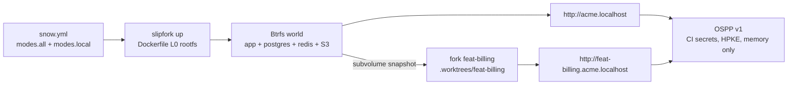

# Slipfork (`0.1.0`)

**Slipfork runs your cloud environment locally in a box; CI is the clutch.** One `snow.yml` gives every developer and every coding agent an instant copy-on-write world: your app, PostgreSQL, Redis, S3, and a port-less `.localhost` URL.

```console
$ sudo slipfork daemon install   # one time: :80 socket activation + AppArmor userns profile
$ slipfork up                    # build the rootfs, boot the canonical world
$ slipfork fork feat-billing     # 11–24 ms writable clone + .worktrees/feat-billing
$ slipfork list                  # one origin URL per world
$ slipfork open                  # browser: http://acme.localhost
$ slipfork open --world feat-billing
```

A fork copies the files **and** the services: its own Btrfs subvolume starts from the canonical world's sealed base, then diverges — PostgreSQL rows, Redis keys, S3 objects, and ports included.

!!! warning "Before the first `up`"
    The state directory (`~/.cache/slipfork` by default) must be Btrfs mounted `user_subvol_rm_allowed,noatime` and owned by you. `slipfork doctor` prints the exact `mount` line and exits `1` on any other filesystem.

!!! info "Ubuntu 24.04"
    `sudo slipfork daemon install` also writes and loads `/etc/apparmor.d/slipfork`, which grants the `userns` access stock kernels deny. Pass `--bin-dir` once per directory that holds the binaries.

## How it fits together



## Everyday commands

| Command | What it does |
|---|---|
| `slipfork up` | Boot or confirm the world selected by `--world` or `cwd` |
| `slipfork fork <name>` | Git worktree (or Jujutsu workspace) plus its own Btrfs world |
| `slipfork list` | One row per world with state and exactly one URL |
| `slipfork ps` | Components and `crun` services of one world |
| `slipfork exec -- <cmd>` | Run a command inside the world with its resolved environment |
| `slipfork shell` | Interactive shell inside the world |
| `slipfork db <id>` / `slipfork redis <id>` | `psql` / `redis-cli` inside the running service container |
| `slipfork restart` | Re-run the boot pipeline after editing code or hooks |
| `slipfork down` / `slipfork drop` | Stop a world / destroy a fork world and its checkout |

Run bare `slipfork` for `status`: daemon ingress, every world, and the next command.

## What ships in `0.1.0`

- Read-only `L0` rootfs built from your `Dockerfile`, cached content-addressed, executed as `$UID:$GID`.
- One unprivileged Btrfs subvolume per world; sealing and cloning are metadata-only.
- Daemonless `crun` backing services: `postgres:<v>`, `redis:<v>`, SeaweedFS on the world's `127.0.0.1`.
- `snow.yml` modes (`all` plus named modes), `??` fallbacks, write-once `!!` secrets in a local `0600` vault.
- OSPP v1 CI secrets over HPKE, decrypted in `slipforkd` memory; pair once, reconnect from `<state_dir>/ospp.json`.
- OpenCode V2 plugin: a worktree becomes a world; shell commands route through `slipfork exec`.
- `git-remote-slipfork`: fetch a running fork's branch over `slipfork://<fork>`.

## Measured cost model

| Operation | Measured |
|---|---:|
| Read-only snapshot of a world subvolume | **`19.5 ms`** |
| Writable clone of a world | **`11–24 ms`** |
| Clone to a warm-SQL world | **`39 ms`** |
| RAM per running world | **`6.3 MiB`** |

Owner-recorded; method and caveats in [`docs/research/btrfs-crun-benchmarks.md`](docs/research/btrfs-crun-benchmarks.md).

## Documentation

- [Getting started](docs/getting-started.md)
- [`snow.yml` modes & secrets](docs/snow-modes.md)
- [OpenCode V2 plugin](docs/agents-and-opencode.md)
- [CLI reference](docs/reference/cli.md) · [Secrets & OSPP v1](docs/reference/ospp.md) · [Manifest reference](docs/reference/manifest.md)

Build the site with `make docs-check`; it runs Zensical `--strict` and a CLI-honesty check.
