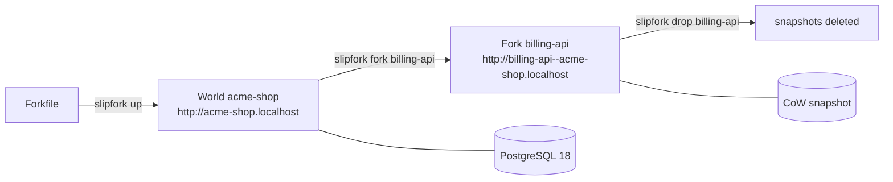

# Slipfork

**Your cloud environment locally in a box; CI is the clutch.**

Slipfork turns one `Forkfile` into your whole stack — container images, PostgreSQL, Redis, S3
buckets and background workers — behind one `.localhost` URL. It runs natively on Btrfs with
`crun`, so there is no Docker daemon and no shared staging box.

```console
$ curl -fsSL https://offworldnexus.github.io/slipfork/install.sh | sh
$ slipfork up
✓ Ready -> http://acme-shop.localhost

$ slipfork fork billing-api
✓ Forked billing-api (0.8s) -> http://billing-api--acme-shop.localhost
```

## One file declares the topology

```forkfile
# forkfile: 0.1

domain main
postgres pg { database app_db }
redis cache
s3 uploads

env common {
  DATABASE_URL = app_db.url
  REDIS_URL    = cache.url
  SECRET_KEY   = secret(SECRET_KEY) ?? random_hex(32)
}

image api . {
  use env common
  service web {
    port 8000
    route /api
    run: @uv run uvicorn app.main:app --host 0.0.0.0 --port $port
  }
}
```

Services live inside the image that runs them, runtime `env` stays separate from build-time `arg`s,
and `@uv` / `@pnpm` wire lockfile-watched installs automatically.

The `0.8s` fork is the whole operation: `≤50ms` snapshotting and the rest booting the cloned stack.
Branch off, test a risky migration, and the parent world keeps serving.

[Get started](docs/getting-started.md) · [The Forkfile](docs/forkfile.md)

## Worlds and forks

A **world** is the running stack declared by one `Forkfile`. A **fork** is an atomic copy-on-write
snapshot of that world and your checkout, booted on its own URL.



Because `.venv`, `node_modules`, database pages and bucket objects already exist on Btrfs, the fork
costs a snapshot rather than a rebuild.

| Verb | What it does |
| :--- | :--- |
| `slipfork up` | Boot the world and print `✓ Ready -> <url>` |
| `slipfork fork feat-auth` | Snapshot code and data, boot a fork on its own URL |
| `slipfork drop feat-auth` | Stop the fork and delete its snapshots |
| `slipfork status` | One tree of every world and domain, forks included |
| `slipfork logs -f api` | Stream merged logs with per-service gutters |
| `slipfork shell pg` | Real PTY `psql`; `shell api` for bash, `shell cache` for redis-cli |
| `slipfork down` | Stop the world, keep the data subvolumes |

## Requirements

`slipfork` needs a Linux host with a Btrfs filesystem and `crun` on `PATH`. `slipfork doctor` checks
exactly those things and prints one `next:` remedy per failing row — zero Docker required anywhere.

!!! warning "Editors on macOS and Windows"

    The `slipfork` CLI is Linux-only because worlds need Btrfs and Linux namespaces. The standalone
    `slipfork-lsp` language server has no such dependency and ships for Linux, macOS and Windows.

## Documentation

* [Getting started](docs/getting-started.md) — install, Forkfile, `up`, `fork`, `drop`, `down`.
* [Install](docs/install.md) — `.deb`, `.rpm`, pacman, APK, the daemon and the `:80` ingress.
* [The Forkfile](docs/forkfile.md) — the complete `# forkfile: 0.1` language.
* [CLI](docs/cli.md) — daily verbs, domain trees, progress and `NO_COLOR`.

Release history lives in [CHANGELOG.md](CHANGELOG.md).
