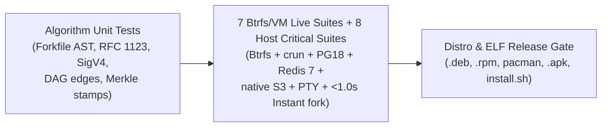

# The Slipfork Testing Plan

Slipfork runs your cloud environment locally in a box; CI is the clutch. Canonical root copy of [`specs/04-testing-plan.md`](./specs/04-testing-plan.md) (alongside [01 `Forkfile`](./specs/01-forkfile.md), [02 CLI UX](./specs/02-cli-ux.md), [03 Under the Hood](./specs/03-under-the-hood.md), [05 `OSPP v1`](./specs/05-ospp-v1.md), and [06 Distribution & Docs](./specs/06-distribution-and-docs.md)) — proven against real Btrfs subvolumes, `crun`, PostgreSQL 18, Redis 7, native Rust S3, and PTYs.

```console
$ tools/do_vm.py sync && tools/do_vm.py test
$ SLIPFORK_TEST_ROOT=/mnt/slipfork-live make live-test
```



!!! warning "Zero mocks & real disk only (never RAM `/tmp`)"
    `Mock*`, `Fake*`, `Stub*`, `Recording*`, in-memory vaults, `sleep()` benchmark simulations, and `chmod 0o555` shims are banned; the only stand-in is the minimal `127.0.0.1:0` loopback `OSPP v1` reference server. Heavy test state (worktrees, OCI caches, `PGDATA`, Btrfs subvolumes, Cargo scratch) must live on real disk under `/var/tmp`, `~/.cache/slipfork`, `.slipfork/`, or the Btrfs mount — never on RAM-backed `/tmp` `tmpfs` — and `SLIPFORK_TEST_ROOT` must resolve to a real Btrfs disk path.

---

## 1. Enclosing `image` Scopes, Native Rust S3 & Ingress Parity

- **Enclosing `image` builds, non-secret `arg` vs runtime `env`, and OCI pulls (`critical_dockerfile_live`, `critical_oci_live`):** Build a multi-stage `Dockerfile` `image <id> <dir> { ... }` (`FROM ... AS`, `ARG`, `COPY --from`, `RUN --mount=type=cache`, `.dockerignore`) natively on Btrfs + `crun` passing `arg VITE_CDN_URL = static-cdn.url`, keeping runtime `env` out of builds, and pulling `image ... from <ref>` (`mailpit`) over HTTPS.
- **Native Btrfs-backed Rust S3 matrix (`critical_world_journey`):** Over `Request::ConfigureS3` on `:8333` and `Dial { port: 8333 }` `:80` ingress, execute real `PUT`, `GET`, `HEAD`, `DELETE`, and `ListObjectsV2` (`?list-type=2` with `prefix`/`continuation-token`) across path-style and virtual-host addressing, verifying `Content-Type`/`ETag`/`Content-Length` sidecars, AWS SigV4 HMAC-SHA256 (`UNSIGNED-PAYLOAD` on `GET`/`HEAD` and `403` on bad signatures), `403` anonymous `GET` on `policy private` (`s3 uploads`), and `200` anonymous `GET` + `403` anonymous `PUT`/`DELETE` on `s3 assets { policy public-read; cdn static-cdn }` at `http://static-cdn.<world>.localhost`.
- **Cloud-identical HTTP/WebSocket ingress (`critical_ingress`, `critical_world_journey`):** Verify preserved prefixes (`route /api`), `strip-prefix`, `rewrite`, `exact`, `domain <id>`, and `route / domain mail.*` across HTTP and upgraded WebSockets with `$port` and `PORT` parity.
- **Fail-closed static checks before boot (`critical_forkfile`):** Refuse missing `# forkfile: 0.1`, symbol collisions, `cdn <id>` without `policy public-read` (`next: add 'policy public-read' inside 's3 <bucket>' to enable 'cdn <id>'`), invalid RFC 1123 labels (`_`, uppercase, leading/trailing `-`, `> 63` chars on `domain`/`cdn`/`route domain <prefix>.*`, plus `< 3` chars or IPv4 literals on `s3 <bucket>`), `strip-prefix` + `rewrite`, and secret-tainted `image` `arg`s — and verify every `forkfile` fence in published `README.md` / `docs/*.md` passes static checking.

---

## 2. `clap` CLI, Frozen-Pane PTY TUI & Terminal Hygiene

- **Real PTY frozen-pane capture & `NO_COLOR`/`TERM=dumb` PTY purity (`critical_status_live`, `critical_cli_surface`):** Drive `slipfork up`, `restart`, and `down` inside a real PTY (`script -qec` / `openpty`), asserting the color TTY renders Braille spinners, dimmed 1–3 line rolling `RUN`/hook tails, the 16-cell `[████░░] done/total` bar, and aligned `✓`/`•` popped rows (`8ch + 2sp` kind + `node_start.elapsed()`). Re-run `up` and `restart` in the **same real PTY** with `NO_COLOR=1` and `TERM=dumb`, asserting the plain-ASCII frozen pane (`|/-\` spinner, `[#.]` bar), **`0` `\x1b[` bytes**, and **no SGR**.
- **Non-TTY replay, `--json` schemas & `clap` completions/manpage (`critical_cli_surface`, `critical_host_verbs`):** On piped non-TTY stdio, assert `→ [i/n]` headers + `✓ <kind> <name> <state>  <dur>` stderr replay with `0` `\x1b[` and `0` `\r` bytes; across the verbs that accept `--json`, assert exact JSON schemas (`up`/`restart` `{world,url,elapsed_ms,nodes}`, `doctor` `{ready,checks}`, structured `{"error":{code,message,next}}` failures) with `0` `\x1b[` bytes, plus non-empty `slipfork completions bash|zsh|fish` and `clap_mangen` `slipfork(1)` output.
- **Service-only default `logs`, `down`, `exec`/`shell`, `db`/`redis`, and `open` (`critical_world_journey`, `critical_host_verbs`):** Verify `slipfork logs [-f]` streams app `service` pods only by default while `-a`/`--all` (or `slipfork logs pg`) includes resources, `down` streams per-pod stop rows + `removed run subvolumes`, restart dividers survive `restart`, `exec` forwards exit codes, `db`/`redis` attach cleanly, and `open` is SSH/headless-safe.

---

## 3. Sub-Second `< 1.0s` Full-Stack `slipfork fork` & Coding Agents

- **Asserted `< 1.0s` `Instant` wall-clock `fork` (`critical_fork_live`):** On the real Btrfs lab host (`165.232.86.174`), boot a parent world with seeded PostgreSQL 18 rows, live Redis 7 AOF keys, native S3 objects, `@uv`/`@pnpm` installs, a `Dockerfile` image, and HTTP routes; wrap the real `Command::spawn` of `slipfork fork feat-auth` through to `200 OK` on `http://feat-auth--demo.localhost` in `std::time::Instant` and **assert** (never merely print) `elapsed < Duration::from_secs(1)` (`< 500ms` target), verifying parent DB rows, Redis keys, and S3 objects are live, matching `world_epoch` stamps skipped `Dockerfile` rebuilds/context walks and `pre-deploy` hooks (`0` re-runs, while mismatched `world_epoch` forces hook re-execution), fork writes stay isolated, and `drop` refuses dirty checkouts without `-f`.
- **Parallel AI coding-agent sessions (`@slipfork/opencode`):** Open concurrent OpenCode worktrees against one repo, verifying `SLIPFORK_WORLD` + `SLIPFORK_URL` export, `_` -> `-` `.localhost` branch slug normalization, and clean fork reaping on session idle.

---

## 4. Installation, Distro Packaging, `OSPP v1` & Language Tooling

- **Install, `doctor`, packages & `install.sh` (`critical_daemon`, `critical_host_verbs`):** Verify `slipfork daemon install`, `sudo slipfork daemon install --ingress`, 3-row `slipfork doctor` (`✓ Ready` vs `✗ N issue(s)` with per-row `next:`), `.deb`/`.rpm`/`.pkg.tar.zst`/`.apk`/portable archives gated by `scripts/check-portable-elf.sh`, `docs/install.sh`, and `slipfork migrate` (`critical_fmt_migrate`).
- **`OSPP v1` secrets & offline fallback (`critical_ospp`):** Pair against the `127.0.0.1:0` loopback `OSPP v1` reference server, verify `hpke-p256` `SecretValue` decryption strictly on `tmpfs`, live `env_updated` restarts, sealed DB dumps, and offline `secret(KEY) ?? random_hex(32)` parity with TTY-gated `--reveal`.
- **Focused algorithm & editor suites (`critical_forkfile`, `critical_fmt_migrate`, `critical_lsp`):** Unit-test `# forkfile: 0.1` parsing, RFC 1123 + `3..=63` S3 bucket validation, `BucketPolicy` checking, `SecretValue` taint rules, DAG deduplication, Merkle + `world_epoch` stamping, SigV4 canonicalization, `slipfork fmt`, `slipfork-lsp`, and the Zed extension.

---

## 5. Running the Protected Live & Workspace Gates

The seven Btrfs/VM live suites (`critical_btrfs_live`, `critical_oci_live`, `critical_dockerfile_live`, `critical_pod_runtime`, `critical_world_journey`, `critical_fork_live`, `critical_status_live`) run sequentially on real Btrfs + `crun` (`165.232.86.174` via `tools/do_vm.py sync && tools/do_vm.py test` or locally via real Btrfs `SLIPFORK_TEST_ROOT=<btrfs-mount> make live-test`) and **fail closed with a 1-line remedy** when Btrfs, namespaces, or `crun` are missing. Every other `critical_*` suite (`critical_ospp`, `critical_ingress`, `critical_cli_surface`, `critical_daemon`, `critical_host_verbs`, `critical_fmt_migrate`, `critical_forkfile`, `critical_lsp`) remains protected by `tools/critical_guard.py` and must stay green in the same gate (`cargo test --workspace`).
