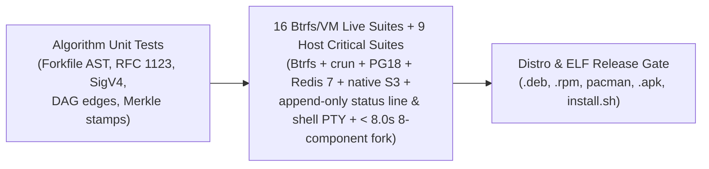

# The Slipfork Testing Plan

Slipfork runs your cloud environment locally in a box; CI is the clutch. Canonical contract mirrored at `TESTING_PLAN.md` and `specs/04-testing-plan.md` (alongside `specs/01-forkfile.md`, `specs/02-cli-ux.md`, `specs/03-under-the-hood.md`, `specs/05-ospp-v1.md`, and `specs/06-distribution-and-docs.md`) — proven against real Btrfs subvolumes, `crun`, PostgreSQL 18, Redis 7, native Rust S3, and real kernel PTYs.

```console
$ tools/do_vm.py sync && tools/do_vm.py test
$ SLIPFORK_TEST_ROOT=/mnt/slipfork-live make live-test
```



!!! warning "Zero mocks & real disk only (never RAM `/tmp`)"
    `Mock*`, `Fake*`, `Stub*`, `Recording*`, in-memory vaults, `sleep()` benchmark simulations, and `chmod 0o555` shims are banned; the only stand-ins are minimal `127.0.0.1:0` loopback reference servers (`OSPP v1` and `Distribution v2`). Heavy test state (worktrees, OCI caches, `PGDATA`, Btrfs subvolumes, Cargo scratch) must live on real disk under `/var/tmp`, `~/.cache/slipfork`, `.slipfork/`, or the Btrfs mount — never on RAM-backed `/tmp` `tmpfs` — and `SLIPFORK_TEST_ROOT` must resolve to a real Btrfs disk path.

!!! note "A live run never tests an installed helper the checkout did not build"
    `SLIPFORK_WORLD_INIT` names the `slipfork-world-init` beside the `slipfork` under test: `tools/do_vm.py test` and `make live-test` build it from this checkout and export that path to every suite. A `PATH` copy outside the binary's own output directory (typically a stale `/usr/bin/slipfork-world-init` from an older install) that predates the binary under test is refused with one line naming both paths and `next: cargo build -p slipfork-world --bin slipfork-world-init` — it is never booted and never silently passes.

---

## 1. Enclosing `image` Scopes, Native Rust S3 & Ingress Parity

- **Enclosing `image` builds, non-secret `arg` vs runtime `env`, and OCI pulls (`critical_dockerfile_live`, `critical_oci_live`):** Build a multi-stage `Dockerfile` `image <id> <dir> { ... }` (`FROM ... AS`, `ARG`, `COPY --from`, `RUN --mount=type=cache`, `.dockerignore`) natively on Btrfs + `crun` passing `arg VITE_CDN_URL = assets.url`, keeping runtime `env` out of builds, and pulling `image ... from <ref>` (`mailpit`) over HTTPS.
- **Private loopback registry login, pull, and `COPY --from` build (`critical_registry_live`):** A real `127.0.0.1:0` `Distribution v2` listener answers `/v2/` with a `401` Bearer challenge and only mints a token at its Basic-checked `/token`; the shipped binary logs in (0600 store), pulls `private/base`, then builds `FROM private/base` plus `COPY --from private/tools /marker`, proving the credential never reaches stdout, stderr, `--json`, or the sealed rootfs.
- **Native Btrfs-backed Rust S3 matrix (`critical_world_journey`):** Over `Request::ConfigureS3` on `:8333` and `Dial { port: 8333 }` `:80` ingress, execute real `PUT`, `GET`, `HEAD`, `DELETE`, and `ListObjectsV2` (`?list-type=2` with `prefix`/`continuation-token`) across path-style and virtual-host addressing, verifying `Content-Type`/`ETag`/`Content-Length` sidecars, AWS SigV4 HMAC-SHA256 (`UNSIGNED-PAYLOAD` on `GET`/`HEAD` and `403` on bad signatures), `403` anonymous `GET` on `policy private` (`s3 uploads`), and `200` anonymous `GET` + `403` anonymous `PUT`/`DELETE` on `s3 assets { policy public-read; cdn edge }` at `http://assets.<world>.localhost`; a declared `cdn <id>` is a cloud-only binding that locally resolves to the bucket's own `<bucket>.<world>.localhost` domain.
- **Cloud-identical HTTP/WebSocket ingress (`critical_ingress`, `critical_world_journey`):** Verify preserved prefixes (`route /api`), `strip-prefix`, `rewrite`, `exact`, `domain <id>` (a route without one binds the primary world domain, and the first declared `domain` is that host) across HTTP and upgraded WebSockets with `$port` and `PORT` parity.
- **Runtime pod identity & umask (`pod_run_live`):** Boot real pods whose image declares `USER` `0:0` (the Dockerfile default) and `USER 1000:1000`; assert each runs as the image's resolved identity mapped 1:1 onto the invoking host uid/gid, that root gets Docker's `14`-capability set while the numeric non-root uid gets an empty set, that OCI `process.umask` is `0022` even when the daemon inherits a hostile `0002` (a created directory is `0755`, never `0775`), and that every file the pod writes is host-owned.
- **Fail-closed static checks before boot (`critical_forkfile`):** Refuse missing `# forkfile: 0.1`, symbol collisions, `cdn <id>` without `policy public-read` (`next: add 'policy public-read' inside 's3 <bucket>' to enable 'cdn <id>'`), invalid RFC 1123 labels (`_`, uppercase, leading/trailing `-`, `> 63` chars on declared `domain`/`cdn`, plus `< 3` chars or IPv4 literals on `s3 <bucket>`), `strip-prefix` + `rewrite`, and secret-tainted `image` `arg`s — and verify every `forkfile` fence in published `README.md` / `docs/*.md` passes static checking.

---

## 2. `clap` CLI, append-only status-line PTY, Real-PTY `shell` & Terminal Hygiene

- **Real-PTY append-only boot narrative & `NO_COLOR`/`TERM=dumb` purity (`critical_status_live`, `critical_cli_surface`):**
  - Drive `slipfork up`, `restart`, and `down` inside a real PTY (`openpty` / `script -qec`), asserting a colour TTY writes settled rows as ordinary newline-terminated scrollback lines and owns **exactly one** in-place status line prefixed `\r\x1b[2K` (the active phase's live row — counter, verb, target, command, elapsed — while a phase runs, else a panel frame of spinner + a 24-cell bar when `cols >= 80` without shearing the counter + `done/total` + `pct%` + label + clock), and the only rewritten bytes are that one status line; settled rows append once.
  - Assert the stream never emits a scroll region, `\x1b[r`, `\x1b[1;{rows-1}r`, absolute cursor addressing, DSR, alternate screen, or a screen clear; settled status lines become normal rows, and a failure expands the failing phase and its `│`/`┃` output once with one verdict plus one `next:`.
  - Re-run in the **same real PTY** with `NO_COLOR=1` and `TERM=dumb`, asserting plain append-only rows with **`0` `\r`**, **`0` `\x1b[`** bytes, no spinner, and **no SGR**.
- **Non-TTY replay, `--json` schemas & `clap` surface (`critical_cli_surface`, `critical_host_verbs`):**
  - On piped non-TTY stdio, assert `→ [i/n]` headers + `✓ <kind> <name> <state>  <dur>` replay with `0` `\x1b[` and `0` `\r` bytes, exact `--json` schemas (`up`/`restart`, `doctor`, structured `{"error":{code,message,next}}`) with `0` `\x1b[` bytes, and non-empty `completions` + `clap_mangen` `slipfork(1)` output.
  - In `critical_cli_surface`, assert `Cli::command()` shape and exit-`2` refusals only — explicitly superseding `crates/slipfork/tests/critical_cli_surface.rs:133,136,242,259,260` (`db`/`redis` subcommands and bare `shell` without `<target>`) — while `critical_host_verbs` covers `down` and SSH/headless-safe `open` (zero `shell` duplication).
- **One cohesive real-PTY `shell <target>`, `logs`, and `exec` journey (`critical_world_journey`):**
  - Inside one booted world, verify `slipfork shell <service|image>` over a real PTY attaches `/dev/pts/N` via `crun exec --tty --console-socket` + `SCM_RIGHTS` (`tty` exits `0`, zero `can't access tty; job control turned off`, `(<world>:<target>)` prompt, `SIGWINCH` `TIOCSWINSZ` resize, cooked mode restored on exit), `slipfork shell <pg|database>` runs `psql` (TTY and piped `-X -q -v ON_ERROR_STOP=1`), `slipfork shell <redis>` runs `redis-cli` (TTY and piped), and `s3`/unknown targets print exact `1 line + next:` refusals on stderr (`✗ 'uploads' is an s3 bucket, not a shell` / `✗ No shellable target 'apii'`).
  - In the same journey (plus one failed cold image build), verify `slipfork logs <image>` reads `<store>/logs/<world>/<id>.log` even when no pods are running and survives `down`, bare `slipfork logs` streams app `service`s only (`-a` adds images + resources), `exec` forwards exit codes, `exec` on a real PTY auto-attaches `/dev/pts/N` (`tty` + `EXEC-TTY-OK`), `exec --no-interactive` keeps stdin a plain pipe (`NO-TTY`, EOF without hanging), `exec -i` without a TTY fails closed with one `next:`, and piped `exec ... -- cat` still forwards stdin.
- **Timestamped log index and ranged reads (`critical_world_journey`):** `<store>/logs/<world>/<id>.idx` stores 16-byte `(ts_ms, offset)` records beside each `.log`, and `read_range(start_ms, end_ms)` proves a binary-search seek to the first in-range record before reading only that byte range. The journey runs `slipfork logs api worker --since <ms> --until <ms> -t` to assert multi-target merge order, `ts_ms` on every `--json` line, and a malformed `--since` exiting `2` with one stderr line plus `next:`.

---

## 3. 8-Component `slipfork fork` & Coding Agents

- **Asserted `< 8.0s` CI-gated wall-clock `fork` across all 8 demo components (`critical_fork_live`):**
  - On `165.232.86.174`, boot the full 8-row demo fixture: **4 resources** (`pg` with seeded rows, `cache` with live Redis 7 AOF keys, private `uploads` S3, `public-read` + CDN `assets` S3) and **4 services** (`api` and `worker` from one `Dockerfile` image, `front` from a second `Dockerfile` image, and one OCI `from <ref>` service), with `@uv`/`@pnpm` installs and a `pre-deploy` migration hook.
  - Run **1 discarded warm-up fork then 3 timed samples**, wrapping `Command::spawn` of `slipfork fork` until all **8** rows report ready and `http://<fork>--<world>.localhost` answers `200 OK` in `std::time::Instant`; print every sample and **assert** the CoW clone budget too: each `fork --json` sample reports `snapshot_ms` in the `~150–365ms` range and **asserts** `snapshot_ms < Duration::from_millis(500)`, alongside the end-to-end **`median < Duration::from_secs(8)`** gate (`~5.5s` first-200 on 4 vCPU; 2-vCPU CI keeps the `< 8.0s` gate, never best-of).
  - Assert warm forks reuse and re-run nothing: zero `image` rebuilds (`cached` rows, never `built`/`pulled`) and zero `uv sync` / `pnpm install` / `pre-deploy` hook re-runs (`up to date`) when the `world_epoch` stamp matches.
  - Assert direct binary `exec` + zero pre-fork `CHECKPOINT` observables: pod `/proc/<pid>/cmdline` argv[0] is the absolute `postgres` / `redis-server` binary path (no `docker-entrypoint.sh`), and parent `PGDATA` `PG_VERSION` + `pg_wal` mtimes remain unchanged across `fork` snapshot preparation.
  - Assert parent `image` subvolume reuse (`cached`) and boot-trace `[started_ms, finished_ms]` interval overlap proving a `service` `Started` before `pg` `Ready` when `world_epoch` stamps match (while a mismatched `world_epoch` or stale `pre-deploy` orders `pg` `Ready` → `pre-deploy` → `service` `Started`), plus isolated fork writes and dirty `drop` refusal without `-f`.
- **Parallel AI coding-agent sessions (`@slipfork/opencode`):** Open concurrent OpenCode worktrees against one repo, verifying `SLIPFORK_WORLD` + `SLIPFORK_URL` export, `_` -> `-` `.localhost` branch slug normalization, and clean fork reaping on session idle.
- **Production-shape `-F -dev` planning (`boot_dag`):** Plan the shipped `support/demo` from the real `Forkfile` with an empty feature base (`--no-default-features`) and assert exactly `pg, cache, uploads, assets, api, worker, front` service/resource nodes, zero `mailpit`, `command: None` on the `api` and `front` service nodes (image `CMD`), `uv run --no-sync python -m app.worker` on `worker`, and `uv run --no-sync python -m app.migrate` on `pre-deploy`; a non-`dev` plan carries zero `uv sync` setup nodes and zero `@`-prequel commands because Slipfork never injects or rewrites `uv` flags — the `Forkfile` writes `--no-sync` itself. The live `slipfork fork prod-check -F -dev` 200-on-`/`+`/api/status` proof lives in the M3.70.2 VM evidence.

---

## 4. Installation, Distro Packaging, `OSPP v1` & Language Tooling

- **Install, `doctor`, packages & `install.sh` (`critical_daemon`, `critical_host_verbs`):** Verify each package transaction stays green rootless (container install legs), `scripts/check-install.sh` syntax-checks every hook and proves the installer's `SLIPFORK_INSTALL_NO_SERVICE` opt-out, four-row `slipfork doctor` (`Storage`, `Containers`, `Daemon`, `Domains`; `✓ Ready` vs `✗ N issue(s)` with per-row `next:`), `.deb`/`.rpm`/`.pkg.tar.zst`/`.apk`/portable archives gated by `scripts/check-portable-elf.sh`, `docs/install.sh`, and `slipfork migrate` (`critical_fmt_migrate`).
- **`OSPP v1` secrets & offline fallback (`critical_ospp`):** Pair against the `127.0.0.1:0` loopback `OSPP v1` reference server, verify `hpke-p256` `SecretValue` decryption strictly on `tmpfs`, live `env_updated` restarts, sealed DB dumps, and offline `secret(KEY, random_string(50))` parity with TTY-gated `--reveal`.
- **Focused algorithm & editor suites (`critical_forkfile`, `critical_fmt_migrate`, `critical_lsp`):** Unit-test `# forkfile: 0.1` parsing, RFC 1123 + `3..=63` S3 bucket validation, `BucketPolicy` checking, `SecretValue` taint rules, DAG concurrency edges (parallel stamped vs resource-gated stale hooks), Merkle + `world_epoch` stamping, SigV4 canonicalization, `slipfork fmt`, `slipfork-lsp`, and the Zed extension. A formatter (`slipfork fmt`) change must also run the CLI crate's `critical_fmt_migrate` — the forkfile-only suites never execute the shipped binary's rewrite path.

---

## 5. Running the Protected Live & Workspace Gates

The sixteen Btrfs/VM live suites (`critical_btrfs_live`, `fork_flat_live`, `critical_oci_live`, `critical_dockerfile_live`, `critical_pod_runtime`, `critical_snapshot_graph`, `pod_control_lab`, `pod_run_live`, `critical_world_journey`, `critical_heads_live`, `critical_status_live`, `critical_fork_live`, `critical_registry_live`, `logs_colour_live`, `logs_last_live`, `image_rpc`) run sequentially on real Btrfs + `crun` (`165.232.86.174` via `tools/do_vm.py sync && tools/do_vm.py test` or locally via real Btrfs `SLIPFORK_TEST_ROOT=<btrfs-mount> make live-test`) and **fail closed with a 1-line remedy** when Btrfs, namespaces, or `crun` are missing. Every other `critical_*` suite (`critical_ospp`, `critical_ingress`, `critical_cli_surface`, `critical_daemon`, `critical_host_verbs`, `critical_fmt_migrate`, `critical_forkfile`, `critical_lsp`, `critical_log_store`) remains protected by `tools/critical_guard.py` and must stay green in the same gate (`cargo test --workspace`).

`SLIPFORK_TEST_ROOT` must be the Btrfs mount root itself, never a directory inside it: the suites resolve the store from the mount and hardcode `<root>/.slipfork-store`, so a subdirectory silently shares the parent store and a warm image cache turns an expected `from:` pull into `cached`. `make live-test` therefore refuses an ambiently warm store with `next: LIVE_RESET=1 make live-test`, purges `<mount>/.slipfork-store` immediately before each suite that declares a cold pull (today `critical_status_live`) so warming by an earlier suite in the same run cannot settle a `from:` pull as `cached`, and builds `slipfork-world-init` from the same checkout, so a manual run reproduces CI exactly.
