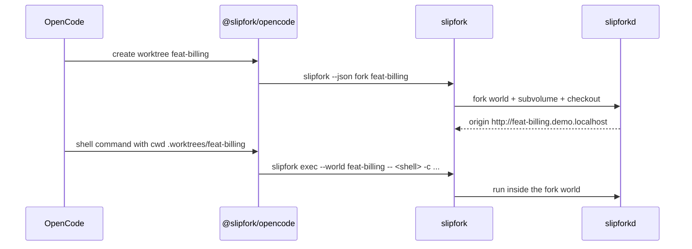

# OpenCode V2 Plugin (`0.1.0`)

`@slipfork/opencode` makes parallel agent sessions safe. When OpenCode creates a worktree, the plugin forks a Slipfork world with it; when the agent runs a shell command there, the command executes inside that world.

```console
$ slipfork up                    # canonical world for the repository
$ slipfork fork feat-billing     # the plugin's worktree create runs the same daemon call
$ slipfork --json status         # the payload the plugin decodes
```

```jsonc title=".opencode/opencode.jsonc"
{
  "$schema": "https://opencode.ai/config.json",
  "worktree": { "directory": ".worktrees" },
  "plugins": [
    { "package": "../packages/opencode-slipfork", "options": { "binary": "slipfork" } }
  ]
}
```

!!! warning "Worktrees belong on disk"
    Keep `.worktrees` on the CoW filesystem, never RAM-backed `/tmp` `tmpfs`. Slipfork always owns `<repo>/.worktrees/<fork>`, and the OpenCode `worktree.directory` value must be `.worktrees` so both tools agree.

!!! info "Relative plugin paths"
    A relative `package` resolves from the config file's directory, so `.opencode/opencode.jsonc` needs `../packages/...`. A plugin entry must be a directory or package name; a single `.ts` file is skipped.

`options.binary` defaults to `slipfork` on `PATH`. Every command runs from the repository root so the daemon can resolve worlds.

## What the plugin wires

| Hook | Behaviour |
|---|---|
| `ctx.worktree.transform` | Registers the project root and daemon-owned worktrees; create runs `slipfork --json fork <fork>`, remove runs `slipfork drop <fork>`, and a failed fork rolls back |
| `ctx.shell.hook("create.before")` | A command whose `cwd` is inside a plugin-owned worktree is rewritten to `slipfork exec --world <fork> --cwd <cwd> -- <shell> -c <command>`, with `SLIPFORK_ACTIVE_WORLD` set |
| `ctx.session.hook("context")` | Appends a `<context key="slipfork-world">` note naming the world, its checkout, and its origin URL |

The plugin never resolves environment or reads a manifest. `slipforkd` owns `Forkfile` evaluation; the plugin only builds CLI arguments and decodes `--json` payloads.

## Session flow



Canonical and unrelated directories pass through untouched. A worktree created outside the plugin keeps normal shell behaviour.

## Project state and failure modes

The plugin inspects the repository once per session. A missing or unreadable project context produces a `<context key="slipfork-project">` notice and leaves shell commands untouched, rather than half-routing a session.

A daemon that refuses a fork surfaces as a `slipfork fork failed: <stderr>` error and the worktree is removed again. No silent fallback to a host shell.

```console
$ slipfork --json status
{
  "ok": true,
  "ingress_port": null,
  "worlds": [
    {
      "world": "demo",
      "state": "running",
      "origin": "http://demo.localhost:41921",
      "worktree": "/home/acme/demo",
      "services": [{ "id": "api", "state": "running", "port": 8000 }]
    }
  ]
}
```

`origin` is port-less when the world is on `:80`, and carries the answered port otherwise. The plugin reads `world`, `origin`, and `worktree` from each row and ignores the rest.

## Tests

`packages/opencode-slipfork/tests` covers the CLI argument contract, the pure coordinator, and a live end-to-end run against the real `slipfork` binary:

```console
$ bun test packages/opencode-slipfork/tests
```
