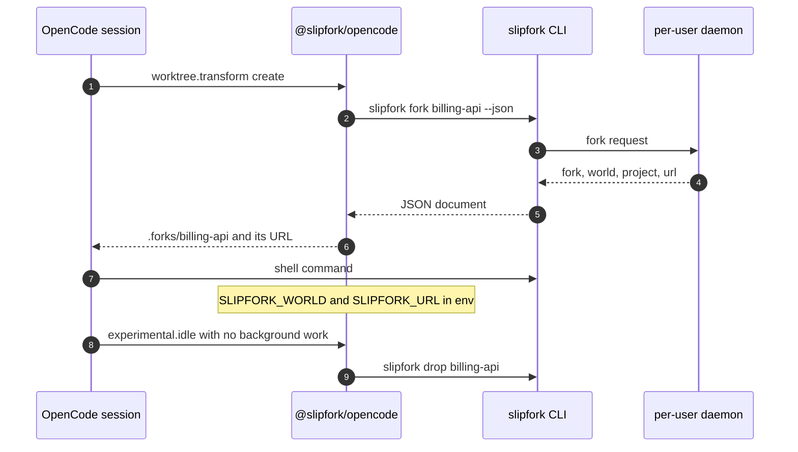

# Agents & OpenCode

Parallel agents editing one checkout collide on files, ports and databases. This plugin gives every
OpenCode session its own Btrfs fork — code, dependencies and live data — behind its own URL.

```console
$ bun add -d @slipfork/opencode
```

```jsonc
// .opencode/opencode.jsonc
{
  "plugin": ["@slipfork/opencode"]
}
```

Boot the parent world once with `slipfork up`. The plugin drives the `slipfork` binary already on
your `PATH`, so it adds no second CLI and no embedded world logic.



## What each hook does

| Hook | When it runs | Effect |
| :--- | :--- | :--- |
| `ctx.worktree.transform` | OpenCode creates, lists or removes a worktree | `slipfork fork <name>`, `slipfork status`, `slipfork drop` |
| `ctx.shell.hook("create.before")` | Before a shell command starts | Adds `SLIPFORK_WORLD` and `SLIPFORK_URL`; never rewrites the command |
| `ctx.session.hook("context")` | A session attaches | Appends one line naming its world and URL |
| `ctx.session.hook("experimental.idle")` | The session goes idle with no background jobs | `slipfork drop` for forks this plugin created |

The plugin keeps one rule the CLI cannot know: it drops only forks it created. A session that merely
opens an existing `.forks/<name>` checkout never destroys it.

## Environment inside a fork

| Name | Value | Use |
| :--- | :--- | :--- |
| `SLIPFORK_WORLD` | `billing-api--acme-shop` | Target the fork world in a script or preview |
| `SLIPFORK_URL` | `http://billing-api--acme-shop.localhost` | Open or curl the fork directly |

The child process inherits only `PATH`, `SYSTEMROOT`, `HOME`, `XDG_RUNTIME_DIR` and `XDG_STATE_HOME`.
When `slipfork` is not on `PATH`, set the plugin's `binary` option to its absolute path.

## Fork, work, drop

```console
$ slipfork fork billing-api
✓ Forked billing-api (0.8s) -> http://billing-api--acme-shop.localhost
$ slipfork status
● acme-shop  ~/projects/acme-shop
  http://acme-shop.localhost
    /     -> web      service              running

● billing-api  ~/projects/acme-shop/.forks/billing-api
  http://billing-api--acme-shop.localhost
    /     -> web      service              running
$ slipfork drop billing-api
```

The `0.8s` is end-to-end; `≤50ms` of it is the CoW snapshot.

A fork inherits `.venv`, `node_modules`, input stamps and the live database snapshot, so the first
command in the new checkout does not install anything. `slipfork drop` stops the fork world before it
deletes the snapshots.

!!! warning "Forks are ephemeral"

    A fork is a snapshot taken at create time, and the plugin reaps the ones it created when the
    session goes idle. Commit work you need to keep before ending the session, or pass `-f` to
    `slipfork drop` only when you mean to discard a dirty checkout.

## When the plugin refuses

The plugin surfaces the CLI's own `message` and `next:` line verbatim. A non-Btrfs project points at
the mount fix; a dirty checkout points at `slipfork drop --force`.

| Symptom | Next |
| :--- | :--- |
| Plugin warns it found no `slipfork` binary | Install Slipfork, or set the `binary` option |
| A fork checkout has no running world | Run `slipfork up` in the project, or `slipfork fork <name>` again |
| CLI failure with no decoded remedy | Run `slipfork doctor` |

!!! info "One plugin, many sessions"

    Each session gets its own checkout and URL, and the parent world keeps serving. Fork names are
    branch-shaped, so `slipfork status` reads like a git branch list.

## Where next

* [Under the hood](under-the-hood.md) — why a fork is a snapshot and not a copy.
* [CLI](cli.md) — `fork`, `drop`, `status` and the tree contract.
* [Troubleshooting](troubleshooting.md) — non-Btrfs, dirty checkout and daemon failures.
