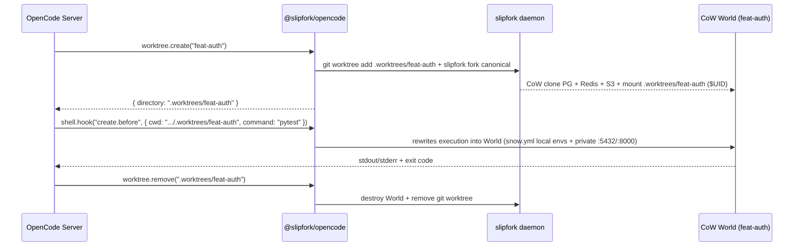

# AI Agents & OpenCode Worktrees

When autonomous coding agents work in parallel git worktrees, traditional setups fall apart immediately:

- Two agents run `manage.py migrate` or `manage.py seed --reset` against the same `localhost:5432` database.
- One agent starts `runserver` on `:8000` while another hits it expecting its own branch's code.
- Teaching an LLM to prefix every command with `docker compose -p worktree_7 exec ...` wastes context tokens and fails constantly when subagents forget.

Slipfork's OpenCode V2 plugin (`@slipfork/opencode`) makes isolated per-worktree environments **100% implicit and invisible to the LLM**.

---

## 1-Line Setup in `.opencode/opencode.jsonc`

```jsonc title=".opencode/opencode.jsonc"
{
  "$schema": "https://opencode.ai/config.json",
  "worktree": {
    "directory": ".worktrees"
  },
  "plugins": [
    "@slipfork/opencode"
  ]
}
```

---

## What Happens Under the Hood

`@slipfork/opencode` hooks into three native OpenCode V2 extension points — **without replacing or renaming the built-in `shell` tool**:



### Why the LLM Never Gets Confused

1. **Standard `shell` tool stays untouched:** The agent still calls `shell` with normal commands (`pytest`, `pnpm check`, `curl http://localhost:8000/health`).
2. **Exact same filesystem path & `$UID`:** `read`, `edit`, `glob`, and `grep` inspect `/path/to/repo/.worktrees/feat-auth` on the host, while `shell` executes inside the forked CoW world with `/path/to/repo/.worktrees/feat-auth` mounted at the identical path under `$UID:$GID`.
3. **`snow.yml` secrets injected automatically:** Every variable from `modes.all` + `modes.local` is already present in the shell environment — agents never need `.env` files on disk.
4. **2-line ambient context:** A `session.hook("context")` entry informs the model in two lines that its directory owns a private CoW world, preventing it from trying to kill or reconfigure host ports.

---

## Standalone CLI Use (Any Agent Harness)

Using Claude Code, Codex, Junie, or terminal tmux panes? The CLI exposes the exact same workflow directly:

```console
$ slipfork fork feat-billing            # Creates .worktrees/feat-billing + CoW world
$ cd .worktrees/feat-billing
$ slipfork shell                        # Interactive shell inside the forked world
$ slipfork drop feat-billing            # Destroys the CoW world and cleans up
```
