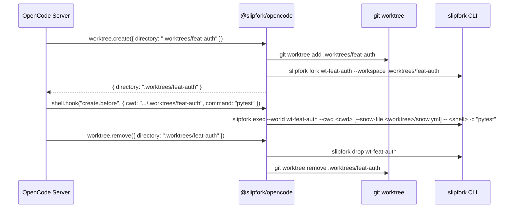

# OpenCode V2 Worktree Plugin (`0.1.0`)

`packages/opencode-slipfork` (`@slipfork/opencode`) integrates Slipfork's `fork`, `exec`, and `drop` commands into OpenCode V2 so parallel sessions in git worktrees get isolated CoW services and `snow.yml` environment variables **without replacing or renaming the built-in `shell` tool**.

---

## Configuration in `.opencode/opencode.jsonc`

Keep worktrees on a CoW-capable disk directory (`.worktrees`, never RAM-backed `/tmp` `tmpfs`) and load `@slipfork/opencode`:

```jsonc title=".opencode/opencode.jsonc"
{
  "$schema": "https://opencode.ai/config.json",
  "worktree": {
    "directory": ".worktrees"
  },
  "plugins": [
    "./packages/opencode-slipfork/src/index.ts"
  ]
}
```

Optional plugin option: `{ "binary": "/custom/path/to/slipfork" }` (defaults to `"slipfork"` on `PATH`).

---

## What `@slipfork/opencode` Wires Today



1. **Rollback on fork failure:** If `slipfork fork` fails (for example when `canonical` snapshot is missing or the filesystem rejects `FICLONE`), the plugin automatically cleans up the newly created git worktree (`git worktree remove --force`) and surfaces the error cleanly (`coordinator.critical.test.ts`).
2. **Implicit `cwd` routing:** Commands running inside `.worktrees/<slug>` (or any subdirectory) are wrapped into `slipfork exec --world wt-<slug>` with `SLIPFORK_ACTIVE_WORLD=wt-<slug>` (passing `--snow-file <worktree>/snow.yml` when `snow.yml` exists at the worktree root and omitting it otherwise), while commands outside registered worktrees pass through untouched.
3. **2-line session context hint:** `ctx.session.hook("context")` appends `<context key="slipfork-world">` informing the model that its worktree owns an isolated CoW world.
