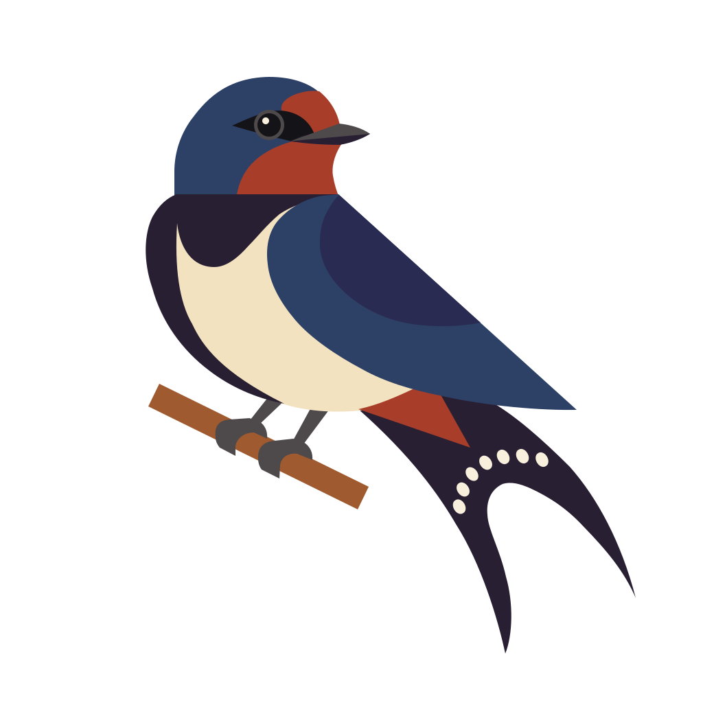

# Barn swallow mascot artwork

Slipfork's mascot is a **barn swallow** (*Hirundo rustica*), drawn in the house
style of the Offworld Nexus birds: flat, geometric, Saul Bass airline poster, a
handful of silkscreen colours.

{ width=320 }

## Why a barn swallow

Its deep forked tail is a literal fork mark: one body that splits cleanly in two,
like `slipfork fork` splitting code, dependencies and running databases. A
swallow is a slipstream flier, fast and light, never weighed down.

It also comes home: a barn swallow returns to the same nest under the same roof
every year, the way your stack lives in one local box instead of a shared staging
server. And one bird becomes a whole flock: every fork is another world flying
with the first.

Tagline: **Small bird. Whole flock.**

Other Offworld Nexus mascots, avoided: Eurasian nuthatch (blastit), European
bee-eater (Screensight), spectacled weaver (Tunnel Weaver). No other project has
a swallow.

## Reference

Generated with **Nano Banana Pro** (`gemini-3-pro-image`, Gemini API
`generateContent`, `responseModalities: ["IMAGE", "TEXT"]`, aspect ratio 1:1,
2K). One prompt, four candidates; candidate 4 was kept as
[`mascot-reference.png`](mascot-reference.png), resized to 1024 × 1024. It had
the clearest field marks and the most cut-paper construction.

The prompt:

> Flat geometric illustration of a barn swallow (Hirundo rustica), in the style
> of a 1960s Saul Bass airline travel poster and mid-century silkscreen prints.
> The bird is perched on a short diagonal branch, three-quarter profile facing
> right, alert, head raised, with its long forked tail sweeping down and to the
> right.
>
> Anatomy must be unmistakably a barn swallow: small plump body, rounded head
> with no visible neck, short pointed bill, tiny legs with simple feet gripping
> the branch. Long steel-blue-black upperparts: crown, nape, back, and folded
> wing. A rich rust-red forehead and throat bib. Clean cream-ivory breast and
> belly. A fine dark line runs through the eye. The tail is long and deeply
> forked into two narrow streamers, with a neat row of small white oval spots
> near the tips. The eye is a solid dark dot with a tiny white highlight.
>
> Style: bold Saul Bass poster geometry. The bird is built from a few large
> shapes cut from circles, arcs, and straight diagonal cuts, like cut paper.
> Confident, slightly angular, iconic, simple enough to read as a logo. Feet are
> two simple dark wedge shapes gripping the branch, not detailed claws. Big flat
> colour shapes with crisp hard edges, exactly seven flat colours (deep
> indigo-blue, darker indigo for the wing and tail, rust-red, cream, white,
> black, dark grey) plus a dark warm brown branch. No gradients, no texture, no
> shading, no outlines, no strokes, no text, no border. Plain flat warm
> off-white background. The bird is centred, filling about two thirds of the
> square with a generous margin. Square 1:1 composition; the whole bird and
> branch sit inside the frame.

Field-mark check against the real bird: glossy indigo crown, nape and back; rust
forehead and throat; a dark breast band under the throat; cream underparts;
long tail streamers with a row of white spots; short pointed bill. The dark band
curling down the side of the breast is poster licence kept from the reference.

## Drawing

Hand-authored in the reference bitmap's 1024 × 1024 coordinate space, by reading
coordinates off gridded crops. No auto-traced paths, embedded bitmaps,
gradients, filters or strokes. The full mascot has **19 elements**: 16 paths and
3 circles.

Each round was checked three ways:

- a **true 50 % overlay** of the artwork on the reference, where a pale rim is
  artwork over the paper;
- a **magenta outline diagnostic** of every path over the reference, to find
  doubled edges and gaps;
- a **colour-label diff**: every pixel of both images labelled with its nearest
  palette colour. It marks artwork over paper, missing artwork and wrong colours,
  and row/column scans turn it into boundary offsets in units.

One block-in and eleven correction rounds:

| Round | What changed |
| --- | --- |
| 1 | Every shape blocked in: head, collar and breast crescent, wing, tail, rump, legs, feet, branch. Already the right bird. |
| 2–3 | Breast crescent thinned on its inner edge and pulled in at the bottom; belly and body hidden points moved inside it; forehead's upper-left corner lowered. |
| 4–5 | Inner edges of both tail streamers re-fitted; legs and tail spots re-placed. |
| 6–7 | Crown dome re-fitted to the reference in two curves; colour-label diff added. |
| 8–9 | Wing's left edge moved out up to 11 units; inner wing band re-drawn (its lower edge was 5–8 units high). |
| 10 | Throat's upper-left edge, bill top and lower-mandible tip; rump's right edge; inner right streamer tip. |
| 11 | Legs re-angled; crescent tip; foot edges along the branch tucked inside it, closing a 1-unit sliver. |

After that, two corrections without moving any geometry: the bill fills were
swapped (the reference's upper mandible is grey, the lower one dark), and the
favicon's nested head was centred.

Most outlines sit within 0–3 units of the reference. The largest remaining
offsets are 2–5 units: the crescent near its tip, the wing tip, the outer right
streamer, and the very tip of the inner right streamer. Those are soft JPEG
edges snapped to clean curves; chasing them further would only re-trace the blur.

### Layering: no seams

Two paths that only *meet* never render cleanly: each anti-aliased edge is part
transparent, and the background shows through the line where they touch. So no
colour boundary is shared by two paths. Each visible boundary is the edge of
exactly one shape lying over another, and the shape below runs 5–10 units under
it.

- **`body`** is one indigo silhouette under the head, back and belly. Where
  indigo is the outline (the crown dome), its edge *is* the outline. Elsewhere
  it stops inside the shape that draws the outline (the crescent, the belly, the
  forehead, the throat).
- **The tail** runs up under `rump` and the wing; `rump`'s top edge hides under
  the wing.
- **`throat`** runs under the collar, the eye-mask and both mandibles.
  `forehead` runs under the eye-mask and the bill.
- **`breast-band`** (the collar, the lobe under it and the long crescent down the
  side of the breast) lies over `underparts`, which runs under it.
- **The wing.** `wing-band` lies on `wing-coverts`; both lie over the collar and
  the belly.
- **The bill.** `bill-lower` reaches up under `bill`; both lie over the eye-mask
  and the throat. The eye-mask runs on under the bill.
- **Legs and feet.** The legs start under the belly and the crescent tip and end
  inside the feet. Each foot's edge along the branch runs inside the branch. The
  gap between the legs, the belly and the branch is deliberate.

### Seam check

[`check_seams.py`](check_seams.py) proves it. It is a PEP 723 script:
`uv run docs/brand/check_seams.py`. Each target is rendered with resvg on a
transparent background at 4× (the head marks at 4× and 8×):

1. Flood the clear region (alpha < 128) from the image border.
2. Add the deliberate gaps: the space between the legs, the ink cutout's pupil
   hole, the paper cutout's eye-mask hole.
3. Widen that region by 1 px to take in the outline's own anti-aliasing.
4. Report every remaining pixel with alpha < 250, in clusters, in SVG units.

Clusters of 3 px or fewer within 2 px of the outside are "outline corners": the
apex of a notch that narrows to a point, such as where the tail leaves the wing.
The script exits 1 on any seam. It also writes renders on magenta and on the
favicon's paper tile, and junction crops (the bill base always at 8×).

| Target | 4× | 8× | Outline corners |
| --- | ---: | ---: | ---: |
| `mascot.svg` | 0 | — | 1 |
| `mascot-head.svg` | 0 | 0 | 0 |
| `mascot-head-ink.svg` | 0 | 0 | 0 |
| `mascot-head-paper.svg` | 0 | 0 | 0 |
| `logo.svg` | 0 | 0 | 0 |
| `favicon.svg` (whole tile) | 0 | 0 | 0 |
| bird in `favicon.svg` | 0 | 0 | 0 |
| bird in `header-light.svg` | 0 | — | 1 |
| bird in `header-dark.svg` | 0 | — | 1 |
| bird in `social-card.svg` | 0 | — | 1 |

The favicon's tile is opaque, so its alpha cannot show a seam; the
`favicon-bird` target checks the head inside it.

### Path inventory

“Anchors” counts move, line, Bézier and arc endpoints, including the first point
of each subpath and the hidden vertices that run under a neighbour. Bottom to top:

| SVG shape ID | Fill | Subpaths | Anchors | Bézier segments | Runs under |
| --- | --- | ---: | ---: | ---: | --- |
| `legs` | `bill` `#4e494a` | 2 | 8 | 0 | `underparts`, `breast-band`, `feet` |
| `body` | `indigo` `#2d4066` | 1 | 18 | 4 | everything above |
| `tail` | `indigo-deep` `#291f33` | 1 | 14 | 10 | `rump`, `wing-coverts` |
| `underparts` | `cream` `#f2e2bf` | 1 | 12 | 2 | `breast-band`, `rump`, wing |
| `rump` | `rust` `#a83e29` | 1 | 5 | 1 | `wing-coverts` |
| `throat` | `rust` `#a83e29` | 1 | 9 | 3 | `breast-band`, `eye-mask`, mandibles |
| `forehead` | `rust` `#a83e29` | 1 | 8 | 4 | `eye-mask`, `bill` |
| `breast-band` | `indigo-deep` `#291f33` | 1 | 14 | 10 | wing |
| `wing-coverts` | `indigo` `#2d4066` | 1 | 8 | 6 | `wing-band` |
| `wing-band` | `indigo-mid` `#2a2b52` | 1 | 7 | 5 | — |
| `tail-spots` | `paper` `#f8f0dd` | 7 | 21 | 0 (14 arcs) | — |
| `eye-mask` | `ink` `#141317` | 1 | 6 | 3 | mandibles, eye ring |
| `bill-lower` | `indigo-deep` `#291f33` | 1 | 6 | 2 | `bill` |
| `bill` | `bill` `#4e494a` | 1 | 3 | 1 | — |
| `eye-ring` | `bill` `#4e494a` | circle r 22 | — | — | `eye` |
| `eye` | `ink` `#141317` | circle r 17 | — | — | `eye-glint` |
| `eye-glint` | `paper` `#f8f0dd` | circle r 5 | — | — | — |
| `branch` | `branch` `#9f5a2f` | 1 | 4 | 0 | `feet` |
| `feet` | `bill` `#4e494a` | 2 | 20 | 8 | — |

The head mark takes `body`, `throat`, `forehead`, `eye-mask`, both mandibles and
the three eye circles, in the same order, under a clip at the shoulder line
(y 283). The cutouts are single even-odd paths. Their outline is the head
silhouette (dome, forehead, bill, throat, closed along y 283), with the throat
curve split exactly at y 283. The banners and the social card inline the full
mascot. Regenerate them all whenever `mascot.svg` changes, then run the check.

## Deliverables

| File | What it is |
| --- | --- |
| [`mascot.svg`](mascot.svg) | Full mascot, transparent, `viewBox="0 0 1024 1024"`. |
| [`mascot-head.svg`](mascot-head.svg) | Head mark: the head shapes clipped at y 283; `viewBox="250 108 294 179"`, geometry in the full mascot's coordinates. 16–64 px tall. |
| [`mascot-head-ink.svg`](mascot-head-ink.svg) | One compound path in `ink`, pupil cut out (even-odd). For light grounds. |
| [`mascot-head-paper.svg`](mascot-head-paper.svg) | One compound path in `paper`: eye-mask and eye ring cut out, glint filled back inside the hole. For dark grounds. |
| [`logo.svg`](logo.svg) | The paper head for the docs header; it draws in `ink` under a light colour scheme. |
| [`favicon.svg`](favicon.svg) | Full-colour head mark on a rounded paper tile. |
| `favicon-32.png`, `favicon.ico` (16/32/48), `apple-touch-icon.png` (180, square), `icon-512.png` | Renders of the favicon. |
| [`palette.svg`](palette.svg), [`brand.css`](brand.css) | The palette sheet, and the same tokens as CSS custom properties. |
| [`social-card.svg`](social-card.svg) / [`social-card.png`](social-card.png) | OpenGraph card, 1280 × 640. |
| [`mascot-reference.png`](mascot-reference.png) | The generated reference, 1024 × 1024. |
| [`mascot-compare.png`](mascot-compare.png) | Reference \| 50 % overlay \| flat artwork. |
| [`mascot-side-by-side.png`](mascot-side-by-side.png) | Reference and flat artwork. |
| [`check_seams.py`](check_seams.py) | The seam and hole check (see *Seam check*). |
| [`../../.github/brand/header-light.svg`](../../.github/brand/header-light.svg), [`header-dark.svg`](../../.github/brand/header-dark.svg) | README banner, 960 × 260, mascot inline as vectors. |

## Palette

Mascot colours are the same in both schemes. OKLCH is `L C H`.

| Token | Hex | OKLCH | Used for |
| --- | --- | --- | --- |
| `ink` | `#141317` | `oklch(19.0% 0.008 297)` | eye-mask, eye |
| `indigo` | `#2d4066` | `oklch(37.4% 0.070 263)` | crown, nape, back, outer wing; UI `primary` |
| `indigo-mid` | `#2a2b52` | `oklch(30.9% 0.069 280)` | wing inner band |
| `indigo-deep` | `#291f33` | `oklch(26.0% 0.039 307)` | collar, breast crescent, tail, lower mandible |
| `rust` | `#a83e29` | `oklch(50.8% 0.144 33)` | forehead, throat, rump; UI light `accent` |
| `cream` | `#f2e2bf` | `oklch(91.7% 0.049 86)` | breast and belly |
| `paper` | `#f8f0dd` | `oklch(95.6% 0.026 88)` | tail spots, eye glint, paper cutout |
| `bill` | `#4e494a` | `oklch(41.1% 0.007 4)` | upper mandible, eye ring, legs, feet |
| `branch` | `#9f5a2f` | `oklch(53.9% 0.107 51)` | perch |

Interface tokens (`brand.css` maps them onto the Material-style `--md-*`
variables for `[data-md-color-scheme="default"]` and `="slate"`):

| Token | Light (`default`) | OKLCH | Dark (`slate`) | OKLCH |
| --- | --- | --- | --- | --- |
| `background` | `#f6eed8` | `oklch(95.0% 0.030 90)` | `#141320` | `oklch(19.5% 0.026 287)` |
| `surface` | `#fffbf1` | `oklch(98.8% 0.014 89)` | `#1d1c2b` | `oklch(23.5% 0.029 287)` |
| `ink` | `#16151b` | `oklch(20.0% 0.012 293)` | `#f4efe3` | `oklch(95.3% 0.017 88)` |
| `muted` | `#5b5a66` | `oklch(47.3% 0.019 289)` | `#a9a7bc` | `oklch(73.7% 0.030 290)` |
| `primary` | `#2d4066` | `oklch(37.4% 0.070 263)` | `#2d4066` | `oklch(37.4% 0.070 263)` |
| `primary-ink` | `#ffffff` | `oklch(100% 0 0)` | `#f4efe3` | `oklch(95.3% 0.017 88)` |
| `accent` | `#a83e29` | `oklch(50.8% 0.144 33)` | `#e89a6e` | `oklch(75.4% 0.111 50)` |
| `accent-ink` | `#ffffff` | `oklch(100% 0 0)` | `#1b0f09` | — |

In `brand.css` the interface `ink` is `--slipfork-ui-ink`, so it never collides
with the mascot's `--slipfork-ink`.

### Contrast (WCAG 2.x)

Every text pair passes AA (4.5:1) for body text.

| Text on ground | Light | Dark |
| --- | ---: | ---: |
| `ink` on `background` | 15.68:1 AAA | 16.00:1 AAA |
| `ink` on `surface` | 17.56:1 AAA | 14.60:1 AAA |
| `muted` on `background` | 5.85:1 AA | 7.82:1 AAA |
| `muted` on `surface` | 6.56:1 AA | 7.13:1 AAA |
| `accent` on `background` (links) | 5.36:1 AA | 8.11:1 AAA |
| `accent` on `surface` | 6.00:1 AA | 7.40:1 AAA |
| `accent-ink` on `accent` (buttons) | 6.20:1 AA | 8.29:1 AAA |
| `primary-ink` on `primary` (header) | 10.31:1 AAA | 8.99:1 AAA |

## Usage

- **Minimum sizes.** Full mascot: 96 px tall; below that the feet and tail spots
  turn to noise, so use the head. Head mark and cutouts: 16 px tall. Favicon:
  16 px.
- **Clear space.** Around the full mascot and the head mark, keep at least the
  eye ring's diameter (44 units) free of text and other marks; around the
  favicon tile, 1/8 of its side.
- **Grounds.** Full colour on warm paper, `surface`, white or the dark
  `background`. On mid or dark grounds use the paper cutout; on light grounds
  the ink cutout. On photographs use a tile.
- **The dark banner's paper box.** On the deep indigo banner the bird sits on a
  rounded paper tile. The indigo tail and collar are too close in value to the
  ground, and the tile reads as Slipfork's "locally in a box".
- **The favicon's paper tile.** The head sits on paper, not rust: on a rust tile
  the rust throat and forehead would vanish. The nested head uses
  `viewBox="236 37 320 320"`, a square around the head that centres it in the
  tile.
- **The logo.** `logo.svg` is loaded as an ``, so page CSS cannot recolour
  it. It answers `prefers-color-scheme` itself: paper by default, `ink` under a
  light scheme.
- **Don't** recolour the bird outside the mascot tokens, add gradients, strokes,
  shadows or outlines, flip it to face left, rotate it, stretch it, crop through
  the eye or the bill, put text over it, or trace the reference again: edit the
  named shapes.
