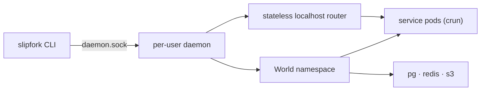

# CLI

Every command renders one domain tree and fails with one `next:` line. World verbs talk to one
per-user daemon; `docker` and `fmt`/`migrate` run in-process without contacting it.

```console
$ slipfork up
✓ Ready -> http://acme-shop.localhost

$ slipfork up feat-auth
✓ Ready -> http://feat-auth--acme-shop.localhost

$ slipfork restart -s worker
✓ Restarted worker

$ slipfork status
● acme-shop  ~/projects/acme-shop
  http://acme-shop.localhost
    /api  -> web      service              running
  http://uploads.acme-shop.localhost
    /     -> uploads  s3 (private)         running
  support
    worker  service       running
    pg      postgres 18   running
    cache   redis 7       running
```



## Daily verbs

| Command | Behaviour |
| :--- | :--- |
| `slipfork status` | Every world and domain as one tree; bare `slipfork` is the same verb |
| `slipfork ps` | The same tree scoped to this directory's world or fork |
| `slipfork up [TARGET]` | Boot this directory's `Forkfile`, a `.forks/<name>` checkout, or a registered world/fork |
| `slipfork down [TARGET]` | Stop this directory's world, or the named world/fork, keeping data and logs |
| `slipfork restart [TARGET] [-s SERVICE]` | Restart a service, a world/fork, or every service here |
| `slipfork fork [name]` | Snapshot code and world data, boot the fork on its own URL |
| `slipfork drop <name>` | Stop a fork and delete its snapshots; `-f` discards a dirty checkout |
| `slipfork logs [-f] [-a] [-t] [--since <time>] [--until <time>] [targets]...` | Merged service logs; `-a` adds images and resources; several targets merge in time order |
| `slipfork logs -r [<id>\|last\|failed]` | Replay one recorded step run; bare `-r` replays the latest failed run, and `--runs` lists the whole catalog |
| `slipfork shell <target>` | Real PTY: `bash`/`sh`, `psql`, or `redis-cli` for one declared target |
| `slipfork exec [-i\|--no-interactive] [service\|image] -- <cmd>` | Run any command in a pod with a real PTY on a terminal; exit code forwarded |
| `slipfork env [component]` | Resolved runtime variables, secrets redacted |
| `slipfork features [+mail\|-dev\|reset]` | Resolved features and persisted edits for the next boot |
| `slipfork secret list\|set\|unset` | Manage local offline secrets; `set` reads stdin |
| `slipfork docker login\|logout\|list\|images\|pull\|build` | Registry credentials, cached OCI refs, native pulls and builds; never a Docker daemon |
| `slipfork open [service]` | Open the world or route URL in a browser |
| `slipfork doctor` | Four plain-English rows: Storage, Containers, Daemon, Domains |
| `slipfork fmt` | Format a Forkfile; `--check` reports only |
| `slipfork migrate` | Convert a legacy `snow.yml` into a `Forkfile` |
| `slipfork completions <shell>` | Print bash, zsh or fish completions |

`slipfork exec` allocates a real kernel PTY whenever stdin and stdout are terminals and `--json` is off, so `ipython`, `bash`, and `psql` keep their prompts, colours, and line editing. `-i` requires both terminals and fails closed without them, while `--no-interactive` keeps a plain pipe so prompts see immediate EOF.

The relay forwards the child's own escapes untouched; only Slipfork's own output obeys `NO_COLOR`.

```console
$ slipfork exec api -- uv run ipython      # interactive REPL on a real PTY
$ echo piped | slipfork exec api -- cat    # piped stdin still streams
```

The `fork` rows report two tiers: `snapshot_ms` for the CoW clone (`~150–365ms`, asserted `< 500ms`)
and `elapsed_ms` for the full 8-component boot (`~5.5s` median, asserted `< 8.0s`). A warm fork
prints `cached` images and `up to date` setup/hooks and re-runs nothing.

`dev` is built in, so a normal boot bind-mounts your checkout at `/project` for live reload. Drop it
for the production shape — no bind, no dev-only services, and each image runs its own `CMD`:

```console
$ slipfork fork prod-check -F -dev
✓ Ready -> http://prod-check--acme-shop.localhost
```

`-F` also accepts comma lists and `+`/`-` edits (`-F mail,dev`, `-F +mail`, `-F -mail`), and
`--no-default-features` starts from an empty base. `slipfork up` and `fork` persist the result in
`.slipfork/features.json`; `slipfork env` evaluates without writing.

## Docker-compatible registry verbs

`slipfork docker` is a Docker-shaped CLI over the native OCI engine, not a Docker daemon: there is
no `dockerd`, no socket, and no second build pipeline. Pulls and builds share the same sealed cache,
step keys, and injected credentials that `up` uses.

```console
$ printf '%s\n' "$GH_TOKEN" | slipfork docker login ghcr.io --username octo --password-stdin
✓ Logged in to ghcr.io as octo

$ slipfork docker pull postgres:18
[1/1] FROM postgres:18
✓ Pulled postgres:18 sha256:… sealed

$ slipfork docker build backend --target runtime
[1/6] FROM python:3.13-slim
[2/6] ENV PYTHONUNBUFFERED=1
…
✓ Built backend sha256:… (5 hits, 0 misses)
```

Credentials live in `~/.config/slipfork/registries.json` with mode `0600`; Docker's
`~/.docker/config.json` is a read-only per-host fallback that is never rewritten. `login` verifies
the password before storing it, `list` prints only `HOST USERNAME`, and every verb accepts
`--json` with zero ANSI.

`Built` prints a local image id, not a registry manifest digest; a real `sha256:` manifest digest
appears only when the build is a pure pulled base. Both `docker pull --json` and `docker build
--json` stream NDJSON step frames and finish with one object.

## Naming a world, fork or service

`up` and `down` take an optional positional target; `restart` takes one target and an optional
`-s/--service`. Resolution runs in this order:

1. For `restart` only, a declared or live service id in this directory's live world.
2. `<cwd>/.forks/<TARGET>`, when that checkout exists on disk.
3. A registered world or fork: exact project match, then a unique registry name.

A live service id wins a name collision for `restart`; `up` and `down` never consider services.

`-s/--service` always names a service, never a world. A bare `restart` target that matches a service
in this directory's live world restarts that service; anything else resolves as a world or fork.
With no target, `restart` restarts every service in this directory's world.

```console
$ slipfork down feat-auth
✓ Stopped feat-auth (1.2s)

$ slipfork restart web
✓ Restarted web

$ slipfork restart feat-auth -s worker
✓ Restarted worker

$ slipfork restart acme-shop
✓ Restarted acme-shop (4 pods)
```

`up` reads and compiles the `Forkfile` of this directory or a `<cwd>/.forks/<name>` checkout before
it contacts the daemon, so an invalid file fails in one line without booting or stopping anything. A
registered world or fork is resolved through the daemon's `ps` first.

!!! warning "Service or world?"

    `slipfork restart -s worker` is unambiguous and always restarts the service. Use the positional
    form for a world or fork: `slipfork restart feat-auth`.

## Honest status rows

`ps` and `status` never invent pods. A stopped fork that is still on disk gets one dim row and stays
directly usable with `up` and `drop`:

```console
$ slipfork ps
● acme-shop  ~/projects/acme-shop
  http://acme-shop.localhost
    /api  -> web      service              running
  support
    pg      postgres 18   running
  ○ feat-auth  ~/demo/.forks/feat-auth  stopped
```

A registered world whose checkout vanished names the one real problem instead of showing fake
orphans. An uncompilable or missing `Forkfile` does the same while live pods stay `running`:

```console
! checkout missing — run `slipfork drop feat-auth`
! checkout missing — restore it or run `slipfork down acme-shop`
! Forkfile invalid: 3:1: unknown resource
```

`orphaned` (yellow) appears only after a successful recompile that no longer declares a live pod,
and the next `up` clears it. A stopped fork row works with `slipfork up feat-auth` or
`slipfork drop feat-auth`.

Stopping the root world never hides its forks: the root row turns dim
(`○ demo  ~/demo  stopped`), every stopped `.forks/*` sibling prints the same dim row, and every
running fork keeps its `●` header.

Inside `~/demo/.forks/<fork>`, `ps` scopes strictly to that one fork, running or stopped.

## Visual hierarchy

Green marks `running` and `ready`; cyan marks `cached` and `up to date`; yellow marks `built`,
`pulled` and `orphaned`; bold red marks `failed` and `stopped`. URLs are bold cyan and underlined,
copyable `next:` commands are bold green, and paths, stopped forks and secondary prose stay dim.

Columns size to the longest id, so a long target never shears the tree.

## Boot progress

Tasks finish one aligned line each; the bottom row is a fixed `apt`-style bar that never scrolls.
Build, setup, hook and pod output never reaches the terminal — it goes to the world log.

```console
$ slipfork up
• image     backend   cached                     1ms
✓ resource  pg        postgres 18 ready         38ms
✓ setup     backend   uv sync (up to date)       0ms
✓ service   api       running -> /api           1.4s
✓ Ready -> http://acme-shop.localhost
```

A successful run ends at `✓ Ready`; there is no trailing reminder. A cache hit says `cached`, never
`pulled` or `built`. A failure keeps its red row, prints exactly one catalog-derived `next:` replay
command, and leaves the captured output readable for inspection:

```console
✗ image     api       failed                    84ms
✗ Failed to build image api
next: slipfork logs -r c91e04
```

A step that never opened a capture (an image whose run target is unreadable) prints its own remedy
instead of a log command that resolves nowhere.

!!! info "`doctor` leads with a verdict"

    Four rows only: Storage, Containers, Daemon, Domains. A clean host prints `✓ Ready`; otherwise
    the first line counts issues and each failing row carries its own `next:` command.

## Shells and logs

`slipfork shell <target>` is the only interactive entry point. The target is required, and Slipfork
picks the program from the declared kind. Pods run as your own uid/gid with a writable
`HOME=/home/slipfork` (a declared non-`/root` `HOME` wins), so `uv`, `pnpm`, `git`, and shell
history work without an image `ENV HOME`:

| Target | Opens |
| :--- | :--- |
| `service` or `image` (`api`) | Real PTY `bash` when the rootfs has it (prompt `(<world>:<api>) \w$ `), else `sh` |
| `postgres` or `database` (`pg`, `app_db`) | `psql` inside the database pod; piped input uses `psql -X -q -v ON_ERROR_STOP=1` |
| `redis` (`cache`) | `redis-cli` inside the cache pod |
| `s3` bucket (`uploads`) | Refused: a bucket is not a shell |

```console
$ slipfork shell pg
(acme-shop:pg) / #
```

Refusals are one line plus one remedy on stderr:

```console
$ slipfork shell uploads
✗ 'uploads' is an s3 bucket, not a shell
next: slipfork shell api, pg, cache
```

`slipfork logs <image>` reads an image build log, including after a failed cold `up`, and
`slipfork logs -f api worker` follows and merges several targets. Every executed step also lands in
one run catalog, so a lost id is never lost output:

```console
$ slipfork logs app              # replays the failed image build
$ slipfork logs -r                # bare: the newest failed step run
$ slipfork logs -r last           # the newest recorded step run
$ slipfork logs --runs           # #run_id kind step status duration recorded
```

`logs <target>` resolves a live pod first, then the newest catalog record whose target is that id
(an image id, a hook, or a service), then the recorded run. Bare `logs -r` means `failed`; write
`-r=<id>` next to a target (`slipfork logs -r=5be421 api`). `logs -r <id>|last|failed` and `--runs`
read the same catalog, and all of it survives `down`: retention keeps the newest 20 successful runs
per world and never prunes a `failed` or crashed one.

The store lives at `<btrfs_mount>/.slipfork-store` on a writable non-`/` mount and
`$XDG_DATA_HOME/slipfork/store` otherwise, so a Btrfs-root host never writes `/.slipfork-store`.
`--since 30m` / `--until 2h` accept `30s`, `5m`, `2h`, `1d` or RFC 3339, and `-t` adds a timestamp
gutter; `--json` lines carry `ts_ms`, while `--runs --json` mirrors
`run_id, kind, target, command, state, started_ms, finished_ms, duration_ms, project, world`.

## Completions

Completions are generated at runtime by `clap_complete` from the same verb tree as `--help`; there
is no checked-in completion file. Adding a positional target changes the script automatically:

```console
$ slipfork completions zsh | grep -- '--service'
'-s+[Service id to restart; always a service, never a world]:SERVICE:_default' \
'--service=[Service id to restart; always a service, never a world]:SERVICE:_default' \
```

Install the script the way your shell expects, for example
`slipfork completions zsh > "${fpath[1]}/_slipfork"`.

## Terminal hygiene

| Contract | Behaviour |
| :--- | :--- |
| TTY-aware colour | ANSI only on a real terminal, `NO_COLOR` unset, `TERM` not `dumb` |
| Fixed bottom bar | One row, clamped to the terminal width and redrawn on resize |
| Clean scrollback | No spinner residue, sha256 lines, Dockerfile dumps or hook noise |
| `--json` parity | The same fields with zero escapes; failures emit `{"error":{code,message,next}}` |
| Actionable errors | `error: <one sentence>` plus exactly one `next: <command>` |
| Auto-selection | `shell`, `exec` and `logs` pick the only candidate, else name the ids |

```console
$ NO_COLOR=1 slipfork status
$ slipfork up --json
```

Under `--json`, `up` streams one NDJSON event per boot node and then
`{world, url, elapsed_ms, nodes: [{kind, name, state, duration_ms}]}`; `restart` answers the same
final shape, and `fork` answers `{fork, world, project, url, elapsed_ms, snapshot_ms}`.

## Where next

* [The Forkfile](forkfile.md) — what these commands boot.
* [Getting started](getting-started.md) — the five-step first run.
