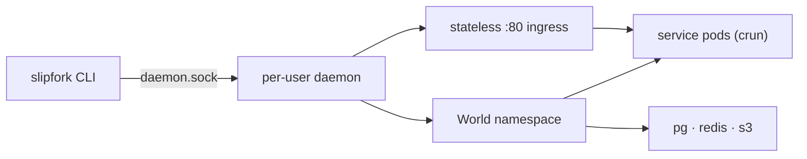

# CLI

Every command talks to one per-user daemon, renders one domain tree, and fails with one `next:` line.
Interactive terminals get colour and a fixed one-line bottom bar; pipes and `--json` get clean data.

```console
$ slipfork up
✓ Ready -> http://acme-shop.localhost

$ slipfork status
● acme-shop  ~/projects/acme-shop
  http://acme-shop.localhost
    /api  -> web      service              running
  http://uploads.acme-shop.localhost
    /     -> uploads  s3 (private)         running
  support
    pg      postgres 18   running
    cache   redis 7       running
```



## Daily verbs

| Command | Behaviour |
| :--- | :--- |
| `slipfork status` | Every world and domain as one tree; bare `slipfork` is the same verb |
| `slipfork ps` | The same tree scoped to this directory's world or fork |
| `slipfork up` | Boot images, resources, setup, hooks and services; idempotent while the file is unchanged |
| `slipfork restart [service]` | Restart one service or all of them in place |
| `slipfork down` | Stop pods and delete run subvolumes, keeping data and logs |
| `slipfork fork [name]` | Snapshot code and world data, boot the fork on its own URL |
| `slipfork drop <name>` | Stop a fork and delete its snapshots; `-f` discards a dirty checkout |
| `slipfork logs [-f] [-a] [target]` | Merged service logs; `-a` adds images and resources, or name one target |
| `slipfork shell <target>` | Real PTY: `bash`/`sh`, `psql`, or `redis-cli` for one declared target |
| `slipfork exec [service\|image] -- <cmd>` | Run any command in a pod and forward its exit code |
| `slipfork env [component]` | Resolved runtime variables, secrets redacted |
| `slipfork secret list\|set\|unset` | Manage local offline secrets; `set` reads stdin |
| `slipfork open [service]` | Open the world or route URL in a browser |
| `slipfork auth [url]` | Pair this machine with a remote `OSPP v1` endpoint |
| `slipfork doctor` | Check Btrfs, namespaces, and the `crun` + `:80` runtime |
| `slipfork fmt` | Format a Forkfile; `--check` reports only |
| `slipfork migrate` | Convert a legacy `snow.yml` into a `Forkfile` |
| `slipfork completions <shell>` | Print bash, zsh or fish completions |
| `slipfork daemon install` | Write the per-user unit; `--ingress` adds the system socket |

## What a state means

| State | Meaning | `next:` |
| :--- | :--- | :--- |
| `running` | The pod is alive and serving | `slipfork logs <id>` |
| `stopped` | Declared, but no pod is running | `slipfork up` |
| `cached` | Image or step resolved from cache with no rebuild | `slipfork logs <id>` |
| `up to date` | A `when changed()` stamp matched and the step was skipped | `slipfork up` |
| `orphaned` | A pod no longer declared after a `Forkfile` edit (yellow) | `slipfork up` |

`orphaned` rows disappear on the next `up`: it reconciles the world by stopping undeclared pods and
booting added or changed services. A repeat `up` with an unchanged file and feature set returns in
`0ms`. Human output never shows ports or uptime ages; `--json` keeps `port`, `started_at_ms`, `url`,
`routes` and `orphaned` for scripts.

## Boot progress

Tasks finish one aligned line each; the bottom row is a fixed `apt`-style bar that never scrolls.
Build, setup, hook and pod output never reaches the terminal — it goes to the world log.

```console
$ slipfork up
• image     backend   cached                     1ms
✓ resource  pg        postgres 18 ready         38ms
✓ setup     backend   uv sync (up to date)       0ms
✓ service   api       running -> /api           42ms
✓ Ready -> http://acme-shop.localhost  (218ms)
```

A cache hit says `cached`, never `pulled` or `built`. A failure keeps its red row and points at the
log, then leaves the world running for inspection:

```console
✗ image     backend   failed                    84ms
✗ Failed to build image backend — check logs with: slipfork logs backend
```

!!! info "`doctor` leads with a verdict"

    Three rows only: Btrfs, Namespaces, Runtime. A clean host prints `✓ Ready`; otherwise the first
    line counts issues and each failing row carries its own `next:` command.

## Shells and logs

`slipfork shell <target>` is the only interactive entry point. The target is required, and Slipfork
picks the program from the declared kind:

| Target | Opens |
| :--- | :--- |
| `service` or `image` (`api`) | Real PTY `bash` when the rootfs has it (prompt `(<world>:<api>) \w$ `), else `sh` |
| `postgres` or `database` (`pg`, `app_db`) | `psql` inside the database pod; piped input uses `psql -X -q -v ON_ERROR_STOP=1` |
| `redis` (`cache`) | `redis-cli` inside the cache pod |
| `s3` bucket (`uploads`) | Refused: a bucket is not a shell |

```console
$ slipfork shell pg
(acme-shop:pg) / #
```

Refusals are one line plus one remedy on stderr:

```console
$ slipfork shell uploads
✗ 'uploads' is an s3 bucket, not a shell
  next: slipfork shell api, pg, cache
```

`slipfork logs <image>` reads an image build log, including after a failed cold `up`;
`slipfork logs -f api` follows a service. `-a` adds image and resource logs to the merged stream.

## Terminal hygiene

| Contract | Behaviour |
| :--- | :--- |
| TTY-aware colour | ANSI only on a real terminal, `NO_COLOR` unset, `TERM` not `dumb` |
| Fixed bottom bar | One row, clamped to the terminal width and redrawn on resize |
| Clean scrollback | No spinner residue, sha256 lines, Dockerfile dumps or hook noise |
| `--json` parity | The same fields with zero escapes; failures emit `{"error":{code,message,next}}` |
| Actionable errors | `error: <one sentence>` plus exactly one `next: <command>` |
| Auto-selection | `shell`, `exec` and `logs` pick the only candidate, else name the ids |

```console
$ NO_COLOR=1 slipfork status
$ slipfork up --json
```

Under `--json`, `up` streams one NDJSON event per boot node and then
`{world, url, elapsed_ms, nodes: [{kind, name, state, duration_ms}]}`; `restart` answers the same
final shape, and `fork` answers `{fork, world, project, url, elapsed_ms, snapshot_ms}`.

## Where next

* [The Forkfile](forkfile.md) — what these commands boot.
* [Getting started](getting-started.md) — the five-step first run.
