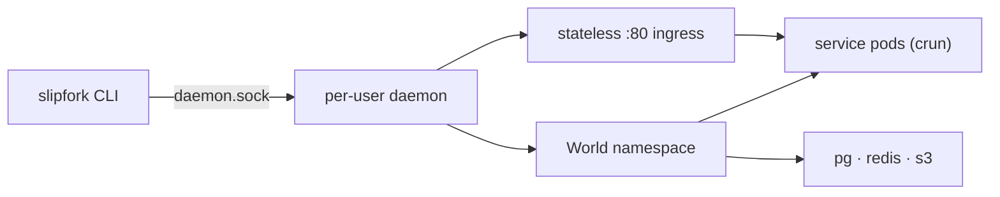

# CLI

Every command talks to one per-user daemon, renders one visual tree, and fails with one `next:` line.
Interactive terminals get real colour and live progress; pipes and `--json` get clean data.

```console
$ slipfork up
✓ Ready -> http://acme-shop.localhost

$ slipfork status
● acme-shop  http://acme-shop.localhost  ~/projects/acme-shop
  ├─ web      running      :8000 -> /api          12m
  ├─ pg       postgres 18  :5432                  12m
  └─ forks
     └─ ● billing-api  http://billing-api--acme-shop.localhost  ~/projects/acme-shop/.forks/billing-api
```



## Daily verbs

| Command | Behaviour |
| :--- | :--- |
| `slipfork status` | Every world as one tree; bare `slipfork` is the same verb |
| `slipfork ps` | The same tree scoped to this directory's world or fork |
| `slipfork up` | Boot images, resources, setup, hooks and services |
| `slipfork restart [service]` | Restart one service or all of them in place |
| `slipfork down` | Stop pods and delete run subvolumes, keeping data |
| `slipfork fork [name]` | Snapshot code and world data, boot the fork on its own URL |
| `slipfork drop <name>` | Stop a fork and delete its snapshots; `-f` discards a dirty checkout |
| `slipfork logs [-f] [-a] [service]` | Merged service `stdout` + `stderr` gutters; `-a` adds resources, or name one |
| `slipfork shell [service\|image]` | `sh -i` inside a pod with its user, workdir and env |
| `slipfork exec [service\|image] -- <cmd>` | Run any command in a pod and forward its exit code |
| `slipfork db [database]` | Interactive `psql`, or piped SQL |
| `slipfork redis [id]` | Interactive `redis-cli` |
| `slipfork env [component]` | Resolved runtime variables, secrets redacted |
| `slipfork secret list\|set\|unset` | Manage local offline secrets; `set` reads stdin |
| `slipfork open [service]` | Open the world or route URL in a browser |
| `slipfork auth [url]` | Pair this machine with a remote `OSPP v1` endpoint |
| `slipfork doctor` | Check Btrfs, namespaces, and the `crun` + `:80` runtime |
| `slipfork fmt` | Format a Forkfile; `--check` reports only |
| `slipfork migrate` | Convert a legacy `snow.yml` into a `Forkfile` |
| `slipfork completions <shell>` | Print bash, zsh or fish completions |
| `slipfork daemon install` | Write the per-user unit; `--ingress` adds the system socket |

## Visual hierarchy

Green marks a running state, `✓` and a green dot; bold cyan marks clickable URLs; red marks `✗` and
`failed`; yellow marks warnings and dirty checkouts; dim marks paths, ages and dividers. Columns size
to the longest service or fork name, so a long id never shears the tree.

```console
$ slipfork up
→ [1/5] Image api
✓ Image api (built 1.4s)
✓ Resources pg, cache, uploads ready (0.4s)
✓ Setup api: uv sync (1.1s)
✓ Services web running (0.2s)
✓ Ready -> http://acme-shop.localhost
```

A failing step prints the step in red, its `Forkfile:<line>` and exactly one remedy, then leaves the
world running so you can inspect it:

```console
✗ service web
  Forkfile:32
error: `@uv run uvicorn app.main:app` exited with 1 before it became ready
next: fix Forkfile:32, then run `slipfork up`
```

!!! info "`doctor` leads with a verdict"

    Three rows only: Btrfs, Namespaces, Runtime. A clean host prints `✓ Ready`; otherwise the first
    line counts issues and each failing row carries its own `next:` command.

## Terminal hygiene

| Contract | Behaviour |
| :--- | :--- |
| TTY-aware colour | ANSI only on a real terminal, `NO_COLOR` unset, `TERM` not `dumb` |
| Clean scrollback | Spinner frames clear before every status or log line |
| `--json` parity | The same fields with zero escapes; failures emit `{"error":{code,message,next}}` |
| Actionable errors | `error: <one sentence>` plus exactly one `next: <command>` |
| Auto-selection | `shell`, `exec`, `db` and `redis` pick the only candidate, else name the ids |

```console
$ NO_COLOR=1 slipfork status
$ slipfork up --json
```

Under `--json`, `up` streams typed boot events as NDJSON and `fork` answers
`{fork, world, project, url, elapsed_ms, snapshot_ms}`. No renderer ever parses human text.

!!! warning "`shell` allocates no TTY"

    `slipfork shell` pipes stdio to `sh -i`, so prompts and job control are limited; `cd`, exports
    and the exact runtime `env` behave normally. Use `slipfork exec` for one-shot commands.

## Where next

* [The Forkfile](forkfile.md) — what these commands boot.
* [Getting started](getting-started.md) — the five-step first run.
