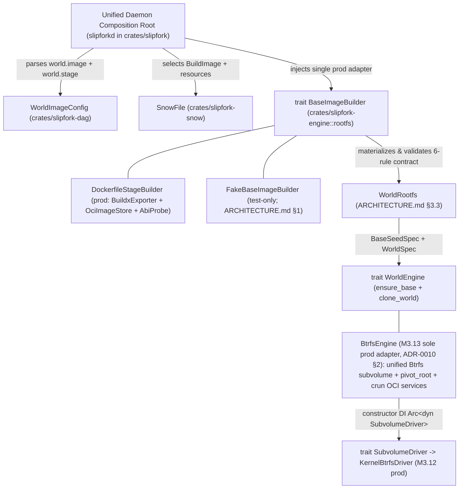

# ADR-0009: `L0` World Base Image from Project `Dockerfile`, Daemonless `crun` Backing-Service Containers, `$UID:$GID` Runtime, and World Image Contract

- **Status:** Accepted (`M2.24` — single-path `Dockerfile` `L0` rootfs + `crun` OCI backing services, zero fallbacks; amended by M3 target-state `ADR-0010` [`M3.20`, `M3.12`–`M3.15`, `M3.21`] — `BtrfsEngine` is the sole `WorldEngine` over `ADR-0010` §2's unified per-world Btrfs subvolumes, and `OciRootfs` carries `ReadinessProbe` in `M3.13`/`M3.15`)
- **Date:** 2026-11-15

## Context

1. **`L0` world rootfs was unspecified in M1's initial prototype:** M1's prototype cloned mutable service directories (`PGDATA`, Redis dir, S3 dir) while sharing host `/usr` and `/lib`, failing on real repositories when the host lacked `redis-server`, SeaweedFS (`weed`), PostGIS, or the project's exact language runtime.
2. **One canonical rootfs from `snow.yml` `images:` (Iron Law #3):** Every deployable `snow.yml` project already declares its own `Dockerfile` under `images:`, keeping local worlds and test slots aligned with production OS packages, native C libraries, and multi-stage build toolchains (such as Rust `cargo`/`rustc`, which production runtime stages omit).
3. **Isolated OCI backing-service containers inside unprivileged user namespaces:** Running `postgres`, `redis`, and `seaweedfs` as isolated OCI containers sharing the world's `127.0.0.1` `netns` decouples backing services completely from the app's Linux distribution (an Alpine `musl` app runs alongside `postgres:18` `glibc` with zero package-manager logic). Inside an unprivileged `--map-user=$UID --map-group=$GID` world (`ADR-0002`), a single static **`crun`** binary spawns OCI containers daemonless as child processes under the existing `$UID:$GID` mapping without nested `subuid` delegation.

## Decision

1. **Single `L0` Rootfs Source (`snow.yml` `images:`), World-Rootfs `crun` Asset & Two-Key `[world]` Selector (`crates/slipfork-dag`, normative):**
   - **One Mechanism Only, Zero Fallbacks:** Every world's `L0` application rootfs is built from a `BuildImage` (`context` + `dockerfile`) declared in the project's own `snow.yml` `images:` list. Slipfork writes a scratch `Dockerfile` outside the worktree appending `FROM <target_stage> AS slipfork-world` that copies **only** static `/.slipfork/bin/crun` and `/.slipfork/bin/slipfork-world-init` (zero `apt`/`apk` package-manager runs on the user's stage) and executes `docker buildx build -f <scratch_dockerfile> --target slipfork-world --output type=local,dest=<staging_dir> <context>`, producing a `$UID:$GID`-owned directory tree on non-`tmpfs` disk.
   - **World-Rootfs Static `crun` Provisioning & Staging (`M3.25`, consumed by `M3.8`–`M3.10`, `M3.15`–`M3.16`, `M3.19`; host-probe exclusion in `ADR-0010` §4):** `slipforkd` (`crates/slipfork::runtime::runtime_assets`) provisions the compile-time SHA-256-pinned upstream static `crun` release binary (`crates/slipfork-engine::rootfs::pin::crun_pin`) into `<state_dir>/cache/runtime/crun-<ver>-<arch>-<sha12>.bin` (the composition-root `--crun <path>` override declared in `ARCHITECTURE.md` §1 changes only the input path, and `BaseImageBuilder` still enforces the compile-time `crun_pin` SHA-256 via `BaseImageError::ExtractedCrunMismatch`), `DockerfileStageBuilder` stages and SHA-256-verifies it at guest path `WorldRootfs.crun_bin = /.slipfork/bin/crun` (`BaseImageError::{MissingRuntimeBinary, ExtractedCrunMismatch}`), and `BtrfsEngine` executes `WorldRootfs.crun_bin` exclusively inside the world's namespaces (`nsenter --target <init_pid> ... /.slipfork/bin/crun`).
   - **No Buildable Image Fails Closed:** If `snow.yml` declares zero `BuildImage` entries, Slipfork refuses to materialize a world, prints the 4-line `images:` snippet to add, and states plainly that a project that cannot be built into an image cannot be forked by Slipfork (projects wanting an upstream image write a 1-line `FROM <image> AS app` `Dockerfile`).
   - **Minimal Selector Surface (`[world]` in `slipfork.toml`, `#[serde(deny_unknown_fields)]`):** `[world]` accepts **at most two optional keys** and zero precedence ladders:
     - `world.image = "<id>"`: selects which `snow.yml` `BuildImage` seeds the world rootfs. Inferred unambiguously when `snow.yml` has exactly 1 `BuildImage`; **mandatory** (failing closed with the candidate list) when `>= 2` `BuildImage` entries exist.
     - `world.stage = "<stage>"`: selects which named `FROM ... AS <stage>` seeds the world rootfs (e.g. `world.stage = "builder"` so Rust/Go projects retain `cargo`/`rustc`/`go` for hooks and `slipfork test`). Inferred when the `Dockerfile`'s final `FROM` has `AS <name>`; an unnamed target stage fails closed naming the 1-line edit.

2. **Three-Layer World Execution & Single Owner Per Tooling Class (normative):**
   - **Layer 1 — Fidelity `L0` App Rootfs (Read-Only `/`):** `DockerfileStageBuilder` (`BaseImageBuilder`) caches the extracted `slipfork-world` stage immutably as a plain directory under `<state_dir>/cache/rootfs/<l0_merkle_sha256>/app` (holding zero `SubvolumeDriver`); `BtrfsEngine` (`M3.13`, `ADR-0010` §2) seeds it into the project's sealed read-only base subvolume (`ADR-0010` §2), cloned into every fork and `TestSlot` and mounted **read-only (`EROFS`)** at `/`. Language runtimes and compiled-language test toolchains (`cargo`, `go`) come exclusively from the selected `Dockerfile` stage (`world.stage`).
   - **Layer 2 — Daemonless `crun` Backing-Service OCI Containers & `OciRootfs.readiness` (Shared World `netns`):** `snow.yml` `resources:` map deterministically to OCI images with **zero new manifest syntax**: `pg_clusters: [{ id, version }]` → `docker.io/library/postgres:<version>`; `redis_clusters: [{ id, version }]` → `docker.io/library/redis:<version>`; non-empty `s3_buckets` → digest-pinned `docker.io/chrislusf/seaweedfs`. Each `OciRootfs` materialized into `WorldRootfs::service_images` carries `{ digest, rootfs, config, readiness: ReadinessProbe }` (`M3.13`/`M3.15` target state: `postgres:<v>` carries `ReadinessProbe::Exec` with port `5432`, in-container `psql` `SELECT 1` `argv`, and bounded `timeout`; `redis:<v>` carries `ReadinessProbe::Exec` with port `6379`, in-container `redis-cli PING` `argv`, and bounded `timeout`; `seaweedfs` carries `ReadinessProbe::TcpPort` on `9000` with bounded `timeout`), and `slipforkd`'s service-spec builder passes `oci_rootfs.readiness` through to `ServiceSpec.readiness` unchanged with **zero `match BackingServiceKey` ladder** (`ADR-0002` §2). Each backing service runs via static `crun` (`--cgroup-manager=disabled`, `readonly: true` rootfs from `<state_dir>/cache/oci/<sha256>/rootfs`, explicit `user`+`pid`+`mount`+`ipc`+`uts` namespaces with identity `uidMappings`/`gidMappings` `$UID -> $UID`, and **no `"network"` namespace** so all containers share the world's `127.0.0.1` loopback) with RW state mounts inside that world's unified Btrfs subvolume (`ADR-0010` §2). Client operations (`initdb`, `ADR-0008` streaming `pg_restore` from `stdin` + `CHECKPOINT` before `freeze_world` [`M3.29` target state, zero on-disk dump mount], `slipfork db` -> `psql`, `slipfork redis` -> `redis-cli`) execute inside the backing service's own OCI rootfs so app images never need DB client packages and never suffer `pg_restore` version skew. Headless browsers remain in the shared host browser pool over `.localhost` (`ADR-0006` §4).
   - **Layer 3 — Opt-In Host-Cache Passthrough (`--host-caches`):** Per-invocation/daemon machine-local opt-in (never committed to `slipfork.toml`) mounting existing `~/.cargo/{registry,git,bin}`, `~/.rustup`, `~/.cache/uv`, `~/.local/share/uv`, and `~/.local/share/pnpm/store` `MountMode::ReadOnly` **only** when a pure-Rust ELF `PT_INTERP` + `glibc`/`musl` ABI probe confirms `host.arch == world.arch`, identical libc family, and `host.glibc <= world.glibc`; any mismatch fails closed naming both ABIs.

3. **`$UID:$GID` Execution (Never Image `USER`, Never Root), 6-Rule Image Contract & Merkle Cache:**
   - **Current-User Rule:** Slipfork ignores the image's `USER` directive and never runs world processes as `root`: every hook, component, `exec`/`shell`, and `crun` service runs as `$UID:$GID` with a synthesized read-only `/etc/passwd` + `/etc/group` overlay mapping `$UID:$GID` to `<host_user>` (`HOME = /.slipfork/home`) so `getpwuid($UID)` succeeds (`initdb`, `git`, `ssh`, `getpass`). Because `/` is `EROFS`, runtime writes are confined strictly to the RW worktree mount, `/.slipfork/home`, `tmpfs` (`/tmp`, `/var/tmp`, `/run`, `/dev/shm`), `SLIPFORK_OUTPUT_DIR`/coverage mounts (`ADR-0006` §5), and the backing-service state directories inside the world's unified Btrfs subvolume (`ADR-0010` §2).
   - **6-Rule World Image Contract:** `BaseImageBuilder` validates extracted rootfs + OCI config before world boot and fails closed with exact 1-line fixes on: (1) unnamed/unknown `Dockerfile` stage, (2) unsupported OS or missing `/bin/sh` (supported `/etc/os-release` set: `debian` `bookworm`|`trixie`, `ubuntu` `jammy`|`noble`, `alpine` `3.20`|`3.21`), (3) static root-only privilege-drop entrypoints (`gosu`, `su-exec`, `sudo`, `chpst` -> `BaseImageError::RootAtRuntimeEntrypoint`; BuildKit's `--output type=local` writes `$UID:$GID`-owned files natively, while boot-time read-only `/` `EROFS` and POSIX mode bits `EACCES` are the sole runtime file-access enforcement — zero recursive pre-boot permission rewrite or path scan, `M3.25` consumed by `M3.8`), (4) baked `BASE_URL`/`.localhost`/`DATABASE_URL` env literals or host `/home`/`/Users` paths violating `ADR-0005` single-origin injection, (5) embedded `postgres`/`redis-server`/`weed`/`dockerd` daemons inside the app stage, and (6) `EXPOSE`/`HEALTHCHECK` port disagreement with `snow.yml` `ingresses`/`internal_ports`.
   - **Non-`tmpfs` Content-Addressed Cache & `BaseImageBuilder::prune_cache` Ownership (`M3.2` target state):** Rootfs and OCI caches live strictly under `<state_dir>/cache/{rootfs,oci}` alongside separately owned `<state_dir>/cache/runtime/` (refusing `/tmp` `tmpfs`). `RootfsDigest` hashes `"slipfork-l0-rootfs:v1\0"` over `(image_id, dockerfile_bytes, dockerignore_filtered_context_merkle, target_stage, sorted_sha256_build_envs, crun_sha256, world_init_sha256, arch)` and feeds `DagPlanner`'s `base` fixture root so `Dockerfile`/lockfile edits invalidate `base -> [fixtures.*]` while leaving `[artifacts.*]` untouched (`ADR-0003`). Phase 2 (`M3.2`) cache garbage collection (`BaseImageBuilder::prune_cache` over `CacheKeepSet` for `<state_dir>/cache/{rootfs,oci}`, and `<state_dir>/cache/runtime/` retention) is specified once in `ARCHITECTURE.md` §3.3.

## Composition Root & DI Tree

`slipforkd` (`crates/slipfork`) is the sole Composition Root wiring `DockerfileStageBuilder` (injected with `BuildxExporter`, `OciImageStore`, `AbiProbe`, and `InputHasher`), resolving `SlipforkConfig.world` (`crates/slipfork-dag`) against `SnowFile` (`crates/slipfork-snow`), and passing the resulting `WorldRootfs` inside `WorldSpec` to M3 target-state `BtrfsEngine` (`dyn WorldEngine`, `M3.13`/`M3.15`, `ADR-0002`, `ADR-0010`) with **zero downcasts**:



```rust
// crates/slipfork-dag — sole [world] schema (2 optional keys, deny_unknown_fields, zero fallbacks)
#[derive(Debug, Default, Clone, PartialEq, Eq, Deserialize)]
#[serde(deny_unknown_fields)]
pub struct WorldImageConfig {
    pub image: Option<String>, // snow.yml BuildImage id (required iff >= 2 BuildImages exist)
    pub stage: Option<String>, // named FROM ... AS <stage> (inferred iff final stage is named)
}
```

- **Rust Port Signatures (`ARCHITECTURE.md` §3.3 is normative):** `OciRootfs` (including `readiness: ReadinessProbe`), `WorldRootfs`, `CacheKeepSet`, `CachePruneReport`, `ServiceRuntime`, and `trait BaseImageBuilder` in `#![forbid(unsafe_code)]` `crates/slipfork-engine::rootfs` are defined once in `ARCHITECTURE.md` §3.3.

- **Single Supervision Surface (`ServiceRuntime`, Zero Parallel Supervisors):** Both `L0` app components (`ServiceRuntime::WorldProcess`) and `crun` backing-service containers (`ServiceRuntime::OciContainer`) go through `WorldEngine::{spawn_service, stop_service, service_logs}`, with `spawn_service` enforcing engine-owned `ServiceSpec.readiness: ReadinessProbe` inside each service's own runtime before returning `Ok(ServiceHandle)` (`ADR-0002` §2). `WorldEngine::exec_in_service(&ServiceHandle, ...)` (for `ADR-0008` `pg_restore` + `CHECKPOINT;`) and `WorldEngine::service_entry_command(&ServiceHandle)` (returning `crun exec` `WorldEntryCommand` for interactive TTY `slipfork db` -> `psql` and `slipfork redis` -> `redis-cli`) fail closed with `EngineError::ServiceNotRunning` if the target container is not `ServiceState::Running`. `WorldEngine::freeze_world` stops `WorldProcess` services first, then `OciContainer` services cleanly before sealing the unified world subvolume read-only per `ADR-0010` §3.
- **`BtrfsEngine` consumption (M3 target state `M3.13`, `ADR-0010` §§2–3, §6):** Clones one unified writable Btrfs subvolume from the sealed read-only snapshot via `SubvolumeDriver::snapshot_writable`, boots `slipfork-world-init` under `ADR-0010` §6's unprivileged namespace set (control files in `WorldSpec.control_dir`, `ADR-0010` §2), mounts `/proc`, `/dev/*`, `tmpfs` (`/tmp`, `/var/tmp`, `/run`, `/dev/shm`), synthesized `/etc/passwd` + `/etc/group`, `/.slipfork/oci/*`, the subvolume's backing-service state mounts (`ADR-0010` §2), `spec.mounts`, and `rootfs.host_caches` over the read-only `L0` root, `pivot_root`s into it, and supervises `ServiceRuntime::OciContainer` specs via `crun`.

## Consequences

- Every world runs on the project's exact `Dockerfile` runtime (`EROFS` `/`, `$UID:$GID`, zero `root:root` worktree pollution) while `postgres:<v>`, `redis:<v>`, and SeaweedFS run distro-independently as `crun` OCI containers (carrying their own `OciRootfs.readiness` probes, `ADR-0002` §2) inside one unified Btrfs subvolume per world (`ADR-0010` §2).
