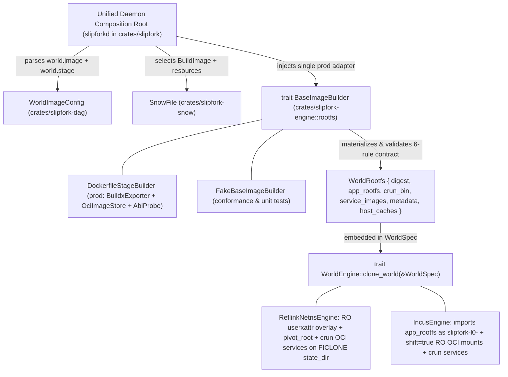

# ADR-0009: `L0` World Base Image from Project `Dockerfile`, Daemonless `crun` Backing-Service Containers, `$UID:$GID` Runtime, and World Image Contract

- **Status:** Accepted (`M2.24` — owner-ratified single-path `Dockerfile` `L0` rootfs + `crun` OCI backing services, zero fallbacks)
- **Date:** 2026-11-15

## Context

1. **`L0` world rootfs was unspecified across both `WorldEngine` drivers:** M1's `ReflinkNetnsEngine` CoW-cloned mutable service directories (`PGDATA`, Redis dir, S3 dir) while sharing host `/usr` and `/lib`, failing on real repositories when the host lacked `redis-server`, SeaweedFS (`weed`), PostGIS, or the project's exact language runtime. Meanwhile `IncusEngine` (`ADR-0002`) accepted an unexplained `base_instance: String` parameter that nothing built or invalidated.
2. **One canonical way beats curated language matrices (Iron Law #3):** Maintaining per-language OS images forces users into version-selection pain while still drifting from production `Dockerfile` packages, native C libraries, and multi-stage build toolchains (such as Rust `cargo`/`rustc`, which production runtime stages deliberately omit). Every deployable `snow.yml` project already declares its own `Dockerfile` under `images:`.
3. **Installing backing services via `apt`/`apk` into the app image creates a distro matrix, while Docker-in-Docker fails in unprivileged user namespaces:** Running `postgres`, `redis`, and `seaweedfs` as isolated OCI containers sharing the world's `127.0.0.1` `netns` decouples backing services completely from the app's Linux distribution (an Alpine `musl` app runs alongside `postgres:18` `glibc` with zero package-manager logic). Inside an unprivileged `--map-user=$UID --map-group=$GID` world (`ADR-0002`), `dockerd` requires nested `newuidmap`/`subuid` delegation blocked in nested containers and CI, whereas a single static **`crun`** binary spawns OCI containers directly as child processes under the existing `$UID:$GID` mapping.

## Decision

1. **Single `L0` Rootfs Source (`snow.yml` `images:`) & Two-Key `[world]` Selector (`crates/slipfork-dag`, normative):**
   - **One Mechanism Only, Zero Fallbacks:** Every world's `L0` application rootfs is built from a `BuildImage` (`context` + `dockerfile`) declared in the project's own `snow.yml` `images:` list. Slipfork writes a scratch `Dockerfile` outside the worktree appending `FROM <target_stage> AS slipfork-world` that copies **only** static `/.slipfork/bin/crun` and `/.slipfork/bin/slipfork-world-init` (zero `apt`/`apk` package-manager runs on the user's stage) and executes `docker buildx build -f <scratch_dockerfile> --target slipfork-world --output type=local,dest=<staging_dir> <context>`, producing a `$UID:$GID`-owned directory tree on non-`tmpfs` disk.
   - **No Buildable Image Fails Closed:** If `snow.yml` declares zero `BuildImage` entries, Slipfork refuses to materialize a world, prints the 4-line `images:` snippet to add, and states plainly that a project that cannot be built into an image cannot be forked by Slipfork (projects wanting an upstream image write a 1-line `FROM <image> AS app` `Dockerfile`).
   - **Minimal Selector Surface (`[world]` in `slipfork.toml`, `#[serde(deny_unknown_fields)]`):** `[world]` accepts **at most two optional keys** and zero precedence ladders:
     - `world.image = "<id>"`: selects which `snow.yml` `BuildImage` seeds the world rootfs. Inferred unambiguously when `snow.yml` has exactly 1 `BuildImage`; **mandatory** (failing closed with the candidate list) when `>= 2` `BuildImage` entries exist.
     - `world.stage = "<stage>"`: selects which named `FROM ... AS <stage>` seeds the world rootfs (e.g. `world.stage = "builder"` so Rust/Go projects retain `cargo`/`rustc`/`go` for hooks and `slipfork test`). Inferred when the `Dockerfile`'s final `FROM` has `AS <name>`; an unnamed target stage fails closed naming the 1-line edit.

2. **Three-Layer World Execution & Single Owner Per Tooling Class (normative):**
   - **Layer 1 — Fidelity `L0` App Rootfs (Read-Only `/`):** The extracted `slipfork-world` stage is cached immutably under `<state_dir>/cache/rootfs/<l0_merkle_sha256>/app` and mounted **read-only (`EROFS`)** across all forks and `TestSlot`s (`O(1)` mount, zero per-world rootfs file copy). Language runtimes and compiled-language test toolchains (`cargo`, `go`) come exclusively from the selected `Dockerfile` stage (`world.stage`).
   - **Layer 2 — Daemonless `crun` Backing-Service OCI Containers (Shared World `netns`):** `snow.yml` `resources:` map deterministically to OCI images with **zero new manifest syntax**: `pg_clusters: [{ id, version }]` → `docker.io/library/postgres:<version>`; `redis_clusters: [{ id, version }]` → `docker.io/library/redis:<version>`; non-empty `s3_buckets` → digest-pinned `docker.io/chrislusf/seaweedfs`. Each backing service runs via static `crun` (`--cgroup-manager=disabled`, `readonly: true` rootfs from `<state_dir>/cache/oci/<sha256>/rootfs`, explicit `user`+`pid`+`mount`+`ipc`+`uts` namespaces with identity `uidMappings`/`gidMappings` `$UID -> $UID`, and **no `"network"` namespace** so all containers share the world's `127.0.0.1` loopback) with RW state mounts from CoW `<state_dir>/{pgdata/<id>,redis/<id>,s3}`. Client operations (`initdb`, `ADR-0008` `pg_restore` + `CHECKPOINT` before `freeze_world`, `slipfork db` -> `psql`, `slipfork redis` -> `redis-cli`) execute inside the backing service's own OCI rootfs so app images never need DB client packages and never suffer `pg_restore` version skew, and a verified `<sha256>.pgdump` reaches that rootfs as a read-only `readonly_mounts` entry on its `ServiceRuntime::OciContainer` spec. Headless browsers remain in the shared host browser pool over `.localhost` (`ADR-0006` §4.2).
   - **Layer 3 — Opt-In Host-Cache Passthrough (`--host-caches`):** Per-invocation/daemon machine-local opt-in (never committed to `slipfork.toml`) mounting existing `~/.cargo/{registry,git,bin}`, `~/.rustup`, `~/.cache/uv`, `~/.local/share/uv`, and `~/.local/share/pnpm/store` `MountMode::ReadOnly` **only** when a pure-Rust ELF `PT_INTERP` + `glibc`/`musl` ABI probe confirms `host.arch == world.arch`, identical libc family, and `host.glibc <= world.glibc`; any mismatch fails closed naming both ABIs.

3. **`$UID:$GID` Execution (Never Image `USER`, Never Root), 6-Rule Image Contract & Merkle Cache:**
   - **Current-User Rule:** Slipfork ignores the image's `USER` directive and never runs world processes as `root`: every hook, component, `exec`/`shell`, and `crun` service runs as `$UID:$GID` with a synthesized read-only `/etc/passwd` + `/etc/group` overlay mapping `$UID:$GID` to `<host_user>` (`HOME = /.slipfork/home`) so `getpwuid($UID)` succeeds (`initdb`, `git`, `ssh`, `getpass`). Because `/` is `EROFS`, runtime writes are confined strictly to the RW worktree mount, `/.slipfork/home`, `tmpfs` (`/tmp`, `/var/tmp`, `/run`, `/dev/shm`), `SLIPFORK_OUTPUT_DIR`/coverage mounts (`ADR-0006` §5), and `<state_dir>/{pgdata,redis,s3}`.
   - **6-Rule World Image Contract:** `BaseImageBuilder` validates extracted rootfs + OCI config before world boot and fails closed with exact 1-line fixes on: (1) unnamed/unknown `Dockerfile` stage, (2) unsupported OS or missing `/bin/sh` (supported `/etc/os-release` set: `debian` `bookworm`|`trixie`, `ubuntu` `jammy`|`noble`, `alpine` `3.20`|`3.21`), (3) root-only privilege-drop entrypoints (`gosu`, `su-exec`, `sudo`, `chpst`) or unreadable non-world-accessible files, (4) baked `BASE_URL`/`.localhost`/`DATABASE_URL` env literals or host `/home`/`/Users` paths violating `ADR-0005` single-origin injection, (5) embedded `postgres`/`redis-server`/`weed`/`dockerd` daemons inside the app stage, and (6) `EXPOSE`/`HEALTHCHECK` port disagreement with `snow.yml` `ingresses`/`internal_ports`.
   - **Non-`tmpfs` Content-Addressed Cache:** Stored strictly under `<state_dir>/cache/{rootfs,oci,runtime}` (refusing `/tmp` `tmpfs`). `RootfsDigest` hashes `"slipfork-l0-rootfs:v1\0"` over `(image_id, dockerfile_bytes, dockerignore_filtered_context_merkle, target_stage, sorted_sha256_build_envs, crun_sha256, world_init_sha256, arch)` and feeds `DagPlanner`'s `base` fixture root so `Dockerfile`/lockfile edits invalidate `base -> [fixtures.*]` while leaving `[artifacts.*]` untouched (`ADR-0003`).

## Composition Root & DI Tree

`slipforkd` (`crates/slipfork`) is the sole Composition Root wiring `DockerfileStageBuilder` (injected with `BuildxExporter`, `OciImageStore`, `AbiProbe`, and `InputHasher`), resolving `SlipforkConfig.world` (`crates/slipfork-dag`) against `SnowFile` (`crates/slipfork-snow`), and passing the resulting engine-agnostic `WorldRootfs` inside `WorldSpec` to `dyn WorldEngine` with **zero `match engine` branches and zero downcasts**:



```rust
// crates/slipfork-dag — sole [world] schema (2 optional keys, deny_unknown_fields, zero fallbacks)
#[derive(Debug, Default, Clone, PartialEq, Eq, Deserialize)]
#[serde(deny_unknown_fields)]
pub struct WorldImageConfig {
    pub image: Option<String>, // snow.yml BuildImage id (required iff >= 2 BuildImages exist)
    pub stage: Option<String>, // named FROM ... AS <stage> (inferred iff final stage is named)
}

// crates/slipfork-engine::rootfs — #![forbid(unsafe_code)], zero slipfork-snow/slipfork-dag dep
#[derive(Debug, Clone, PartialEq, Eq)]
pub struct WorldRootfs {
    pub digest: RootfsDigest,                                   // sha256:<64 lowercase hex>
    pub app_rootfs: PathBuf,                                    // <state_dir>/cache/rootfs/<hex>/app
    pub crun_bin: PathBuf,                                      // /.slipfork/bin/crun (static ELF)
    pub service_images: BTreeMap<BackingServiceKey, OciRootfs>, // postgres:<v>, redis:<v>, seaweedfs
    pub metadata: ImageContractMetadata,                        // os_release, elf_abi, exposed_ports
    pub host_caches: Vec<WorldMount>,                           // empty unless --host-caches ABI probe passes
}

/// Unified service execution payload on `ServiceSpec` — ONE supervision path (`spawn_service` / `stop_service` / `service_logs`).
#[derive(Debug, Clone, PartialEq, Eq)]
pub enum ServiceRuntime {
    WorldProcess { argv: Vec<String>, cwd: PathBuf },
    OciContainer {
        image: BackingServiceKey,
        argv: Vec<String>,
        state_mounts: Vec<StateSubdirMount>, // e.g. pgdata/<id> -> /var/lib/postgresql/data
        readonly_mounts: Vec<WorldMount>,    // e.g. verified <sha256>.pgdump -> /dumps/<sha256>.pgdump (ADR-0008 §2)
    },
}

pub trait BaseImageBuilder: Send + Sync {
    fn materialize(
        &self,
        req: &WorldRootfsRequest,
        on_event: &mut dyn FnMut(RootfsBuildEvent),
    ) -> Result<WorldRootfs, BaseImageError>;
}
```

- **Single Supervision Surface (`ServiceRuntime`, Zero Parallel Supervisors):** Both `L0` app components (`ServiceRuntime::WorldProcess`) and `crun` backing-service containers (`ServiceRuntime::OciContainer`) go through `WorldEngine::{spawn_service, stop_service, service_logs}`. `WorldEngine::exec_in_service(&ServiceHandle, ...)` (for `ADR-0008` `pg_restore` + `CHECKPOINT;`) and `WorldEngine::service_entry_command(&ServiceHandle)` (returning `crun exec` `WorldEntryCommand` for interactive TTY `slipfork db` -> `psql` and `slipfork redis` -> `redis-cli`) fail closed with `EngineError::ServiceNotRunning` if the target container is not `ServiceState::Running`. `WorldEngine::freeze_world` stops `WorldProcess` services first, then `OciContainer` services cleanly before reflinking `state_dir`.
- **`ReflinkNetnsEngine` consumption:** `slipfork-world-init` mounts a read-only two-lowerdir `userxattr` overlay (`<world_dir>/mountpoints:<rootfs.app_rootfs>`), binds `/proc`, `/dev/*`, `tmpfs` (`/tmp`, `/var/tmp`, `/run`, `/dev/shm`), synthesized `/etc/passwd` + `/etc/group`, `/.slipfork/oci/*`, `<world_dir>/state`, `spec.mounts`, and `rootfs.host_caches`, `pivot_root`s into the merged root, and supervises `ServiceRuntime::OciContainer` specs via `crun` against `<world_dir>/state/{pgdata,redis,s3}`.
- **`IncusEngine` consumption (replaces `base_instance: String`):** Imports `rootfs.app_rootfs` once per `rootfs.digest` into Incus as immutable `slipfork-l0-<digest12>`, clones via `POST /1.0/instances` (`source.type = "copy"`), attaches `spec.mounts`, `rootfs.host_caches`, and `rootfs.service_images` (`shift = "true"`, `readonly = "true"`), and supervises the identical `ServiceRuntime` specs inside the instance's `netns`.

## Rejected Alternatives

- **Maintained per-language OS base images or separate registry-pull config modes:** Rejected per Iron Law #3 (One Canonical Way): curating a language/version matrix is painful, drifts from production `Dockerfile` dependencies, omits compiled toolchains in runtime stages, and a 1-line `FROM <upstream> AS app` `Dockerfile` already covers upstream images with zero second code path.
- **Running a `dockerd` daemon inside the world:** Rejected because rootless `dockerd` inside an unprivileged `--map-user=$UID` `userns` requires nested `newuidmap`/`newgidmap` `subuid` delegation (blocked with `EPERM` in LXC/CI containers) and adds socket-daemon startup latency, whereas static `crun` executes daemonless under the world's single `$UID:$GID` identity mapping (proven live on `kernel 6.12.117+deb13-amd64`, `docs/design/world-base-image.md` §7).
- **Installing `postgresql`/`redis`/`seaweedfs` into the app rootfs via `apt`/`apk`:** Rejected because it couples backing-service versions to the app's OS distribution (`debian` vs `alpine`) and mutates the user's production image filesystem.

## Consequences

- Every world runs on the project's exact `Dockerfile` runtime (`EROFS` `/`, `$UID:$GID`, zero `root:root` worktree pollution) while `postgres:<v>`, `redis:<v>`, and SeaweedFS run distro-independently as `crun` OCI containers over `FICLONE`-clonable state directories; doc consistency lands in `M2.25` and code sequences cleanly across `M2.26`–`M2.29` and `M3.1` (`docs/design/world-base-image.md` §8).
