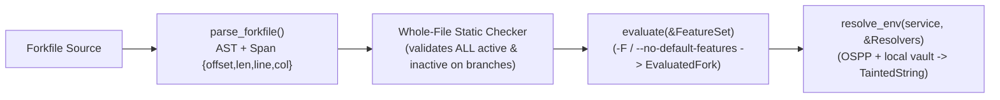

# `Forkfile` Specification: Procedural Manifest, Static Checker & `SnowFile` Parity

Slipfork runs your cloud environment locally in a box; CI is the clutch. One `<repo_root>/Forkfile` defines resources, per-service containers, feature flags, and tasks with full whole-file static checking.

```text title="Forkfile"
features {
    default = [dev]
    dev     = [mail]
    mail
}

postgres pg {
    database app_db
}
redis cache
domain main

env common {
    DATABASE_URL = app_db.url
    REDIS_URL    = cache.url
    SECRET_KEY   = secret(SECRET_KEY) ?? random_hex(32)
}

service api ./api {
    use env common
    port 8000
    route /api
    volume .venv
    setup: uv sync --frozen
    pre-deploy: uv run alembic upgrade head
    run uv run gunicorn app.main:app --bind 0.0.0.0:$port
    on dev: run uv run uvicorn app.main:app --host 0.0.0.0 --port $port --reload
}

on mail {
    service mailpit from axllent/mailpit:latest {
        port 8025
        route mail.*
    }
}

task migrate in api: uv run alembic upgrade head
```

!!! info "Single Manifest, Top-to-Bottom Procedural Semantics"
    `Forkfile` is the sole repository manifest (`project <slug>` optionally overrides the VCS-derived project slug). Statements execute top-to-bottom: inside active `on` blocks, scalar assignments (`run`, `port`, `stage`, `dockerfile`, `size`, `version`, `env.KEY = ...`) overwrite earlier values without `else` branches, while additive blocks (`volume`, `route`, `setup`, `pre-deploy`, `post-deploy`, `failed-deploy`, `service`, `task`) append or override by key deterministically.

## 1. Feature Flags & Conditional Execution



- **Cargo-style `features { ... }`:** Declares feature identifiers and transitive implications (`default = [dev]`, `dev = [mail]`). Unknown feature names in `Forkfile` or CLI (`-F, --features <f1,f2>`, `--no-default-features`) and feature cycles fail immediately.
- **Conditionals (`on <expr> { ... }` / `on <expr>: <stmt>`):** Allowed at top level and inside `service`, `postgres`, or `redis`. Supports `feat`, `!feat`, `a & b`, `a | b`, and `(...)` (`!` > `&` > `|`).

## 2. Resources, Built-In Scopes & Property Parity

Resources and domains bind typed identifiers matching Kerfufoo's `SnowFile` 1:1 (`version` is optional inside `{ ... }`, defaulting to `"18"` for PostgreSQL and `"7"` for Redis):

| Construct / Built-In | Syntax | Exposed Properties (**bold** = carries secret taint) |
|---|---|---|
| **PostgreSQL Cluster & DBs** | `postgres <cluster> { version 18; database <db>; database <db2> { pool = false } }` (`version` optional, default `"18"`) | `<db>.` — `host`, `port`, `user`, **`password`**, `db_name`, **`url`**, **`jdbc`**, `ca_cert` (`pool` default `true`; `<cluster>.url` errors naming `<db>.url`) |
| **Redis Cluster** | `redis <id>` or `redis <id> { version 7 }` (`version` optional, default `"7"`) | `<id>.` — `host`, `port`, `user`, **`password`**, **`url`**, `ca_cert` |
| **S3 Bucket** | `s3 <id>` | `<id>.` — `endpoint`, `bucket`, `region`, `access_key`, **`secret_key`**, **`url`** |
| **Domain** | `domain <id>` | `<id>.` — `name`, `leader_name`, `url` (bare `<id>` without property is a static error) |
| **Service Handle** | `service <id> <./dir \| from <img_ref>> { ... }` | `<id>.` — `private_domain`, `private_url`, `private_port`, `commit_hash`, `public_route_path`, `public_url` |
| **App Scope** | Built-in `app` | `app.` — `domain`, `url`, `id` |
| **Deployment Scope** | Built-in `deployment` | `deployment.` — `id`, `date_create`, `date_event`, `cause`, `commit_sha`, `env.branch.{name,repo}`, `env.name`, `env_group.key`, `is_production`, `is_leader`, `product.{name,slug}` |

## 3. Services, CoW Volumes, Expressions & Direct `execve` Commands

- **Container Source & Deduplication:** `service <id> ./dir` sets both the Docker build context (`./dir/Dockerfile`, overridable via `dockerfile <relpath>` and `stage <name>`) and the container's default working directory (`<worktree>/<dir>`). `service <id> from <registry/repo:tag>` pulls an OCI image directly; services sharing identical `(./dir, dockerfile, stage, build_env)` build and cache their rootfs **once**.
- **Service Directives:** `stage <name>`, `dockerfile <relpath>`, `size "<hint>"` (default `"*"`), `port <u16>` (`1..=65535`), `internal_ports [<u16>, ...]`, `route <prefix | sub.*>` (`route /`, `route /api`, `route mail.*` -> `http://mail.<world_host>`, bound to the service handle so `on dev: port 5173` routes to `5173` automatically), and `volume <rel_path>` (mounts `<world_subvol>/volumes/<id>/<sanitized_path>` over `<worktree>/<dir>/<rel_path>`, CoW-cloning `.venv` / `node_modules` in ~20 ms on `fork` while source files stay live `MS_BIND`-mounted from the host).
- **Reusable `env` Groups & `TaintedString` Expressions:** Top-level `env <group> { ... }` blocks are imported via `use env <group>` and merged in order with `env { KEY = <expr> }`, `env.KEY = <expr>`, and `build_env { ... }` (`build_env` vs `env` key collisions fail statically). `<expr>` supports string/bool/int literals, `<entity>.<prop>`, `var(<KEY>)`, `secret(<KEY>)`, `<lhs> ?? <fallback>`, write-once CSPRNG generators (`random_hex(<bytes>)`, `random_base64(<bytes>)`, `random_string(<len>)`, `uuid4()` valid strictly on `secret(<KEY>) ?? <gen>`), and `+` concatenation; touching any secret contaminates the resulting `TaintedString`.
- **Direct `execve` Lifecycle & Tasks (Zero Shell Wrappers):**
  - `run <argv...>` supervises one direct child process inside the service's `crun` container (no `/bin/sh -c`).
  - `setup`, `pre-deploy`, `post-deploy`, and `failed-deploy` accept `: <argv...>` or `{ <line1>\n <line2> }`, running each line sequentially via `execve` with `[1/N]` progress and failing fast on non-zero exit with `Forkfile:<line>`.
  - Top-level `task <name> in <service>: <argv...>` (or `{ ... }`) runs via `slipfork run <name> [extra_args...]` (single-command tasks append `extra_args` to `argv`; multi-line tasks reject trailing args).
  - **Word-split-safe `$` injection:** `$port`, `$env.KEY`, and `$<entity>.<prop>` resolve directly into their `argv` slot without word-splitting (supporting `"..."` interpolation with spaces, `'...'` literals, and leading `FOO=bar` per-command env overrides); secret-tainted args redact as `[REDACTED]` in logs and diagnostics.

## 4. Whole-File Multi-Error Static Checker & Caret Diagnostics

`parse_forkfile` checks **every statement and every `on` branch (active and inactive)**, collecting **all** diagnostics rather than stopping at the first error:
1. Duplicate IDs across postgres clusters, databases, redis clusters, s3 buckets, domains, services, env groups, tasks, and features.
2. Unknown features in `on <expr>`, unknown identifiers or invalid properties (`pg.url` suggests child database `app_db.url`), and bare `<domain>` references.
3. Unknown `$port` / `$env.KEY` / `$<entity>.<prop>` tokens in `run`, hooks, or `task` `argv` slots, `dockerfile`/`stage`/`build_env` on `from <image_ref>` services, invalid generators outside `secret(...) ?? <gen>`, port bounds (`1..=65535`), invalid routes, and `build_env` vs `env` conflicts.

Every AST node carries `Span { offset, len, line, col }` (`1`-based line and column) for rustc-style diagnostics:

```text
error: `pg` is a postgres cluster, not a database
  --> Forkfile:14:20
   |
14 |     DATABASE_URL = pg.url
   |                    ^^^^^^ did you mean database `app_db.url`?
```

## 5. Programmatic Rust & JSON Interface (`crates/slipfork-forkfile`)

`ForkFile` round-trips losslessly to canonical JSON (`serde`) so Kerfufoo and `slipforkd` share one typed workflow:

```rust
pub fn parse_forkfile(source: &str) -> Result<ForkFile, Vec<Diagnostic>>;

impl ForkFile {
    pub fn validate(&self, external: &dyn ExternalCheck) -> Vec<Diagnostic>;
    pub fn evaluate(&self, features: &FeatureSet) -> Result<EvaluatedFork, Vec<Diagnostic>>;
    pub fn has_id(&self, id: &str) -> bool;
    pub fn find_service(&self, id: &str) -> Option<&ServiceDef>;
    pub fn find_image(&self, id: &str) -> Option<&ImageSource>;
    pub fn find_pg_cluster(&self, id: &str) -> Option<&PgClusterDef>;
    pub fn find_pg_database(&self, id: &str) -> Option<(&PgClusterDef, &PgDatabaseDef)>;
    pub fn find_redis_cluster(&self, id: &str) -> Option<&RedisClusterDef>;
}

impl EvaluatedFork {
    pub fn resolve_env(
        &self,
        service_id: &str,
        resolvers: &Resolvers<'_>,
    ) -> Result<BTreeMap<String, TaintedString>, Vec<Diagnostic>>;
}
```
