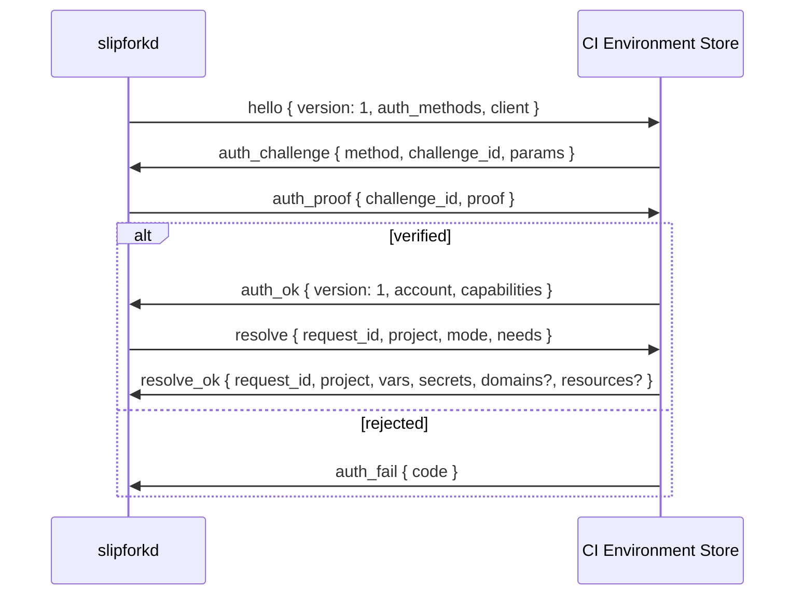
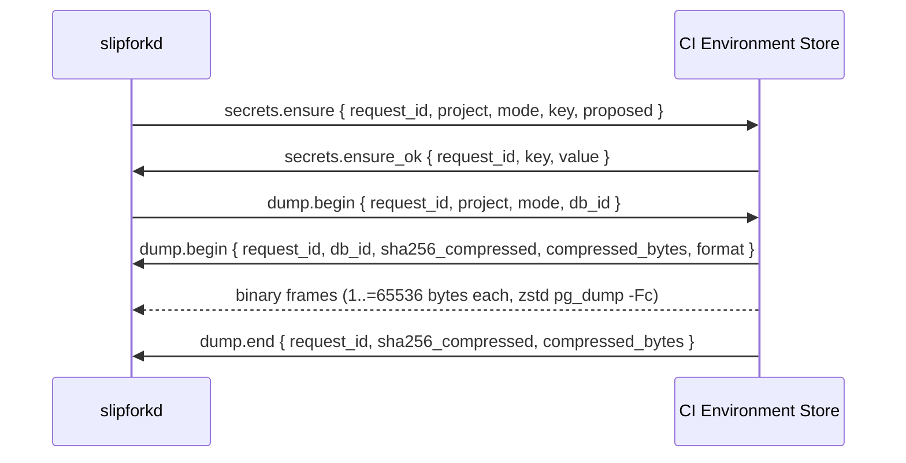

# Open Secret Provider Protocol (OSPP v1)

> **Status.** `0.1.0` ships the `slipforkd` OSPP v1 client only; no provider implements the protocol and the public reference publishes no wire format ([OSPP v1 reference](../reference/ospp.md)). This page is the `0.2.0` target — negotiated authentication, repository-keyed project identity, and `resolve` — binding on client and provider together when the first integration lands.

## 1. Purpose

Slipfork runs a local cloud in a box: an isolated world with its own network namespace, its own backing services (PostgreSQL, Redis, S3), and its own writable copy-on-write storage. CI creates the real cloud environments — provisioning buckets, databases, and deployed configuration — and holds the authoritative secrets and values for each of them. In `0.2.0`, OSPP v1 configures the local cloud from that source of truth: `slipforkd` resolves the secrets, values, and optional resource coordinates that make the local world behave like the deployed environment.

## 2. Roles & ownership

Slipfork owns and defines the OSPP v1 wire specification, state machine, cryptographic transcript, and conformance vectors. Kerfufoo (the CI/deployment environment store) and any compatible provider will implement the server side of this specification downstream; `slipforkd` is the sole client owner on the local machine and feeds resolved values into local worlds exclusively through the synchronous `SecretProvider` port and the `RemoteResourceOffer` value type.

## 3. Transport, framing & primitive types

OSPP v1 runs over a single WebSocket connection (`wss://<host>:<port>/<mount>`; mount: §8 item 1, `INPUT NEEDED` — `0.1.0`'s client dials `/_ospp/v1/connect` and `/_ospp/v1/pair`). Plaintext `ws://` is accepted solely when `<host>` is literal `127.0.0.1`, `::1`, or `localhost`. The client MUST send `Sec-WebSocket-Protocol: ospp-v1` and close immediately if the server omits or alters that subprotocol.

- **Control & RPC frames:** UTF-8 JSON text frames carrying `"type": tag_str`, capped at `16_384` bytes (`16 KiB`). Unknown object keys MUST be rejected (`deny_unknown_fields`).
- **Binary dump frames:** Raw WebSocket binary frames capped at `65_536` bytes (`64 KiB`), legal strictly after `S→C dump.begin` and before `S→C dump.end`. Any binary frame outside that range terminates the connection.
- **Version negotiation:** `hello.version` and `auth_ok.version` carry `version: u16` set to `1`; future protocol revisions negotiate through this same field. `0.1.0`'s unpublished `version: 1` frames are not interoperable with this shape; this page defines the wire both peers implement. Any unsupported version fails closed with `auth_fail { code: "unsupported_version" }`.
- **Correlation & in-flight bound:** Every post-`auth_ok` client request carries `request_id: u32` (monotonic per session starting at `1`), echoed in the server reply. At most one request per `request_id` MAY be in flight, and an active `dump.begin..dump.end` stream blocks further requests on that socket until `dump.end`.
- **Deadlines & close semantics:** Connect and handshake frames enforce a `10_000 ms` read deadline; post-auth frames enforce a `30_000 ms` read deadline. On `auth_fail`, malformed JSON, oversized frames, unknown `request_id`, or interrupted dump streams, the peer sends a WebSocket `Close` frame and drops the session without retry.

| Type alias | Wire representation & bounds |
|---|---|
| `u16`, `u32`, `u64` | Unsigned JSON integers within exact Rust bit widths (`0..=65535`, `0..=2^32-1`, `0..=2^64-1`). |
| `bytes32_hex`, `sha256_hex` | `string(64)`: exact 64 lowercase ASCII hex digits (`[0-9a-f]{64}`). |
| `p256_key_id` | `string(71)`: `"p256:"` followed by 66 lowercase hex digits encoding a valid 33-byte SEC1-compressed P-256 point. |
| `p256_sig_hex` | `string(128)`: raw 64-byte big-endian ECDSA P-256 `r \|\| s` signature in lowercase hex (ASN.1 DER forbidden). |
| `challenge_id_str` | `string(16..=128)`: printable ASCII (`0x21..=0x7e` excluding `"` and `\`), single-use server token. |
| `slug_str` | `string(1..=63)`: lowercase DNS label `^[a-z0-9]([a-z0-9-]{0,61}[a-z0-9])?$`. |
| `mode_name` | `string(1..=32)`: `^[a-z0-9_-]{1,32}$` (e.g. `local`, `test`, `cloud`). |
| `canon_remote_str` | `string(3..=512)`: lowercase `<host>/<path>` without scheme, userinfo, port, trailing `/`, or `.git` suffix. |
| `key_str` | `string(1..=256)`: printable ASCII (`0x21..=0x7e`) without `"` or `\`. |
| `val_str`, `secret_str` | `string(0..=8192)` for `val_str`; `string(1..=8192)` for `secret_str` (redacted as `[REDACTED]` in logs/`Debug`). |
| `host_str`, `url_str` | `string(1..=253)` lowercase DNS hostname; `string(1..=1024)` `https://` or loopback `http://` URL. |

## 4. Handshake & authentication

```
C→S  hello          { version, auth_methods, client }
S→C  auth_challenge { method, challenge_id, params }
C→S  auth_proof     { challenge_id, proof }
S→C  auth_ok        { version, account, capabilities } | auth_fail { code }
C→S  resolve        { request_id, project, mode, needs }
S→C  resolve_ok     { request_id, project, vars, secrets, domains?, resources? } | resolve_err { request_id, code }
```



### Frame fields & validation

| Frame (`type`) | Direction | Fields |
|---|---|---|
| `hello` | `C→S` | `version: u16` (`1`), `auth_methods: list<auth_method_id>(1..=8)`, `client: string(1..=64)` (`"slipfork/<semver>"`). |
| `auth_challenge` | `S→C` | `method: auth_method_id`, `challenge_id: challenge_id_str`, `params: MethodChallengeParams`. |
| `auth_proof` | `C→S` | `challenge_id: challenge_id_str`, `proof: MethodProof`. |
| `auth_ok` | `S→C` | `version: u16` (`1`), `account: string(1..=128)`, `capabilities: list<capability_id>(0..=8)`. |
| `auth_fail` | `S→C` | `code: auth_err_code` (server closes WebSocket immediately after sending). |
| `resolve` | `C→S` | `request_id: u32`, `project: ProjectIdentity`, `mode: mode_name`, `needs: list<read_cap_id>(1..=2)`. |
| `resolve_ok` | `S→C` | `request_id: u32`, `project: ResolvedProject`, `vars: map<key_str, val_str>`, `secrets: map<key_str, secret_str>`, `domains?: map<key_str, host_str>`, `resources?: ResourceBundle`. |
| `resolve_err` | `S→C` | `request_id: u32`, `code: resolve_err_code`. |

### Negotiated authentication methods (`auth_method_id`)

The client advertises in `hello.auth_methods` **only** methods for which it currently holds usable credentials. The server picks one supported method in `auth_challenge.method` or replies `auth_fail { code: "unsupported_method" }`. If the server picks a method the client did not advertise, the client closes immediately.

1. **`"tpmd-p256"` (hardware-sealed device key, developer workstations):**
   - `auth_challenge.params`: `{ "nonce_s": bytes32_hex }` (32 single-use CSPRNG bytes bound 1:1 to `challenge_id`).
   - `auth_proof.proof`: `{ "key_id": p256_key_id, "nonce_c": bytes32_hex, "sig": p256_sig_hex }`.
   - Signed transcript (hashed once with SHA-256, signed as raw 64-byte `r || s`):
     `"ospp-v1" || raw(nonce_s, 32) || raw(nonce_c, 32) || utf8(server_name)`
     where `server_name` (`host_str`) is the exact lowercase ASCII TLS SNI hostname without port, and `nonce_s` is uniquely bound to `challenge_id` on the server. The server reconstructs `server_name` from its own canonical host configuration so host-header or proxy confusion fails signature verification.
   - Signer rule: `slipforkd` signs via `tpmd` (`sealed` floor). A local `0600` software P-256 key is used solely when no `tpmd` socket exists on the host; `tpmd` lock timeouts, floor rejections, or signature mismatches fail closed.
2. **`"bearer"` (CI-issued token, headless runners & autonomous agents):**
   - `auth_challenge.params`: `{}` (empty object; `challenge_id` remains mandatory and single-use).
   - `auth_proof.proof`: `{ "token": secret_str }` (never logged; exact Kerfufoo token grammar is `INPUT NEEDED`).

**Extension & zero-fallback rule:** Adding a future authentication method requires a new `auth_method_id` negotiated explicitly in `hello.auth_methods`. Neither peer MAY retry or silently fall back to another method after `auth_challenge` or `auth_fail`.

**Handshake refusal rules:** `hello.version != 1` → `unsupported_version`; no common `auth_methods` → `unsupported_method`; unknown, expired, or reused `challenge_id` → `replayed_challenge`; invalid P-256 signature, wrong `server_name` binding, or malformed `r || s` → `bad_proof`; unknown `key_id` or invalid/expired `bearer` token → `unknown_credential`; authenticated principal lacking access → `access_denied`. Any post-auth frame sent before `auth_ok` terminates the connection.

## 5. Project identity

Instead of bare `(project, mode)` strings, OSPP v1 keys resolution on canonical repository identity plus the `snow.yml` digest so a local world binds to the exact `EnvGroup` that CI created for that repository.

- **`ProjectIdentity` (`C→S`):** `{ "remote": canon_remote_str | null, "snow_sha256": sha256_hex, "slug": slug_str }`.
  - `remote` normalizes `<vcs_root>`'s upstream URL (`git@github.com:Acme/Shop.git` and `https://github.com/Acme/Shop/` both become `"github.com/acme/shop"`).
  - `snow_sha256` is the SHA-256 digest of the exact `<vcs_root>/snow.yml` bytes being resolved.
  - `slug` comes from `<vcs_root>/slipfork.toml` `project` if set, else `<vcs_root>`'s directory basename.
- **Precedence & missing-remote rule:**
  1. When `remote` is non-null, the server resolves the target `EnvGroup` strictly from `(remote, mode)` and cross-checks `slug` if configured.
  2. When `remote` is `null` (an unpushed local repo), resolution is permitted **only when `mode == "local"`**; if `mode != "local"` or the provider requires a repository remote, the server replies `resolve_err { code: "missing_remote" }` (and `slipforkd` refuses before dialing for non-`local` modes).
- **Server echo (`ResolvedProject` in `resolve_ok`):** `{ "remote": canon_remote_str | null, "snow_sha256": sha256_hex, "slug": slug_str, "mode": mode_name, "env_group": string(1..=128) }`. `slipforkd` verifies exact equality of `(remote, snow_sha256, slug, mode)` against the request and fails closed on any discrepancy.

## 6. Capabilities

`auth_ok.capabilities` lists a subset of `["env.bundle", "secrets.ensure", "resources.describe", "dump.begin"]`. Read capabilities (`env.bundle`, `resources.describe`) are batched inside `resolve.needs` (`read_cap_id`); write and streaming capabilities (`secrets.ensure`, `dump.begin`..`dump.end`) run as dedicated `request_id`-correlated frames after `auth_ok`.



| Capability | Request fields (`C→S`) | Response fields (`S→C`) | Failure codes | Target client (`slipforkd`) behaviour |
|---|---|---|---|---|
| `env.bundle` | `resolve` with `"env.bundle" ∈ needs` | `resolve_ok`: `vars: map<key_str, val_str>`, `secrets: map<key_str, secret_str>`, `domains?: map<key_str, host_str>` (`cloud` mode only) | `resolve_err`: `unknown_project`, `unknown_mode`, `missing_remote`, `identity_conflict`, `access_denied`, `unsupported_capability` | In `local` mode, local `0600` vault keys take precedence over `vars`/`secrets` and `WorldOrigin` overrides `domains`. Missing required keys fail closed before world boot. |
| `secrets.ensure` | `type: "secrets.ensure"`, `request_id: u32`, `project: ProjectIdentity`, `mode: mode_name`, `key: key_str`, `proposed: secret_str` | `type: "secrets.ensure_ok"`, `request_id: u32`, `key: key_str`, `value: secret_str` (write-once compare-and-set: stores `proposed` iff absent, always returns stored value) | `capability.error`: `unsupported_capability`, `access_denied`, `invalid_request`, `conflict`, `internal_error` | Called over OSPP v1 only for `cloud` mode `!!` secrets (`local` mode persists `!!` exclusively to the local `0600` vault). Rejects mismatched `key` or empty `value`. |
| `resources.describe` | `resolve` with `"resources.describe" ∈ needs` | `resolve_ok.resources`: `{ s3_buckets: map<key_str, S3Coords>, pg_databases: map<key_str, PgDumpMeta> }` (`S3Coords = { endpoint: url_str, region: string(1..=64), bucket: string(1..=128), access_key: secret_str, secret_key: secret_str }`; `PgDumpMeta = { db_id: key_str, sha256_compressed: sha256_hex, compressed_bytes: u64, format: "pg_custom_zstd" }`) | `resolve_err`: `not_offered`, `unsupported_capability`, `access_denied`, `unknown_project`, `unknown_mode` | Validates non-empty coordinates and `db_id` match; maps into `RemoteResourceOffer`. On `not_offered` or omitted capability, `prefer_remote` uses world-local resources and `remote` fails closed. |
| `dump.begin` / `dump.end` | `type: "dump.begin"`, `request_id: u32`, `project: ProjectIdentity`, `mode: mode_name`, `db_id: key_str` | `dump.begin { request_id: u32, db_id: key_str, sha256_compressed: sha256_hex, compressed_bytes: u64, format: "pg_custom_zstd" }`, `0+` binary frames (`≤ 64 KiB`), `dump.end { request_id: u32, sha256_compressed: sha256_hex, compressed_bytes: u64 }` | `capability.error`: `unknown_resource`, `not_offered`, `access_denied`, `unsupported_capability`, `internal_error` | Streams to `<state_dir>/dumps/` (never `tmpfs`), verifies byte count > 0 and SHA-256 against `PgDumpMeta`/`dump.begin`/`dump.end`, discards and poisons session on mismatch, restores via `pg_restore` in-container. |

## 7. Errors

Every refusal uses one closed code set; `capability.error` carries `{ "type": "capability.error", "request_id": u32, "capability": capability_id, "code": cap_err_code, "message"?: string(0..=512) }`.

| Frame | Closed `code` values | Wire & client handling |
|---|---|---|
| `auth_fail` | `unsupported_version`, `unsupported_method`, `replayed_challenge`, `bad_proof`, `unknown_credential`, `access_denied` | Server closes immediately; `slipforkd` surfaces typed auth failure and never retries or falls back. |
| `resolve_err` | `unknown_project`, `unknown_mode`, `missing_remote`, `identity_conflict`, `access_denied`, `not_offered`, `unsupported_capability` | Session stays open; `not_offered` applies only when `needs == ["resources.describe"]`. All other codes fail the command closed. |
| `capability.error` | `unsupported_capability`, `access_denied`, `unknown_resource`, `invalid_request`, `not_offered`, `conflict`, `internal_error` | `slipforkd` verifies `(request_id, capability)` match and **withholds** `message` from diagnostics and logs so refusals never echo secret data. |

**Client invariant:** `slipforkd` fails closed on every error code, never invents or substitutes a missing `vars::`/`secrets::` value, and treats `not_offered` on remote resources by provisioning hermetic world-local SeaweedFS and PostgreSQL instances inside the local world (logging `[resources] <id>: prefer_remote -> local (not_offered)`), failing closed only when the user explicitly configured `remote` or passed `--refresh-dump`.

## 8. Kerfufoo mapping

- `EnvGroup` (created and managed by Kerfufoo per `mode`, defaulting to `"cloud"`) ↔ `resolve` (`env.bundle` `vars` and `cloud`-mode `domains`).
- `EnvGroup.Secret` (encrypted secret store on `EnvGroup`) ↔ `resolve_ok.secrets` (read into local worlds and `cloud` deploys) and `secrets.ensure` (write-once `!!` persistence in `cloud` mode; in `local` mode `!!` writes strictly to the local `0600` vault).
- Remote S3 / PostgreSQL seed resources ↔ `INPUT NEEDED` (item 4 below); if Kerfufoo offers no coordinates, it omits `"resources.describe"` / `"dump.begin"` from `auth_ok.capabilities` (or returns `not_offered`), and `slipforkd` provisions hermetic services inside the local world.

Kerfufoo facts that are unknown and **must be supplied before implementation** (`INPUT NEEDED`):

1. **Auth endpoint & credential enrollment (`INPUT NEEDED`):** Exact WebSocket mount path/hostname on Kerfufoo, `bearer` token wire format and minting/scoping flow for CI/agents, and how `tpmd-p256` `p256:<66 hex>` keys are paired to a Kerfufoo account.
2. **`EnvGroup` addressing (`INPUT NEEDED`):** Whether Kerfufoo keys `EnvGroup` by canonical git remote URL, project slug, or an internal project/group identifier, and how `(remote, slug, mode)` selects a unique `EnvGroup`.
3. **`EnvGroup.Secret` CAS & rotation semantics (`INPUT NEEDED`):** Whether `EnvGroup.Secret` provides atomic write-if-absent (`secrets.ensure`) under concurrent callers, how secret rotation/versioning behaves, and exact key/value length limits.
4. **Resource-coordinate model (`INPUT NEEDED`):** Whether Kerfufoo exposes or plans shared S3 credentials / PostgreSQL seed dumps per `EnvGroup`, or permanently returns `not_offered`.

## 9. Conformance & existing crate status

Conformance requires: (1) committed golden JSON and binary WebSocket frame vectors for `version: 1` covering both auth methods, project-identity echo mismatches, write-once `secrets.ensure`, and `dump.begin..dump.end` SHA-256/truncation rejections; (2) the in-tree synchronous reference server (`crates/slipfork-ospp-testkit`, rewritten to these frames alongside the client) passing the full client positive and adversarial suite; and (3) a verified live integration run against Kerfufoo as the gate to update `docs/reference/ospp.md` and ship `0.2.0`.

`ADR-0008` §§1–2 remain normative only for the shipped `0.1.0` client — server-first `challenge`/`hello`/`welcome`/`reject`, `env.bundle` keyed on `(project, mode)`, and `/_ospp/v1/pair` handle pairing behind `slipfork auth login` — and this page supersedes them at `0.2.0`, when that client is rewritten with no compatibility preserved and enrollment moves to §8 item 1.

## 10. Open inputs

- `INPUT NEEDED` — Kerfufoo WebSocket mount URL, `bearer` token format/lifecycle, and `tpmd-p256` public-key enrollment flow.
- `INPUT NEEDED` — Kerfufoo `EnvGroup` lookup key (canonical repo remote vs slug vs internal ID) and `(remote, slug, mode)` resolution rule.
- `INPUT NEEDED` — Kerfufoo `EnvGroup.Secret` atomic compare-and-set semantics, encryption/rotation model, and size bounds.
- `INPUT NEEDED` — Kerfufoo remote resource-coordinate model (`s3_buckets` / `pg_databases` offers vs permanent `not_offered`).
