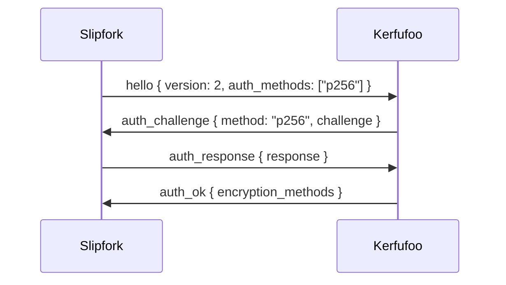
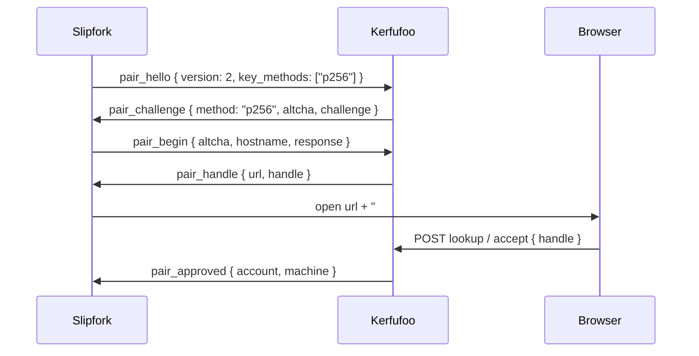
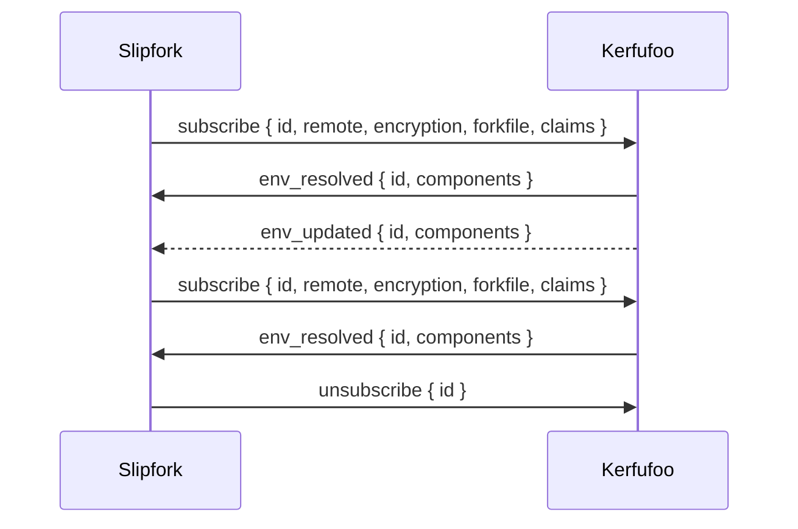
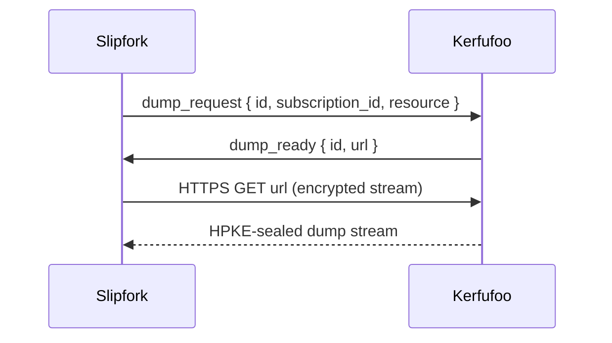

# Open Secret Provider Protocol (OSPP v1)

Slipfork is a local "cloud in a box"; CI (Kerfufoo) creates and manages the real cloud environments and holds their authoritative variables, secrets, and managed infrastructure. OSPP v1 is the persistent WebSocket protocol Slipfork uses as a clutch to configure a local world from CI: the client sends its evaluated active `Forkfile` manifest (`EvaluatedFork` JSON for the active feature set), the names/IDs of entries it claims locally, and an ephemeral encryption public key; receives per-service environment variables with server-resolved secrets encrypted end-to-end (decrypted and finalized in memory, injected directly into managed processes, and never stored on disk); stays subscribed over the open WebSocket so upstream secret or configuration changes push live updates (allowing Slipfork to restart affected services); and requests on-demand resource dumps.

## Transport & Framing

OSPP v1 runs over a persistent WebSocket connection negotiated with `Sec-WebSocket-Protocol: ospp-v1`. Every WebSocket frame is a UTF-8 JSON text message carrying a `"type"` string field; resource dumps are downloaded out-of-band over HTTPS so large transfers never head-of-line block live `env_updated` messages.

## Handshake & Authentication



On connect, the client announces protocol `"version": 2` and the list of authentication method names it supports:

```json
{ "type": "hello", "version": 2, "auth_methods": ["p256"] }
```

The server selects one supported method and issues its challenge, the client replies with its proof, and the server confirms the authenticated session alongside the list of secret-encryption method names it supports:

```json
{ "type": "auth_challenge", "method": "p256", "challenge": { "nonce": "<32-byte hex>" } }
```

```json
{
  "type": "auth_response",
  "response": {
    "public_key": "<compressed P-256 hex>",
    "client_nonce": "<32-byte hex>",
    "signature": "<raw r || s hex>"
  }
}
```

```json
{ "type": "auth_ok", "encryption_methods": ["hpke-p256"] }
```

!!! warning "One protocol version, fail closed"
    `hello` and `pair_hello` carry `version: 2` because `subscribe` now carries the feature-evaluated `Forkfile`. Any other value is refused with an `error` frame coded `unsupported_version` and the socket closes; the server never negotiates down. Upgrade the provider, or run a matching `slipforkd`.

### `p256` Authentication

In `p256` authentication, the server sends a random 32-byte hex `nonce` inside `challenge`. The client replies with its compressed P-256 `public_key` (hex), a random 32-byte hex `client_nonce`, and an ECDSA P-256 SHA-256 `signature` (raw `r || s` hex) computed over `"ospp-v1" || server_nonce_bytes || client_nonce_bytes`.

## Device Pairing



When a machine's key is not yet enrolled, the client opens an `ospp-v1` WebSocket and initiates pairing instead of `hello`:

```json
{ "type": "pair_hello", "version": 2, "key_methods": ["p256"] }
```

The server picks a supported key method and returns `pair_challenge`, combining an ALTCHA proof-of-work challenge (rate-limiting unauthenticated pairing attempts without requiring prior credentials) and a random 32-byte hex `nonce` for key proof-of-possession:

```json
{ "type": "pair_challenge", "method": "p256", "altcha": { "...": "..." }, "challenge": { "nonce": "<32-byte hex>" } }
```

The client solves the proof-of-work and sends `pair_begin`, where `signature` signs `"ospp-v1-pair" || server_nonce_bytes || client_nonce_bytes` to prove possession of the private key being enrolled:

```json
{
  "type": "pair_begin",
  "altcha": "<altcha solution payload>",
  "hostname": "dev-laptop",
  "response": {
    "public_key": "<compressed P-256 hex>",
    "client_nonce": "<32-byte hex>",
    "signature": "<raw r || s hex>"
  }
}
```

If valid, the server supplies the full browser pairing URL (without `#`, since the UI origin or path may differ from the WebSocket host) alongside `handle`, and the client appends `#handle=<handle>` rather than computing the URL from the hostname:

```json
{
  "type": "pair_handle",
  "url": "https://ci.example.com/pair",
  "handle": "<32-byte hex>"
}
```

- **Fragment-only capability:** The single-use 32-byte hex `handle` appears strictly in the URL `#fragment`, never in the path or query string, so HTTP access logs and `Referer` headers never record it; the browser page strips the fragment from the address bar immediately on load and submits the handle in authenticated JSON `POST` bodies (`lookup`, `accept`, `reject`).
- **Socket-bound in-memory lifetime:** Pending pairings live purely in server memory for the lifetime of that open WebSocket (one pending pairing per public key; disconnecting, Ctrl-C, or restarting the server cancels it immediately, with no polling).
- **Push verdict:** The browser shows the key fingerprint and proposed `hostname` (editable by the signed-in user). Once acted upon, the server pushes `pair_approved` (`{ "type": "pair_approved", "account": "alice", "machine": "dev-laptop" }`) or `error` (`rejected`, `already_paired`, `throttled`, `bad_proof`) over the waiting WebSocket and closes the pairing session, after which the client opens a normal authenticated `hello` session.

## Environment Resolution & Live Subscription



Project identity is the Git remote string and only the Git remote string (`"remote": "git@github.com:acme/web.git"`), sent verbatim with no client-side slug, hash, mode, or canonicalization rules; Kerfufoo resolves the remote internally at its discretion. Locally, Slipfork evaluates its `Forkfile` for the active feature set (`ForkFile::evaluate(&features)` -> canonical `EvaluatedFork` JSON, with all `on <feat>` conditionals already flattened so Kerfufoo never needs local feature flags), generates an ephemeral encryption keypair in memory (never stored on disk), and sends `subscribe`:

```json
{
  "type": "subscribe",
  "id": "sub-1",
  "remote": "git@github.com:acme/web.git",
  "encryption": {
    "method": "hpke-p256",
    "public_key": "<hex>"
  },
  "forkfile": {
    "postgres": [{ "id": "pg", "version": "18", "databases": [{ "id": "app_db", "pool": true }] }],
    "domains": [{ "id": "main" }],
    "services": {
      "api": {
        "env": {
          "LOG_LEVEL": "\"info\"",
          "DEBUG": "var(DEBUG)",
          "DATABASE_URL": "app_db.url",
          "SECRET_KEY": "secret(SECRET_KEY)"
        }
      }
    }
  },
  "claims": {
    "vars": ["DEBUG"],
    "secrets": ["LOCAL_DEV_KEY"],
    "resources": {
      "pg_databases": ["app_db"]
    },
    "domains": ["main"]
  }
}
```

`claims` follows one uniform rule across all `Forkfile` namespaces (`vars`, `secrets`, `resources.<kind>`, `domains`, and `components`): any claimed entry tells the server not to resolve it and to leave its claimed expression untouched in the output string without failing on it, while everything not in `claims` is resolved by the server (or refused if missing). This lets a local world own local services, override `var(DEBUG)`, or introduce a new `secret(...)` key on a feature branch before it exists in CI, without ever sending local values or credentials to the server. In `env_resolved` and `env_updated`, plain non-secret values are strings, whereas any variable whose server evaluation touched an unclaimed `secret(...)` key or a sensitive server-resolved resource credential ("secrets contaminate") is returned as `{ "encrypted": "<base64>" }`:

```json
{
  "type": "env_resolved",
  "id": "sub-1",
  "components": {
    "api": {
      "LOG_LEVEL": "info",
      "DEBUG": "var(DEBUG)",
      "DATABASE_URL": "app_db.url",
      "SECRET_KEY": { "encrypted": "<base64>" }
    }
  }
}
```

Slipfork decrypts `{ "encrypted": "<base64>" }` values in memory using the subscription's ephemeral private key, resolves any remaining claimed `Forkfile` expressions locally via `EvaluatedFork::resolve_env`, and injects the resulting plaintext strings directly into child container environments (never writing them to disk). The WebSocket stays open while worlds run: whenever secrets or variables change upstream, the server pushes `env_updated` (`{ "type": "env_updated", "id": "sub-1", "components": { ... } }`), and Slipfork restarts affected services with the updated environment. Updating `Forkfile`, active features, or local claims re-sends `subscribe` with the same `id`; stopping the world sends `unsubscribe` (`{ "type": "unsubscribe", "id": "sub-1" }`).

### `hpke-p256` Encryption

Encrypting secret values directly inside the JSON payload — even over `wss://` — prevents plaintext secrets from leaking into stack traces, debug logs, or copy-pasted wire messages (keeping protocol debugging safe), and protects secrets even if HTTPS/TLS is misconfigured or terminated prematurely along the path.

In `hpke-p256` encryption, subscription secrets are sealed end-to-end with RFC 9180 HPKE Base mode using `DHKEM(P-256, HKDF-SHA256)`, `HKDF-SHA256`, `AES-256-GCM`, and `info = "ospp-v1-secret"`. The client encodes its ephemeral recipient `public_key` as hex inside `encryption`, and the server seals each secret UTF-8 value with `SealBase(public_key, info, aad = "<component>:<env_key>", plaintext)`, encoding `enc || ciphertext` as standard RFC 4648 base64 in `{ "encrypted": "<base64>" }`. Binding `aad` to `<component>:<env_key>` prevents ciphertexts from being replayed or swapped across components or variable names.

## Resource Dumps



To seed a local resource, the client sends `dump_request` referencing an active `subscription_id` (which already binds both the Git `remote` and the subscription's `encryption` `{ method, public_key }`):

```json
{ "type": "dump_request", "id": "dump-1", "subscription_id": "sub-1", "resource": "pg_databases.app_db" }
```

If available and permitted, the server replies with a short-lived download URL (otherwise `error`), and the client streams the dump via an out-of-band `HTTPS GET` without the server caching whole dumps in memory or on disk:

```json
{ "type": "dump_ready", "id": "dump-1", "url": "https://ci.example.com/dumps/<token>" }
```

Under `hpke-p256`, the HTTP response body is encrypted end-to-end to the subscription's `public_key` using RFC 9180's stateful sender context (`SetupBaseS(public_key, info = "ospp-v1-dump")`): the stream begins with the 65-byte uncompressed P-256 `enc` header, followed by sequential frames of `4-byte big-endian plaintext length` + `ctx.Seal(aad = "<subscription_id>:<resource>", chunk)`, and ends with a final empty sealed chunk (`len = 0`) so truncation is detected before completion. Even if the short-lived URL is logged or intercepted, the payload is unreadable without Slipfork's in-memory subscription private key, and Slipfork decrypts and pipes the stream directly into the local service without writing plaintext to disk.

## Errors

Whenever the server cannot fulfill a request (unsupported version, auth method, or encryption method; unknown Git remote; unauthorized key; pairing rejection or proof failure; unfillable unclaimed entry; or unavailable dump), it replies with an `error` frame (`"id"` is included when correlated to a request) and closes the socket on handshake, pairing, or authentication failures:

```json
{ "type": "error", "id": "<optional correlation id>", "code": "<string>", "message": "<human explanation>" }
```
