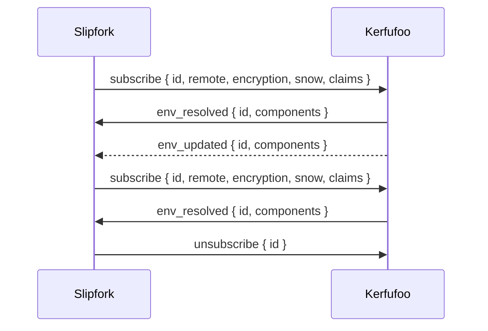
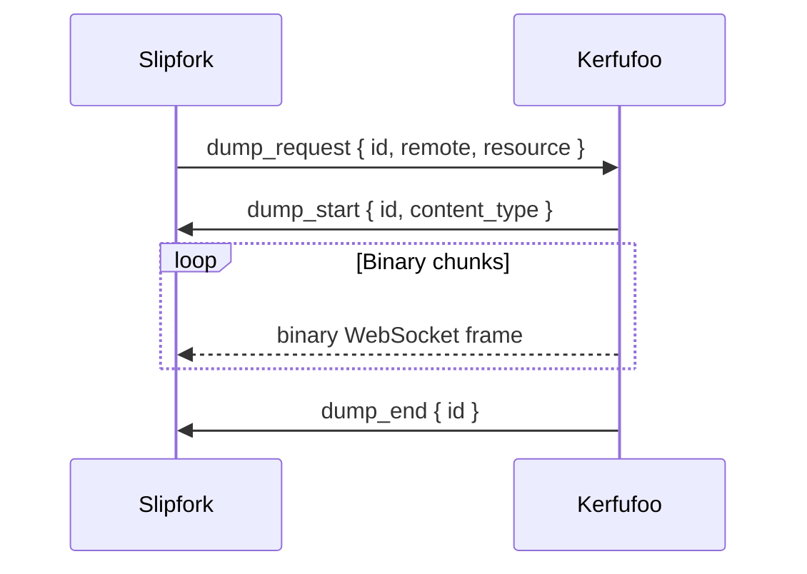

# Open Secret Provider Protocol (OSPP v1)

Slipfork is a local "cloud in a box"; CI (Kerfufoo) creates and manages the real cloud environments and holds their authoritative variables, secrets, and managed infrastructure. OSPP v1 is the persistent WebSocket protocol Slipfork uses as a clutch to configure a local world from CI: the client sends its `snow.yml`, the names/IDs of entries it claims locally, and an ephemeral encryption public key; receives per-component environment variables with server-resolved secrets encrypted end-to-end (decrypted and finalized in memory, injected directly into managed processes, and never stored on disk); stays subscribed over the open WebSocket so upstream secret or configuration changes push live updates (allowing Slipfork to restart affected services); and requests on-demand resource dumps.

## Transport & Framing

OSPP v1 runs over a persistent WebSocket connection negotiated with `Sec-WebSocket-Protocol: ospp-v1`. Control messages are UTF-8 JSON text frames carrying a `"type"` string field; raw binary WebSocket frames are used exclusively for streaming dump chunks between `dump_start` and `dump_end`.

## Handshake & Authentication


On connect, the client announces protocol `"version": 1` and the list of authentication method names it supports:

```json
{ "type": "hello", "version": 1, "auth_methods": ["p256"] }
```

The server selects one supported method and issues its challenge, the client replies with its proof, and the server confirms the authenticated session alongside the list of secret-encryption method names it supports:

```json
{ "type": "auth_challenge", "method": "p256", "challenge": { "nonce": "<32-byte hex>" } }
```

```json
{
  "type": "auth_response",
  "response": {
    "public_key": "<compressed P-256 hex>",
    "client_nonce": "<32-byte hex>",
    "signature": "<raw r || s hex>"
  }
}
```

```json
{ "type": "auth_ok", "encryption_methods": ["hpke-p256"] }
```

### `p256` Authentication

In `p256` authentication, the server sends a random 32-byte hex `nonce` inside `challenge`. The client replies with its compressed P-256 `public_key` (hex), a random 32-byte hex `client_nonce`, and an ECDSA P-256 SHA-256 `signature` (raw `r || s` hex) computed over `"ospp-v1" || server_nonce_bytes || client_nonce_bytes`.

## Environment Resolution & Live Subscription



Project identity is the Git remote string and only the Git remote string (`"remote": "git@github.com:acme/web.git"`), sent verbatim with no client-side slug, hash, mode, or canonicalization rules; Kerfufoo resolves the remote internally at its discretion. For each subscription, the client picks one method from `encryption_methods`, generates an ephemeral encryption keypair in memory (never stored on disk), and sends `subscribe`:

```json
{
  "type": "subscribe",
  "id": "sub-1",
  "remote": "git@github.com:acme/web.git",
  "encryption": {
    "method": "hpke-p256",
    "public_key": "<hex>"
  },
  "snow": "<raw snow.yml content>",
  "claims": {
    "vars": ["DEBUG"],
    "secrets": ["LOCAL_DEV_KEY"],
    "resources": {
      "pg_databases": ["main"]
    },
    "domains": ["main"]
  }
}
```

`claims` follows one uniform rule across all `snow.yml` namespaces (`vars`, `secrets`, `resources.<kind>`, `domains`, and `components`): any claimed entry tells the server not to resolve it and to leave its `${{ ... }}` expression untouched in the output string without failing on it, while everything not in `claims` is resolved by the server (or refused if missing). This lets a local world own local services, override a variable such as `vars::DEBUG`, or introduce a new `secrets::` key on a feature branch before it exists in CI, without ever sending local values or credentials to the server. In `env_resolved` and `env_updated`, plain non-secret values are strings, whereas any variable whose server evaluation touched an unclaimed `secrets::` key or a sensitive server-resolved resource credential ("secrets contaminate") is returned as `{ "encrypted": "<base64>" }`:

```json
{
  "type": "env_resolved",
  "id": "sub-1",
  "components": {
    "api": {
      "LOG_LEVEL": "info",
      "DEBUG": "${{ vars::DEBUG }}",
      "DATABASE_URL": "${{ resources::pg_databases.main.url }}",
      "SECRET_KEY": { "encrypted": "<base64>" }
    }
  }
}
```

Slipfork decrypts `{ "encrypted": "<base64>" }` values in memory using the subscription's ephemeral private key, substitutes local values for any remaining claimed `${{ ... }}` expressions, and injects the resulting plaintext strings directly into child process environments (never writing them to disk). The WebSocket stays open while worlds run: whenever secrets or variables change upstream, the server pushes `env_updated` (`{ "type": "env_updated", "id": "sub-1", "components": { ... } }`), and Slipfork restarts affected services with the updated environment. Updating `snow.yml` or local claims re-sends `subscribe` with the same `id`; stopping the world sends `unsubscribe` (`{ "type": "unsubscribe", "id": "sub-1" }`).

### `hpke-p256` Encryption

In `hpke-p256` encryption, subscription secrets are encrypted end-to-end with RFC 9180 HPKE Base mode using `DHKEM(P-256, HKDF-SHA256)`, `HKDF-SHA256`, `AES-256-GCM`, and `info = "ospp-v1-secret"`. The client encodes its ephemeral recipient `public_key` as hex inside `encryption`, and the server seals each secret UTF-8 value with `SealBase(public_key, info, aad = "<component>:<env_key>", plaintext)`, encoding `enc || ciphertext` as standard RFC 4648 base64 in `{ "encrypted": "<base64>" }`. Binding `aad` to `<component>:<env_key>` prevents ciphertexts from being replayed or swapped across components or variable names.

## Resource Dumps



To seed a local resource, the client sends `dump_request`:

```json
{ "type": "dump_request", "id": "dump-1", "remote": "git@github.com:acme/web.git", "resource": "pg_databases.main" }
```

If available and permitted, the server streams the dump on demand without caching it server-side: it sends `dump_start` (`{ "type": "dump_start", "id": "dump-1", "content_type": "application/zstd" }`), streams raw binary WebSocket frames, and finishes with `dump_end` (`{ "type": "dump_end", "id": "dump-1" }`). Otherwise, it replies with `error`.

## Errors

Whenever the server cannot fulfill a request (unsupported version, auth method, or encryption method; unknown Git remote; unauthorized key; unfillable unclaimed entry; or unavailable dump), it replies with an `error` frame (`"id"` is included when correlated to a request) and closes the socket on handshake or authentication failures:

```json
{ "type": "error", "id": "<optional correlation id>", "code": "<string>", "message": "<human explanation>" }
```
