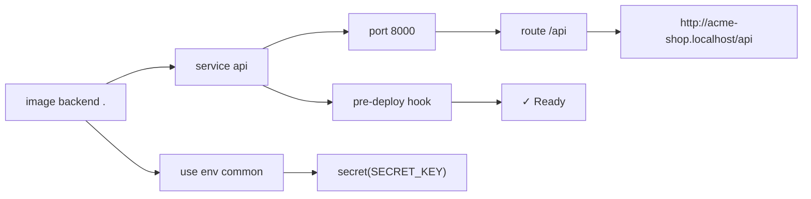

# The Forkfile

`Forkfile` at the repository root is the whole topology: images, resources, runtime `env`, services
and routes. One file expresses local development and production, so your machine and CI agree.

```forkfile
# forkfile: 0.1

features {
  default = [dev]
  dev = [mail]
  mail
}

domain main
postgres pg { database app_db }
redis cache
s3 uploads
s3 assets {
  policy public-read
  cdn edge
}

env common {
  DATABASE_URL         = app_db.url
  REDIS_URL            = cache.url
  UPLOADS_URL          = uploads.url
  ASSETS_CDN_URL       = edge.url
  SECRET_KEY           = secret(SECRET_KEY) ?? random_hex(32)
}

image api . {
  on dev: stage dev
  use env common

  service web {
    port 8000
    route /api
    pre-deploy: @uv run alembic upgrade head
    run: uv run gunicorn app.main:app --bind 0.0.0.0:$port
  }
}
```

`slipfork fmt` rewrites the file canonically, and `slipfork fmt --check` is the CI gate.

## The version header

While Slipfork is pre-`1.0`, line 1 is `# forkfile: 0.1`. Any other value fails before a container
starts, with a `Forkfile:<line>:<col>` caret span naming the token.

## `features` and `on`

`features` declares named switches, and `default` is active for local commands. `on <expr>` accepts
`dev`, `!dev`, `dev & mail`, and `staging | preview`; it can select a Dockerfile `stage`, add a
conditional `arg`, swap in a hot-reloading `@`-prefixed `run:`, or add a dev-only tool like `mailpit`.
Slipfork type-checks every `on` branch at once before booting anything.

## `image` scopes

| Form | Meaning |
| :--- | :--- |
| `image api . { ... }` | Build `./Dockerfile` natively on Btrfs |
| `image frontend ./front { ... }` | Build in `./front`; `front` is the default `workdir` |
| `image mailpit from axllent/mailpit:latest { ... }` | Pull an OCI image over HTTPS |
| `dockerfile <path>` / `stage <name>` / `workdir <path>` | Overrides inside the block |
| `arg KEY = <expr>` | Build-time only; `secret(...)` is rejected statically |

Every `service` and hook inside the block inherits the rootfs, the default `workdir`, `use env`
groups and the bind-mounted project subvolume.

!!! warning "`arg` is never secret"

    Build-time `arg` values bake into image layers. Slipfork rejects `secret(...)` and any
    secret-tainted property there; runtime `env` is the only place a secret belongs.

## Resources

Top-level resources and named child resources share one flat, globally unique symbol namespace.

| Declaration | Local behaviour | Typed properties |
| :--- | :--- | :--- |
| `postgres pg { database app_db }` | PostgreSQL 18 (`version` optional) | `app_db.url`, `.host`, `.port`, `.name`, `.user`, `.password` |
| `redis cache` | Redis 7 (`version` optional) | `cache.url`, `.host`, `.port` |
| `s3 uploads` | Private: anonymous `GET` answers `403` | `uploads.url`, `.endpoint`, `.bucket`, `.access_key`, `.secret_key` |
| <code>s3 assets {<br>  policy public-read<br>  cdn edge<br>}</code> | `public-read` bucket plus a cloud CDN binding | bucket properties + `edge.domain`, `edge.url` |
| `domain main` | Primary plus extra `<id>.<world>.localhost` | `main.domain`, `main.url` |

A plain `s3` bucket is `policy private` by default: anonymous `GET`/`HEAD` answer `403`.

Every `s3` bucket serves at `http://<bucket>.<world>.localhost`; a fork serves it at
`http://<bucket>.<fork>--<world>.localhost`. `cdn <id>` is a **cloud** binding only: locally
`<id>.domain` and `<id>.url` resolve to the bucket's own URL, and no separate `<id>.localhost`
hostname exists.

!!! warning "`cdn` never silently publicizes a bucket"

    `cdn <id>` requires an explicit `policy public-read` inside the same `s3`; otherwise the file
    fails at `Forkfile:line:col` with one `next:` remedy.

Any `domain`, `cdn`, bucket, or `route ... domain <prefix>.*` label outside RFC 1123 (`1..=63`,
lowercase `[a-z0-9-]`, alphanumeric edges; buckets `3..=63` and never IPv4-shaped) fails statically.

## Runtime `env` and secrets

`env` is strictly runtime: it reaches services and lifecycle hooks, never a `Dockerfile` build.

```forkfile
# forkfile: 0.1

domain main

env common {
  PUBLIC_URL = main.url
  SECRET_KEY = secret(SECRET_KEY) ?? random_hex(32)
}
```

`var(KEY)` reads non-secret config. `secret(KEY)` resolves the live cloud secret when paired and
generates an offline one otherwise; `random_hex(n)`, `random_base64(n)`, `random_alnum(n)` and
`random_uuid()` are the generators. Secret-tainted values print as `[REDACTED]`.

## Services, ports and routes

A `service` declares one public `port`, exposed as `$port` and injected as `PORT`, plus optional
`internal_ports`. `route` preserves the matched prefix by default.

| Route | Path behaviour | Host filter |
| :--- | :--- | :--- |
| `route /api` | `/api/users` -> `/api/users` | every declared domain |
| `route /api strip-prefix` | `/api/users` -> `/users` | every declared domain |
| `route /api rewrite /v1` | `/api/users` -> `/v1/users` | every declared domain |
| `route exact /healthz` | `/healthz` only | every declared domain |
| `route / domain admin` | `/` | `admin.<world>.localhost` |
| `route / domain mail.*` | `/` | `mail.<world>.localhost` |

`strip-prefix` and `rewrite` are mutually exclusive, and a route naming an undeclared `domain`
fails statically.

```forkfile
# forkfile: 0.1

image backend . {
  service api {
    port 8000
    internal_ports [8081]
    route exact /healthz
    before-start when changed(prisma/schema.prisma): @pnpm exec prisma generate
    pre-deploy: @uv run alembic upgrade head
    run {
      uv run python -m app.migrate
      uv run gunicorn app.main:app -b 0.0.0.0:$port
    }
  }
}
```

`before-start when changed(...)` hashes its inputs against `.slipfork/` stamps, so an unchanged step
skips in under 1 ms and the stamps travel into every fork. An `@`-prefixed tool (`@uv`, `@poetry`,
`@pnpm`, `@npm`, `@yarn`, `@bun`, `@composer`, `@bundle`, `@go`, `@cargo`) also inserts one
deduplicated lockfile-watched install node per `(image, lockfile_dir)`.



## Where next

* [CLI](cli.md) — the verbs that boot, inspect and fork this file.
* [Getting started](getting-started.md) — a complete file you can boot today.
