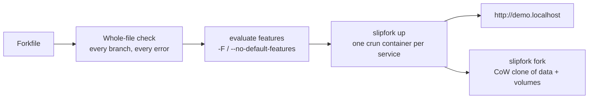

# The `Forkfile`

**One file describes your whole stack.** A `Forkfile` declares your services, databases, caches, environment, secrets, and tasks in plain text. `slipfork up` turns it into a copy-on-write world with a single `.localhost` origin.

```text title="Forkfile"
project demo

postgres pg { database app_db }

env app {
    DATABASE_URL = app_db.url
    SECRET_KEY   = secret(SECRET_KEY) ?? random_string(50)
}

service api ./api {
    use env app
    port 8000
    route /api
    volume .venv
    setup: python3 -m venv .venv
    run .venv/bin/python -m uvicorn app.main:app --host 0.0.0.0 --port $port
}

service front ./front {
    port 5173
    route /
    run npm run dev -- --host 0.0.0.0 --port $port
}
```

Save it as `Forkfile` at the repository root and run `slipfork up`. `http://demo.localhost/` reaches `front`, `http://demo.localhost/api` reaches `api`, and `app_db` runs in its own `postgres:18` container.

!!! info "No `.env`, no port table"
    `DATABASE_URL` comes from the declared database, and `$port` is the port you declared. Nothing is copied into the repository.

## How a `Forkfile` becomes a world



Statements run top to bottom. Scalar assignments (`port`, `run`, `stage`, `dockerfile`, `size`, `version`, `env.KEY = ...`) overwrite earlier values; additive blocks (`route`, `volume`, `setup`, `service`, `task`) append or replace by key.

## Services

`service <id> ./dir` builds `<dir>/Dockerfile` and runs the container with `<worktree>/<dir>` as its working directory. `service <id> from <registry/repo:tag>` pulls an image instead.

| Directive | Effect |
|---|---|
| `port 8000` | The one public port this service serves |
| `internal_ports [9000, 9001]` | Container ports that are not routed |
| `route /api` | Path prefix served on the world origin (`route mail.*` routes by host) |
| `volume .venv` | CoW volume, cloned in milliseconds by `slipfork fork` |
| `run <argv...>` | The supervised process; executed directly, never through a shell |
| `setup`, `pre-deploy`, `post-deploy`, `failed-deploy` | Lifecycle hooks, before or after the service starts |

Services that share `(dir, dockerfile, stage, build_env)` build one cached rootfs.

!!! warning "Hooks are argv, not shell"
    `setup: uv sync --frozen` runs `uv` directly. Use `sh -c '…'` when you need pipes or redirection.

A hook accepts one line or a block. Each line runs in order and stops the boot on the first non-zero exit:

```text title="Forkfile"
service api ./api {
    pre-deploy: {
        uv run alembic upgrade head
        uv run python -m app.warm_cache
    }
}
```

## Databases, caches, and domains

```text title="Forkfile"
postgres pg {
    version 18
    database app_db
    database analytics { pool = false }
}

redis cache
s3 media
domain docs
```

Declare a resource and use its properties anywhere in `env`: `app_db.url`, `cache.url`, `media.bucket`, `docs.url`. A bare resource name is a static error, so a typo fails before anything boots.

## Environment and secrets

Top-level `env <group> { ... }` blocks merge into a service with `use env <group>`; inline `env { ... }` and `env.KEY = <expr>` override by key.

```text title="Forkfile"
env app {
    DATABASE_URL = app_db.url
    LOG_LEVEL    = var(LOG_LEVEL) ?? "info"
    API_TOKEN    = secret(API_TOKEN) ?? random_base64(32)
    BASE_URL     = "http://" + app.domain
}
```

!!! info "Secrets stay secret"
    `secret(...)` resolves from the local vault or CI, and any value it touches is tainted: logs and `slipfork env` print `[REDACTED]` until `--reveal`.

Generators (`random_hex(16)`, `random_base64(32)`, `random_string(50)`, `uuid4()`) are write-once and valid only on the right side of `secret(KEY) ??`.

## Features and `on`

```text title="Forkfile"
features {
    default = [dev]
    dev     = [mail]
    mail
}

on mail {
    service mailpit from axllent/mailpit:latest {
        port 8025
        route mail.*
    }
}
```

`slipfork up -F mail` enables a feature; `--no-default-features` drops the `default` set. `on` accepts `feat`, `!feat`, `a & b`, `a | b`, and parentheses, and it nests inside `service`, `postgres`, and `redis`.

## Tasks

```text title="Forkfile"
task migrate in api: uv run alembic upgrade head
```

`slipfork run migrate` executes the task inside the `api` container with the service's resolved environment. A single-command task appends extra arguments (`slipfork run migrate --revision head`); a block task rejects them.

## Errors you can act on

The checker reads every statement and every `on` branch, then reports all diagnostics at once with rustc-style carets:

```text
error: `pg` is a postgres cluster, not a database
  --> Forkfile:14:20
   |
14 |     DATABASE_URL = pg.url
   |                    ^^^^^^ did you mean database `app_db.url`?
```

`slipfork lsp` serves the same checker over stdio for Zed, Neovim, and VS Code.

!!! info "Coming from an older manifest?"
    `slipfork migrate` converts an upstream Snow manifest into a `Forkfile` and then statically verifies the result.

Next: the [Forkfile reference](reference/forkfile.md) for every directive and property, or [CLI reference](reference/cli.md) for the commands.
