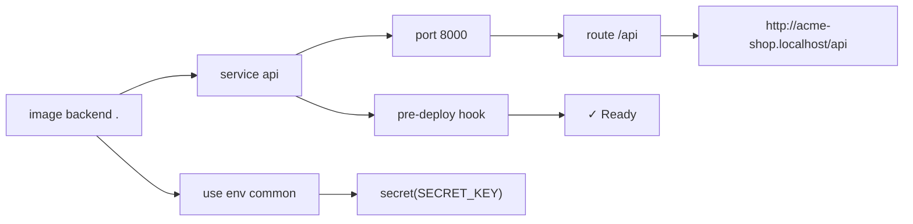

# The Forkfile

`Forkfile` at the repository root is the whole topology: images, resources, runtime `env`, services
and routes. One file expresses local development and production, so your machine and CI agree.

```forkfile
# forkfile: 0.1

features {
  dev = [mail]
  mail
}

domain main
postgres pg { database app_db }
redis cache
s3 uploads
s3 assets {
  policy public-read
  cdn edge
}

env common {
  DATABASE_URL   = app_db.url
  REDIS_URL      = cache.url
  UPLOADS_URL    = uploads.url
  ASSETS_CDN_URL = edge.url
  PUBLIC_URL     = self.url
  LOGIN_URL      = "${self.url}/login"
  COOKIE_DOMAIN  = main.name
  SECRET_KEY     = secret(SECRET_KEY, random_string(50))
}

image api . {
  on dev: stage dev
  use env common

  service web {
    port 8000
    route /api
    pre-deploy: uv run --no-sync alembic upgrade head
    on dev: run: @uv run uvicorn app.main:app --reload --host 0.0.0.0 --port $port
  }
}
```

`slipfork fmt` rewrites the file canonically, keeps at most one authored blank line between consecutive declarations in a body (and after the `# forkfile:` header when you authored one), and `slipfork fmt --check` is the CI gate.

## The version header

While Slipfork is pre-`1.0`, line 1 is `# forkfile: 0.1`. Any other value fails before a container
starts, with a `Forkfile:<line>:<col>` caret span naming the token.

## `features` and `on`

`dev` is built in and active for `up`, `fork` and `env`; it is what bind-mounts your checkout at
`/project`. Declare only extra switches, and let groups imply their members: `dev = [mail]` turns
`mail` on whenever `dev` is on. Drop `dev` per command with `-F -dev` or `--no-default-features`.

With `dev`, a Dockerfile-built image overlays its live build context at the target stage's
`WORKDIR` and at any distinct whole-context `COPY` destination, so `slipfork exec` and
`slipfork shell` see your edits immediately. An explicit `WORKDIR` under `/project` keeps that bind.

That overlay is a bind mount, so apps see your checkout's **host** ownership and modes: a service
with a strict writability check (one that refuses a group-writable `drwxrwxr-x` tree) needs `0755`
directories and `0644` files, while files Slipfork's own containers create are `umask 0022`.

```console
$ chmod -R g-w,o-w .
```

A stage with no `WORKDIR` (still `/`) refuses a `dev` boot with one line + a `next:` hint.
`-F -dev` keeps the image copy instead.

`slipfork features` shows the resolved set and persists edits (`slipfork features +mail`,
`slipfork features -dev`, `slipfork features reset`) into `.slipfork/features.json` for the next boot.

`on <expr>` accepts `dev`, `!dev`, `dev & mail`, and `staging | preview`; it can select a Dockerfile
`stage`, add a conditional `arg`, swap in a hot-reloading `@`-prefixed `run:`, or add a dev-only tool
like `mailpit`. `else` closes a guard instead of mirroring it: `on dev { … } else { … }`,
`on dev: … else: …`, and `else on <expr>` chains. Slipfork type-checks every `on` branch at once
before booting anything.

In the production shape (`-F -dev`) a service needs no `else` at all: omit `run:` and Slipfork runs
the image's own `ENTRYPOINT`/`CMD`, so the Dockerfile stays the single source of truth.

```forkfile
image frontend ./front {
  on dev: stage dev
  service front {
    port 3000
    route /
    on dev {
      port 5173
      run: @pnpm exec vite dev --host 0.0.0.0 --port $port
    }
  }
}
```

## `image` scopes

| Form | Meaning |
| :--- | :--- |
| `image api . { ... }` | Build `./Dockerfile` natively on Btrfs |
| `image frontend ./front { ... }` | Build in `./front`; `front` is the default `workdir` |
| `image mailpit from axllent/mailpit:latest { ... }` | Pull an OCI image over HTTPS |
| `dockerfile <path>` / `stage <name>` / `workdir <path>` | Overrides inside the block |
| `arg KEY = <expr>` | Build-time only; `secret(...)` is rejected statically |
| `service web { port 3000 }` | Exposes the running `web.port` and `web.name` to `arg` |

```forkfile
postgres pg { database app_db }
redis cache

image api . {
  arg DB_URL = app_db.url
  arg REDIS_PORT = cache.port
  arg PORT = web.port
  on dev { arg DEBUG = "1" }

  service web {
    port 3000
    route /
    run: app --port $port
  }
}
```

Declare `port` unconditionally in the service body; an active `on dev { port 5173 }` may still
override the running port at boot. An arg whose expression does not evaluate is a
`Forkfile:line:col` error naming the arg, never a silently dropped build arg.

Every `service` and hook inside the block inherits the rootfs, the default `workdir`, `use env`
groups and the bind-mounted project subvolume.

!!! warning "`arg` is never secret"

    Build-time `arg` values bake into image layers. Slipfork rejects `secret(...)` and any
    secret-tainted property there; runtime `env` is the only place a secret belongs.

## Resources

Top-level resources and named child resources share one flat, globally unique symbol namespace.

| Declaration | Local behaviour | Typed properties |
| :--- | :--- | :--- |
| `postgres pg { database app_db }` | PostgreSQL 18 (`version` optional) | `app_db.url`, `.host`, `.port`, `.name`, `.user`, `.password` |
| `redis cache` | Redis 7 (`version` optional) | `cache.url`, `.host`, `.port` |
| `s3 uploads` | Private: anonymous `GET` answers `403` | `uploads.url`, `.endpoint`, `.bucket`, `.access_key`, `.secret_key` |
| <code>s3 assets {<br>  policy public-read<br>  cdn edge<br>}</code> | `public-read` bucket plus a cloud CDN binding | bucket properties + the CDN's `.domain` and `.url` |
| `domain main` | Primary host only: `<world>.localhost` | `main.name` (bare hostname) |

A plain `s3` bucket is `policy private` by default: anonymous `GET`/`HEAD` answer `403`.

Every `s3` bucket serves at `http://<bucket>.<world>.localhost`; a fork serves it at
`http://<bucket>.<fork>--<world>.localhost`. `cdn <id>` is a **cloud** binding only: locally its
`.domain` and `.url` resolve to the bucket's own URL, and no separate `<id>.localhost` hostname
exists.

!!! tip "A domain is a hostname, not a URL"

    `domain main` exposes `main.name` (`acme-shop.localhost`) and nothing else. A URL always needs a
    scheme: use `self.url` for the app's primary URL, or `"${self.scheme}://${dom_b.name}"` for
    another declared domain. Any URL property on a `domain` fails statically, with one `next:`
    remedy.

!!! warning "`cdn` never silently publicizes a bucket"

    `cdn <id>` requires an explicit `policy public-read` inside the same `s3`; otherwise the file
    fails at `Forkfile:line:col` with one `next:` remedy.

Any `domain`, `cdn`, bucket, or `route ... domain <id>` label outside RFC 1123 (`1..=63`,
lowercase `[a-z0-9-]`, alphanumeric edges; buckets `3..=63` and never IPv4-shaped) fails statically.

## Runtime `env` and secrets

`env` is strictly runtime: it reaches services and lifecycle hooks, never a `Dockerfile` build.

```forkfile
# forkfile: 0.1

domain main

env common {
  PUBLIC_URL = self.url
  LOGIN_URL = "${self.url}/login"
  COOKIE_DOMAIN = main.name
  SECRET_KEY = secret(SECRET_KEY, random_string(50))
  THIRD_PARTY_API_URL = var(THIRD_PARTY_API_URL) ?? "https://thirdparty.com"
}
```

`var(KEY)` reads non-secret config. `secret(KEY)` resolves the live cloud secret when paired and
generates an offline one otherwise; `secret(KEY, <generator>)` and `var(KEY, <generator>)` name the
generator used while unset. The generators are `random_string(n)`, `random_hex(n)`,
`random_base64(n)`, and `random_uuid()`.

A generator is valid **only** as that second argument. `??` is a deterministic fallback, so
`secret(SECRET_KEY, random_string(50))` is right and `secret(SECRET_KEY) ?? random_string(50)` is
rejected. Double-quoted strings interpolate with `"${<expr>}"`, so compose URLs instead of
concatenating. Secret-tainted values print as `[REDACTED]`.

## Services, ports and routes

A `service` declares one public `port`, exposed as `$port` and injected as `PORT`, plus optional
`internal_ports`. `route` preserves the matched prefix by default.

| Route | Path behaviour | Host filter |
| :--- | :--- | :--- |
| `route /api` | `/api/users` -> `/api/users` | primary `<world>.localhost` |
| `route /api strip-prefix` | `/api/users` -> `/users` | primary `<world>.localhost` |
| `route /api rewrite /v1` | `/api/users` -> `/v1/users` | primary `<world>.localhost` |
| `route exact /healthz` | `/healthz` only | primary `<world>.localhost` |
| `route / domain admin` | `/` | `admin.<world>.localhost` |
| `route / domain mail` | `/` | `mail.<world>.localhost` |

The first declared `domain` **is** the primary host: `<domain>.name` evaluates to
`<world>.localhost`, so an unfiltered route and `route / domain <first>` both answer on
`http://<world>.localhost`; later declared domains only add subdomains.

`strip-prefix` and `rewrite` are mutually exclusive, and a route naming an undeclared `domain`
fails statically. A service gets its own host by declaring `domain <id>` inline or inside
`on <expr> { … }`:

```forkfile
# forkfile: 0.1

on mail {
  domain mail
  image mailpit from axllent/mailpit:latest {
    service mailpit {
      port 8025
      route / domain mail
    }
  }
}
```

```forkfile
# forkfile: 0.1

image backend . {
  service api {
    port 8000
    internal_ports [8081]
    route exact /healthz
    pre-deploy: uv run --no-sync alembic upgrade head
    on dev {
      before-start when changed(prisma/schema.prisma): @pnpm exec prisma generate
      run: @uv run uvicorn app.main:app --reload --host 0.0.0.0 --port $port
    }
  }
}
```

`before-start when changed(...)` hashes its inputs against `.slipfork/` stamps, so an unchanged step
skips in under 1 ms and the stamps travel into every fork. An `@`-prefixed tool (`@uv`, `@poetry`,
`@pnpm`, `@npm`, `@yarn`, `@bun`, `@composer`, `@bundle`, `@go`, `@cargo`) also inserts one
deduplicated lockfile-watched install node per `(image, lockfile_dir)` — so a hook treats `@<tool>`
only as that boot-time prequel marker, never as a direct-binary rewrite. Keep it under `on dev`:
a `dev` world may sync, while a non-`dev` command writes `uv run --no-sync …` itself.



## Where next

* [CLI](cli.md) — the verbs that boot, inspect and fork this file.
* [Tutorial](tutorial.md) — build a world step by step, then fork it.
