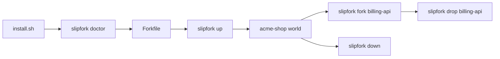

# Getting started

From an empty machine to a forked world in five steps: install, write a `Forkfile`, boot it, fork it,
drop it. Everything runs under your user — no root except the one-time `:80` ingress socket.

## 1. Install

```console
$ curl -fsSL https://offworldnexus.github.io/slipfork/install.sh | sh
$ slipfork doctor
✓ Ready
```

The installer adds the signed package repository where it can, and otherwise unpacks the release
archive under `~/.local`. [Install](install.md) lists every distro and flag.

!!! warning "`doctor` must be green first"

    Slipfork needs a Btrfs filesystem, rootless containers and the local user daemon. `slipfork
    doctor` names the exact remedy for whichever row fails; fix that before the first `slipfork up`.

!!! tip "On ext4 or XFS?"

    Keep your disk layout and still get real subvolumes: [mount a sparse Btrfs workspace image](install.md#on-ext4-or-xfs-mount-a-btrfs-workspace-image-in-your-home-folder) with a systemd `.mount` unit, then run `slipfork doctor`.

## 2. Write a Forkfile

Create `Forkfile` at the repository root. This one is complete and boots a real API.

```forkfile
# forkfile: 0.1

domain main

postgres pg { database app_db }
redis cache
s3 uploads

env common {
  DATABASE_URL = app_db.url
  REDIS_URL    = cache.url
  SECRET_KEY   = secret(SECRET_KEY) ?? random_hex(32)
}

image api . {
  use env common

  service web {
    port 8000
    route /api
    run: @uv run uvicorn app.main:app --host 0.0.0.0 --port $port
  }
}
```

`SECRET_KEY` resolves from the paired cloud when you ran `slipfork auth`, or becomes a random local
value. [The Forkfile](forkfile.md) covers the rest of the language.

## 3. Boot it

```console
$ slipfork up
• image     api       cached                     1ms
✓ resource  pg        postgres 18 ready         38ms
✓ resource  cache     redis 7 ready              7ms
✓ resource  uploads   s3 (private) ready         1ms
✓ setup     api       uv sync (up to date)       0ms
✓ service   web       running -> /api           1.4s
✓ Ready -> http://acme-shop.localhost
```

Each finished task is one aligned row; all build and hook output goes to the world log. Open the URL,
let Slipfork open it, or follow the logs:

```console
$ slipfork open
$ slipfork logs -f web
```

Repeating `slipfork up` with an unchanged file returns in `0ms`. After an edit it reconciles: pods no
longer declared stop and show `orphaned` until reaped, and new services boot.

## 4. Fork the world

```console
$ slipfork fork billing-api
✓ billing-api (4.9s) -> http://billing-api--acme-shop.localhost
  path  ~/projects/acme-shop/.forks/billing-api
```

Those are the two tiers: `snapshot_ms` is the CoW clone (`~250ms` here; `~150–365ms` on the
4-vCPU droplet, asserted `< 500ms`) and the elapsed covers the full boot. On the real 8-component
FastAPI + SvelteKit stack the boot medians `~5.5s`, asserted `< 8.0s`, set by `uvicorn --reload`
and `vite dev` first requests rather than by the clone.

The fork has its own checkout, PostgreSQL and Redis snapshots, and URL. Dependencies and input-hash
stamps came along, so nothing installs again. Throw the experiment away when you are done:

```console
$ slipfork drop billing-api
```

`slipfork status` lists worlds flat, each with its domains; `slipfork ps` shows only the world rooted
in the current directory.

## 5. Stop, start and poke around

```console
$ slipfork down        # stop pods, keep data subvolumes
$ slipfork up          # back on http://acme-shop.localhost
$ slipfork shell pg    # real psql PTY
(acme-shop:pg) / #
```

`slipfork shell api` opens `bash` (or `sh`) in a service pod, and `slipfork shell cache` opens
`redis-cli`. A bucket is not a shell: `slipfork shell uploads` refuses with one `next:` line.



!!! info "Data survives `down`"

    `slipfork down` stops the pods and deletes run subvolumes; PostgreSQL, Redis and bucket data
    subvolumes stay. `slipfork drop` is the verb that deletes a fork's snapshots.

## Where next

* [Install](install.md) — packages, daemon unit and the privileged `:80` ingress.
* [The Forkfile](forkfile.md) — resources, services, routes and hooks.
* [CLI](cli.md) — every daily verb and the terminal contract.
