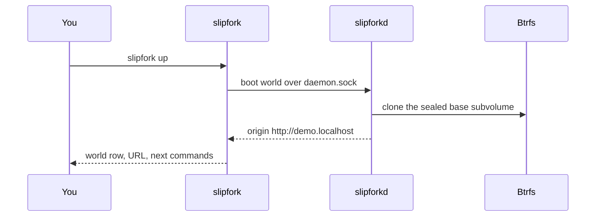
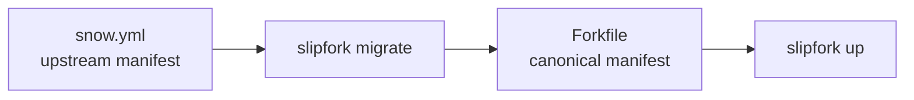

# Getting Started (`0.1.0`)

From a Git checkout to a forkable, running world in about ten minutes. The only unusual requirement is a Btrfs filesystem for the state directory.

```console
$ cargo install --path crates/slipfork-engine   # slipfork-world-init
$ cargo install --path crates/slipfork          # slipfork, slipforkd, git-remote-slipfork
$ sudo slipfork daemon install                  # :80 socket activation + AppArmor profile
$ cd /path/to/your/project
$ slipfork doctor && slipfork up
$ slipfork fork feat-billing
$ slipfork open -w feat-billing
```

!!! warning "Btrfs state directory"
    `mkfs.btrfs` erases the device. Keep the state directory on real disk, never RAM-backed `/tmp` `tmpfs`, and mount it `user_subvol_rm_allowed,noatime` before the first `slipfork` command.

!!! info "Root is for setup only"
    Only `mkfs.btrfs`, `mount`, `chown`, `daemon install`, and `apparmor_parser` need root. Never run `slipfork` or `slipforkd` under `sudo`, or your worktrees and vault end up root-owned.

## How a boot works



## 1. One-time host setup

| Requirement | Why |
|---|---|
| Linux `x86_64`, Rust 1.94+, a non-bare Git repo | Builds the binaries; `fork` creates a worktree (a `.jj` checkout forks a Jujutsu workspace instead) |
| Btrfs state directory, owned by you | Every world and sealed snapshot is one unprivileged `$UID:$GID` subvolume |
| Docker with `buildx`, `unshare`, `ip` | Rootfs export and world namespaces |
| `curl` on first boot | `slipforkd` downloads the pinned static `crun` once, sha256-verified |
| Docker usable without `sudo` | The rootfs export runs as you |

Mount the state directory. Replace `/dev/<device>` with a free device and keep the path on disk:

```console
$ mkdir -p ~/.cache/slipfork
$ sudo mkfs.btrfs -L slipfork /dev/<device>
$ sudo mount -o user_subvol_rm_allowed,noatime /dev/<device> ~/.cache/slipfork
$ sudo chown "$(id -u):$(id -g)" ~/.cache/slipfork
```

Install the units and the AppArmor profile once. For a `cargo install` layout, name the binary directory explicitly:

```console
$ sudo "$(command -v slipfork)" daemon install --bin-dir "$(dirname "$(command -v slipfork)")"
wrote     /etc/systemd/system/slipforkd.socket
wrote     /etc/systemd/system/slipforkd.service
wrote     /etc/apparmor.d/slipfork
enabled   slipforkd.socket + slipforkd.service, ingress 127.0.0.1:80 + [::1]:80
next      slipfork up
```

Ubuntu 24.04 LTS restricts unprivileged user namespaces by default. `daemon install` writes and loads `/etc/apparmor.d/slipfork`, so `doctor` passes `unshare_userns` and `netns` afterwards.

## 2. Probe the host

```console
$ slipfork doctor
✓ Ready
  state_dir: /home/acme/.cache/slipfork
  filesystem: btrfs
  btrfs_super_magic: ok
  subvolume_ioctl: ok
  unshare_userns: ok
  netns: ok
  noatime: ok
  ingress: :80 active (port-less origins)
```

`doctor` exits `0` only when the Btrfs checks and both namespace probes pass. On a non-Btrfs path it exits `1`, prints one `next:` line per failed check, and writes nothing. `slipfork doctor --json` emits the same report as one object.

## 3. Describe the world in a `Forkfile`

One file at the repository root declares services, resources, and environment:

```text title="Forkfile"
project demo

postgres pg { database app_db }

env app {
    DATABASE_URL = app_db.url
    SECRET_KEY   = secret(SECRET_KEY) ?? random_string(50)
}

service api ./api {
    use env app
    port 8000
    route /api
    setup: python3 -m venv .venv
    run .venv/bin/python -m uvicorn app.main:app --host 0.0.0.0 --port $port
}

task migrate in api: .venv/bin/python -m app.migrate
```

`service api ./api` builds `api/Dockerfile` and runs the container with `api/` as its working directory. The origin is `/`, `/api` is routed to this service, and `$port` expands to `8000` without word splitting.

!!! info "One container per service"
    Every `service` block becomes its own `crun` container in one network namespace. `postgres`, `redis`, and S3 run as separate backing containers in the same world.

## Coming from `snow.yml`?

One command converts an upstream Snow manifest into the `Forkfile` the runtime reads:



```console
$ cd /path/to/your/project
$ slipfork migrate
✓ Migrated snow.yml → Forkfile (2 services, 1 postgres cluster, 2 env groups)
```

With no argument, `migrate` uses `./snow.yml`, then `./snow.yaml`. Name one explicitly as `slipfork migrate path/to/snow.yml`; `-o` chooses the destination and `--stdout` previews the conversion without writing.

That output is real: it comes from the two-service fixture in `support/demo/migrate/snow.yml`. Here is the head of the `Forkfile` it wrote.

```text title="Forkfile"
# migrated from snow.yml

postgres psql {
    version 18;
    database app_db;
}

env app {
    DATABASE_URL = app_db.url
    SECRET_KEY = secret(SECRET_KEY) ?? random_string(50)
}

env frontend {
    PUBLIC_API = app.url + "/api"
}
```

The conversion is one-way and statically verified: `migrate` re-parses its own output with the whole-file checker, so the `Forkfile` is valid before it lands. After that the runtime reads only `Forkfile`; continue with boot and fork below.

!!! info "Secrets survive the conversion"
    `secret(SECRET_KEY) ?? random_string(50)` carries over verbatim: the generator runs once on first boot and the value lands in your local `0600` vault.

## 4. Boot and fork

```console
$ slipfork up
$ slipfork fork feat-billing
$ slipfork status
```

`up` prints one world row, the app URL, the worktree, and the next commands. `fork` creates `.worktrees/feat-billing` and clones the world's subvolume in one daemon call. Each fork gets its own origin, database, Redis, and S3 state.

!!! info "Jujutsu checkouts"
    If the checkout carries `.jj`, `fork` runs `jj workspace add` and projects the working copy into the colocated Git store. `jj` must be on `PATH`; Slipfork fails closed rather than silently using Git.

## 5. Work inside the world

```console
$ slipfork exec -s api -- env | grep DATABASE_URL
$ slipfork shell api
$ slipfork run migrate
$ slipfork logs api --follow
$ slipfork db app_db
$ slipfork ps
```

All of these resolve the world from `cwd` or `--world` and need the world running. `db` and `redis` fail closed when the container is stopped; `forward` bridges a service port to an ephemeral host port for non-interactive tools.

## 6. Secrets: local first, CI when paired

`secret(<KEY>) ?? random_string(50)` generates a value once and keeps it in the project's `0600` vault at `~/.local/share/slipfork/vaults/<project>.json`. That tier is yours: app secrets, self-run database passwords, and local values that must survive a restart.

CI values are the other tier. Pair this machine once with `slipfork auth`; afterwards `<state_dir>/ospp.json` remembers the endpoint, account, and machine, so later daemons reconnect without the flag. Details: [Secrets & OSPP v1](reference/ospp.md).

## 7. Stop and clean up

```console
$ slipfork down --world feat-billing   # stop services, keep .worktrees/feat-billing
$ slipfork drop feat-billing           # remove world, worktree, branch, snapshot ref
$ slipfork prune                       # preview worlds whose checkout is gone
$ slipfork prune --yes                 # reap them (sealed snapshots and caches stay)
```

Next: [the `Forkfile` guide](forkfile.md), then the [CLI reference](reference/cli.md).
