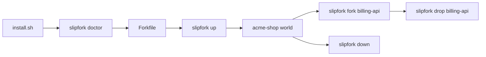

# Getting started

From an empty machine to a forked world in five steps: install, write a `Forkfile`, boot it, fork it,
drop it. Everything runs under your user — no root except the one-time `:80` ingress socket.

## 1. Install

```console
$ curl -fsSL https://offworldnexus.github.io/slipfork/install.sh | sh
$ slipfork doctor
✓ Ready
```

The installer adds the signed package repository where it can, and otherwise unpacks the release
archive under `~/.local`. [Install](install.md) lists every distro and flag.

!!! warning "`doctor` must be green first"

    Slipfork needs Btrfs, unprivileged namespaces and `crun`. `slipfork doctor` names the exact
    remedy for whichever row fails; fix that before the first `slipfork up`.

## 2. Write a Forkfile

Create `Forkfile` at the repository root. This one is complete and boots a real API.

```forkfile
# forkfile: 0.1

domain main

postgres pg { database app_db }
redis cache
s3 uploads

env common {
  DATABASE_URL = app_db.url
  REDIS_URL    = cache.url
  SECRET_KEY   = secret(SECRET_KEY) ?? random_hex(32)
}

image api . {
  use env common

  service web {
    port 8000
    route /api
    run: @uv run uvicorn app.main:app --host 0.0.0.0 --port $port
  }
}
```

`SECRET_KEY` resolves from the paired cloud when you ran `slipfork auth`, or becomes a random local
value. [The Forkfile](forkfile.md) covers the rest of the language.

## 3. Boot it

```console
$ slipfork up
→ [1/5] Image api
✓ Image api (built 1.4s)
✓ Resources pg, cache, uploads ready (0.4s)
✓ Setup api: uv sync (1.1s)
✓ Services web running (0.2s)
✓ Ready -> http://acme-shop.localhost
```

Open the URL, let Slipfork open it, or follow the logs:

```console
$ slipfork open
$ slipfork logs -f web
```

Boot progress replaces each line in place. On the next run the unchanged `uv sync` node prints a dim
`(up to date)` and finishes in under 1 ms.

## 4. Fork the world

```console
$ slipfork fork billing-api
✓ Forked billing-api (0.8s) -> http://billing-api--acme-shop.localhost
  path  ~/projects/acme-shop/.forks/billing-api
```

The `0.8s` is end-to-end; the CoW snapshot itself is `38ms` (`≤50ms` on network block storage) and
the rest boots the cloned stack.

The fork has its own checkout, PostgreSQL and Redis snapshots, and URL. Dependencies and input-hash
stamps came along, so nothing installs again. Throw the experiment away when you are done:

```console
$ slipfork drop billing-api
```

## 5. Stop and start again

```console
$ slipfork down        # stop pods, keep data subvolumes
$ slipfork up          # back on http://acme-shop.localhost
```



!!! info "Data survives `down`"

    `slipfork down` stops the pods and deletes run subvolumes; PostgreSQL, Redis and bucket data
    subvolumes stay. `slipfork drop` is the verb that deletes a fork's snapshots.

## Where next

* [Install](install.md) — packages, daemon unit and the privileged `:80` ingress.
* [The Forkfile](forkfile.md) — resources, services, routes and hooks.
* [CLI](cli.md) — every daily verb and the terminal contract.
