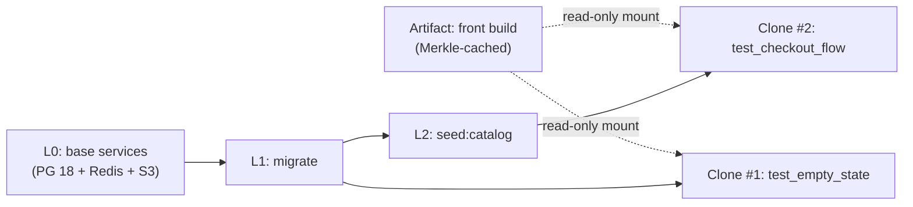

# Slipfork

**Fork a running full-stack environment in milliseconds. Run every heavy test in its own clean world.**

Slipfork reads your [`snow.yml`](snow-modes.md) infrastructure manifest, boots a local environment where source files stay owned by your own user, and uses copy-on-write (CoW) snapshots to clone databases, caches, object buckets, and warm processes instantaneously.

```console
$ slipfork up        # Boot Postgres, Redis, S3 & app from snow.yml (modes.local)
$ slipfork test      # Build changed artifacts once; run each test in a CoW clone
$ slipfork fork exp  # Clone the live environment into .worktrees/exp in ~30 ms
```

---

## What Slipfork Eliminates

| Pain today | With Slipfork |
|---|---|
| `pytest` builds the frontend inside a fixture, picks random ports, and pins browser tests to 1 worker | Frontend builds once as a cached **Artifact Volume**; every test clone runs on canonical ports (`:8000`, `:3000`, `:5432`) across all CPU cores |
| `transactional_db` / `serialized_rollback` flushes and re-seeds Postgres 25 times per run | Migrations and seeds form a **Fixture Snapshot DAG**; each test clones its ancestor in milliseconds and discards it on exit — zero teardown |
| Docker bind-mounts leave `root:root` migrations, lockfiles, and screenshots on your laptop | Source code mounts directly with your exact `$UID:$GID`; generated files are yours immediately |
| `.env` files drift from cloud config, or agents monkey-patch `settings.py` around missing keys | `snow.yml` `modes.all` + `modes.local` resolves everything semantically, auto-generates `!!` secrets once, and halts cleanly on missing credentials |
| Parallel AI agents in git worktrees fight over port `5432`, Redis `FLUSHDB`, and dev servers | [`@slipfork/opencode`](agents-and-opencode.md) forks the world on worktree creation and routes `shell` commands implicitly by directory |

---

## 30-Second Tour

### 1. One manifest for Cloud and Local (`snow.yml`)

```yaml
resources:
  pg_clusters: [{ id: psql, version: "18" }]
  pg_databases: [{ id: psql, cluster: psql }]
  redis_clusters: [{ id: redis, version: "8" }]
  s3_buckets: [{ id: media }]

modes:
  all:
    envs:
      django:
        SECRET_KEY: '${{ secrets::SECRET_KEY !! random_string(50) }}'
        DATABASE_URL: '${{ resources::pg_databases.psql.url }}'
        REDIS_URL: '${{ resources::redis_clusters.redis.url }}'
  cloud:
    envs:
      django:
        STORAGES_MODE: 'do'
        AWS_STORAGE_BUCKET_NAME: '${{ vars::AWS_STORAGE_BUCKET_NAME }}'
  local:
    envs:
      django:
        DEBUG: 'True'
        STORAGES_MODE: 's3'
        AWS_S3_ENDPOINT_URL: '${{ resources::s3_buckets.media.endpoint_url }}'
```

### 2. Orthogonal Snapshot DAG for Tests



- Editing CSS rebuilds **only** `front build` — `migrate` and `seed:catalog` snapshots stay warm.
- Adding a migration rebuilds **only** `migrate` -> `seed:catalog` — `front build` is untouched.

---

## Next Steps

- **[Getting started](getting-started.md)** — Install Slipfork and boot your first project in 3 steps.
- **[`snow.yml` modes & secrets](snow-modes.md)** — `modes.all`, `!!` secret generators, and Kerfufoo integration.
- **[Parallel testing DAG](testing-dag.md)** — Multi-language test adapters (`pytest`, `Playwright`, `PHPUnit`, `cargo`).
- **[AI agents & OpenCode](agents-and-opencode.md)** — Zero-confusion worktree worlds for autonomous coding agents.
- **[Blastit integration](blastit.md)** — Single-pass parallel wire learning and zero-trust route verification.
