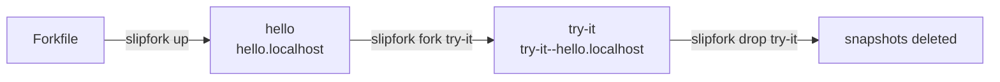

{ align=right width=220 }

# Your stack, running locally in a box

Slipfork is like Docker Compose with opinions, without Docker and on crack. One `Forkfile` boots your images, PostgreSQL, Redis and S3 behind one `.localhost`. `slipfork fork` clones the running world and boots it on its own URL.

- **No Docker daemon** — every `RUN` is a cached copy-on-write subvolume.
- **No port collisions** — each world owns `<world>.localhost`, each fork `<fork>--<world>.localhost`.
- **No setup script** — PostgreSQL, Redis and S3 are declared resources, cloned into every fork.
- **Your agent can fork the running stack** — code, dependencies and data — in milliseconds.

## Start here

```console
$ curl -fsSL https://offworldnexus.github.io/slipfork/install.sh | sh
$ git clone --depth 1 https://github.com/OffworldNexus/slipfork
$ cd slipfork/support/demo && slipfork up
✓ Ready -> http://demo.localhost
```

Linux, with Btrfs and `crun`; on ext4 or XFS [mount a workspace image](install.md#on-ext4-or-xfs-mount-a-btrfs-workspace-image-in-your-home-folder), and `slipfork doctor` names anything else missing.

The demo is the full eight-component stack. The [tutorial](tutorial.md) builds the same shape from scratch in four steps, and [Install](install.md) covers packages and uninstall.

> **Pre-1.0.** The Forkfile and CLI can change between releases; report what breaks in the [issue tracker](https://github.com/OffworldNexus/slipfork/issues).

## One file, the whole stack

```forkfile
# forkfile: 0.1

postgres pg { database app_db }
redis cache
s3 uploads

env common {
  DATABASE_URL = app_db.url
  REDIS_URL = cache.url
}

image api . {
  use env common
  on dev: stage dev
  service web {
    port 8000
    route /api
    on dev: run: @uv run uvicorn app:api --reload --host 0.0.0.0 --port $port
  }
}

image frontend ./front {
  on dev: stage dev
  service front {
    port 3000
    route /
    on dev {
      port 5173
      run: @pnpm exec vite dev --host 0.0.0.0 --port $port
    }
  }
}
```

`fork` snapshots the project and the database pages, then boots the fork through the ordinary `up` path.



The [Forkfile](forkfile.md) reference covers every declaration, [Under the hood](under-the-hood.md) shows the subvolumes, namespaces and `:80` edge behind it, and the [CLI](cli.md) page lists every daily verb.
