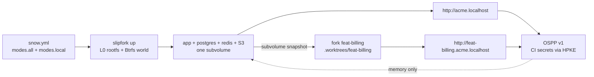

# Slipfork (`0.1.0`)

**Slipfork runs your cloud environment locally in a box; CI is the clutch.** Your `snow.yml` already describes the app and its services. Slipfork boots that description as a disposable Btrfs world and forks it in milliseconds for every branch, task, or agent.

```console
$ sudo slipfork daemon install   # one time: :80 socket activation + AppArmor userns profile
$ slipfork up                    # Dockerfile rootfs → Btrfs world → http://acme.localhost
$ slipfork fork feat-billing     # second world + .worktrees/feat-billing
$ slipfork list                  # one URL per world
$ slipfork open --world feat-billing
```

!!! warning "Btrfs is the substrate"
    Every world and sealed snapshot is one unprivileged subvolume. The state directory must be Btrfs mounted `user_subvol_rm_allowed,noatime`; `slipfork doctor` prints the exact `mount` line and exits `1` on anything else.

!!! info "One daemon, thin clients"
    `slipfork` auto-spawns the unprivileged `slipforkd` when `<state_dir>/run/daemon.sock` does not answer. `doctor` runs locally; world commands and secret resolution run through the daemon.

## The workflow



Forking a Git worktree isolates source files. Slipfork also isolates the database, cache, object store, and ports those files talk to — with one metadata snapshot, not a rebuild.

## What runs today

| Surface | Shipped behaviour |
|---|---|
| **Host probe** | `slipfork doctor` checks the Btrfs magic, a live subvolume round-trip, `userns`/`netns`, and `:80` ingress; text or `--json` |
| **World rootfs** | Read-only `L0` image built from your `Dockerfile`, cached under `<state_dir>/cache/rootfs`, run as `$UID:$GID` |
| **Backing services** | `postgres:<v>`, `redis:<v>`, and SeaweedFS as `crun` containers on the world's `127.0.0.1` |
| **Lifecycle** | `up`, `down`, `restart`, `fork`, `drop`, `list`, `ps`, `prune`, `open`, bare `status` |
| **Inside a world** | `exec`, `shell`, `logs`, `hook run`, `db`, `redis`, `forward` |
| **`snow.yml`** | `modes.all` + named modes, `??` fallbacks, write-once `!!` secrets in a local `0600` vault |
| **OSPP v1** | Pair once with `slipfork auth`; remote secrets arrive HPKE-encrypted and stay in daemon memory |
| **OpenCode V2** | Worktree becomes a world; shell commands route through `slipfork exec` |

## Measured cost model

| Operation | Measured |
|---|---:|
| Read-only snapshot of a world subvolume | **`19.5 ms`** |
| Writable clone of a world | **`11–24 ms`** |
| Clone to a warm-SQL world | **`39 ms`** |
| RAM per running world | **`6.3 MiB`** |

Owner-recorded figures; provenance in `docs/research/btrfs-crun-benchmarks.md` in the repository.

## Next steps

- **[Getting started](getting-started.md)** — mount Btrfs, probe, boot, fork, and work inside a world.
- **[`snow.yml` modes & secrets](snow-modes.md)** — mode resolution, `!!` generators, coordinates.
- **[Secrets & OSPP v1](reference/ospp.md)** — pair once, reconnect from the saved record.
- **[OpenCode V2 plugin](agents-and-opencode.md)** — automatic worktree worlds for agents.
- **[CLI](reference/cli.md)** and **[manifest reference](reference/manifest.md)** — commands, flags, schemas.
