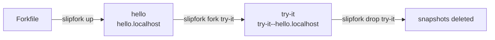

{ align=right width=220 }

# Your cloud environment, locally in a box

Slipfork is Docker Compose with opinions, without Docker: one `Forkfile` boots your images, PostgreSQL, Redis and S3 buckets behind one `.localhost` URL. `slipfork fork` snapshots the whole running world — code, dependencies and data — in milliseconds, then boots it in seconds.

!!! warning "Linux, Btrfs and `crun`"

    Slipfork uses Btrfs subvolumes and rootless `crun` pods. On ext4 or XFS, [mount a Btrfs workspace image in your home folder](install.md#on-ext4-or-xfs-mount-a-btrfs-workspace-image-in-your-home-folder) first; `slipfork doctor` names any other missing piece.

!!! warning "Very experimental release"

    0.1.1 breaks things on purpose. Report what breaks in the [issue tracker](https://github.com/OffworldNexus/slipfork/issues).

## Start here

```console
$ curl -fsSL https://offworldnexus.github.io/slipfork/install.sh | sh
$ git clone --depth 1 https://github.com/OffworldNexus/slipfork
$ cd slipfork/support/demo && slipfork up
✓ Ready -> http://demo.localhost
```

That demo is the full eight-component stack; the [tutorial](tutorial.md) builds the same shape from scratch in four steps. [Install](install.md) covers packages, the Btrfs workspace image and uninstall.

## What you get

- **No Docker daemon.** Images build natively on Btrfs; every `RUN` becomes a cached subvolume.
- **No port collisions.** Each world gets `<world>.localhost`; each fork gets `<fork>--<world>.localhost`.
- **No setup script.** PostgreSQL, Redis and S3 are declared resources, booted with the world and snapshotted into every fork.

## One file, the whole stack

```forkfile
# forkfile: 0.1

postgres pg { database app_db }
redis cache
s3 uploads

env common {
  DATABASE_URL = app_db.url
  REDIS_URL = cache.url
}

image api . {
  use env common
  on dev: stage dev
  service web {
    port 8000
    route /api
    on dev: run: @uv run uvicorn app:api --reload --host 0.0.0.0 --port $port
  }
}

image frontend ./front {
  on dev: stage dev
  service front {
    port 3000
    route /
    on dev {
      port 5173
      run: @pnpm exec vite dev --host 0.0.0.0 --port $port
    }
  }
}
```

`fork` snapshots both the project and the database pages, then boots the fork through the ordinary `up` path.



The [Forkfile](forkfile.md) reference covers every declaration; [Under the hood](under-the-hood.md) shows the subvolumes, namespaces and `:80` edge behind it.
