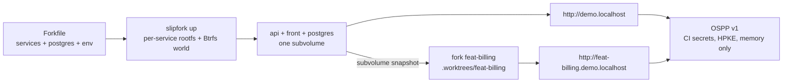

# Slipfork (`0.1.0`)

**Slipfork runs your cloud environment locally in a box; CI is the clutch.** One `Forkfile` describes your services, databases, and secrets. `slipfork up` boots them as a copy-on-write Btrfs world behind a `.localhost` origin, and `slipfork fork` clones the whole world — data included — in milliseconds.

```console
$ sudo slipfork daemon install   # one time: :80 socket activation + AppArmor userns profile
$ slipfork up                    # Forkfile → containers → http://demo.localhost
$ slipfork fork feat-billing     # own worktree, database, cache, URL
$ slipfork status                # every world, one URL each
$ slipfork open -w feat-billing
```

```text title="Forkfile"
postgres pg { database app_db }

service api ./api {
    port 8000
    route /api
    env { DATABASE_URL = app_db.url }
    run .venv/bin/uvicorn app.main:app --host 0.0.0.0 --port $port
}
```

That is the whole manifest: no Compose file, no `.env`, no port table. Each `service` is its own `crun` container, `postgres` is another, and fork copies all of it.

!!! warning "Btrfs is the substrate"
    Every world and sealed snapshot is one unprivileged subvolume. The state directory must be Btrfs mounted `user_subvol_rm_allowed,noatime`; `slipfork doctor` prints the exact `mount` line and exits `1` on anything else.

!!! info "One daemon, thin clients"
    `slipfork` auto-spawns the unprivileged `slipforkd` on `up` and `fork`. `doctor` runs locally; world commands, tasks, and secret resolution run through the daemon.

## How it fits together



## Everyday commands

| Command | What it does |
|---|---|
| `slipfork up` | Boot or confirm the world selected by `--world` or `cwd` |
| `slipfork fork <name>` | Git worktree (or Jujutsu workspace) plus its own Btrfs world |
| `slipfork status` | Every world with state and exactly one URL |
| `slipfork ps` | Services and `crun` containers of one world |
| `slipfork exec -s api -- <cmd>` | Run a command inside a service with its resolved environment |
| `slipfork run <task>` | Run a `Forkfile` task inside its service |
| `slipfork shell <service>` | Interactive shell inside a service container |
| `slipfork db <id>` / `slipfork redis <id>` | `psql` / `redis-cli` inside the running container |
| `slipfork restart` | Re-run the boot pipeline after editing code or hooks |
| `slipfork down` / `slipfork drop` | Stop a world / destroy a fork world and its checkout |

Run bare `slipfork` for the same fleet tree as `status`. Add `--json` for the machine document agents read.

## What ships in `0.1.0`

- `Forkfile`: one procedural manifest with whole-file static checking, features, `on` conditionals, env groups, tasks, and rustc-style diagnostics.
- Read-only per-service rootfs built from each service's `Dockerfile`, cached content-addressed, executed as `$UID:$GID`.
- One unprivileged Btrfs subvolume per world; sealing and cloning are metadata-only.
- Daemonless `crun` containers: every `service`, plus `postgres:<v>`, `redis:<v>`, and SeaweedFS on the world's `127.0.0.1`.
- `secret(KEY) ?? <generator>` write-once secrets in a local `0600` vault; `var(KEY) ?? <fallback>` for local overrides.
- OSPP v1 CI secrets over HPKE, decrypted in `slipforkd` memory; pair once, reconnect from `<state_dir>/ospp.json`.
- OpenCode V2 plugin: a worktree becomes a world; shell commands route through `slipfork exec`.
- `git-remote-slipfork`: fetch a running fork's branch over `slipfork://<fork>`.
- `slipfork lsp` for `Forkfile` diagnostics, and `slipfork migrate` for upstream Snow manifests.

## Measured cost model

| Operation | Measured |
|---|---:|
| Read-only snapshot of a world subvolume | **`19.5 ms`** |
| Writable clone of a world | **`11–24 ms`** |
| Clone to a warm-SQL world | **`39 ms`** |
| RAM per running world | **`6.3 MiB`** |

Owner-recorded; method and caveats in `docs/research/btrfs-crun-benchmarks.md` in the repository.

## Documentation

- [Getting started](getting-started.md)
- [The `Forkfile`](forkfile.md) and its [reference](reference/forkfile.md)
- [OpenCode V2 plugin](agents-and-opencode.md)
- [CLI reference](reference/cli.md) · [Secrets & OSPP v1](reference/ospp.md)

Build the site with `make docs-check`; it runs Zensical `--strict` and a CLI-honesty check.
