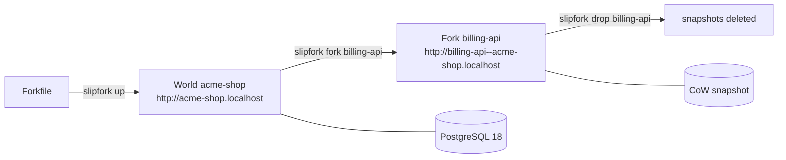

# Your cloud environment, locally in a box

**Slipfork turns one `Forkfile` into your whole stack** — images, PostgreSQL, Redis, S3 buckets and
workers — and serves it from one `.localhost` URL. It runs natively on Btrfs with `crun`, so there is
no Docker daemon to install and no shared staging box to fight over.

```console
$ curl -fsSL https://offworldnexus.github.io/slipfork/install.sh | sh
$ slipfork up
✓ Ready -> http://acme-shop.localhost
```

[Get started](getting-started.md){ .md-button .md-button--primary }
[The Forkfile](forkfile.md){ .md-button }

!!! info "One URL, cloud-identical routes"

    `http://acme-shop.localhost` is the front door. `route /api` keeps its prefix, `domain mail`
    answers on `mail.acme-shop.localhost`, and each `s3` bucket on `<bucket>.acme-shop.localhost`.

## Worlds and forks

A **world** is the running stack declared by one `Forkfile`. A **fork** is an atomic copy-on-write
snapshot of that world and your checkout, with its own dependencies, data pages and URL.



`slipfork fork` finishes in ~0.8s end-to-end (the `< 1s` ceiling). `≤50ms` of that is CoW
snapshotting (`0.3–50ms` per ioctl: local NVMe versus network block storage); the rest boots the
cloned stack because `.venv`, `node_modules`, database pages and bucket objects are already on disk.
Test a risky migration on the fork; the parent world keeps serving.

## A Forkfile is the whole topology

```forkfile
# forkfile: 0.1

domain main
postgres pg { database app_db }
redis cache
s3 uploads

env common {
  DATABASE_URL = app_db.url
  REDIS_URL    = cache.url
}

image api . {
  use env common
  service web {
    port 8000
    route /api
    run: @uv run uvicorn app.main:app --host 0.0.0.0 --port $port
  }
}
```

Services live inside the image that runs them. Build-time `arg`s stay separate from runtime `env`,
and `@uv` / `@pnpm` wire lockfile-watched installs automatically.

| Verb | What it does |
| :--- | :--- |
| `slipfork up` | Boot the world and print `✓ Ready -> <url>` |
| `slipfork fork feat-auth` | Snapshot code and data, boot a fork on its own URL |
| `slipfork drop feat-auth` | Stop the fork and delete its snapshots |
| `slipfork status` | One tree of every world and domain, forks included |
| `slipfork logs -f api` | Stream merged logs with per-service gutters |
| `slipfork down` | Stop the world, keep the data subvolumes |

!!! warning "Linux, Btrfs and crun"

    `slipfork` needs a Linux host with a Btrfs filesystem and `crun` on `PATH`; `slipfork doctor`
    checks exactly those three things. The editor language server `slipfork-lsp` runs on Linux,
    macOS and Windows.

## Where next

* [Getting started](getting-started.md) — install, a Forkfile, `up`, `fork`, `drop`, `down`.
* [Install](install.md) — every distro, the daemon unit and the `:80` ingress.
* [The Forkfile](forkfile.md) — the complete `# forkfile: 0.1` language.
* [CLI](cli.md) — daily verbs, trees, progress and `NO_COLOR`.
