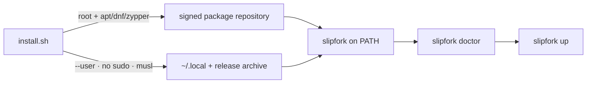
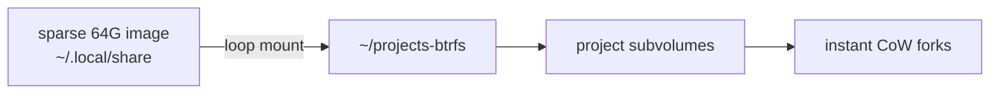

# Install

One `slipfork` binary on every Linux distribution, plus a standalone `slipfork-lsp` for editors
anywhere. A fresh machine is one command and one green `slipfork doctor` away from a running world.

```console
$ curl -fsSL https://offworldnexus.github.io/slipfork/install.sh | sh
$ slipfork doctor
✓ Ready
$ slipfork up
✓ Ready -> http://acme-shop.localhost
```



## One installer, every distro

The installer prefers your package manager and falls back to the release archive. Upgrades then come
from the repository, so the installer is a one-time command.

| Flag | Effect |
| :--- | :--- |
| `--version <ver>` | Install exactly this release |
| `--nightly` | Use the nightly component |
| `--mirror cloudsmith\|forgejo` | Pick the package mirror |
| `--user` | No root: archive under `~/.local` |
| `--prefix <dir>` | No root: archive under a directory you own |
| `--develop [ref]` | The unsigned CI archive for that ref; a digest is mandatory |
| `-y`, `--yes` | Do not ask for confirmation |

Pass flags through the pipe with `sh -s --`:

```console
$ curl -fsSL https://offworldnexus.github.io/slipfork/install.sh | sh -s -- --user
```

## Native packages

Every package declares `crun` and `btrfs-progs`, and ships the systemd units (or the OpenRC service
on Alpine). A package never enables a root daemon.

| Distro | Install | Upgrade |
| :--- | :--- | :--- |
| Debian, Ubuntu | `sudo apt-get install ./slipfork_0.1.0_<arch>.deb` | `sudo apt-get upgrade slipfork` |
| Fedora, RHEL, Rocky, Alma | `sudo dnf install ./slipfork-0.1.0-1.<arch>.rpm` | `sudo dnf upgrade slipfork` |
| openSUSE | `sudo zypper install ./slipfork-0.1.0-1.<arch>.rpm` | `sudo zypper update slipfork` |
| Arch Linux | `sudo pacman -U ./slipfork-0.1.0-1-<arch>.pkg.tar.zst` | `yay -S slipfork-bin` (AUR) |
| Alpine | `sudo apk add ./slipfork-0.1.0-r0-<arch>.apk` | `sudo apk upgrade slipfork` |

`<arch>` is `amd64` (`.deb`) or `x86_64` (`.rpm`, `.pkg.tar.zst`, `.apk`) on 64-bit x86; ARM uses
`arm64` and `aarch64`.

Verify the same way on every row:

```console
$ slipfork --version
$ slipfork doctor
✓ Ready
```

!!! note "Alpine runs OpenRC"

    On Alpine the `:80` ingress is the `slipfork-ingress` OpenRC service, not a systemd socket.
    `sudo slipfork daemon install --ingress` writes `/etc/conf.d/slipfork-ingress` with the invoking
    user and grants that user the unprivileged `:80` bind; then enable and start it:

    ```console
    $ sudo rc-update add slipfork-ingress default
    $ sudo rc-service slipfork-ingress start
    ```

## On ext4 or XFS? Mount a Btrfs Workspace Image in Your Home Folder

You do not have to repartition your disk. A sparse Btrfs image mounted through the kernel loop driver
gives your projects real subvolumes inside your home folder.

```console
$ sudo apt install btrfs-progs          # or: sudo dnf install btrfs-progs / sudo pacman -S btrfs-progs
$ mkdir -p ~/.local/share ~/projects-btrfs
$ truncate -s 64G ~/.local/share/slipfork-btrfs.img
$ mkfs.btrfs -f ~/.local/share/slipfork-btrfs.img
$ sudo mount -o loop,user_subvol_rm_allowed,noatime,compress=zstd,discard=async \
    ~/.local/share/slipfork-btrfs.img ~/projects-btrfs
$ sudo chown "$USER:$(id -gn)" ~/projects-btrfs
```

The image is **sparse**: it reports `64G` but occupies almost nothing on disk until files are
written. It mounts through the kernel `loop` driver, so there is no `qemu-nbd` daemon to install or
supervise.

`discard=async` punches freed blocks back to ext4 or XFS, so dropping a fork returns that space to
your home filesystem. Point Slipfork at a project under `~/projects-btrfs`, and never run
`mkfs.btrfs` against an existing disk or partition — the command above targets only the image file
you just created.



!!! info "Mount it again after a reboot"

    One `/etc/fstab` line keeps the workspace mounted, with `nofail` so a missing image never blocks
    boot:

    ```text
    /home/<you>/.local/share/slipfork-btrfs.img /home/<you>/projects-btrfs btrfs loop,user_subvol_rm_allowed,noatime,compress=zstd,discard=async,nofail 0 0
    ```

    Then run `sudo mount -a` once and confirm with `findmnt ~/projects-btrfs`.

Grow it live when `64G` stops being enough:

```console
$ truncate -s 128G ~/.local/share/slipfork-btrfs.img
$ sudo losetup -c /dev/loopN      # N from `losetup -j ~/.local/share/slipfork-btrfs.img`
$ sudo btrfs filesystem resize max ~/projects-btrfs
```

Verify from inside the mount, where `doctor` reports four plain-English rows:

```console
$ cd ~/projects-btrfs && slipfork doctor
✓ Ready
  ✓ Storage     ~/projects-btrfs · on · Btrfs · instant copy-on-write forks ready
  ✓ Containers  crun 1.20 · rootless container sandboxing enabled
  ✓ Daemon      running · background user service active
  ✓ Domains     http://*.localhost · local domain routing active
```

## The daemon and the `:80` ingress

Worlds are served by **one per-user daemon**. Install it without `sudo`:

```console
$ slipfork daemon install
$ systemctl --user enable --now slipfork
```

That writes `~/.config/systemd/user/slipfork.service`; the second line keeps it on at login. The
`.localhost` edge on `127.0.0.1:80` is the one privileged piece:

```console
$ sudo slipfork daemon install --ingress
```

This installs `slipfork-ingress.socket`, its template instance and the AppArmor profile. The socket
is stateless: it forwards each accepted connection to your daemon, which makes every routing
decision.

!!! warning "`slipfork` needs Linux"

    Worlds need Linux kernel namespaces, a Btrfs filesystem and `crun`. On macOS or Windows, run
    Slipfork inside a Linux VM or container; editors there still get the standalone language server.

## Editor language server

`slipfork-lsp` is a separate binary from the `slipfork` CLI, and it needs no Btrfs or `crun`:

| Platform | Release assets |
| :--- | :--- |
| Linux | `slipfork-lsp-linux-x86_64.tar.gz`, `slipfork-lsp-linux-aarch64.tar.gz` |
| macOS | `slipfork-lsp-darwin-x86_64.tar.gz`, `slipfork-lsp-darwin-aarch64.tar.gz` |
| Windows | `slipfork-lsp-windows-x86_64.zip`, `slipfork-lsp-windows-aarch64.zip` |

A local build is `cargo install --path crates/slipfork-lsp`. The Zed extension finds the binary or
downloads the matching asset.

## Where next

* [Getting started](getting-started.md) — two files, three steps to a world.
* [CLI](cli.md) — every verb and the terminal contract.
* [The Forkfile](forkfile.md) — the complete `# forkfile: 0.1` language.
