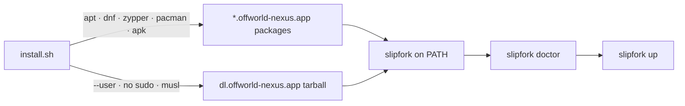
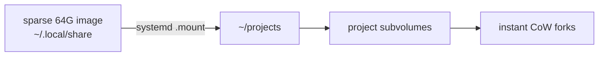

# Install

One `slipfork` binary on every Linux distribution, plus a standalone `slipfork-lsp` for editors
anywhere. A fresh machine is one command and one green `slipfork doctor` away from a running world.

0.1.0 is a very experimental release, so expect breakage and
[report it](https://github.com/OffworldNexus/slipfork/issues).

```console
$ curl -fsSL https://offworld-nexus.app/install.sh | sudo sh
$ sudo apt install slipfork          # or: dnf / zypper / apk / pacman
$ slipfork doctor
✓ Ready
$ slipfork up
✓ Ready -> http://acme-shop.localhost
```

The installer detects your distribution, adds the signed Offworld Nexus repository and key, and
hands the install to your own package manager; `--dry-run` prints every change, `--uninstall`
reverts them, and `| sudo sh -s -- --channel nightly` follows nightlies.

!!! info "What the installer trusts"

    `apt`, `dnf`, `zypper`, `pacman` and `apk` verify package signatures and never disable that
    verification. The script only adds the repository and its key; your package manager performs the install.



## Manual per-distro steps

Five hosts serve every channel: `apt.`, `rpm.`, `apk.` and `arch.offworld-nexus.app` for package
managers, and `dl.offworld-nexus.app` for tarballs and editor builds. Pick your distro and paste the
block; `<arch>` is `x86_64` unless your host says `aarch64`.

### Debian, Ubuntu

```console
$ sudo install -d -m 0755 /etc/apt/keyrings
$ sudo curl -fsSL https://apt.offworld-nexus.app/keyring.gpg \
    -o /etc/apt/keyrings/offworld-nexus.gpg
$ sudo tee /etc/apt/sources.list.d/offworld-nexus.sources >/dev/null <<'EOF'
Types: deb
URIs: https://apt.offworld-nexus.app
Suites: any-distro
Components: main
Signed-By: /etc/apt/keyrings/offworld-nexus.gpg
EOF
$ sudo apt-get update && sudo apt-get install -y slipfork
```

Use `Components: nightly` instead of `main` to follow nightlies.

### Fedora, RHEL, Rocky, Alma, openSUSE

```console
$ sudo tee /etc/yum.repos.d/offworld-nexus.repo >/dev/null <<'EOF'
[offworld-nexus]
name=Offworld Nexus (Stable)
baseurl=https://rpm.offworld-nexus.app/stable/$basearch/
enabled=1
gpgcheck=1
repo_gpgcheck=1
gpgkey=https://rpm.offworld-nexus.app/gpg.key
EOF
$ sudo dnf install -y slipfork
```

Replace `/stable/` with `/nightly/` for nightlies; on openSUSE run `sudo zypper install slipfork`
after the same repo file.

### Alpine

```console
$ sudo wget -O /etc/apk/keys/packages@offworld.nexus.rsa.pub \
    https://apk.offworld-nexus.app/packages@offworld.nexus.rsa.pub
$ echo "https://apk.offworld-nexus.app/stable" | sudo tee -a /etc/apk/repositories
$ sudo apk update && sudo apk add slipfork
```

Swap `/stable` for `/nightly` on the repository line to follow nightlies.

### Arch Linux

```console
$ curl -fsSL https://arch.offworld-nexus.app/gpg.key | sudo pacman-key --add -
$ sudo pacman-key --lsign-key E9DD32C63321505EBBCF86386E08120B3306C720
$ sudo tee -a /etc/pacman.conf >/dev/null <<'EOF'

[offworld]
Server = https://arch.offworld-nexus.app/stable/$arch
EOF
$ sudo pacman -Sy --needed --noconfirm slipfork
```

Use `/nightly/$arch` in the `Server` line to follow nightlies.

Every package declares `crun`, `btrfs-progs`, and `slirp4netns`. The last one is the user-mode NAT
that gives a world outbound network, so `@uv`, `@pnpm`, and HTTPS reach the internet.

Systemd packages ship both units and enable them for the installing user: the install hook reads
`SUDO_USER` from a normal `sudo` install, turns on lingering, starts `slipfork.service`, and enables
`slipfork-ingress.socket`. There is no separate ingress command.

```console
$ slipfork --version
$ slipfork doctor
✓ Ready
```

!!! note "Alpine runs OpenRC"

    On Alpine the `:80` ingress is the `slipfork-ingress` OpenRC service, not a systemd socket.
    The install hook writes `/etc/conf.d/slipfork-ingress` with the installing user and runs
    `rc-update`/`rc-service` for the ingress only; `slipfork up` starts the daemon.

!!! note "Tarballs and headless hosts"

    When no package hook ran, `docs/install.sh` provisions the user unit and the socket on a
    systemd host; set `SLIPFORK_INSTALL_NO_SERVICE=1` to skip it. By hand, put the user unit under
    `~/.config/systemd/user` and run `systemctl --user enable --now slipfork`, then put the socket
    and template under `/etc/systemd/system` and run
    `sudo systemctl enable --now slipfork-ingress.socket`.

## This project's installer (alternative)

This repository's own [`install.sh`](https://offworldnexus.github.io/slipfork/install.sh) is the
alternative when you cannot use `sudo`: `--user` unpacks under `~/.local` with no root and the musl
build is included. `--nightly` follows nightlies, and `--version` pins a release through your
package manager; on the tarball path pin an archive with `SLIPFORK_ARCHIVE_URL` and `SLIPFORK_SHA256`.

It prefers your package manager and falls back to the signed tarball, so upgrades come from the same
repository and `install.sh` stays a one-time command.

| Flag | Effect |
| :--- | :--- |
| `--version <ver>` | Install exactly this release |
| `--nightly` | Use the nightly channel; re-run without it for releases |
| `--user` | No root: tarball under `~/.local` |
| `--prefix <dir>` | No root: tarball under a directory you own |
| `--develop [ref]` | Use the CI archive named by `SLIPFORK_ARCHIVE_URL`; unsigned, so a digest is mandatory |
| `-y`, `--yes` | Do not ask for confirmation |
| `-h`, `--help` | Print the flags |

Pass flags through the pipe with `sh -s --`:

```console
$ curl -fsSL https://offworldnexus.github.io/slipfork/install.sh | sh -s -- --user
```

!!! info "What the installer trusts"

    The default tarball origin is HTTPS with its published `.sha256` checked when present. An
    overridden origin (`--develop` or `SLIPFORK_ARCHIVE_URL`) requires `SLIPFORK_SHA256`, and any
    digest mismatch aborts before unpacking.

## Portable tarballs

On a glibc host the tarball is `slipfork-x86_64-unknown-linux-gnu.tar.gz`; musl hosts use the
`-musl` build. Both live under `https://dl.offworld-nexus.app/tarballs/stable/` (or `/nightly/`) and
are installed through the same one-liner:

```console
$ curl -fsSL https://offworldnexus.github.io/slipfork/install.sh | sh -s -- --user
$ ~/.local/bin/slipfork doctor
```

## On ext4 or XFS? Mount a Btrfs Workspace Image in Your Home Folder

You do not have to repartition your disk. A sparse Btrfs image, mounted by a systemd `.mount` unit,
gives your projects real subvolumes inside your home folder.

```console
$ sudo apt install btrfs-progs          # or: sudo dnf install btrfs-progs / sudo pacman -S btrfs-progs
$ mkdir -p ~/.local/share ~/projects
$ truncate -s 64G ~/.local/share/slipfork-btrfs.img
$ mkfs.btrfs -f ~/.local/share/slipfork-btrfs.img
```

The image is **sparse**: it reports `64G` but occupies almost nothing on disk until files are
written. It mounts through the kernel `loop` driver, so there is no `qemu-nbd` daemon to install or
supervise.

`discard=async` punches freed blocks back to ext4 or XFS, so dropping a fork returns that space to
your home filesystem. Never run `mkfs.btrfs` against an existing disk or partition — the command
above targets only the image file you just created.

Let `systemd` own the mount, so the image is mounted now and on every boot:

```bash
UNIT="$(systemd-escape --path --suffix=mount "$HOME/projects")"
sudo tee "/etc/systemd/system/$UNIT" >/dev/null <<EOF
[Unit]
Description=Slipfork Btrfs workspace image

[Mount]
What=$HOME/.local/share/slipfork-btrfs.img
Where=$HOME/projects
Type=btrfs
Options=loop,user_subvol_rm_allowed,noatime,compress=zstd,discard=async

[Install]
WantedBy=multi-user.target
EOF

sudo systemctl daemon-reload
sudo systemctl enable --now "$UNIT"
sudo chown "$USER:$(id -gn)" "$HOME/projects"
systemctl status "$UNIT" --no-pager   # mounted now, and on every boot
```

This beats hand-editing `/etc/fstab`: a wrong entry can block boot, while a `.mount` unit fails in
isolation with `nofail`-style ordering handled by `systemd`. `systemd` also sets up and tears down the
loop device for you, and the unit is inspectable with `systemctl status` or `journalctl -u`.

!!! info "If you prefer fstab"

    The equivalent single line, with `nofail` so a missing image never blocks boot:

    ```text
    /home/<you>/.local/share/slipfork-btrfs.img /home/<you>/projects btrfs loop,user_subvol_rm_allowed,noatime,compress=zstd,discard=async,nofail 0 0
    ```



Grow it live when `64G` stops being enough:

```console
$ truncate -s 128G ~/.local/share/slipfork-btrfs.img
$ sudo losetup -c /dev/loopN      # N from `losetup -j ~/.local/share/slipfork-btrfs.img`
$ sudo btrfs filesystem resize max ~/projects
```

Verify from inside the mount, where `doctor` reports four plain-English rows:

```console
$ cd ~/projects && slipfork doctor
✓ Ready
  ✓ Storage     ~/projects · on · Btrfs · instant copy-on-write forks ready
  ✓ Containers  crun 1.20 · rootless container sandboxing enabled
  ✓ Daemon      running · background user service active
  ✓ Domains     http://*.localhost · local domain routing active
```

A missing `slirp4netns` turns the `Containers` row red with
`slirp4netns not installed · pods cannot reach PyPI, npm, or HTTPS`.

## The daemon and the `:80` ingress

Worlds are served by **one per-user daemon**. Systemd packages installed with `sudo` enable and
start it for the installing user, so a package install needs nothing else.

The `.localhost` edge on `127.0.0.1:80` is a system socket the same hook enables for that user; it
ships `slipfork-ingress.socket`, its template instance and the AppArmor profile. On a tarball,
headless, or rootless systemd install, `docs/install.sh` enables both; by hand, place the template
and socket under `/etc/systemd/system` and run
`sudo systemctl enable --now slipfork-ingress.socket`.

The socket is stateless: it forwards each accepted connection to your daemon, which makes every
routing decision.

!!! warning "`slipfork` needs Linux"

    Worlds need Linux kernel namespaces, a Btrfs filesystem, `crun`, and `slirp4netns`. On macOS or
    Windows, run Slipfork inside a Linux VM or container; editors there still get the standalone
    language server.

## Editor language server

`slipfork-lsp` is a separate binary from the `slipfork` CLI, and it needs no Btrfs or `crun`. Editor
builds live on `dl.offworld-nexus.app` under `macos/{stable,nightly}/` and
`windows/{stable,nightly}/`:

| Platform | Asset |
| :--- | :--- |
| Linux | `slipfork-lsp-linux-<arch>.tar.gz` (the `slipfork` tarball already ships `slipfork-lsp`) |
| macOS | `slipfork-lsp-darwin-<arch>.tar.gz` |
| Windows | `slipfork-lsp-windows-<arch>.zip` |

The installer prints the exact URL for your host on a non-Linux machine. A local build is
`cargo install --path crates/slipfork-lsp`, and the Zed extension finds the binary or downloads the
matching asset.

## Where next

* [Getting started](getting-started.md) — two files, three steps to a world.
* [CLI](cli.md) — every verb and the terminal contract.
* [The Forkfile](forkfile.md) — the complete `# forkfile: 0.1` language.
