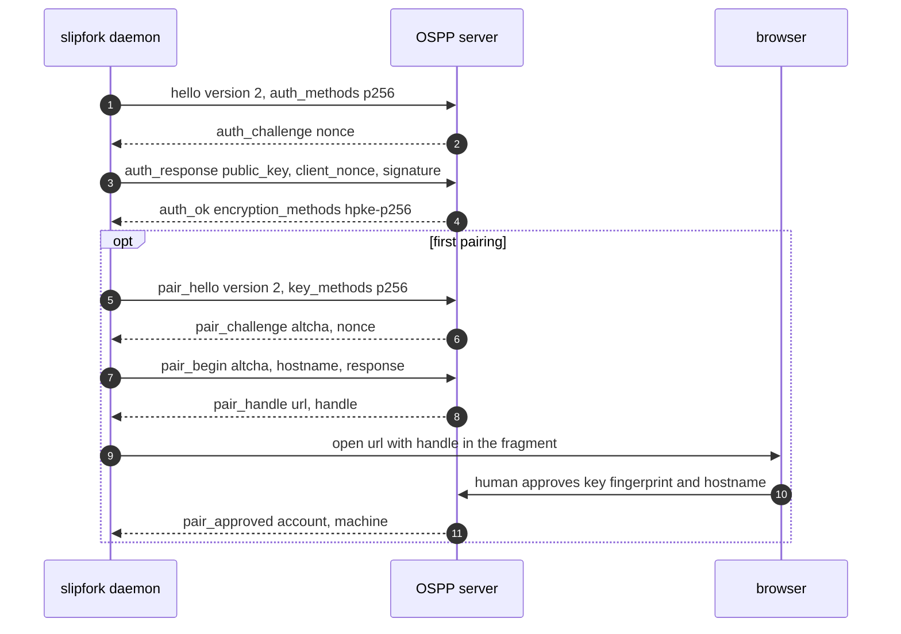

# OSPP v1

!!! warning "Pairing is not available in 0.1.1"

    The pairing CLI is not part of this release; the wire contract below is unchanged.

This is the OSPP v1 wire contract that OSPP pairing uses once it returns; 0.1.1 ships local
`secret()` values only. A paired world receives the same `vars`, secrets and resources CI has —
without `.env` files, pasted tokens, or a secret written to disk in the clear.

Frames are UTF-8 JSON text messages over the `ospp-v1` WebSocket subprotocol, always at version 2.
The frame set is closed: an unknown type or field is a protocol violation, never ignored, and
plaintext `ws://` is accepted only on loopback.

## One daemon, one identity

The machine key, the pairing record and the decrypted vault are per-user `0600` files under
`<state_dir>`; the CLI never holds the long-lived key. A pairing resolves its endpoint by
precedence: the explicit endpoint, then the positional URL, then the saved record.

## Authentication and first pairing

The machine proves possession of its P-256 key over a transcript bound to fresh nonces. First-time
enrolment adds an ALTCHA proof of work and a browser approval step.

| Value | Encoding |
| :--- | :--- |
| Machine public key | Compressed SEC1 P-256, 66 lowercase hex |
| Client nonce | 32 random bytes, 64 hex |
| Signature | ECDSA P-256 over SHA-256, raw `r ‖ s`, 128 hex |
| Auth transcript | `b"ospp-v1" ‖ server_nonce ‖ client_nonce` |
| Pairing transcript | `b"ospp-v1-pair" ‖ server_nonce ‖ client_nonce` |

The 32-byte handle appears only in the URL fragment, so access logs and `Referer` headers never
record it.

## Frames

Seven client frames open, attach and ask; nine server frames answer, push and refuse.

| Direction | Frame | Key fields |
| :--- | :--- | :--- |
| client | `hello` | `version`, `auth_methods` |
| client | `auth_response` | `response.public_key`, `client_nonce`, `signature` |
| client | `pair_hello` | `version`, `key_methods` |
| client | `pair_begin` | `altcha`, `hostname`, `response` |
| client | `subscribe` | `id`, `remote`, `encryption`, `forkfile`, `claims` |
| client | `unsubscribe` | `id` |
| client | `dump_request` | `id`, `subscription_id`, `resource` |
| server | `auth_challenge` | `method`, `challenge.nonce` |
| server | `auth_ok` | `encryption_methods` |
| server | `pair_challenge` | `method`, `altcha`, `challenge.nonce` |
| server | `pair_handle` | `url`, `handle` |
| server | `pair_approved` | `account`, `machine` |
| server | `env_resolved` | `id`, `components` |
| server | `env_updated` | `id`, `components` |
| server | `dump_ready` | `id`, `url` |
| server | `error` | `id`, `code`, `message` |

`subscribe` carries the feature-evaluated `Forkfile` exactly once, plus the verbatim Git `remote`.
Claims are **IDs only**: `vars`, `secrets`, `resources`, `domains` and `components` name what stays
local; everything unclaimed resolves server-side.

## Secrets stay local

Values are sealed with HPKE against a keypair generated per subscription. The private key lives only
in the daemon's memory, and each ciphertext is bound to its destination by the AAD.

| Parameter | Value |
| :--- | :--- |
| Mode | RFC 9180 Base |
| KEM / KDF | `DHKEM(P-256, HKDF-SHA256)` / `HKDF-SHA256` |
| AEAD | `AES-256-GCM` |
| `info` / `aad` | `ospp-v1-secret` / `<service>:<env_key>` |
| Ciphertext / wire | `enc` (65 bytes) ‖ sealed value, as `{ "encrypted": "<base64>" }` |

Decryption happens in the daemon, never in the CLI, and resolved values reach only the `0600` vault
or the pod's tmpfs. `env_updated` reuses the `components` shape and restarts affected services in
place; there is no bearer token anywhere in the client.

## Sealed resource dumps

A resource such as `pg_databases.main` arrives as an encrypted HTTPS stream written straight into the
world data subvolume. A truncated stream leaves the world on its sealed base instead of a partial
dump.

| Element | Value |
| :--- | :--- |
| Body | `enc` (65 bytes), then repeated frames, then one final frame |
| Frame | 4-byte big-endian plaintext length ‖ `ctx.Seal(aad, chunk)` |
| EOF | `len = 0` sealed frame, mandatory |
| `info` / `aad` | `ospp-v1-dump` / `<subscription_id>:<resource>` |
| Limits | 1 MiB chunk, 16 KiB response headers, mandatory `Content-Length` |
| Transport | `https://` anywhere, `http://` loopback only, zero redirects |

The dump URL is single-use and short-lived, and no pooled connection outlives the stream.

## Ingress is stateless

The `:80` socket accepts, then forwards the descriptor to the daemon over `ingress.accept`. The
daemon resolves the world and the longest route prefix; nothing in the ingress knows a project name.

## Errors

Every refusal is an `error` frame. Handshake, pairing and authentication failures also close the
socket.

| Code | Meaning | Next |
| :--- | :--- | :--- |
| `unsupported_version` | No shared protocol version | Upgrade the client or provider |
| `unsupported_auth` | Server accepts no offered method | Ask the provider to enable P-256 |
| `unsupported_encryption` | No shared encryption method | Upgrade to a client with `hpke-p256` |
| `unauthorized_key` | Key may not act on this project | Pair the account that owns the remote |
| `unknown_remote` | Verbatim Git remote is unknown | Connect the repository in CI |
| `bad_proof` | Signature did not verify | Re-run the pairing with the endpoint URL |
| `rejected` | A human rejected the pairing | Approve in the browser, then retry |
| `already_paired` | Machine key enrolled elsewhere | Remove the old machine, then pair again |
| `throttled` | Pairing is rate-limited | Wait, then retry |
| `unresolved` | An unclaimed entry could not resolve | Set the CI value or claim the id locally |
| `dump_unavailable` | Dump is missing or expired | Request a fresh dump |
| `bad_frame` | Frame, field or value violated the spec | Upgrade both ends and retry |

!!! warning "Fail closed, by design"

    There is no version negotiation, no weaker auth, no local fallback and no partial decode. A
    refusal that is not one of these codes never happened on this protocol.

## Where next

* [Under the hood](under-the-hood.md) — where the daemon and the `:80` edge sit.
* [CLI](cli.md) — `secret` and the terminal contract.
* [Troubleshooting](troubleshooting.md) — pairing and URL failures with remedies.
