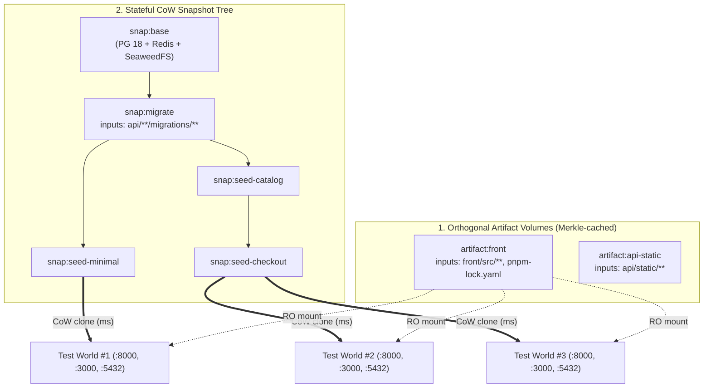

# Parallel Testing & Fixture Snapshot DAG

Heavy integration and browser tests are slow for three structural reasons:

1. **Test runners do build work** (compiling frontend bundles inside `pytest` session fixtures and re-baking random `live_server` ports per worker).
2. **Databases clean up by deleting rows** (`TRUNCATE` + `serialized_rollback` or re-running seeders 25 times).
3. **Workers share `localhost`** (colliding on Redis `FLUSHDB`, S3 buckets, background workers, and ports).

Slipfork fixes all three outside your application code by turning build steps into **Orthogonal Artifact Volumes** and test fixtures into a **Copy-on-Write Snapshot DAG**.

---

## How the DAG Works



### Key Properties

- **No change = Zero rebuild:** Every artifact and snapshot node hashes its declared input globs + resolved `snow.yml` envs. Unchanged nodes resolve in `< 1 ms`.
- **Orthogonal invalidation:** Editing a Svelte/React component rebuilds **only** `artifact:front`; `snap:migrate` and `snap:seed-*` are reused as-is. Editing a migration rebuilds `snap:migrate` -> `snap:seed-*` without rebuilding `front`.
- **Common ancestor sharing:** Ten tests needing `seed-checkout` all clone `snap:seed-checkout` in milliseconds. None of them run `migrate` or `seed` during the test!
- **Canonical ports everywhere:** Every test world has its own private network stack (`127.0.0.1:5432`, `:6379`, `:8000`, `:3000`, `:9000`), so the frontend bundle is built **once** against fixed URLs and works across 32 parallel workers.
- **Zero teardown cost:** Tests can commit real transactions (`transactional_db`), mutate Redis, and upload S3 files freely. When the test finishes, Slipfork destroys the ephemeral CoW clone — zero `TRUNCATE`, zero `DROP DATABASE` locks.

---

## Declaring Fixtures & Pipelines

Zero extra config is needed for standard `pre-deploy` migrations in `snow.yml`. To declare multi-stage fixture snapshots or artifact builds, add a `test` block in `slipfork.toml` (or let framework adapters infer them):

```toml title="slipfork.toml"
[artifacts.front]
inputs = ["front/src/**", "front/package.json", "front/pnpm-lock.yaml"]
build = "pnpm --dir front build"
mount = "front/build"

[fixtures.migrate]
inputs = ["api/**/migrations/*.py", "api/pyproject.toml"]
run = "uv run --directory api python manage.py migrate"

[fixtures.catalog]
parent = "migrate"
inputs = ["api/catalog/seed.py"]
run = "uv run --directory api python manage.py seed --profile catalog"
```

---

## Polyglot Test Adapters

`slipfork test` discovers tests, groups them by required fixture snapshot, warms a pre-imported runner zygote per snapshot where supported, and schedules each heavy test into a fresh CoW world:

=== "Python (`pytest`)"

    ```python
    import pytest

    @pytest.mark.slipfork_fixture("catalog")
    def test_checkout_commits_order(page):
        # Postgres, Redis, S3, API (:8000) & Front (:3000) are ALREADY running
        # with the 'catalog' snapshot loaded!
        page.goto("http://localhost:3000/products/espresso")
        page.get_by_role("button", name="Buy now").click()
        assert page.url.endswith("/orders/confirmed")
    ```

    ```console
    $ slipfork test -- pytest api/tests/bdd
    ```

=== "TypeScript (`Playwright` / `Vitest`)"

    ```ts
    import { test, expect } from "@playwright/test";

    test.describe("checkout @fixture:catalog", () => {
      test("completes payment in isolated world", async ({ page }) => {
        await page.goto("http://localhost:3000/cart");
        await expect(page.getByTestId("cart-ready")).toBeVisible();
      });
    });
    ```

    ```console
    $ slipfork test -- pnpm --dir front exec playwright test
    ```

=== "PHP (`PHPUnit` / `Pest`)"

    ```php
    #[Group('fixture:catalog')]
    public function testInvoiceGeneration(): void {
        $response = $this->postJson('/api/orders/1/invoice');
        $response->assertCreated();
    }
    ```

    ```console
    $ slipfork test -- vendor/bin/phpunit
    ```

=== "Rust (`cargo test` / `nextest`)"

    ```console
    $ slipfork test -- cargo test --workspace --test "*e2e*"
    ```
