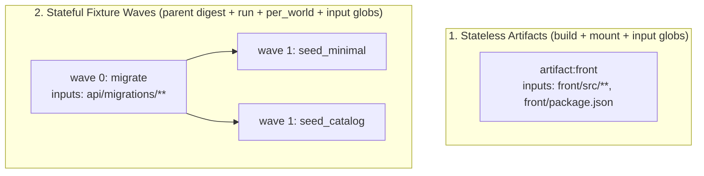

# Orthogonal Artifact & Fixture DAG Planner (`0.1.0`)

`slipfork dag plan` separates **stateless build artifacts** (`[artifacts.<id>]`) from **stateful fixture lineages** (`[fixtures.<id>]`), so a frontend edit never invalidates database setup digests and a migration edit never rebuilds the frontend. In `0.1.0` it hashes and orders the plan; it does not materialize it.

```console
# after writing slipfork.toml (see below)
$ slipfork dag plan
artifact front            Rebuild (65f537d6f3b4)
wave 0 fixture migrate      Rebuild (1476fead1385)
wave 1 fixture seed_catalog Rebuild (c0ba2a8330c1)
wave 1 fixture seed_minimal Rebuild (60a17079cace)
```

## Authoring `slipfork.toml`

```toml title="slipfork.toml"
# Optional canonical project slug (defaults to the Git store's repository name; colocated jj included).
project = "acme"

[artifacts.front]
inputs = ["front/src/**", "front/package.json"]
build = "pnpm --dir front build"
mount = "front/dist"

[fixtures.migrate]
inputs = ["api/migrations/*.sql"]
run = "psql -f api/migrations/0001_schema.sql"

[fixtures.seed_catalog]
parent = "migrate"
inputs = ["api/migrations/seed_catalog.sql"]
run = "psql -f api/migrations/seed_catalog.sql"

[fixtures.seed_minimal]
parent = "migrate"
inputs = ["api/migrations/seed_minimal.sql"]
run = "psql -f api/migrations/seed_minimal.sql"
```

`--file` defaults to `<vcs_root>/slipfork.toml`; a missing manifest fails closed rather than planning an empty graph:

```console
$ slipfork dag plan
slipfork: cannot read /home/acme/acme-shop/slipfork.toml: No such file or directory (os error 2)
```

`[test]`, `[world]`, and every other key in the same file: [manifest reference](reference/manifest.md).

## How orthogonal hashing works



- **Artifact digest inputs:** `id`, `build`, `mount`, and one SHA-256 Merkle over the matching `inputs` globs.
- **Fixture digest inputs:** `id`, the parent digest (`root:base-v1` at a root fixture), `run`, the `per_world` discriminator, and one Merkle over its `inputs`. A fixture's digest therefore folds in every ancestor's `run` and inputs.
- **Orthogonal invalidation (`critical_dag.rs`):** editing `front/src/app.ts` changes only the `front` digest — `migrate`, `seed_catalog`, and `seed_minimal` stay bit-for-bit identical (verified by diffing two `dag plan` runs). Editing `api/migrations/0001_schema.sql` invalidates `migrate` and its two seed descendants without touching `front`.
- **Fail-closed validation:** an unknown `parent` (`DagError::UnknownParent`), a dependency cycle (`DagError::CycleDetected`), and an origin-independent fixture under a `per_world = true` parent (`DagError::OriginIndependentChildOfPerWorld`) are rejected before any hashing.

## Reading the output

One line per artifact, then one line per fixture, grouped by wave (`wave 0` runs first; fixtures in the same wave can run in parallel):

| Column | Meaning |
|---|---|
| `artifact <id>` / `wave <n> fixture <id>` | Node id and its topological position; artifacts have no ordering constraint |
| `Rebuild` / `Cached` | `0.1.0` prints `Rebuild` for every node: the digest lookup ships (it checks `<state_dir>/{artifacts,fixtures}/<digest>`, `~/.cache/slipfork` by default, `--state-dir` to override), but nothing writes those digest directories yet — materialization is `0.2.0` |
| `(<digest>)` | First 12 hex characters of the full SHA-256 node digest |

`Cached` is only reachable once those digest directories exist, and `per_world = true` fixtures report `Rebuild` unconditionally because the digest cache is world-independent. `slipfork --json dag plan` emits the same plan as one object.

!!! note "Not shipped in `0.1.0` — planned for `0.2.0`"
    `dag plan` reports that every node needs a `Rebuild`, because nothing writes `<state_dir>/{artifacts,fixtures}/<digest>` yet. The `0.2.0` design materializes each `[artifacts.<id>]` build and each `[fixtures.<id>]` wave as a read-only **Btrfs subvolume snapshot** under those digest paths, clones it into a `TestSlot` world, and never caches a `per_world = true` fixture (it bakes this world's origin URLs). `slipfork test` also lands in `0.2.0`: a language-blind orchestrator speaking **`STP v1`** over an inherited `SLIPFORK_PROTOCOL_FD` `AF_UNIX` socketpair, with **CBOR (RFC 8949)** frames, framework-exposed DAG stage nodes, protocol-native coverage, and the typed `[test]` thresholds. Design only — `ADR-0003`, `ADR-0006` §3, and `ADR-0010`.
