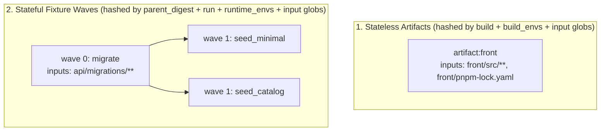

# Orthogonal Artifact & Fixture DAG Planner (`0.2.0`)

`crates/slipfork-dag` and `slipfork dag plan` separate **stateless build artifacts** (`[artifacts.<id>]`) from **stateful fixture snapshot lineages** (`[fixtures.<id>]`) so frontend asset edits never invalidate database snapshots and schema/seed edits never trigger frontend rebuilds.

---

## How Orthogonal Hashing Works



- **Orthogonal invalidation (`critical_dag.rs`):** Modifying a file under `front/src/**` flips `artifact:front` to `Rebuild` while leaving `migrate`, `seed_minimal`, and `seed_catalog` digests bit-for-bit identical (`Cached`). Modifying `api/migrations/**` invalidates `migrate` and its descendants without touching `front`.
- **Cycle & parent validation:** Unknown `parent` names or dependency cycles fail closed immediately (`DagError::UnknownParent` / `DagError::CycleDetected`).

---

## Authoring `slipfork.toml` & Running `slipfork dag plan`

```toml title="slipfork.toml"
# Optional canonical project slug (defaults to the canonical git/jj repository name).
project = "acme"

[artifacts.front]
inputs = ["front/src/**", "front/package.json"]
build = "pnpm --dir front build"
mount = "front/dist"

[fixtures.migrate]
inputs = ["api/migrations/*.sql"]
run = "psql -f api/migrations/0001_schema.sql"

[fixtures.seed_catalog]
parent = "migrate"
inputs = ["api/migrations/seed_catalog.sql"]
run = "psql -f api/migrations/seed_catalog.sql"
```

Inspect the deterministic topological execution plan in human-readable or `--json` format:

```console
$ slipfork dag plan --file slipfork.toml --repo .
artifact front            Rebuild (9f2c1a4e81b0)
wave 0 fixture migrate      Rebuild (48ab77c109e2)
wave 1 fixture seed_catalog Rebuild (c019fe8823a1)
```

`FsDigestCache` checks `<state_dir>/artifacts/<digest>` and `<state_dir>/fixtures/<digest>` (`~/.cache/slipfork` by default, override via `--state-dir`). Because nothing materializes those digests yet, every node reports `Rebuild`; `Cached` is only reachable once M3 writes them.

!!! note "Upcoming in M3 (`0.3.0`)"
    `slipfork dag plan` computes and verifies the content-addressed plan (used in `poc/run_benchmark.py`); automated DAG materialization and polyglot `RunnerProtocol` test execution (`slipfork test`) land in Milestone 3 (`ADR-0006`).
