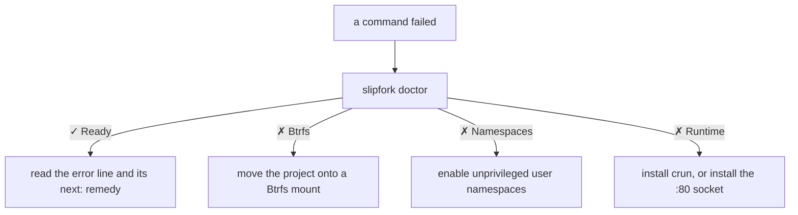

# Troubleshooting

Every Slipfork failure is one line plus a `next:` command; start with the host verdict and read the
remedy that matches the failing row.

```console
$ slipfork doctor
✗ 1 issue(s)
  ✓ Btrfs       /home is btrfs (subvolume snapshots enabled)
  ✓ Namespaces  unprivileged user + netns available
  ✗ Runtime     crun is not on PATH
     next: install crun (for example `sudo apt-get install crun`) and retry
```



## The three doctor rows

| Row | Passing detail | Failing message | Remedy |
| :--- | :--- | :--- | :--- |
| `Btrfs` | `<path> is btrfs (subvolume snapshots enabled)` | `<path> is not on a btrfs filesystem` | Move the project onto a Btrfs mount, then `slipfork up` |
| `Namespaces` | `unprivileged user + netns available` | `unprivileged user + netns unavailable` | `sudo sysctl -w kernel.unprivileged_userns_clone=1` |
| `Namespaces` | same | `user.max_user_namespaces is 0` | `sudo sysctl -w user.max_user_namespaces=2147483647` |
| `Runtime` | `crun <ver>, :80 .localhost ingress active` | `crun is not on PATH` | Install `crun` for your distro, then retry |

`doctor` exits non-zero when any row fails, so it is safe inside a setup script.

## Host and boot failures

| Symptom | Command |
| :--- | :--- |
| `` `/path` is not on Btrfs `` from `slipfork up` | Move the checkout to Btrfs; there is no fallback |
| `crun is not on PATH` | `sudo apt-get install crun` · `sudo dnf install crun` · `sudo pacman -S crun` · `sudo apk add crun` |
| `unprivileged user + netns unavailable` | `sudo sysctl -w kernel.unprivileged_userns_clone=1` |
| Userns still blocked on Ubuntu | `sudo slipfork daemon install --ingress`, then `sudo apparmor_parser -r /etc/apparmor.d/slipfork` |
| `Forkfile:<line>` with one `next:` | Fix that line, then `slipfork up` again |
| Boot says a step failed while the world stays up | `slipfork logs <service>`, then `slipfork restart <service>` |

!!! warning "Do not run worlds under `sudo`"

    `sudo slipfork daemon install --ingress` is the only privileged step. Running `slipfork up` as
    root puts the world outside your session and breaks the per-user socket.

## URL and ingress failures

| Symptom | Command |
| :--- | :--- |
| `doctor` is green but the URL does not answer | `sudo slipfork daemon install --ingress`, then `systemctl is-active slipfork-ingress.socket` |
| Runtime row says `installed but not active` | `sudo systemctl enable --now slipfork-ingress.socket` |
| `Address already in use` on `:80` | `sudo ss -ltnp 'sport = :80'` and stop the other server |
| `Permission denied` binding `:80` | Bind through the system socket, not a user process |
| `400` for a non-`.localhost` host | Use `<world>.localhost` or a declared `domain` |
| `421` for an unknown `.localhost` world | `slipfork status`, then `slipfork up` in that project |
| `404` inside a known world | Check the `route` prefix and `port` in the `Forkfile` |

Never edit `/etc/hosts` for `.localhost`; the ingress resolves it and the socket forwards to your
daemon.

## Daemon and command failures

| Symptom | Command |
| :--- | :--- |
| `the slipfork daemon did not answer` | `slipfork daemon install`, then `systemctl --user restart slipfork` |
| Daemon keeps exiting | Read `<state_dir>/daemon.log`, then `slipfork doctor` |
| `several routes match` | `slipfork open <service>` names the one route you want |
| `slipfork drop` refuses a dirty fork | `slipfork drop <name> -f` discards the checkout |
| `slipfork open` prints a URL but no browser | Open that URL on a machine with a browser |
| `cannot open <url>` | Install `xdg-open`, or open the URL manually |

`slipfork status` reads the daemon, not a cache, so a service it cannot prove is never shown as
running.

## Remote pairing

| Symptom | Command |
| :--- | :--- |
| No endpoint configured | `slipfork auth wss://ci.acme-shop.example/ospp` |
| Pairing was rejected | Approve in the browser, then rerun `slipfork auth <url>` |
| A saved endpoint is stale | `slipfork auth --ospp-endpoint wss://ci.acme-shop.example/ospp` |
| `already_paired` | Remove the old machine in CI, then pair again |
| A secret is wrong but pairing worked | `slipfork secret list`, then `slipfork env <component>` |

The full code list, with the frame that produced it, lives in [OSPP v1](ospp.md).

## Where next

* [Under the hood](under-the-hood.md) — daemon, namespace and ingress layout.
* [OSPP v1](ospp.md) — pairing, HPKE and sealed dumps.
* [CLI](cli.md) — every verb, `--json` and the terminal contract.
