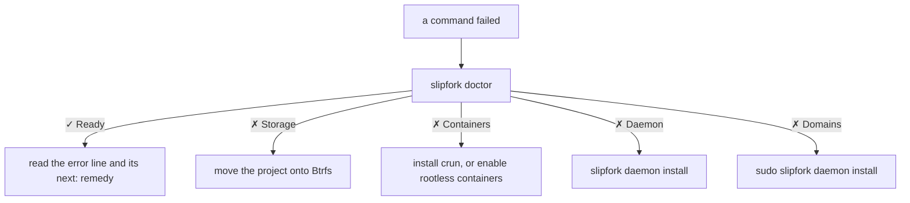

# Troubleshooting

Every Slipfork failure is one line plus a `next:` command; start with the host verdict and read the
remedy that matches the failing row.

```console
$ slipfork doctor
✓ Ready
  ✓ Storage     ~/projects/acme-shop · on · Btrfs · instant copy-on-write forks ready
  ✓ Containers  crun 1.20 · rootless container sandboxing enabled
  ✓ Daemon      running · background user service active
  ✓ Domains     http://*.localhost · local domain routing active
```



## The four doctor rows

| Row | Passing detail | Failing detail | Remedy |
| :--- | :--- | :--- | :--- |
| `Storage` | `<path> · on · Btrfs · instant copy-on-write forks ready` | `<path> · not on · Btrfs · instant copy-on-write forks are unavailable` | Move the project onto a Btrfs mount, then `slipfork up` |
| `Containers` | `crun <ver> · rootless container sandboxing enabled` | `crun not installed · rootless container sandboxing unavailable` | Install `crun`, then retry |
| `Containers` | same | `crun <ver> · rootless container sandboxing blocked by AppArmor` | `sudo sysctl -w kernel.apparmor_restrict_unprivileged_userns=0` |
| `Containers` | same | `crun <ver> · rootless container sandboxing unavailable` | `sudo sysctl -w user.max_user_namespaces=2147483647` |
| `Daemon` | `running · background user service active` | `not installed · start it with slipfork daemon install` | `slipfork daemon install` |
| `Domains` | `http://*.localhost · local domain routing active` | `http://*.localhost · local domain routing inactive` | `sudo slipfork daemon install` |

`doctor` exits non-zero when any row fails, so it is safe inside a setup script. Its `--json` form
emits `{ready, checks:[{name, ok, detail, next?}]}` with the same words.

!!! info "Not on Btrfs yet?"

    You do not need to repartition. Follow
    [Mount a Btrfs workspace image in your home folder](install.md#on-ext4-or-xfs-mount-a-btrfs-workspace-image-in-your-home-folder),
    then rerun `slipfork doctor` from inside that mount.

## Storage and container failures

| Symptom | Command |
| :--- | :--- |
| `` `/path` is not on Btrfs `` from `slipfork up` | [Mount a Btrfs workspace image](install.md#on-ext4-or-xfs-mount-a-btrfs-workspace-image-in-your-home-folder) and move the checkout there |
| `crun not installed` | `sudo apt-get install crun` · `sudo dnf install crun` · `sudo pacman -S crun` · `sudo apk add crun` |
| Rootless containers blocked by AppArmor | `sudo sysctl -w kernel.apparmor_restrict_unprivileged_userns=0` |
| `rootless container sandboxing unavailable` | `sudo sysctl -w user.max_user_namespaces=2147483647` |
| `Forkfile:<line>` with one `next:` | Fix that line, then `slipfork up` again |
| A build failed | `slipfork logs <image>`, fix the Dockerfile, then `slipfork up` |
| A row shows `orphaned` after a `Forkfile` edit | `slipfork up` stops undeclared pods and boots the new ones |

!!! warning "Do not run worlds under `sudo`"

    `sudo slipfork daemon install` is the only privileged step. Running `slipfork up` as root puts
    the world outside your session and breaks the per-user socket.

## Daemon and domain failures

| Symptom | Command |
| :--- | :--- |
| `not installed · start it with slipfork daemon install` | `slipfork daemon install`, then `systemctl --user restart slipfork` |
| Doctor is green but the URL does not answer | `sudo slipfork daemon install`, then `systemctl is-active slipfork-ingress.socket` |
| `local domain routing inactive` | `sudo systemctl enable --now slipfork-ingress.socket` |
| `Address already in use` on port 80 | `sudo ss -ltnp 'sport = :80'` and stop the other server |
| `Permission denied` binding port 80 | Install the system socket through `sudo slipfork daemon install` |
| `400` for a non-`.localhost` host | Use `<world>.localhost` or a declared `domain` |
| `421` for an unknown `.localhost` world | `slipfork status`, then `slipfork up` in that project |
| `404` inside a known world | Check the `route` prefix and `port` in the `Forkfile` |

Never edit `/etc/hosts` for `.localhost`; the router resolves it and forwards to your daemon.

## Daemon and command failures

| Symptom | Command |
| :--- | :--- |
| `the slipfork daemon did not answer` | `slipfork daemon install`, then `systemctl --user restart slipfork` |
| Daemon keeps exiting | Read `<state_dir>/daemon.log`, then `slipfork doctor` |
| `several routes match` | `slipfork open <service>` names the one route you want |
| `slipfork drop` refuses a dirty fork | `slipfork drop <name> -f` discards the checkout |
| `slipfork open` prints a URL but no browser | Open that URL on a machine with a browser |
| `cannot open <url>` | Install `xdg-open`, or open the URL manually |
| `--since` or `--until` is rejected | Pass `30s`, `5m`, `2h`, `1d`, or RFC 3339; the command exits `2` with one `next:` line |
| Logs seem to jump or miss lines | Add `-t` to see each line's timestamp, then narrow with `--since` / `--until` |

`slipfork status` reads the daemon, not a cache, so a service it cannot prove is never shown as
running.

## Remote pairing

| Symptom | Command |
| :--- | :--- |
| No endpoint configured | `slipfork auth wss://ci.acme-shop.example/ospp` |
| Pairing was rejected | Approve in the browser, then rerun `slipfork auth <url>` |
| A saved endpoint is stale | `slipfork auth --ospp-endpoint wss://ci.acme-shop.example/ospp` |
| `already_paired` | Remove the old machine in CI, then pair again |
| A secret is wrong but pairing worked | `slipfork secret list`, then `slipfork env <component>` |

The full code list, with the frame that produced it, lives in [OSPP v1](ospp.md).

## Where next

* [Under the hood](under-the-hood.md) — daemon, namespace and routing layout.
* [Install](install.md) — packages, the workspace image and the system socket.
* [CLI](cli.md) — every verb, `--json` and the terminal contract.
