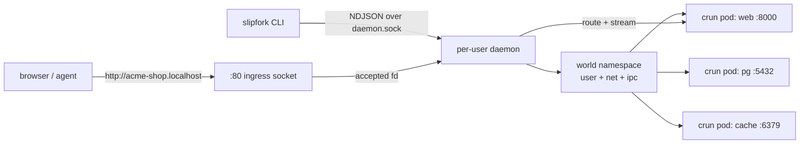
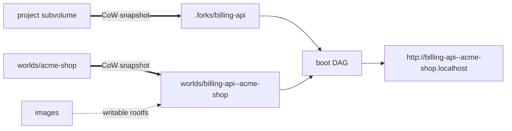
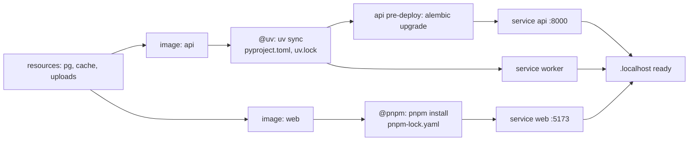
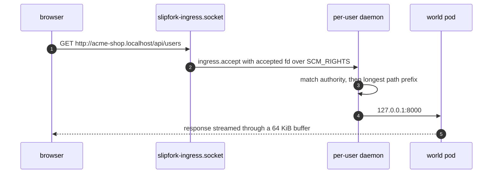
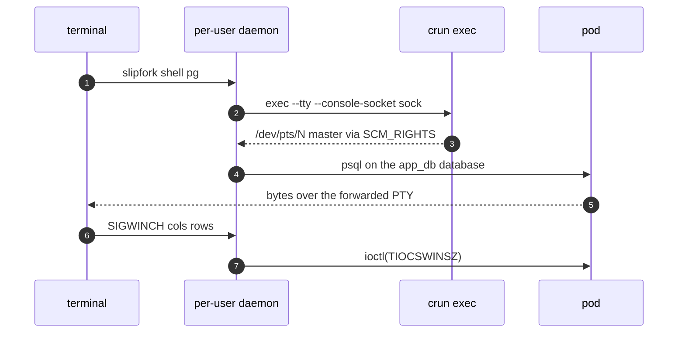

# Under the hood

One `slipfork` binary boots your entire stack on native Btrfs subvolumes and `crun`, behind one
`.localhost` edge. There is no Docker daemon, no VM, and no second daemon executable.

```console
$ slipfork up
✓ Ready -> http://acme-shop.localhost
```

Every local command is a thin client of **one per-user daemon**. That daemon owns worlds, pods,
snapshots, secrets and the routing table, so `status`, `logs` and `fork` all read the same truth.



| Piece | Owns | Lives at |
| :--- | :--- | :--- |
| CLI | argv, rendering, `next:` remedies | your terminal |
| Daemon | worlds, lifecycle, routing, vault | `<runtime_dir>/daemon.sock` |
| World namespace | one user + net + ipc namespace per world | kernel |
| Pods | one `crun` container per service, resource or setup step | world namespace |

!!! info "The daemon is the same binary"

    `slipfork daemon install` writes a unit that runs `slipfork` in its daemon mode; there is no
    separate daemon package or executable.

## Pure Btrfs, no hybrid layers

Your checkout is itself a Btrfs subvolume, and a fork is a snapshot of it. Images, build steps and
world data live beside it in one store on the same Btrfs mount; a project off Btrfs is refused.

```text
<btrfs mount>/
├── home/you/projects/acme-shop/        # project subvolume: code, .venv, node_modules, .slipfork/
│   └── .forks/
│       └── billing-api/                # fork checkout, a CoW snapshot
└── .slipfork-store/
    ├── images/                         # read-only OCI layers + cached Dockerfile steps
    └── worlds/
        ├── acme-shop/                  # pg, redis, s3 data subvolumes
        └── billing-api--acme-shop/     # fork data snapshot
```

## A fork is two snapshots and one URL

`slipfork fork billing-api` checkpoints the live databases, snapshots the project and world data
subvolumes, then boots the fork through the ordinary `up` path.



A fork inherits the same Btrfs pages for `.venv`, `node_modules` and the live PostgreSQL, Redis and
bucket data, plus the `.slipfork/` stamps that keep `when changed` steps up to date.

`slipfork drop billing-api` stops the fork world first, refuses a dirty checkout unless you pass
`-f`, then deletes both snapshots.

## Native image engine

Upstream images are pulled straight from an OCI registry over HTTPS and unpacked once into
read-only Btrfs subvolumes. A `Dockerfile` is evaluated natively; every `RUN` becomes a cached
step subvolume, so a rebuild is a snapshot instead of a replay.

| Instruction | Native behaviour |
| :--- | :--- |
| `FROM` | Pull and cache the OCI layer set, then a writable CoW snapshot |
| `ARG` | Build-time values only; never runtime `env` |
| `RUN` | Execute in `crun`, snapshot the result as a cache step |
| `COPY` / `ADD` | Copy from the build context or another stage, honour `.dockerignore` |
| `CMD` / `ENTRYPOINT` | Recorded in the pod spec, not baked as a shell string |

Secrets never enter an image layer or a build step. Runtime `env` and OCI bundles live on a
mode-`0700` tmpfs under `$XDG_RUNTIME_DIR/slipfork/pods/<world>`.

## The boot DAG

`@uv`, `@pnpm` and friends synthesize a `before-start when changed(<lockfile>)` node keyed by
`(image, directory)`, so two services that need the same install share one node.



An unchanged stamp skips its step in under a millisecond and prints `(up to date)`. A changed
lockfile re-runs only that install node, then its dependants.

## The `:80` edge

The privileged part is one systemd socket. Each accepted connection is handed to your unprivileged
daemon, which makes every routing decision from the evaluated `Forkfile`.



Request and response heads are capped at 16 KiB; bodies and WebSocket bytes stream through a fixed
64 KiB buffer. The ingress is stateless: it forwards one descriptor and holds no route table.

!!! warning "Nothing listens on `:80` until you install the socket"

    The per-user unit alone serves no `.localhost` URL. Run
    `sudo slipfork daemon install --ingress` to add `slipfork-ingress.socket`, its template unit and
    the AppArmor profile; no URL answers until that socket is active.

## Who owns what

| Crate | Responsibility |
| :--- | :--- |
| `slipfork` | CLI, rendering, daemon composition, control plane |
| `slipfork-forkfile` | parse, typecheck, evaluate, `fmt`, `migrate` |
| `slipfork-world` | subvolumes, snapshots, namespaces, pods, boot/reap |
| `slipfork-image` | OCI pulls and native `Dockerfile` builds |
| `slipfork-ingress` | HTTP/WS framing and `.localhost` route matching |
| `slipfork-ospp` | OSPP v1 frames, device keys, HPKE, sealed dumps |
| `slipfork-vcs` | worktrees, branch topology, dirty snapshots |

## Where next

* [OSPP v1](ospp.md) — pairing, encrypted secrets and sealed dumps.
* [Agents & OpenCode](agents-and-opencode.md) — one fork per agent session.
* [Troubleshooting](troubleshooting.md) — the real message behind every failed boot.

## One PTY, one log file

`slipfork shell <target>` never nests a shell wrapper. The daemon asks `crun exec` for a console
socket, receives the PTY master over `SCM_RIGHTS`, and a `crossterm` raw-mode guard restores your
terminal on exit. Resizes are forwarded as `TIOCSWINSZ` on `SIGWINCH`.



Service and image targets open `bash` when the rootfs has it (prompt `(<world>:<target>) \w$ `) and
`sh` otherwise; postgres targets open `psql`, redis targets `redis-cli`. A bucket is refused with one
`next:` line.

Every build, setup, hook and pod byte lands in `<store>/logs/<world>/<id>.log`, never the terminal.
The boot bar keeps exactly one row per task, which is why `slipfork logs <image>` can still read a
build log after a failed cold `up`.

## Where next

* [OSPP v1](ospp.md) — pairing, encrypted secrets and sealed dumps.
* [Agents & OpenCode](agents-and-opencode.md) — one fork per agent session.
* [Troubleshooting](troubleshooting.md) — the real message behind every failed boot.
