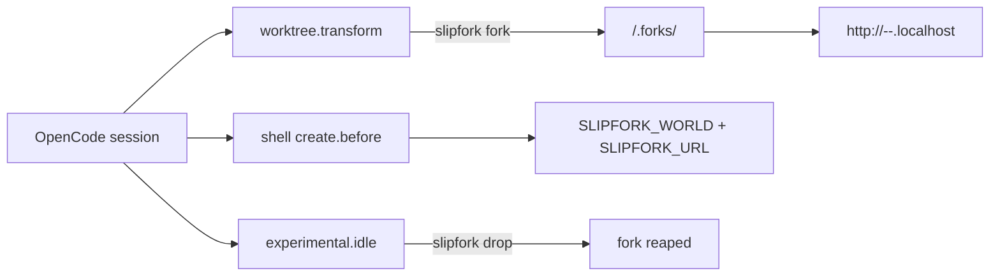

# `@slipfork/opencode`

Parallel agents on one checkout collide on files, ports, and databases. This OpenCode V2 plugin gives every session its own Btrfs fork of the running Slipfork world — code, dependencies, and live PostgreSQL/S3 state — behind one `http://<fork>--<world>.localhost` URL.

## Install

```console
$ bun add -d @slipfork/opencode
```

```jsonc
// .opencode/opencode.jsonc
{
  "plugin": ["@slipfork/opencode"]
}
```

The plugin drives the `slipfork` binary already on your `PATH`; set `binary` in the plugin options when it lives elsewhere. Boot the parent world once per project with `slipfork up`.

## What each session gets



Inside a fork checkout the plugin exports `SLIPFORK_WORLD` and `SLIPFORK_URL` so your shell commands and previews can target the fork. It also appends one context line naming the URL and reaps the fork when the session goes idle.

!!! warning "Sessions are ephemeral"
    Commit work you need to keep before the session ends. The plugin drops only forks it created and never touches an existing `.forks/<name>` checkout.

## Remedies

The plugin surfaces Slipfork's own `message` + `next:` remedy verbatim — a non-Btrfs project points at the mount fix, a dirty checkout points at `--force`. When a failure carries no decoded remedy, run `slipfork doctor`; when `slipfork` is not found, install it or set `binary` in `.opencode/opencode.jsonc`.
