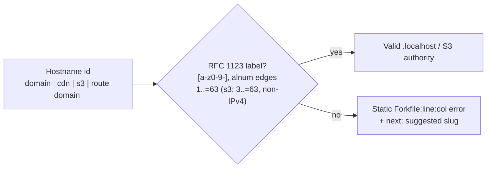

# 01 — The `Forkfile` Specification

Slipfork runs your cloud environment locally in a box; CI is the clutch. One `Forkfile` at your repository root declares backing resources, runtime `env` and secrets, and the `image`s that enclose the `service`s running inside them.

```forkfile
# forkfile: 0.1

features {
  default = [dev]
  dev = [mail]
  mail
}

domain main
postgres pg { database app_db }
redis cache
s3 uploads
s3 assets {
  policy public-read
  cdn edge
}

env common {
  DATABASE_URL   = app_db.url
  REDIS_URL      = cache.url
  UPLOADS_URL    = uploads.url
  ASSETS_CDN_URL = edge.url
  SECRET_KEY     = secret(SECRET_KEY) ?? random_hex(32)
}

image api . {
  on dev: stage dev
  use env common

  service web {
    port 8000
    route /api
    run: @uv run uvicorn app.main:app --host 0.0.0.0 --port $port
  }
}
```

## 1. Version header and identifiers

Line 1 is `# forkfile: 0.1` while Slipfork is pre-`1.0`; any other value fails before a container starts, with a `Forkfile:<line>:<col>` caret span. Hyphenated ids (`app-db`, `edge`) are valid everywhere, including property access, and every declaration shares one flat, globally unique namespace.



`domain`, `cdn`, `s3` and `route ... domain <id>` labels are lowercase `[a-z0-9-]` with alphanumeric edges; buckets are `3..=63` and never IPv4-shaped.

## 2. `image <id>` and build-time `arg`

Each `image` declares a rootfs and encloses the `service`s and hooks that run inside it, built and cached natively on Btrfs + `crun` with zero Docker dependency.

| Form | Meaning |
| :--- | :--- |
| `image api . { ... }` | Build `<dir>/Dockerfile` natively |
| `image api ./backend { ... }` | Build in `./backend`; that directory is the default `workdir` |
| `image mailpit from axllent/mailpit:latest { ... }` | Pull OCI layers over HTTPS |
| `arg KEY = <expr>` | Build-time value; `secret(...)` is rejected statically |

`workdir`, `dockerfile` and `stage` override inside the block. Build-time `arg`s are never runtime `env`, and a secret-tainted `arg` in any `on` branch fails the file.

## 3. `features` and `on <expr>`

`features` declares named switches; `default` is active for local commands. `on <expr>` accepts `dev`, `!dev`, `dev & mail` and `staging | preview`, switching Dockerfile stages, conditional `arg`s, hot-reloading `run:` commands and dev-only services. Slipfork type-checks every branch before booting anything.

## 4. Resources, S3 hosts and `cdn`

| Declaration | Local behaviour | Typed properties |
| :--- | :--- | :--- |
| `postgres <id> { database <db> }` | PostgreSQL `18` (`version` optional) | `<db>.url` (secret), `.host`, `.port`, `.name`, `.user`, `.password` (secret) |
| `redis <id>` | Redis `7` (`version` optional) | `<id>.url`, `.host`, `.port` |
| `s3 <bucket>` | Private: anonymous `GET`/`HEAD` answer `403` | `<bucket>.url` (secret), `.endpoint`, `.bucket`, `.access_key`, `.secret_key` (secret) |
| `s3 <bucket> { policy public-read }` | Anonymous `GET`/`HEAD` answer `200`; writes need SigV4 | Bucket properties on `<bucket>` |
| `s3 <bucket> { policy public-read; cdn <id> }` | Bucket host plus a cloud CDN binding | bucket properties plus `<id>.domain`, `<id>.url` |
| `domain <id>` | Extra `<id>.<world>.localhost` | `<id>.domain`, `<id>.url` |

Every `s3 <bucket>` always serves at `http://<bucket>.<world>.localhost`; a fork serves it at `http://<bucket>.<fork>--<world>.localhost`. No extra hostname is invented for an S3 bucket.

`cdn <id>` inside an `s3` block is a **cloud** binding only. Locally, `<id>.domain` and `<id>.url` resolve to the bucket's own `<bucket>.<world>.localhost` and `http://<bucket>.<world>.localhost`; adding a CDN never adds a separate local `<id>.<world>.localhost` hostname.

!!! warning "`cdn <id>` requires explicit `policy public-read`"

    `s3 <bucket>` defaults to private, and Slipfork never silently makes a private bucket public. Declaring `cdn <id>` without `policy public-read` fails statically:

```text
error: 'cdn edge' inside 's3 assets' requires 'policy public-read'
  --> Forkfile:18:13
   |
18 | s3 assets { cdn edge }
   |             ^^^^^^^^
next: add 'policy public-read' inside 's3 assets' to enable 'cdn edge'
```

## 5. Runtime `env` and secrets

`env` (`env <group>`, `use env <group>`, inline `env { ... }`) is strictly runtime: it reaches services and hooks on an in-memory `tmpfs`, never a `Dockerfile` build.

`var(KEY) ?? "default"` resolves non-secret config. `secret(KEY) ?? random_hex(32)` streams encrypted cloud secrets over `OSPP v1` when paired and persists local fallback secrets offline; `random_base64(n)`, `random_alnum(n)` and `random_uuid()` are the other generators. Secret-tainted values print as `[REDACTED]` and zeroize on drop.

## 6. Ports, routes and domains

Each HTTP `service` declares one public `port <u16>`, available as `$port` and injected as `PORT`, plus optional `internal_ports [8081, ...]`. Routes preserve the matched prefix by default.

| Route | Path match | Authority |
| :--- | :--- | :--- |
| `route /api` | `/api/users` -> `/api/users` | primary world domain and the first declared `domain` |
| `route /api strip-prefix` | `/api/users` -> `/users` | same |
| `route /api rewrite /v1` | `/api/users` -> `/v1/users` | same |
| `route exact /healthz` | `/healthz` only | same |
| `route / domain admin` | `/` | `admin.<world>.localhost` |
| `route / domain mail` | `/` | `mail.<world>.localhost` |

`strip-prefix` and `rewrite <path>` are mutually exclusive, and a route naming an undeclared `domain` fails statically. A service that wants its own host declares `domain <id>` inline or inside `on <expr> { … }` and writes `route / domain <id>`:

```forkfile
on mail {
  domain mail
  image mailpit from axllent/mailpit:latest {
    service mailpit {
      port 8025
      route / domain mail
    }
  }
}
```

## 7. Services, hooks and `@<tool>` prequels

- **Hooks and `run`:** `service <id>` supports `before-start`, `pre-deploy`, `post-deploy`, `failed-deploy`, and `run:` / `run { ... }` (optional with an OCI `ENTRYPOINT`/`CMD`), expanding `$port` and `$env.KEY` without shell word-splitting.
- **`before-start when changed(...)`:** hashes inputs against `.slipfork/` stamps, so an unchanged step skips in under 1 ms and the stamps travel into every fork.
- **`@<tool>` auto-prequels:** `@uv`, `@poetry`, `@pnpm`, `@npm`, `@yarn`, `@bun`, `@composer`, `@bundle`, `@go` and `@cargo` synthesize one deduplicated `(image, lockfile_dir)` install node.

## 8. Validation and tooling

Slipfork type-checks every `on` combination before booting anything, with `Forkfile:line:col` carets and one `next:` remedy. It ships comment-preserving `slipfork fmt` (`--check`), a standalone cross-platform `slipfork-lsp` stdio server, and a Zed extension.
